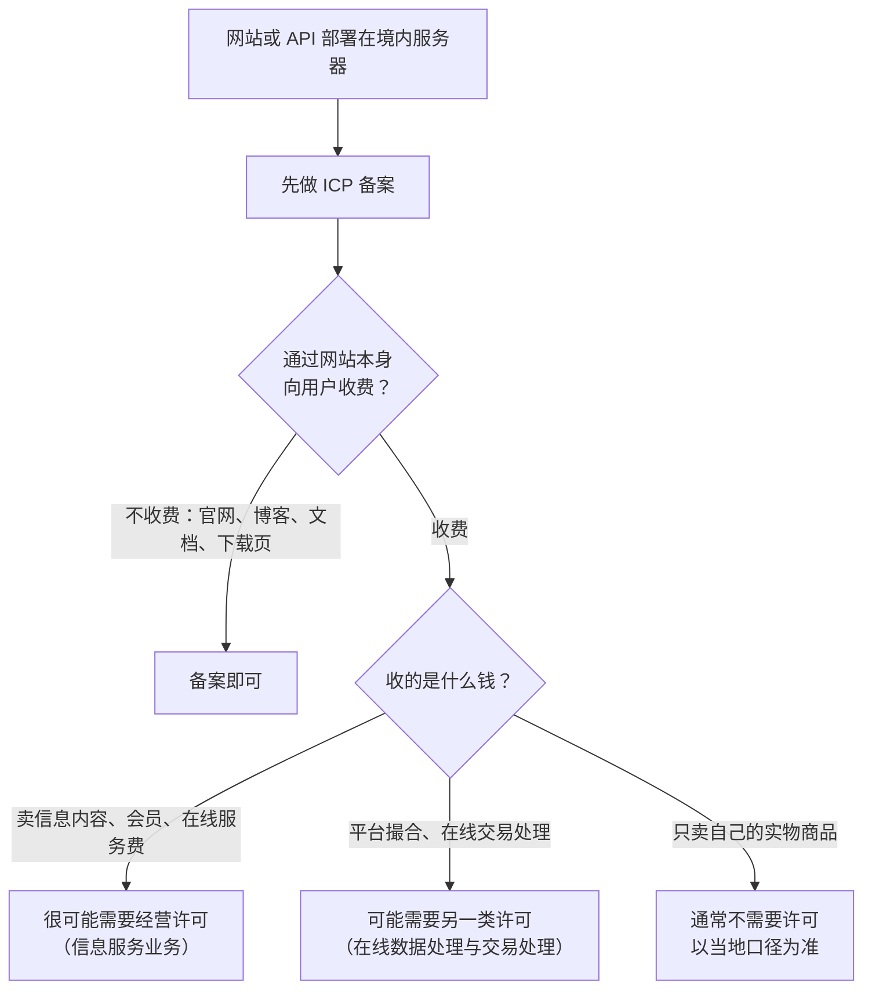
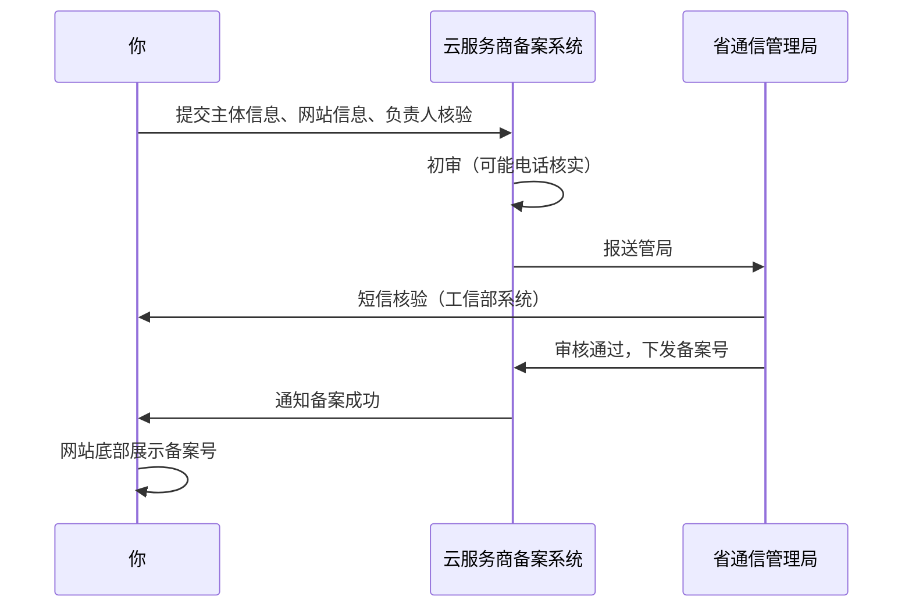
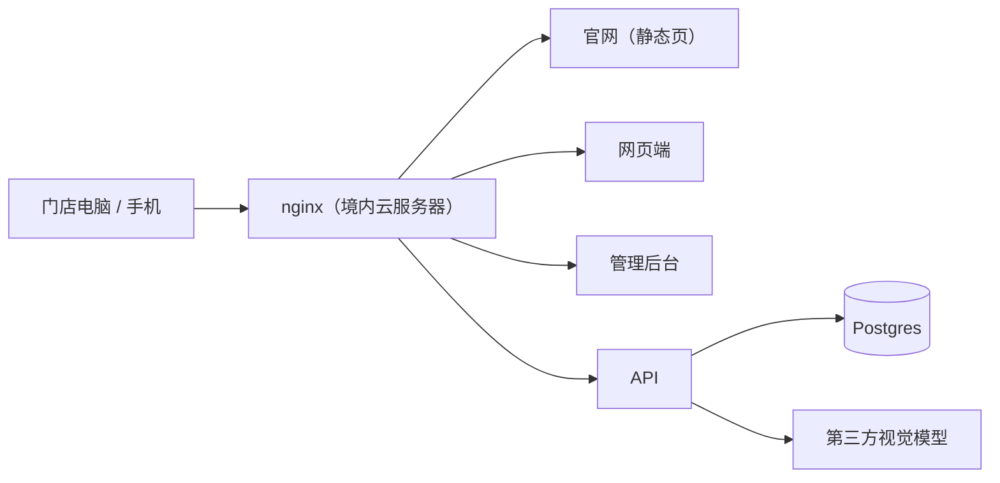

# ICP 备案与经营许可

在国内云服务器上跑一个网站或 API，第一道门槛就是 ICP 备案：没有备案，云厂商会拦截你的域名，HTTP 请求到不了你的服务。这一章讲清楚三件事：备案和许可证是什么关系、你的产品要哪一个、备案的流程和常见的坑。

> [!WARNING]
> 本章按 2025 年前后的规则整理，备案和许可的具体规则由工业和信息化部及各省通信管理局制定和执行，各地口径不完全一致且会调整；办理时以工信部 ICP/IP 地址/域名信息备案管理系统、接入服务商的备案系统提示和当地通信管理局的最新要求为准。

业务是否属于经营性拿不准时，直接咨询通信管理局或专业人士。

## 法规骨架

> [!WARNING]
> 本节列出的法规和规章名称按 2025 年前后的情况整理，可能已修订，以国家法律法规数据库和工业和信息化部的最新公布为准。

ICP 这套制度的上位法是国务院的《互联网信息服务管理办法》，它把互联网信息服务分成两类：

| | 非经营性互联网信息服务 | 经营性互联网信息服务 |
|---|---|---|
| 含义 | 无偿提供公开、共享信息 | 通过互联网**有偿**提供信息或网页制作等服务 |
| 管理方式 | **备案**制 | **许可**制 |
| 拿到的东西 | ICP 备案号（形如「X ICP 备 xxxx 号」） | 增值电信业务经营许可证（俗称 ICP 证） |
| 配套规章 | 《非经营性互联网信息服务备案管理办法》 | 《电信业务经营许可管理办法》 |

**两者的关系**：备案是所有在境内服务器上提供网站服务的基础要求；许可证是在此之上、对经营性业务的额外要求。拿到许可证的网站，用许可证号替代备案号的作用。

实际流程里，无论最后要不要办许可证，**先做 ICP 备案**几乎是必经之路，因为没有备案号云厂商不放行域名。

## 我的产品要备案还是要许可证

> [!WARNING]
> 经营性认定和许可证门槛按 2025 年前后的规定整理，各省口径不同且可能已调整，以工业和信息化部和当地通信管理局的最新要求为准。

这是独立开发者最常问、也最难一句话回答的问题。判断的关键是「有偿提供信息服务」这几个字怎么理解，而各地通信管理局的理解有差异。可以按下面的思路粗分：

几个常见形态：

| 产品形态 | 一般判断 | 说明 |
|---|---|---|
| 公司官网、产品介绍页、下载页 | 备案 | 不收费，纯展示 |
| 技术博客、文档站 | 备案 | 个人博客可用个人备案 |
| SaaS，合同和收费在线下签 | 有争议，多数按备案处理 | 网站本身不承载收费行为，但各地口径不一 |
| SaaS，用户在网站上自助订阅付费 | 倾向需要许可 | 「通过互联网有偿提供服务」比较明确 |
| 付费会员、付费内容、在线课程 | 倾向需要许可 | 还可能涉及出版、视听等前置许可 |
| 多方入驻的交易平台 | 可能需要在线数据处理与交易处理许可 | 平台类业务的另一类增值电信许可 |

增值电信业务许可证有多个业务种类，和独立开发者最相关的通常是**信息服务业务**（一般说的 ICP 证）和**在线数据处理与交易处理业务**（俗称 EDI）。申请许可证有主体资格要求（公司）、注册资本门槛、人员和场地要求，还有年报义务。具体门槛以工信部和通信管理局最新规定为准，不在这里写数字。

一个实务建议：**先按备案上线，业务模式确定要在线收费时，再评估许可证**。办许可证不是一两周的事，提前规划。

### 特殊内容的前置审批

有些内容即使不收费，在备案之前也要先拿到主管部门的许可或同意，常说的「前置审批」。比如涉及新闻、出版、药品和医疗器械、网络文化（音乐、游戏、动漫、演出等）、视听节目、宗教等。备案系统里会让你勾选网站内容类别，勾到这些类别就会要求上传对应的批准文件。

做工具类软件一般碰不到这些，但如果你的产品带内容社区、教育课程、AI 生成音视频，要留意。

## 备案的流程

> [!WARNING]
> 前置条件、审核期间的要求和公安联网备案按 2025 年前后的流程整理，可能已调整，以接入服务商备案系统的提示、当地通信管理局和全国互联网安全管理服务平台的最新要求为准。

备案在**接入服务商**（你用的云厂商，比如阿里云、腾讯云、华为云）的备案系统里提交，由服务商初审后报省通信管理局审核。

### 前置条件

- **境内服务器**：要在该服务商那里有一台符合条件的境内云服务器（或其他可备案的资源），服务商才会受理。部分服务商对资源的规格、购买时长有要求
- **域名已实名，且持有者与备案主体一致**：公司备案就要求域名实名在公司名下
- **域名后缀可备案**：域名后缀要是工信部批准在境内提供服务的顶级域，常见后缀基本都可以，冷门后缀先查清楚
- **主体证件和负责人**：营业执照、法定代表人身份证；还要指定**主体负责人**和**网站负责人**，提供身份证、手机号，做实名核验（通常是手机 App 刷脸）

### 要填的内容

| 项 | 注意 |
|---|---|
| 主体信息 | 和执照完全一致，通信地址写到门牌号 |
| 网站名称 | 不能是纯域名、纯数字，不能和主体名称或产品无关，不能用「中国」「国家」这类词；各地规则略有差异 |
| 网站内容 / 服务类型 | 如实选择，涉及前置审批的类别会要求批文 |
| 网站负责人 | 可以是法人本人；要能接电话，管局和服务商会打电话核实 |
| 备注 / 网站用途说明 | 有些省份要求写清网站用途，简短如实即可 |

### 审核期间

- 服务商初审可能打电话问你网站做什么用，**如实回答**，不要说「卖东西」「收费」这种会让人觉得应办许可证的话，前提是确实不收费
- 管局审核期间，有些省份要求网站**暂不能访问**或只能展示固定内容，按服务商提示来
- 时间从几天到几周不等，各省差异大

### 备案通过以后

1. **首页底部展示备案号**，并链接到工信部的备案管理系统。hatch-counter 的网页端登录页最底下一行就是版权和备案号，官网也一样
2. **公安联网备案**：网站开通后，还要在全国互联网安全管理服务平台办理公安备案，通过后在页面展示公安备案编号。办理期限和要求以平台和当地网安部门的提示为准
3. **信息变更要同步**：换服务商（叫「接入备案」，把备案接入到新服务商）、换负责人、增加域名、网站内容变化，都要在备案系统里变更
4. **备案号要维护**：管局会抽查，网站长期打不开、内容与备案不符、联系不上负责人，都可能被注销备案

## 几个独立开发者的高频问题

### 个人备案能不能用来做产品

不行。个人备案只能用于个人网站（博客、作品展示等），**不能有商业内容**，包括广告、产品推广、收费服务。拿个人备案去挂公司产品，抽查时可能被注销，而注销后再以公司身份重新备案会更麻烦。

### API 子域名、管理后台要不要单独备案

ICP 备案是**按域名**的，一个备案主体下可以有多个网站，每个网站对应一个或多个域名。一个已备案主域名下的子域名（`api.`、`admin.`、`app.`）通常不需要单独备案，但新的主域名要新增网站备案。

### 服务器在境外是不是就不用备案

> [!WARNING]
> 本节结论按 2025 年前后的备案和数据出境规定整理，可能已调整，以工业和信息化部和国家网信办的最新规定为准。

服务器在境外确实不需要 ICP 备案，但：

- 国内访问速度和稳定性难以保证，B 端客户体验差
- **App 备案、国内应用市场仍然会要求**备案信息（第 4、8 章）
- 处理境内用户的个人信息、把数据放到境外，会触发数据出境的一整套规则（第 6 章）

做面向国内用户的产品，正面解决备案是性价比最高的路线。

### Cloudflare、CDN、对象存储

用国内 CDN 加速，CDN 厂商同样要求加速域名已备案。境外 CDN 服务境内用户则面临上面说的速度问题。对象存储绑定自定义域名对外访问时，国内的存储服务一般也要求域名已备案。

## hatch-counter 的备案方案

hatch-counter 的部署结构是：一台境内云服务器，Docker Compose 跑 API、Postgres，nginx 统一反代，按子域名分出官网、网页端、管理后台和 API。

合规上的处理：

| 部分 | 处理 |
|---|---|
| 主域名 | 公司名下实名，以公司主体做 ICP 备案，网站名称用品牌名 |
| 子域名 | 跟主域名同一个备案，不另行备案 |
| 官网和网页端页面底部 | 展示 ICP 备案号和公安备案号 |
| 收费方式 | 开户和收费由运营方线下办理，网站本身不承载在线支付，按备案上线；将来做在线自助续费前，再评估是否需要经营许可 |
| 服务器迁移 | 换云厂商时先在新服务商做接入备案，再切 DNS |

这样做的好处是上线最快；代价是业务模式受限，在线支付要等许可评估。对一个刚开始的 SaaS 来说，这个取舍是合理的。

## 本章要点

- 规定会变，以接入服务商提示和通信管理局最新要求为准；经营性认定拿不准就咨询
- 《互联网信息服务管理办法》把服务分成**非经营性（备案）**和**经营性（许可）**两类
- 境内服务器对外提供网站服务，**先备案**；网站本身承载收费服务时，评估增值电信业务经营许可
- 新闻、出版、医疗、网络文化、视听等内容需要**前置审批**
- 备案要求：境内服务器、域名实名且与主体一致、负责人核验；通过后首页底部展示备案号，并办理公安联网备案
- 个人备案不能放商业内容；子域名一般跟随主域名备案；境外服务器省了备案但躲不开 App 备案和数据出境问题
