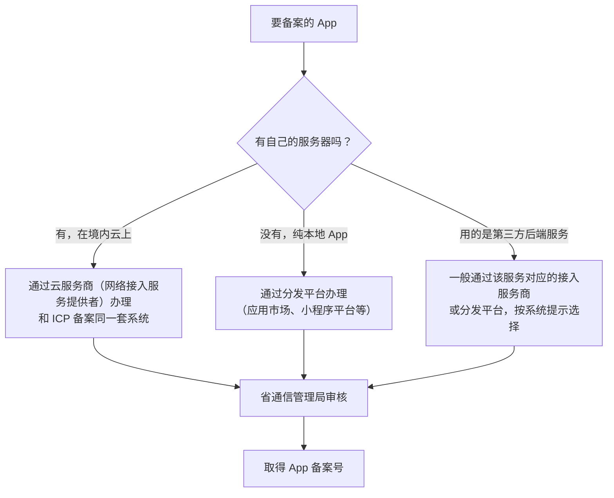
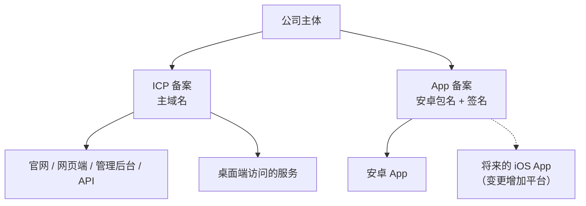

# App 备案

2023 年以前，国内做 App 只需要网站有 ICP 备案，App 本身没有专门的备案。2023 年夏天，工业和信息化部发布《关于开展移动互联网应用程序备案工作的通知》，要求 App 参照网站的方式备案。从那以后，**App 备案成了上架国内应用市场的硬门槛**：应用市场不收、接入商不接、手机厂商不预装没有备案的 App。

这一章讲：哪些东西要备案、在哪里办、要准备什么、和 ICP 备案怎么衔接，以及 hatch-counter 这种「有服务端、多端」的产品怎么处理。

> [!WARNING]
> 本章按 2025 年前后的规则整理，App 备案在各省执行的细节（材料清单、审核时长、核验方式）各有不同，接入服务商和应用市场的系统也在迭代；办理时以工业和信息化部、省通信管理局的最新要求和接入服务商、分发平台的系统提示为准。

## 为什么要备案

> [!WARNING]
> 本节依据 2023 年工业和信息化部《关于开展移动互联网应用程序备案工作的通知》整理，后续可能有新的配套规定，以工业和信息化部的最新通知为准。

通知的依据是《中华人民共和国反电信网络诈骗法》和《互联网信息服务管理办法》等法律法规。背景很直白：App 和网站一样在提供互联网信息服务，但过去 App 可以通过各种渠道分发，主办者难以追溯，诈骗类 App 换个壳就能重新上线。备案把「这个 App 是谁做的」和实名主体绑定起来。

理解了这个出发点，很多规则就好记了：备案的核心是**主体实名、App 可识别（名称、包名、签名）、责任人可联系**。

## 哪些东西要备案

> [!WARNING]
> 备案对象范围和补办期安排按 2025 年前后的口径整理，可能已调整，桌面客户端等边界情形以工业和信息化部和省通信管理局的最新口径为准。

| 对象 | 是否需要 | 说明 |
|---|---|---|
| 安卓 App | 需要 | 在境内提供服务的 |
| iOS App | 需要 | 同上，上架中国大陆区 App Store 也会要求相关备案信息 |
| 微信 / 支付宝 / 抖音等小程序 | 需要 | 通常在小程序平台的后台直接办理 |
| 快应用 | 需要 | 通知覆盖的范围 |
| 网站 | 走 ICP 备案 | 上一章 |
| 桌面客户端（Electron 等） | 通知的直接对象是移动 App、小程序和快应用 | 桌面端的后台服务依托网站域名，已有 ICP 备案覆盖；如有疑问以主管部门口径为准 |

时间节点上，通知发布后**新上线的 App 要先备案再开展业务**；通知发布前已上线的 App 有一个补办期，之后主管部门组织检查，未备案的依法处置。也就是说，现在新做的 App，备案是上线前的步骤，不是事后补的。

## 在哪里办

App 备案的入口取决于 App 有没有自己的服务端：



对有服务端的产品来说，App 备案通常是在**云服务商的备案系统里，给已有的备案主体新增一个「App」类型的服务**。所以主体信息不用重填，主要补 App 本身的信息。

纯本地 App（比如 hatch-shelf 这种离线书架，没有服务器）走分发平台渠道，在应用市场的开发者后台按提示提交。

## 要准备什么

除了主体信息（复用 ICP 备案的）和负责人核验，App 特有的信息是这些：

| 信息 | 说明 | 容易出错的地方 |
|---|---|---|
| App 名称 | 要和上架时的名称一致 | 应用市场名称加了后缀或副标题，导致不一致 |
| 安卓包名 | 如 `com.example.app` | 一旦备案，改包名就要变更备案 |
| iOS Bundle ID | 如 `com.example.app` | 同上 |
| 签名信息 | 安卓签名证书的公钥、MD5 等特征值；iOS 也有对应字段 | 用了 debug 签名提交；后来换了签名证书 |
| 运行平台 | 安卓 / iOS / 鸿蒙等 | 只报了一个平台，另一个平台上架时没有覆盖 |
| 服务内容 / 前置审批 | 与网站类似，涉及特定类别需要批文 | 用了 AI 生成能力，没有在系统里如实勾选 |

安卓签名的特征值可以用 JDK 自带的 `keytool` 从签名文件里读出来：

```bash
# 从 keystore 中读取证书信息（会提示输入 keystore 密码）
keytool -list -v -keystore release.keystore -alias your-alias

# 或者从已签名的 APK 中读取证书信息
keytool -printcert -jarfile app-release.apk
```

输出中包含证书的指纹（SHA-1、SHA-256，部分 JDK 版本也给 MD5）。备案系统要的是哪几个值、什么格式，按系统提示填；有些云服务商提供在线工具，上传 APK 自动提取。iOS 的对应字段一般从开发者账号的证书信息获取，同样按系统提示操作。

**签名是 App 身份的一部分**。如果你的 App 用 Expo 构建，签名证书可能由构建服务托管，也可能在本地 `keystore` 里，备案前确认清楚**正式发布用的是哪一张**，以后不要轻易换。

## 和 ICP 备案的衔接

把两种备案放在一起看：

| | ICP 备案 | App 备案 |
|---|---|---|
| 对象 | 网站（按域名） | App、小程序、快应用（按包名或 ID） |
| 前提 | 境内服务器、域名实名 | 有服务端的：通常已有 ICP 备案主体 |
| 办理入口 | 接入服务商 | 接入服务商或分发平台 |
| 标识 | ICP 备案号 | App 备案号 |
| 展示 | 网站首页底部 | 分发平台详情页展示；App 内展示按最新要求和平台规则 |

一个主体可以同时有多个网站备案和多个 App 备案，它们挂在同一个主体下，主体信息变更时要一起维护。

## 备案之后

> [!WARNING]
> 变更、注销和展示要求按 2025 年前后的规定整理，可能已调整，以工业和信息化部备案管理系统和省通信管理局的最新要求为准。

- **信息变化要变更备案**：App 改名、换包名、换签名、换服务器接入商、增加运行平台，都要在系统里变更
- **不再运营要注销备案**：App 下架停止服务时，及时注销
- **应用市场会核对**：上架时应用市场会校验 App 名称、包名、主体是否与备案一致，不一致直接驳回

很多开发者在 App 的「关于」页面展示 App 备案号，和网站底部展示 ICP 备案号的做法一致。是否强制、展示在哪里看当时的要求；放上去没有坏处。

## hatch-counter 的 App 备案

hatch-counter 有三种客户端：

- **网页端**：浏览器访问，属于网站，ICP 备案覆盖
- **桌面端**：Electron 打包的 Windows / macOS 客户端，从官网下载；它访问的服务端在已备案的域名下
- **移动端**：Expo + React Native 的安卓 App，目前从官网扫码下载安装，以后计划上架国内应用市场

移动端的备案思路：

1. 在云服务商的备案系统里，给公司主体新增一个 App 类型的服务
2. 填 App 名称（品牌名）、安卓包名、正式签名的特征值
3. 如果以后要做 iOS 版，Bundle ID 也提前想好，可以一并填报或之后变更增加
4. 服务内容里如实说明：门店经营管理，含图片识别功能
5. 备案通过后，App「关于」页展示备案号

一个容易忽略的问题：**官网扫码下载、不经过应用市场，是不是就不用备案了？** 答案是仍然要。通知约束的是在境内提供服务的 App 主办者，分发渠道不改变这一点。而且没有备案的 App，以后想上架应用市场时还是要补。



## 常见的坑

- **用测试签名提交备案**：上架时发现签名不一致，只能变更备案，重新排队
- **多渠道包用了不同签名**：有的团队给不同应用市场打不同签名的包，备案时要全部覆盖，独立开发者没必要这么做，统一一张签名
- **App 名称和备案不一致**：应用市场的名称不要随手加「—— 最好用的 xx 工具」这类后缀，按备案名称来
- **小程序和 App 分开管理忘了维护**：小程序在平台后台备案，App 在云服务商备案，主体信息变更时两边都要改
- **以为只做 iOS 就不用管**：中国大陆区 App Store 同样会要求备案信息，第 8 章细讲

## 本章要点

- 规定会变，以工信部、省通信管理局最新要求和备案系统提示为准
- 依据《关于开展移动互联网应用程序备案工作的通知》，境内提供服务的 **App、小程序、快应用**都要备案，新 App **先备案后上线**
- 有服务端的 App 通常在**云服务商**备案系统办理，纯本地 App 走**分发平台**
- 备案的核心字段：App 名称、包名 / Bundle ID、**签名特征值**，备案后改动都要变更
- 应用市场会核对名称、包名、主体与备案一致；官网直接分发也不能免除备案义务
