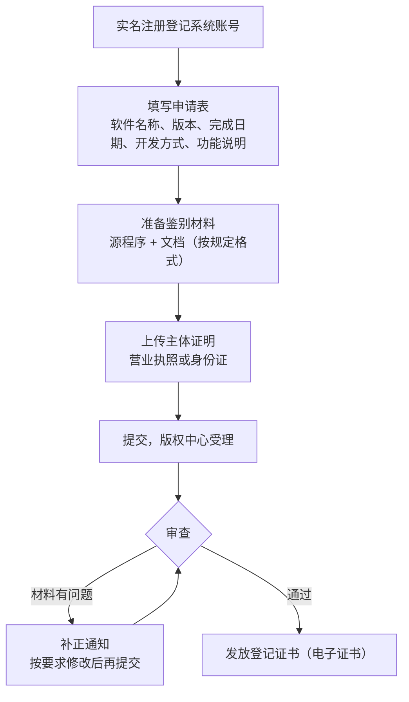

# 软件著作权与商标

「软著」是独立开发者最常听说、也最常误解的一项手续。有人以为没有软著代码就不受保护，有人以为有了软著就能防止别人抄。两种理解都偏了。这一章讲清楚：软件著作权是什么、登记有什么用、怎么登记、代码归属有哪些坑，最后顺带讲和它常被混在一起的**商标**。

> [!WARNING]
> 本章按 2025 年前后的登记要求整理，登记机构的材料要求、格式规范、办理渠道会调整，以中国版权保护中心和国家知识产权局商标局的最新要求为准；涉及权属纠纷、侵权诉讼、转让和许可的重大事项，请咨询知识产权律师。

## 著作权自动产生，登记是证据

软件著作权的法律依据是《中华人民共和国著作权法》和国务院的《计算机软件保护条例》，登记程序依据《计算机软件著作权登记办法》。

最重要的一条原理：**著作权自软件开发完成之日起自动产生，不以登记为前提**。你写完代码的那一刻，著作权就已经是你的了。

那登记有什么用？

| 作用 | 说明 |
|---|---|
| 权属的初步证明 | 发生纠纷时，登记证书是证明「这个软件是我的、什么时候完成的」的有力证据，对方要推翻需要拿出相反证据 |
| 应用市场上架材料 | 多数国内安卓应用市场要求提供软著证书或认可的替代证明（第 8 章） |
| 资质与政策 | 部分资质认定、政府扶持政策、税收优惠的申请材料里会用到 |
| 交易与融资 | 转让、许可、作价出资时，登记过的软件权属更清楚 |

而它**不能**做的事：

- **不保护创意和功能**。著作权保护的是表达（代码本身），不保护思想、算法、功能和交互逻辑。别人看了你的 App，用自己的代码实现一个一模一样功能的产品，著作权一般管不到
- **不是审查合格的证明**。登记时版权中心做的是形式审查，不判断你的软件是否原创、是否侵犯别人的权利

想保护功能和创意，要靠专利（门槛高、周期长、对独立开发者通常不划算）、商业秘密（服务端代码不公开本身就是一种保护）和做得比别人快。

## 谁是著作权人

登记之前先把权属想清楚，这是独立开发者最容易埋雷的地方。

### 个人写的，还是公司的

《计算机软件保护条例》区分了几种情形：

| 情形 | 著作权一般归属 |
|---|---|
| 你以个人身份、自己的时间和设备写的 | 你个人 |
| 你作为公司员工，为完成工作任务写的 | 符合条件的属于法人（职务作品），具体看是否主要使用了单位的物质技术条件、是否为单位的工作任务等 |
| 委托外包开发 | **按合同约定**；合同没约定或约定不明的，归受托人（写代码的那一方） |
| 合作开发 | 按合同约定；没约定的，由合作开发者共同享有 |

对一人公司来说，常见的问题有三个：

1. **公司成立前自己写的代码**：著作权在你个人名下。如果要以公司名义登记软著、上架 App，最干净的做法是你个人把软件著作权**转让或者许可**给公司，签一份书面协议。或者等公司成立后以公司名义申请，但要能说明公司是怎么取得权利的
2. **找人外包了一部分**：外包合同里必须写明**著作权归委托方（你的公司）**，否则默认归外包方
3. **还在上班时写的副业代码**：仔细看劳动合同里关于知识产权的条款，有的合同约定了在职期间的相关成果归公司。这不只是软著的问题，是产品归属的问题

### 用 AI 写的代码

> [!WARNING]
> AI 生成内容的著作权归属在法律上仍在发展，本节按 2025 年前后的司法实践整理，以国家版权局、中国版权保护中心的最新口径和最高人民法院的相关判例为准。

重度使用编码 agent 写代码的开发者会关心：AI 生成的代码能不能登记、归谁？

这个问题在法律上还在发展中。可以确定的方向是：著作权保护的是**人的智力成果**，你在设计架构、拆解需求、选择和修改生成结果、整合成完整软件的过程中投入的智力劳动，是主张权利的基础。实务上的建议：

- 以你（或你的公司）作为开发者申请，如实填写开发信息
- 保留开发过程的证据：需求文档、设计文档、提交历史、你对生成代码的审查和修改记录。Git 历史本身就是很好的证据
- 不要把明显来自他人代码库的大段代码（无论是 AI 吐出来的还是复制来的）当作自己的作品登记

### 开源依赖

你的软件里用了大量开源库，这不影响你对**自己写的那部分**享有著作权，但要遵守开源协议：

- MIT、Apache-2.0、BSD 这类宽松协议：保留版权声明和许可证文本即可。App 里放一个「开源许可」页面是常规做法
- GPL 这类强 copyleft（著佐权）协议：如果你分发了链接 GPL 代码的软件，可能需要以同样协议开放你的源码。商业闭源产品引入前要评估
- 服务端代码不分发给用户，部分协议（如 GPL）的开源义务不会被触发，但 AGPL 会

可以用工具扫描依赖的协议：

```bash
# 列出生产依赖的许可证（license-checker 是常用的 npm 工具）
npx license-checker --production --summary

# 只允许指定协议，出现其他协议时报错，适合放进 CI
npx license-checker --production --onlyAllow "MIT;Apache-2.0;BSD-2-Clause;BSD-3-Clause;ISC"
```

## 登记流程

软著登记由**中国版权保护中心**办理，现在主要通过其线上登记系统提交。



### 要准备的材料

> [!WARNING]
> 材料清单和格式要求按 2025 年前后的规定整理，可能已调整，以中国版权保护中心登记系统最新公布的要求为准。

| 材料 | 要点 |
|---|---|
| 申请表 | 软件全称、简称、版本号、开发完成日期、首次发表日期、开发方式（独立 / 合作 / 委托 / 下达任务）、权利取得方式（原始 / 继受）、硬件和软件环境、编程语言、源程序量、主要功能和技术特点 |
| 源程序鉴别材料 | 从源代码中按规定截取一部分，排版有格式要求（每页行数、页眉中的软件名称和版本号等） |
| 文档鉴别材料 | 用户手册、设计说明书之类，同样有页数和格式要求；文档中的截图、软件名称要和申请表一致 |
| 主体证明 | 公司营业执照或个人身份证；继受取得的还要有转让合同等证明 |

页数、每页行数、页眉格式这些细节，提交前对照着版权中心公布的要求检查一遍。大量补正都出在格式上。

### 常见的补正原因

- **软件名称不一致**：申请表、源程序页眉、文档、截图里的名称和版本号必须完全一致。名称建议以「软件」「系统」「平台」「App」等结尾，按版权中心的命名规则来
- **源代码里有敏感信息**：提交的源程序中不能有密钥、账号、真实的服务器地址，也不要有大段注释掉的代码或无关的第三方代码。截取前先清理
- **文档和代码对不上**：文档描述的功能在代码里找不到对应实现，或者截图是另一个产品
- **日期矛盾**：开发完成日期晚于首次发表日期，或首次发表日期晚于申请日期

### 要不要找代理

自己办完全可行，主要成本是时间：熟悉格式规范、准备材料、等审查、处理补正。代理机构的价值是格式熟、补正少，以及部分机构提供的加急服务。独立开发者第一次可以自己办一遍，了解流程；以后如果软件多，再考虑代理。

注意区分**官方登记**和一些平台提供的**电子版权认证**、**区块链存证**。后者是第三方的存证服务，部分应用市场接受它作为上架材料的替代，但它不等同于版权中心的登记证书。用哪个，看你要上的平台认哪个。

## 一个产品要登记几个软著

软著按「软件」登记，一个产品由多个独立的软件组成时，可以分别登记，也可以作为一个系统登记，取决于你需要怎么用证书。

| 做法 | 适用 |
|---|---|
| 整个产品作为一个系统登记 | 应用市场只要一个证书证明 App 权属时最省事 |
| 按客户端、服务端分别登记 | 各端独立对外、或者以后可能单独转让许可时 |
| 新的大版本重新登记 | 功能有实质变化、想留下新版本的权属证据时 |

hatch-counter 的做法是先按「安卓 App」这个上架对象登记一个，名称和应用市场的 App 名称对应；服务端和网页端作为系统的组成部分在文档里说明。以后有需要再单独登记。

## 顺带说商标

> [!WARNING]
> 商标申请规则和审查周期按 2025 年前后的情况整理，可能已调整，以国家知识产权局商标局的最新规定和《类似商品和服务区分表》为准。

软著保护代码，**商标保护名字和标识**。对一个要长期做的产品，商标往往比软著更重要：你的 App 名字被别人抢注了商标，可能被迫改名，之前积累的品牌和搜索流量全部作废。

商标的要点：

- 依据《中华人民共和国商标法》，在国家知识产权局商标局申请
- **申请在先**原则为主：谁先申请谁更有优势，不是谁先用
- 按**类别**注册，一个类别保护一组商品或服务。软件产品常见的相关类别包括计算机软件类商品、软件服务和技术服务类、与你业务对应的服务类，具体选哪些类别和小项，查商标分类表或咨询代理
- 审查周期较长，从申请到核准要数月以上，所以要**尽早申请**
- 产品名、公司字号、Logo 可以分别申请

一个简单的顺序建议：**确定产品名 → 查商标 → 申请商标 → 再大规模推广**。千万不要在推广起来之后才发现名字已经被人注册了。

## 本章要点

- 规定会变，以中国版权保护中心、国家知识产权局的最新要求为准；权属和侵权纠纷咨询律师
- 著作权**自动产生**，登记是**初步证明**和**上架材料**，不是保护的前提
- 著作权保护代码表达，**不保护功能和创意**
- 先理清权属：公司成立前的代码要转让或许可给公司；外包合同写明著作权归委托方
- AI 辅助开发保留过程证据，开源依赖遵守协议，可用 `license-checker` 扫描
- 登记补正多出在**名称不一致、格式不符、源码含敏感信息**
- 产品名要尽早查商标、申请商标，商标比软著更关系品牌存亡
