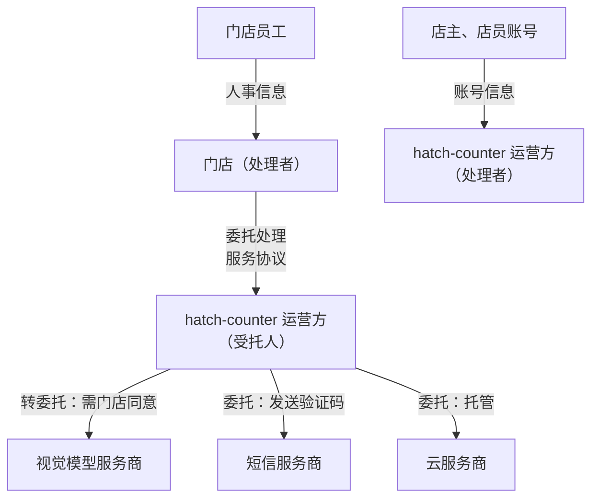

# 个人信息保护法

前几章的手续都是一次性的：办下来就有了。个人信息保护不一样，它是**持续性的义务**，从你设计第一张数据库表开始，到用户注销账号、你删掉最后一条备份为止。它也是独立开发者最容易「无意中违规」的领域：多收一个权限、多埋一个第三方 SDK、日志里多打一个手机号，都可能踩线。

这一章讲个人信息保护的法规框架、几个核心概念，然后落到工程上：怎么写隐私政策、怎么设计同意、怎么处理第三方服务，以及 hatch-counter 这种 B 端 SaaS 在其中扮演什么角色。

> [!WARNING]
> 本章按 2025 年前后的法规和标准整理，个人信息保护的配套规定、国家标准、执法尺度都在变化，以国家法律法规数据库的法律原文和国家网信办等主管部门的最新规定为准；涉及敏感个人信息、大规模处理、数据出境的业务，务必咨询专业律师。

## 法规地图

> [!WARNING]
> 本表按 2026 年 11 月查到的原文整理：《网络安全法》修正决定（全国人大常委会 2025 年 10 月 28 日通过，新华社受权发布全文，国家网信办网站刊载修正后文本）、《个人信息保护合规审计管理办法》（国家网信办令第 18 号）、《个人信息出境认证办法》（国家网信办、市场监管总局 2025 年 10 月 17 日公布）。此后仍可能有新的修正和配套规定，以国家网信办和国家法律法规数据库（flk.npc.gov.cn）的最新公布为准。

个人信息保护不是一部法，是一组法律、行政法规、部门规章和国家标准：

| 层级 | 名称 | 和你的关系 |
|---|---|---|
| 法律 | 《中华人民共和国个人信息保护法》 | 核心，规定处理规则、个人权利、处理者义务 |
| 法律 | 《中华人民共和国网络安全法》 | 网络运营者的安全义务、等级保护制度；2025 年 10 月修正，2026 年 1 月 1 日起施行 |
| 法律 | 《中华人民共和国数据安全法》 | 数据分类分级、数据安全保护义务 |
| 行政法规 | 《网络数据安全管理条例》 | 把上面三部法落到网络数据处理活动的具体规则，2025 年起施行 |
| 部门文件 | 《App 违法违规收集使用个人信息行为认定方法》 | 列举了 App 常见违规情形，监管检测时对照它 |
| 部门文件 | 《常见类型移动互联网应用程序必要个人信息范围规定》 | 不同类型 App 能收集的「必要」个人信息 |
| 部门规章 | 《个人信息保护合规审计管理办法》 | 处理者定期做合规审计，2025 年 5 月 1 日起施行 |
| 国家标准 | GB/T 35273《信息安全技术 个人信息安全规范》 | 推荐性标准，隐私政策和同意设计的常用参照 |
| 数据出境 | 《数据出境安全评估办法》《个人信息出境标准合同办法》《个人信息出境认证办法》《促进和规范数据跨境流动规定》 | 个人信息传到境外时适用；认证办法 2026 年 1 月 1 日起施行 |

独立开发者不需要背下全部条文，但要知道**《个人信息保护法》是主干**，其他文件是展开和细化。

## 核心概念

### 个人信息和敏感个人信息

**个人信息**是以电子或者其他方式记录的、与已识别或者可识别的自然人有关的各种信息，**不包括匿名化处理后的信息**。手机号、姓名、设备标识、IP 地址、位置、照片里的人脸，都可能是个人信息。

**敏感个人信息**是一旦泄露或者被非法使用，容易导致自然人的人格尊严受到侵害或者人身、财产安全受到危害的个人信息，法律列举了**生物识别、宗教信仰、特定身份、医疗健康、金融账户、行踪轨迹**等信息，以及**不满十四周岁未成年人的个人信息**。

处理敏感个人信息要满足更高的要求：要有**特定的目的和充分的必要性**，采取严格保护措施，并且通常需要取得个人的**单独同意**。

注意「匿名化」和「去标识化」的区别：

| | 去标识化 | 匿名化 |
|---|---|---|
| 含义 | 处理后不借助额外信息无法识别特定个人 | 处理后无法识别特定个人**且不能复原** |
| 还是不是个人信息 | **是**，仍受保护 | 不是 |
| 例子 | 把手机号换成内部用户 ID，映射表另存 | 只保留「某城市某天有 37 家店上传了单据」这种统计数字 |

工程上常说的「脱敏」大多是去标识化，不能因此就认为数据不受个人信息保护法约束了。

### 处理者、受托人和第三方

这组概念决定了**谁对什么负责**，对 SaaS 尤其关键：

| 角色 | 含义 | 例子 |
|---|---|---|
| 个人信息处理者 | 自主决定处理目的、处理方式的组织、个人 | 一个 To C App 的运营方 |
| 受托人 | 接受处理者**委托**、按约定处理的一方 | 处理者用的云服务器、短信服务商 |
| 其他处理者（第三方） | 从处理者那里**接收**个人信息、自己决定怎么用 | 合作方拿走用户数据做自己的业务 |

法律对委托处理的要求是：处理者和受托人要**约定**委托处理的目的、期限、处理方式、个人信息的种类、保护措施和双方权利义务；受托人只能按约定处理，不得超出约定；委托结束后要返还或删除；**未经处理者同意，受托人不得转委托**。

而向其他处理者提供个人信息，要告知个人接收方的身份、目的、方式和信息种类，并取得**单独同意**。

## 处理的合法性基础

> [!WARNING]
> 本节按《个人信息保护法》原文和 2025 年前后的监管实践整理，同意的有效性认定以国家网信办和工信部的最新通报、认定方法为准。

处理个人信息必须有法律认可的理由。《个人信息保护法》列举了几种情形，和独立开发者最相关的是：

1. **取得个人的同意**
2. **为订立、履行个人作为一方当事人的合同所必需**，或者按照依法制定的劳动规章制度和依法签订的集体合同实施人力资源管理所必需
3. 为履行法定职责或者法定义务所必需
4. 其他法律、行政法规规定的情形

很多人以为「一切都要用户同意」，其实不是。用户注册时你收集手机号用来登录，属于履行服务合同所必需；但你想把这个手机号拿去发营销短信，就超出了合同必需的范围，需要另行取得同意。

**同意要有效**：在充分知情的前提下自愿、明确作出。默认勾选、不同意就不让用（而该信息又不是提供服务所必需的）、把多个目的捆绑在一个同意里，都是监管通报里常见的问题。

## 告知：隐私政策要写什么

处理个人信息前，要以**显著方式、清晰易懂的语言**真实、准确、完整地告知个人。隐私政策是告知的主要载体，至少要覆盖：

```text
1. 我们是谁：处理者的名称和联系方式
2. 收集哪些信息、为什么收集、怎么收集
   - 按功能分别列出，区分「必要」和「可选」
   - 敏感个人信息单独标出，说明必要性和对个人的影响
3. 保存多久、保存在哪里（境内 / 境外）
4. 和谁共享：委托处理的服务商、第三方 SDK 清单（名称、目的、收集的信息）
5. 你的权利和怎么行使：查阅、复制、更正、删除、撤回同意、注销账号、转移
6. 我们怎么保护：安全措施、事件响应
7. 未成年人保护
8. 政策更新时怎么通知
9. 联系我们：投诉和咨询渠道、响应时限
```

几个实务要点：

- **隐私政策要和代码一致**。监管的 App 检测会实际抓包、看权限调用，政策里没写的收集行为、写了但实际收集更多的，都会被认定为违规
- **第三方 SDK 要单列**。统计、推送、崩溃上报、登录、支付 SDK 都在收集信息，每一个都要写清楚。能不用的 SDK 就不用
- **首次启动弹窗**。App 首次运行时要弹出隐私政策摘要并取得同意，**在用户同意之前不能初始化会收集个人信息的 SDK、不能申请权限**
- **权限按需申请**。用到拍照功能时再申请相机权限，并说明用途；不要启动就一次性要一堆权限

## 个人的权利，落到功能上

法律规定的个人权利，每一项都要有对应的产品功能或处理流程：

| 权利 | 产品上要有 |
|---|---|
| 知情、决定 | 隐私政策、同意弹窗、可关闭的可选功能 |
| 查阅、复制 | 能看到自己的资料；能导出 |
| 更正、补充 | 能修改资料 |
| 删除 | 能删除内容；处理目的已实现、撤回同意、停止服务时主动删除 |
| 撤回同意 | 关闭某项可选授权的入口，撤回后不影响之前的处理 |
| 注销账号 | **App 内要有注销入口**，不能设置不合理的障碍 |
| 转移 | 符合条件时，请求将其个人信息转移至指定的处理者 |

注销是 App 检测的高频项。注销后，要删除或匿名化该账号的个人信息；法律法规要求保留的（比如交易记录、日志的法定留存期）可以保留，但要停止除存储和必要安全保护之外的处理。

## 处理者的义务

> [!WARNING]
> 影响评估和等级保护按 2025 年前后的规定整理；合规审计按 2026 年 11 月查到的《个人信息保护合规审计管理办法》（国家网信办令第 18 号，国家网信办网站原文）整理，网络安全法罚则按 2025 年 10 月 28 日的修正决定原文整理。配套规定可能更新，以国家网信办、公安部的最新规定为准。

除了上面这些面向用户的规则，处理者自己还有一组内部义务：

- **制度和措施**：内部管理制度和操作规程，对个人信息分类管理，采取加密、去标识化等安全技术措施，合理确定操作权限，定期培训，制定并组织实施安全事件应急预案
- **个人信息保护影响评估**：处理敏感个人信息、利用个人信息进行自动化决策、委托处理 / 向他人提供 / 公开个人信息、向境外提供个人信息等情形下，事前要做影响评估，评估报告和处理情况记录**至少保存三年**
- **安全事件通知**：发生或者可能发生个人信息泄露、篡改、丢失的，要立即采取补救措施，并通知履行个人信息保护职责的部门和个人
- **合规审计**：定期对处理活动进行合规审计，下面单独讲
- **网络安全等级保护**：《网络安全法》规定的等级保护制度，网络运营者要按要求定级、备案、测评。小型系统具体怎么做，咨询当地网安部门或测评机构

### 合规审计：小公司也有，但不用请审计机构

《个人信息保护合规审计管理办法》2025 年 5 月 1 日起施行，把《个人信息保护法》第五十四条的「定期合规审计」落成了具体规则。按处理规模分三档：

| 规模 | 要求 |
|---|---|
| 所有处理者 | 由内部机构或委托专业机构**定期**做合规审计（第三条），办法没有给小处理者规定固定频率 |
| 处理 100 万人以上个人信息 | 指定**个人信息保护负责人**，负责合规审计工作（第十二条） |
| 处理超过 1000 万人个人信息 | **每两年至少一次**合规审计（第四条） |

另外，监管部门在几种情形下可以**要求**你委托专业机构审计（第五条）：处理活动存在较大风险、可能侵害众多个人的权益，或者发生安全事件，导致 100 万人以上个人信息、或 10 万人以上敏感个人信息泄露、篡改、丢失、毁损。

对一人公司，实际要做的是第一档：按办法附带的《个人信息保护合规审计指引》，**每年自己对照查一遍**，留下书面记录。指引的检查项和本章的结构基本对得上：合法性基础、告知和同意、委托处理和第三方 SDK、个人权利响应、安全措施、影响评估、出境。把检查结果、发现的问题和改法写成一页文档，和影响评估报告放在一起保存。这份记录平时没人看，出事时它就是你「尽到了义务」的证据。

### 网络安全法修正：罚款不再「先警告」

《网络安全法》2025 年 10 月 28 日完成施行以来的第一次修改，2026 年 1 月 1 日起施行。和独立开发者关系最大的是罚则：

- **网络运营者不履行安全保护义务**（修正后第六十一条，原第五十九条）：修正前是责令改正、警告，**拒不改正或者造成后果**才罚款；修正后在责令改正、警告的同时，**可以处一万元以上五万元以下罚款**。拒不改正或者导致危害网络安全等后果的，处五万元以上五十万元以下罚款；造成严重、特别严重后果的，档位一路升到二百万元、一千万元，直接负责的主管人员也要另行罚款
- **个人信息**：修正后第四十二条明确网络运营者处理个人信息要遵守《民法典》《个人信息保护法》等规定；侵害个人信息权益的行为，按有关法律、行政法规处理处罚（第七十一条），也就是回到《个人信息保护法》的罚则
- **人工智能**：新增第二十条，国家支持人工智能研发、完善伦理规范、加强风险监测评估和安全监管。这是方向性条款，具体义务仍看[第 7 章](07-generative-ai.md)的那几部规定

对小公司的意思很直接：等级保护、日志留存、漏洞处置这些「网络安全保护义务」，以前没做被查到通常先给改正机会，现在第一次就可能罚款。上线前按[工程上的落地](#工程上的落地)那张表过一遍，比等检查时再补便宜得多。

违反《个人信息保护法》的后果可以很重：责令改正、警告、没收违法所得、暂停或终止服务，情节严重的罚款可以高到相当可观的金额，直接责任人也可能被处罚。不要抱侥幸心理。

## 工程上的落地

把法律要求翻译成工程实践，一个最小清单：

| 要求 | 工程做法 |
|---|---|
| 最小必要 | 每个字段问一遍「不收集它，功能还能做吗」；不收集身份证号、精确位置这类非必要信息 |
| 安全措施 | HTTPS；数据库访问控制和多租户隔离；敏感字段加密；备份加密 |
| 操作权限 | 管理后台分权限；运营人员查看用户数据留审计日志 |
| 日志 | 日志里不打完整的手机号、令牌、密码；按需脱敏 |
| 保存期限 | 每类数据定保存期限，到期自动清理 |
| 删除 | 注销和删除请求能真正删到数据库和对象存储；备份按周期轮换覆盖 |

日志脱敏是最容易落实的一项。在 NestJS 里可以在日志层统一处理：

```typescript
// 对日志中的手机号做脱敏：保留前 3 位和后 4 位
const PHONE_RE = /(?<!\d)(1\d{2})\d{4}(\d{4})(?!\d)/g;

export function maskPii(input: string): string {
  return input.replace(PHONE_RE, "$1****$2");
}

// 用法：在自定义 Logger 或日志格式化函数里统一调用
// logger.log(maskPii(`login ok phone=13800138000`));
// => "login ok phone=138****8000"
```

这只是一个起点：令牌、身份证号、邮箱等也按同样思路处理。更根本的做法是**不把这些字段写进日志**，脱敏是兜底。

## hatch-counter 的角色分析

hatch-counter 是 B 端 SaaS，个人信息保护上的角色比 To C App 复杂。先列出它碰到的个人信息：

| 数据 | 谁的信息 | 用途 |
|---|---|---|
| 登录手机号 | 店主、店员 | 账号和验证码登录 |
| 登录设备、IP、操作日志 | 店主、店员 | 安全、审计 |
| 员工档案、排班、工资 | 门店的员工 | 门店的人事和工资管理 |
| 进货单照片 | 可能含供货商联系人的姓名、电话 | 识别成进货记录 |
| 销量、库存、开支 | 门店的经营数据，一般不是个人信息 | 经营分析 |

然后看角色：



这张图揭示了两种不同的身份：

1. **对店主、店员的账号信息**（手机号、登录日志），hatch-counter 运营方是**处理者**。要有面向用户的隐私政策，登录时取得同意
2. **对门店录入的员工档案、工资、进货单内容**，处理目的和方式由门店决定，hatch-counter 运营方更接近**受托人**。这时要做的是：
   - 在服务协议里写明**委托处理条款**：处理目的仅限于提供服务，处理方式、保护措施、服务终止后的数据返还或删除
   - 员工档案里的信息由门店负责取得员工的同意或者具备其他合法性基础（比如人力资源管理所必需），协议里写清楚门店的这项义务
   - 把进货单图片交给视觉模型服务商识别，是**转委托**，要在服务协议里**取得门店的同意**，并列明服务商
   - 服务商只能在境内：hatch-counter 用的是境内的模型服务，避免了数据出境的问题

另外几个落地动作：

- 员工工资是否属于敏感个人信息，取决于具体情况和监管口径；hatch-counter 按敏感数据对待，按钥匙（权限）严格控制谁能看工资页
- 操作日志保留 90 天后压成按月计数，是「保存期限」原则的直接体现
- 识别和短信服务商的密钥只存在服务端单独的 schema 里，审计日志里不记录密钥，这是安全措施
- 门店停用或删店后，数据怎么保留、多久删除，要在服务协议里写清，并且代码里真的按这个执行

## 数据出境：用海外大模型要特别小心

> [!WARNING]
> 数据出境的豁免门槛按 2025 年前后的《促进和规范数据跨境流动规定》整理；出境认证的适用条件按 2026 年 11 月查到的国家网信办网站《个人信息出境认证办法》答记者问整理，认证规则、标准和认证机构名单以国家市场监督管理总局和国家网信办后续公布为准。配套规定变化快，以国家网信办的最新规定和申报指南为准。

独立开发者很容易踩的一个坑：**服务端调用海外的大模型 API，把含有个人信息的内容发了过去**。这在法律上属于向境外提供个人信息，适用数据出境的一整套规则：

- 要告知个人境外接收方的情况，并取得**单独同意**
- 要事前做个人信息保护影响评估
- 根据数据量和类型，可能需要走**安全评估**、**签订标准合同并备案**或**个人信息保护认证**中的一种，也可能符合豁免条件，具体门槛按《促进和规范数据跨境流动规定》等最新规定判断

三条路里的**个人信息保护认证**，在 2026 年 1 月 1 日起施行的《个人信息出境认证办法》里有了具体规则。能走认证（也能走标准合同）的，要同时满足：

- 不是关键信息基础设施运营者
- 当年 1 月 1 日起累计向境外提供 **10 万人以上、不满 100 万人**的个人信息（不含敏感个人信息），或者**不满 1 万人**的敏感个人信息
- 出境的数据里不包括重要数据

认证由取得个人信息保护认证资质的专业机构做，证书有效期 3 年。办法明确**不得用拆分数量等手段**，把本该走安全评估的出境改走认证。对独立开发者来说，认证和标准合同是二选一的关系：标准合同自己签、自己备案，认证要找机构、花钱，但一张证书能覆盖同一类出境活动三年。真走到这一步，数据量已经不小，应该请专业人士来定。

实务建议：**面向国内用户的产品，涉及个人信息的模型调用优先用境内已备案的模型服务**；确实要用海外模型的场景，先把个人信息剥离或去标识化，再咨询专业人士评估出境合规路径。

## 本章要点

- 规定会变，以法律原文和主管部门最新规定为准；敏感信息、大规模处理、出境务必咨询律师
- 《个人信息保护法》是主干，配套有《网络安全法》《数据安全法》《网络数据安全管理条例》和 App 相关的认定方法、必要信息范围规定
- 区分**个人信息 / 敏感个人信息**、**去标识化 / 匿名化**、**处理者 / 受托人 / 第三方**
- 合法性基础不只是同意，**履行合同所必需**也是；但超出必要范围就要另行同意
- 隐私政策要和代码一致，第三方 SDK 单列，同意前不初始化 SDK、不申请权限，App 内要有注销入口
- 合规审计所有处理者都要定期做，小公司每年按指引自查一遍、留记录；2026 年起《网络安全法》修正后，不履行安全保护义务首次就可能罚款
- B 端 SaaS 对客户录入的数据通常是**受托人**：服务协议写委托条款，转委托给模型服务商要取得客户同意
- 把个人信息发给海外大模型属于**数据出境**，优先用境内已备案模型
