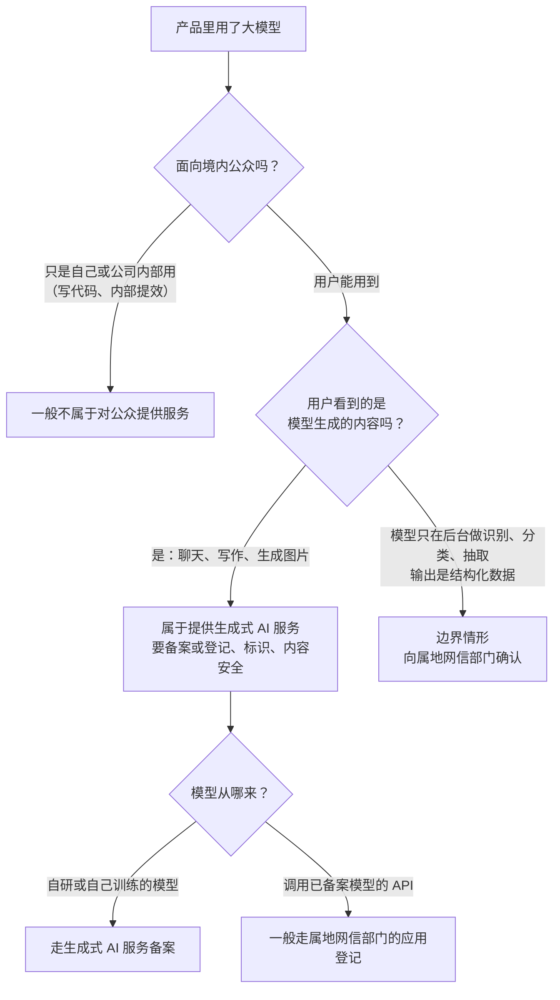
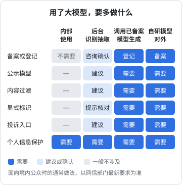

# 生成式 AI 相关规定

现在几乎每个新产品都想加一点 AI：聊天助手、文案生成、图片识别、智能总结。技术上调一个 API 就能做到，合规上却多出一整层：模型从哪来、有没有备案、生成的内容谁负责、要不要打标识、用户数据有没有被拿去训练。

这一章讲国内和生成式 AI 相关的主要规定，重点是**独立开发者调用别人的模型**这个最常见的场景该做什么。

> 生成式 AI 是监管变化最快的领域之一：新的办法、标准、备案口径几乎每年都有更新，各地网信部门的执行细节也不同。下面讲的是截至写作时的框架。**一定以国家网信办和属地网信部门的最新要求为准**；产品面向公众提供生成内容、涉及舆论属性的，**上线前咨询属地网信部门或专业人士**。

## 规定地图

| 名称 | 管什么 | 和独立开发者的关系 |
|---|---|---|
| 《生成式人工智能服务管理暂行办法》 | 向境内公众提供生成文本、图片、音频、视频等内容的服务 | 主干，2023 年 8 月 15 日起施行 |
| 《互联网信息服务深度合成管理规定》 | 用深度学习、虚拟现实等技术生成或编辑文本、图像、音视频等的服务 | 做换脸、合成语音、图像编辑类功能时直接相关 |
| 《互联网信息服务算法推荐管理规定》 | 个性化推送、排序精选、检索过滤等算法推荐服务 | 有舆论属性或社会动员能力的，要做算法备案 |
| 《人工智能生成合成内容标识办法》及配套强制性国家标准 GB 45438-2025 | AI 生成内容的显式标识和隐式标识 | 2025 年 9 月 1 日起施行，生成内容给用户看的产品要关注 |
| 安全要求类标准和技术文件 | 训练数据、模型、服务的安全要求 | 自研模型、做大模型备案时的评估依据 |

这几部规定相互衔接：算法推荐管的是「推什么给你」，深度合成管的是「合成和编辑」，生成式 AI 办法管的是「生成内容」，标识办法管的是「告诉用户这是 AI 生成的」。

## 先判断：你是不是在「提供生成式 AI 服务」

《生成式人工智能服务管理暂行办法》适用于**利用生成式人工智能技术向中华人民共和国境内公众提供生成文本、图片、音频、视频等内容的服务**。办法同时明确，行业组织、企业、教育和科研机构等研发、应用生成式人工智能技术，**未向境内公众提供**生成式人工智能服务的，不适用本办法。

这个适用范围引出几个判断维度：



图中最难的是「边界情形」：模型只在后台把一张图片转成表格，用户拿到的是结构化的业务数据，而不是一段生成的文章或一张生成的图片。这算不算提供生成式 AI 服务，不同人有不同理解。稳妥的做法是：**按「可能属于」来准备，向属地网信部门咨询确认**。

## 备案和登记

国家对生成式 AI 服务有两条路径：

| | 生成式人工智能服务**备案** | 生成式人工智能应用或功能**登记** |
|---|---|---|
| 适用 | 直接提供生成式 AI 服务的，尤其是自研或自行训练、部署模型的 | 通过 API 或其他方式**直接调用已备案模型能力**的应用或功能 |
| 办理 | 经属地网信部门，报国家网信办 | 属地（省级）网信部门 |
| 复杂度 | 高：安全评估、语料来源、模型测试、拦截关键词、应急机制等 | 相对低：以应用层的安全措施为主 |
| 公示 | 国家网信办定期公布备案信息 | 网信部门公布登记信息 |

网信部门的公告还要求，已上线的生成式 AI 应用或功能，要在**显著位置或产品详情页公示所使用的已备案生成式 AI 服务的情况**，包括模型名称和备案号（或上线编号）。

对独立开发者来说，结论很清楚：

- **不要自己训练基础模型去对公众提供服务**，备案门槛不是一个人能轻松跨过的
- **调用境内已备案的模型**，走登记路径，工作量可控
- **调用未在境内备案的模型（包括海外模型）对境内公众提供生成服务**，合规上基本走不通，2023 年苹果中国区大规模下架接入境外模型的 AI 应用就是例子

怎么知道一个模型有没有备案？国家网信办会定期公布已备案的生成式 AI 服务清单，模型服务商一般也会在官网或文档里给出备案信息。选型时把它当作硬条件。

## 提供服务时的持续义务

无论是备案还是登记，上线之后都有一组持续义务。暂行办法里对服务提供者的主要要求可以归纳为：

| 义务 | 要做什么 |
|---|---|
| 内容生产者责任 | 依法承担网络信息内容生产者责任；不得生成法律法规禁止的内容 |
| 内容安全 | 对输入和输出做审核过滤；发现违法内容及时停止生成、停止传输、消除，并整改 |
| 个人信息保护 | 对用户的输入信息和使用记录依法履行保护义务；不得非法留存能识别用户身份的输入信息和使用记录；不得非法向他人提供 |
| 服务协议 | 和用户签订服务协议，明确双方权利义务 |
| 未成年人 | 采取有效措施防止未成年人用户过度依赖或者沉迷 |
| 标识 | 按规定对生成的图片、视频等内容进行标识 |
| 投诉举报 | 建立健全投诉、举报机制，设置便捷入口，及时受理和处理 |
| 用户违法使用 | 发现用户利用服务从事违法活动的，依法依约采取警示、限制功能、暂停或终止服务等处置措施 |

落到工程上，最小的实现通常包括：

1. **输入输出过滤**：调用模型服务商提供的内容安全接口，或者接入云厂商的内容审核服务；自己维护一份业务相关的拦截规则
2. **日志留存和处置能力**：记录生成请求的必要信息，便于追溯和处置；同时遵守个人信息保护的最小必要和保存期限
3. **投诉举报入口**：App 和网页里一个可以找到的反馈入口，有人处理
4. **服务协议和隐私政策里写明 AI 功能**：用的是哪家的模型、输入会被发给谁、会不会用于训练

### 用户数据会不会被拿去训练

这是用户和 B 端客户最关心的问题之一。你调用的模型服务商，会不会用你发过去的数据训练模型？答案取决于服务商的条款。选型时要确认：

- 服务商的 API 条款对输入数据的使用和留存怎么约定
- 能否关闭数据用于训练、能否约定留存期限
- 这些约定要能写进你自己的隐私政策和服务协议

如果服务商的条款不清楚或者默认会用于训练，而你的输入里有客户的经营数据或个人信息，这个服务商就不适合。

## AI 生成内容标识

《人工智能生成合成内容标识办法》和配套的强制性国家标准 GB 45438-2025 于 2025 年 9 月 1 日起施行，把标识分成两类：

| | 显式标识 | 隐式标识 |
|---|---|---|
| 形式 | 用户能直接感知：文字提示、角标、语音提示 | 写在文件元数据里，用户看不到 |
| 目的 | 让用户知道这是 AI 生成的 | 让平台和监管能追溯来源 |
| 例子 | 生成的文本旁边写「内容由 AI 生成」；图片角上加标识 | 在图片、音视频文件的元数据中写入生成合成相关信息 |

具体什么情形必须加显式标识、标识放在哪里、元数据写什么字段，以办法和国家标准的原文为准。实务上要注意：

- **生成内容给用户看、给用户下载**的，都要考虑标识
- 标识要在**导出、下载、分享**时保留，不能只在页面上显示、文件里没有
- 应用分发平台在上架审核时会要求说明是否提供生成合成服务，并核验相关材料

在 React 里给 AI 生成的内容加一个统一的显式标识，最简单的做法是封装一个组件，所有 AI 输出都经过它渲染：

```tsx
type AiContentProps = {
  children: React.ReactNode;
  model: string; // 例如「某某大模型」，与公示信息一致
};

export function AiContent({ children, model }: AiContentProps) {
  return (
    <section className="rounded-lg border border-slate-200 p-3">
      <div className="mb-2 text-xs text-slate-500">
        以下内容由 AI 生成（{model}），请核对后使用
      </div>
      {children}
    </section>
  );
}
```

这样做的好处是：哪天规则调整，只改一个组件。

## hatch-counter 怎么处理

hatch-counter 的 AI 用法是：店主拍一张手写进货单，服务端把图片发给视觉模型，模型返回识别出的品名、数量、单价，服务端整理成一张待确认的进货单，店主核对后入库。

按本章的框架逐项过一遍：

| 问题 | hatch-counter 的情况 | 处理 |
|---|---|---|
| 是否面向公众 | 面向开户的门店，但门店是公众的一部分 | 按「对外提供服务」对待 |
| 用户是否看到生成内容 | 看到的是识别出的结构化数据，经过人工核对才入库 | 边界情形，向属地网信部门咨询是否需要登记 |
| 模型来源 | 调用境内服务商的视觉模型，降级链里有两家 | 选型硬条件：服务商的模型已在境内备案；在产品详情或说明页公示所用模型和备案信息 |
| 数据出境 | 图片发给境内服务商 | 不涉及出境 |
| 训练使用 | 进货单是门店的经营数据 | 选型时确认服务商条款对输入数据的使用和留存约定 |
| 个人信息 | 单据上可能有供货商联系人姓名电话 | 服务协议中取得门店对转委托的同意（第 6 章） |
| 标识 | 识别结果不对外传播，但用户需要知道是机器识别的 | 待确认的进货单上明确提示「识别结果，请核对」 |
| 投诉和纠错 | 识别错了店主会直接改 | 保留反馈入口；识别失败时给出明确的提示，不暴露服务商内部信息 |

这里有一个产品设计和合规方向一致的地方：**人工核对后才入库**。从产品角度，视觉模型对手写字的识别不可能百分之百准确，让店主核对是必需的；从合规角度，它让 AI 的输出不直接成为对外发布的内容，责任边界更清晰。

如果以后 hatch-counter 增加「AI 经营建议」这类功能，模型直接生成一段文字给店主看，那就明确落入生成式 AI 服务的范围了，要走登记、加显式标识、做输出过滤。



## 本章要点

- 规定变化快，以国家网信办和属地网信部门最新要求为准；面向公众的生成服务上线前咨询
- 主干是《生成式人工智能服务管理暂行办法》，配套有深度合成、算法推荐、生成合成内容标识等规定
- **内部使用不面向公众的，不适用暂行办法**；模型只在后台做识别抽取的属于边界情形，向网信部门确认
- 自研模型对外提供服务走**备案**，调用已备案模型的应用走属地**登记**；要公示所用模型和备案号
- 调用未在境内备案的模型对境内公众提供生成服务，基本走不通
- 持续义务：内容安全、个人信息保护、服务协议、投诉举报、防沉迷、标识
- 2025 年 9 月 1 日起施行的标识办法和 GB 45438-2025 要求**显式 + 隐式**标识，导出下载时也要保留
