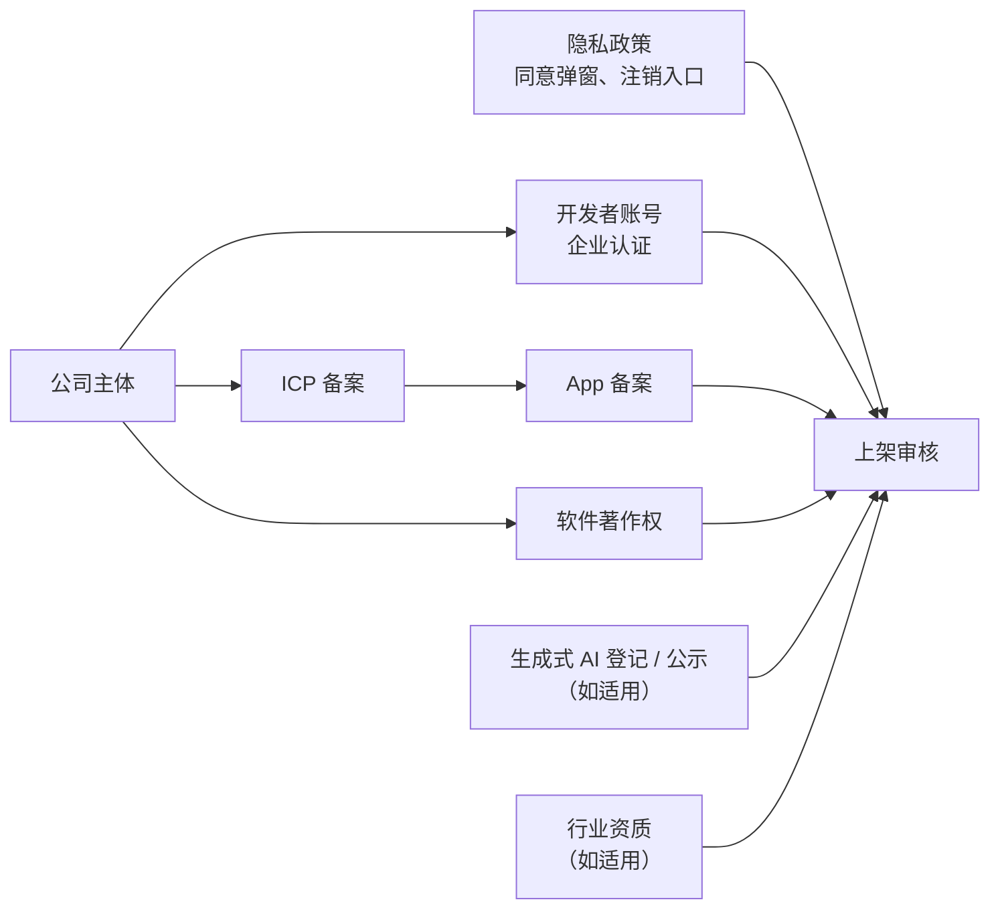
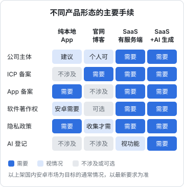
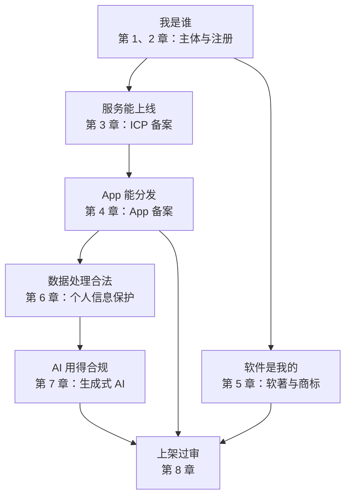

# 上架资质：把前面的手续串起来

前七章各管一摊：主体、注册、ICP 备案、App 备案、软著、个人信息、生成式 AI。这些东西最终要在一个地方集中接受检验：**应用市场的上架审核**。审核员不会关心你的架构有多漂亮，只会对着一张清单逐项核对。

这一章把前面的手续按应用市场重新组织一遍，讲清楚各平台通常要什么、审核在看什么、怎么准备审核账号，最后给出一份上线清单和合规日历。

> 各应用市场的规则调整非常频繁，同一个平台不同类目的要求也不同。下面讲的是**通常要求和准备思路**，提交前务必看各平台开发者后台的最新规则和审核指南。资质认定上拿不准的，以平台的官方答复和主管部门的要求为准。

## 资质从哪来

先把前面几章的产出和上架的关系画清楚：



可以看到，上架审核本身没有新的「证」要办，它检验的是**前面的东西有没有、对不对得上**。

## 国内安卓应用市场

国内安卓生态分散：手机厂商的应用商店（华为、小米、OPPO、vivo、荣耀等）和第三方应用商店（如腾讯应用宝）各自审核。好消息是它们的要求大同小异。

### 通常要求的材料

| 项 | 说明 |
|---|---|
| 开发者账号 | 越来越多的平台对新应用只接受**企业开发者**，个人开发者能上的类目很少，且在收紧 |
| App 备案号 | 硬门槛，平台会校验 App 名称、包名、主体与备案一致 |
| 软件著作权证书 | 多数平台要求；部分平台接受指定的电子版权认证作为替代 |
| 隐私政策 | 提供链接，并且 App 内首次启动弹窗、设置页可查看 |
| 权限说明 | 申请的每个敏感权限都要说明用途 |
| 应用信息 | 名称、图标、截图、简介、分类、年龄分级 |
| 特殊资质 | 按类目：游戏要版号，金融、医疗、新闻、教育等有各自的许可，生成式 AI 功能要说明并提供相关材料 |

### 审核在看什么

除了核对材料，平台普遍有**隐私合规检测**：自动化工具安装运行你的 App，看它在用户同意前有没有收集信息、调用了哪些权限、SDK 有没有偷偷上报。常见的驳回原因：

- **同意前收集**：隐私弹窗出来之前，某个 SDK 已经读了设备标识
- **政策与行为不一致**：检测到读取了某类信息，但隐私政策里没写
- **频繁申请权限**：用户拒绝后反复弹窗
- **没有注销入口**，或者注销流程设置了不合理的门槛
- **自启动、关联启动**：后台被唤醒、拉起其他 App
- **名称不一致**：应用名称与备案、软著对不上

这些问题在第 6 章讲过原理。上架前最好自己先跑一遍：很多平台提供免费的预检测工具，第三方也有隐私合规检测服务。

## Apple App Store 中国大陆

### 账号

苹果开发者账号分**个人**和**组织**两种。组织账号需要邓白氏编码（D-U-N-S），个人账号以个人名义上架，App Store 上显示个人姓名。

个人账号在 App Store 上架没有国内安卓市场那么严格的限制，但上架中国大陆区时，备案要求同样适用，而备案需要主体。所以真正要在中国大陆区长期运营的产品，用公司主体的组织账号更合适。

### 中国大陆区的额外要求

- **ICP 备案号**：App Store Connect 在中国大陆区的上架流程中要求填写 App 的备案信息，并会核对 App 名称与备案记录。没有备案的 App 无法上架中国大陆区
- **特定类目的许可**：游戏需要版号；新闻、出版等类目需要相应许可
- **生成式 AI**：提供生成式 AI 功能的 App，要能提供相应的备案或登记材料；苹果曾在 2023 年因此大规模下架中国区的相关应用

### 通用的审核要求

App Store 审核指南里和本书相关的几条（以苹果最新版审核指南为准）：

| 要求 | 说明 |
|---|---|
| 隐私政策 | App Store Connect 和 App 内都要能访问 |
| 账号删除 | 支持创建账号的 App，要允许用户在 App 内发起删除账号 |
| 隐私标签 | 在 App Store Connect 里如实填写数据收集情况 |
| 数字商品付费 | App 内解锁数字内容和功能，一般要求使用 App 内购买，[《定价与商业模式》](../pricing-monetization/)一书细讲 |

## 审核账号：短信登录的 App 怎么过审

只支持手机号验证码登录的 App，会遇到一个实际问题：**审核员收不到你的验证码**。如果不提供登录方式，审核员看不到 App 的主要功能，大概率驳回。

常见的做法是提供一个**审核专用账号**：

- 在提交审核时的备注里写明一个手机号和一个固定验证码
- 这个账号登录进去的是一个**演示数据**的环境，不是真实客户的数据
- 固定验证码只对这一个号生效，平时可以关掉，提交审核前打开

hatch-counter 就是这么做的：管理后台有一个「审核登录」配置，指定一个号码和一个固定码，登录进去是一家用 mock 数据生成的演示门店。几个安全上的细节值得照抄：

- 固定码只存在服务端、只有超管能改，**审计日志里只记录改没改，不记录码本身**
- 审核账号只能进演示门店，不能进任何真实门店
- 不用时在后台关掉

```typescript
import { createHash, timingSafeEqual } from "node:crypto";

// 先各自做哈希再比较，长度一致，避免时序侧信道
function timingSafeEqualStr(a: string, b: string): boolean {
  const ha = createHash("sha256").update(a).digest();
  const hb = createHash("sha256").update(b).digest();
  return timingSafeEqual(ha, hb);
}

// 验证码校验时优先判断审核登录（示意：reviewLoginConfig、smsCodeStore 是你自己的服务）
async function verifyCode(phone: string, code: string): Promise<boolean> {
  const review = await reviewLoginConfig.get(); // 从服务端配置读取，带短期缓存
  if (review.enabled && phone === review.phone) {
    return timingSafeEqualStr(code, review.code);
  }
  return smsCodeStore.verifyAndConsume(phone, code);
}
```

这样审核员能完整体验功能，真实客户的数据也不会暴露。

## hatch-counter 的上架清单

把全书的内容对到 hatch-counter 的安卓 App 上架上：

| 类别 | 项 | 状态要求 | 对应章节 |
|---|---|---|---|
| 主体 | 一人有限公司，状态正常、无经营异常 | 年报按时 | 1、2 |
| 账号 | 各应用市场企业开发者认证 | 主体名称一致 | 8 |
| 备案 | 主域名 ICP 备案，官网底部展示 | 已通过 | 3 |
| 备案 | 安卓 App 备案，包名和正式签名 | 与上架包一致 | 4 |
| 著作权 | 安卓 App 软著，名称与应用名对应 | 证书已下 | 5 |
| 商标 | 品牌名商标已申请 | 尽早 | 5 |
| 隐私 | 隐私政策、首次启动弹窗、权限按需申请、App 内注销 | 与代码一致 | 6 |
| 隐私 | 服务协议中的委托处理和转委托条款 | 门店签约时确认 | 6 |
| AI | 所用视觉模型已在境内备案，公示模型信息；向属地网信部门确认是否需要登记 | 上线前确认 | 7 |
| 审核 | 审核登录账号，演示门店 | 提交前打开 | 8 |



## 合规日历

上线以后，合规变成周期性的事。把它们放进日历，比靠记忆可靠得多：

| 时间 | 事项 |
|---|---|
| 每月 / 每季 | 纳税申报（交给代账，但要确认已报） |
| 每年 1 月 1 日至 6 月 30 日 | 报送上一年度的企业年度报告 |
| 每年 | 企业所得税汇算清缴 |
| 每年 | 复查隐私政策和实际数据收集是否一致；复查第三方 SDK 和服务商清单 |
| 每年 | 复查各类保存期限的清理任务是否正常运行 |
| 每次加新功能 | 是否新增了个人信息收集、新的第三方服务、AI 能力；是否要改隐私政策、变更备案 |
| 每次换服务商 | 云服务商：接入备案；模型、短信服务商：更新服务协议和隐私政策里的清单 |
| App 改名、换包名、换签名 | 先变更 App 备案，再提交上架 |
| 发生安全事件 | 按应急预案处置，依法通知主管部门和受影响的个人 |
| 法规更新时 | 关注网信办、工信部的新规定，评估影响 |

最后一项最难做到，也最重要。一个实用的办法是：订阅主管部门官网的政策栏目，或者关注一两个靠谱的合规资讯来源，每个季度花一个小时扫一遍。遇到可能影响你业务的新规定，花钱找专业人士聊一次，往往比自己摸索划算。

## 全书回顾



一个人做产品，合规不需要做到大公司那样有专门的法务团队，但有几条底线不能碰：**主体要真实、备案要齐全、数据要守规矩、AI 要用已备案的模型**。其余的，按产品的发展阶段逐步完善。

再提醒一次：**本书讲的是框架，规定会变，以主管部门最新要求为准，重大事项咨询专业人士。**

## 本章要点

- 规定会变，以各平台最新规则和主管部门要求为准
- 上架审核检验的是前面所有手续**有没有、对不对得上**：主体、开发者账号、ICP 备案、App 备案、软著、隐私合规、AI 材料
- 国内安卓市场普遍要求**企业开发者 + App 备案 + 软著（或认可的替代）+ 隐私合规检测**
- App Store 中国大陆区要求填写**备案信息**，App 内要支持**删除账号**
- 短信登录的 App 要准备**审核账号**：固定码只存服务端、只进演示数据、不用时关掉
- 上线后按**合规日历**维护：年报、报税、隐私复查、服务商变更、法规更新

## 接下来读什么

主体办下来、产品上了架，下一步是让人用起来。按导读的顺序，接下来读[《获客与增长》](../growth-marketing/)：增长模型、SEO、ASO、冷启动和留存。和本书关系最紧的两本是[《财务与税务》](../opc-finance/)（把公司的钱和你的钱分开，正是一人公司责任隔离的基础）和[《出海实务》](../going-global/)（如果你的产品要面向海外用户，那边是另一套规则）。
