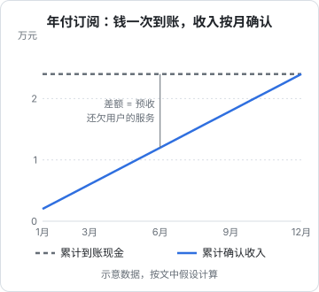
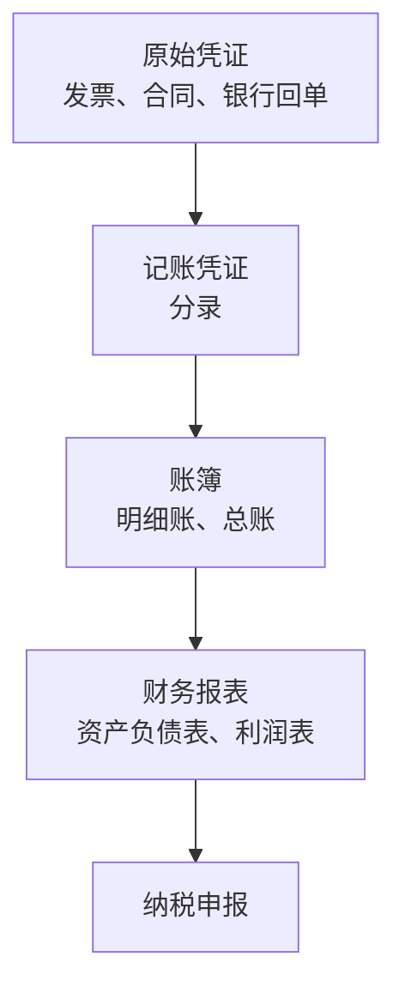

# 记账基础

**这本书讲什么**：一个人开公司以后，除了写代码、做产品，还多了一个躲不掉的角色：老板兼财务。这本书面向中国大陆的**个体工商户**和**一人有限责任公司**，讲清楚四件事的框架：账怎么记、税有哪些、发票怎么开和收、现金怎么管，再加上「个人和公司的钱分开」以及「记账工具与代账」两个实操话题。

**适合谁**：会写代码、刚注册或准备注册主体、对会计和税务几乎零基础的独立开发者。读完你不会变成会计，但能看懂代账给你的报表，知道哪些事必须按时做、哪些钱不能乱动、什么时候该花钱请专业的人。

**怎么读**：第 1 章打基础（会计的基本语言），第 2、3 章是税和发票，第 4 章讲现金流（和政策无关，最值得反复读），第 5 章讲公私分开，第 6 章讲工具和代账。建议按顺序读一遍，之后遇到具体问题再回头查。

> [!WARNING]
> 税率、起征点、小规模纳税人标准和各种减免优惠几乎每年调整、各地口径不一，本书**刻意不写具体数字**，只讲结构、流程和判断方法，按截至 2026 年 11 月的规定整理。涉及金额较大、结构复杂（股权、跨境、融资、注销）的事情，请找代账会计或税务师，以国家税务总局和当地税务机关的最新规定为准。

主体怎么选、怎么注册，见[《国内合规实务》](../opc-compliance-cn/)；这本书默认你已经有了主体，或者正在二选一。

## 为什么工程师也要懂一点记账

很多开发者的想法是：反正有代账，我只管赚钱。这个想法对了一半。代账会帮你把账做出来、把税报上去，但有三件事他们替你做不了：

1. **判断业务该怎么做**。一笔钱是走工资还是分红、是年付还是月付、收海外用户的钱从哪个账户进，这些决定发生在记账之前，代账只能事后记录
2. **提供原始凭证**。代账拿到什么就记什么。你不给发票、不给合同、不说明这笔转账是什么，账就是错的
3. **看懂经营状况**。代账交给你的利润表和资产负债表，如果你看不懂，它们就只是报税的副产品，而不是经营的仪表盘

所以目标不是学会做账，而是**能和代账用同一种语言对话**，并且自己能看清公司的钱。

## 会计恒等式：一切的起点

会计只有一个核心等式：

$$
\text{资产} = \text{负债} + \text{所有者权益}
$$

- **资产**：公司拥有或控制的、能带来经济利益的东西。银行存款、别人欠你的钱（应收账款）、买的电脑
- **负债**：公司欠别人的。欠供应商的钱、预收了用户但还没提供的服务、还没交的税
- **所有者权益**：剩下的部分，属于你（股东）。包括你投进去的注册资本和公司赚的、还没分走的利润

这个等式**永远成立**。任何一笔业务都会让等式两边同时变化，或者让一边内部此增彼减。举几个例子：

| 业务 | 资产 | 负债 | 所有者权益 |
|---|---|---|---|
| 你向公司实缴注册资本 | 银行存款 增加 | — | 实收资本 增加 |
| 公司买一台开发用电脑 | 银行存款 减少，固定资产 增加 | — | — |
| 用户预付一年订阅费 | 银行存款 增加 | 预收（合同负债）增加 | — |
| 每月提供服务，确认收入 | — | 预收 减少 | 利润 增加 |
| 付这个月的云服务费 | 银行存款 减少 | — | 利润 减少（费用） |
| 计提本季度应交的税 | — | 应交税费 增加 | 利润 减少 |

注意「买电脑」这一行：钱少了，但公司并没有变穷，只是现金换成了设备。这就是为什么**利润不等于现金变化**，第 4 章会专门讲。

## 收付实现制与权责发生制

记账有两种确认收入和费用的时点：

| | 收付实现制 | 权责发生制 |
|---|---|---|
| 收入什么时候算 | 钱到账的时候 | 服务提供、商品交付的时候 |
| 费用什么时候算 | 钱付出去的时候 | 费用归属的那个期间 |
| 优点 | 简单直观，和银行流水一致 | 能反映真实经营成果 |
| 典型使用者 | 个人记账、部分简易建账 | 企业会计准则、小企业会计准则 |

一人有限公司适用的是会计准则体系（小微企业通常适用《小企业会计准则》），按**权责发生制**记账。个体户的建账要求相对宽松，具体按当地税务机关的要求执行。

对 SaaS 和 App 开发者来说，权责发生制最常见的影响是**年付订阅**：用户 1 月一次付了一年的钱，这笔钱在会计上是按 12 个月分摊确认收入的，没确认的部分挂在负债里（「预收账款」或「合同负债」，取决于适用的准则和代账的处理）。



这个例子假设 1 月卖出 100 份年付订阅，每份 240 元，共 2.4 万元一次到账，之后每月确认 2000 元收入。到 6 月底，公司手里有 2.4 万现金，但只「赚」了 1.2 万，另外 1.2 万是还欠用户的服务。

## 复式记账：每笔业务记两次

**复式记账**的意思是：每笔业务至少影响两个账户，金额相等、方向相反。中国企业使用**借贷记账法**，「借」和「贷」只是左右两边的记号，不要按字面理解成借钱贷款。

规则可以记成一张表：

| 账户类型 | 增加记在 | 减少记在 |
|---|---|---|
| 资产、费用 | 借方 | 贷方 |
| 负债、所有者权益、收入 | 贷方 | 借方 |

口诀是**有借必有贷，借贷必相等**。比如「付这个月的云服务费 500 元」：

```text
借：管理费用——云服务费       500
    贷：银行存款                 500
```

「用户预付年费 240 元，支付渠道扣了手续费 X 元」：

```text
借：银行存款                 240 - X
借：财务费用——手续费         X
    贷：合同负债（预收账款）     240
```

这里的手续费科目只是常见做法之一，具体挂哪个科目以代账的处理为准。你不需要自己写分录，但看到代账的凭证时，要能认出每一行在说什么。

## 凭证、账簿、报表

会计工作的流水线是：



- **原始凭证**是证据：发票、合同、银行回单、支付平台账单、工资表。这一层由你提供，质量决定一切
- **记账凭证**把原始凭证翻译成分录
- **账簿**按科目汇总
- **报表**是给外部（税务、银行、投资人）和你自己看的结果

原始凭证和账簿要按规定保存一定年限，具体年限以《会计档案管理办法》等规定为准。电子发票、电子回单可以电子化归档，但要确保能完整导出、不可篡改。

## 三张报表看什么

| 报表 | 回答什么问题 | 时间性质 | 你重点看 |
|---|---|---|---|
| 资产负债表 | 此刻公司有什么、欠什么 | 某个时点 | 货币资金、应收账款、应交税费、其他应收款（股东借款） |
| 利润表 | 这段时间赚了还是亏了 | 一段期间 | 营业收入、各项费用、利润总额 |
| 现金流量表 | 这段时间钱从哪来、到哪去 | 一段期间 | 经营活动现金流是正是负 |

小企业日常报税时，现金流量表不一定每期都要报，但你自己应该每月看现金（第 4 章用一张简单的表格代替它）。

资产负债表里有一个科目要特别留意：**其他应收款**。如果这里挂着一大笔「应收股东」，通常意味着你从公司拿了钱没有合法名目，第 5 章会讲它的风险。

## 软件开发者常用的科目

科目表很长，但一个做软件、卖订阅的一人公司常用的就这些：

| 类别 | 科目 | 例子 |
|---|---|---|
| 资产 | 银行存款 | 对公账户余额 |
| 资产 | 其他货币资金 | 支付平台里还没提现的余额（是否这样处理以代账为准） |
| 资产 | 应收账款 | 外包客户还没付的款 |
| 资产 | 固定资产 | 达到一定金额标准的电脑、设备 |
| 负债 | 合同负债 / 预收账款 | 年付订阅中未提供服务的部分 |
| 负债 | 应付职工薪酬 | 给自己发的工资（有限公司） |
| 负债 | 应交税费 | 已计提未缴纳的各种税 |
| 权益 | 实收资本 | 你实际缴进公司的注册资本 |
| 权益 | 未分配利润 | 历年赚的、还没分走的钱 |
| 收入 | 主营业务收入 | 订阅、买断、外包服务 |
| 费用 | 管理费用 / 销售费用 | 云服务、域名、软件订阅、推广费 |
| 费用 | 财务费用 | 银行手续费、支付渠道手续费 |

## 个体户和一人有限公司的记账差异

> [!WARNING]
> 建账要求和征收方式按截至 2026 年 11 月的规定整理，个体户建账标准和核定征收范围各地执行不同；以财政部、国家税务总局的最新规定和主管税务机关的要求为准。

| | 个体工商户 | 一人有限公司 |
|---|---|---|
| 会计制度 | 建账要求相对简单，有的地方允许简易建账 | 按会计准则建账，需要完整的账簿和报表 |
| 是否必须有账 | 视征收方式而定（查账征收要建账，核定征收要求较低） | 必须建账 |
| 公私边界 | 法律上经营者对债务承担无限责任，但账上仍要分清 | 公司是独立法人，公私混同风险很大 |
| 年度事项 | 经营所得个税汇算、年报 | 企业所得税汇算清缴、年报、可能的审计要求 |

不论哪种，**「不用做账」都是一种误解**。即使是核定征收的个体户，也应该留着收支记录：将来转查账、申请贷款、核对收入，都用得上。

## 一个月的最小记账流程

不管是自己记还是交给代账，你每个月要做的事都差不多：

1. **月初前几天**：导出上月银行流水、支付平台账单（微信支付、支付宝、App Store、Stripe 等）
2. **收集凭证**：把上月所有进项发票、合同、付款截图放到一个约定好的文件夹，按月命名
3. **标注**：流水里每一笔看不出用途的，写一句说明（「客户 A 第二期款」「Cloudflare 年费」）
4. **交给代账**，或者导入自己的记账工具
5. **看结果**：代账做完后，看一眼利润表和应交税费，有疑问当月问清

第 6 章会把这个流程做成具体的文件夹结构和脚本。

## 本章要点

- 本书只讲框架，不写具体税率和门槛；政策以当年官方规定为准，重大事项找代账或税务师
- **资产 = 负债 + 所有者权益**，任何业务都不会破坏这个等式
- 有限公司按**权责发生制**记账；年付订阅收到的钱要分期确认收入，没确认的部分是负债
- 复式记账「有借必有贷，借贷必相等」，看得懂分录就能和代账对话
- 原始凭证由你提供，它的质量决定账的质量
- 三张报表：资产负债表看此刻，利润表看盈亏，现金流量表看钱的流向
- 个体户和一人有限公司的建账要求不同，但都不能「不记账」
