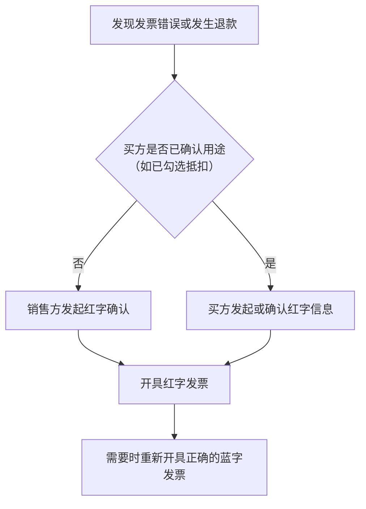

# 发票

在中国做生意，发票不只是一张收据。它是增值税抵扣的凭证、企业所得税前扣除的主要凭证、收入申报的数据来源，也是税务机关监控交易的核心工具。对一人公司来说，发票问题分成两头：**开出去的**（你的销售）和**收进来的**（你的成本）。这一章讲两头各自要注意什么，以及软件开发者特有的几类麻烦：订阅收入、平台分成和海外服务。

> 发票的种类、开具方式、红字处理流程近年变化很大，各地推行节奏也不完全同步。本章讲的是稳定的原则和流程框架，具体操作以电子税务局的实际界面和当地税务机关的规定为准。

## 发票的类型

### 按增值税用途分

| 类型 | 能否用于抵扣进项 | 谁需要 |
|---|---|---|
| 增值税专用发票 | 能（买方是一般纳税人时） | 一般纳税人企业客户通常会要 |
| 增值税普通发票 | 一般不能 | 个人消费者、小规模纳税人客户、不需要抵扣的企业 |

两者都可以作为企业所得税税前扣除的凭证。区别只在于增值税能否抵扣。

### 按载体分：数电发票

过去的发票有纸质、税控设备开具的电子发票等多种形态。现在全国推行的是**全面数字化的电子发票**（简称数电发票，推广初期也叫全电发票），它的特点是：

- 不需要税控设备和税控盘，在电子税务局里直接开
- 不需要领用发票，按「额度」管理，税务机关根据纳税人情况动态调整开票额度
- 开出后自动交付到买方的税务数字账户，买方在电子税务局里就能看到
- 以电子形式为主，可以下载为 PDF、OFD、XML 等格式

对一人公司来说，数电发票大大降低了开票门槛：注册完成、税务登记后，在电子税务局里就能开票，不用再买设备。具体开通情况以你所在地区为准。

## 开票：你的销售

### 什么时候开

增值税的纳税义务发生时间和开票时间有关，基本原则是：**收讫销售款或取得索取销售款凭据的当天**，先开发票的为开票当天。所以：

- 收到钱就产生了纳税义务，不管开没开票
- 先开票后收钱，开票时就产生纳税义务

对 B2B 外包或定制开发，常见的做法是按合同里程碑开票。要注意：开了票但客户迟迟不付款，你可能已经要为这笔收入交税了（第 4 章「账期」一节会讲它对现金的影响）。

### 开票要填什么

| 字段 | 注意事项 |
|---|---|
| 购买方名称和纳税人识别号 | 企业客户必须准确，填错要红冲重开 |
| 项目名称 | 必须和实际业务一致，按规定选择税收分类编码 |
| 规格型号、单位、数量 | 软件服务通常按「项」或按期间 |
| 金额、税率或征收率、税额 | 系统根据你的纳税人身份和编码自动带出 |
| 备注 | 某些业务有特定备注要求 |

**税收分类编码**是新手最容易选错的地方。软件开发、技术服务、信息技术服务、软件产品销售、广告服务……它们的编码和适用税率不同。第一次开某类业务的发票前，问一次代账该选哪个编码，之后照着开。

### 不能开的发票

**发票必须如实开具，业务、金额、对象三者都要真实**。下面这些是违法的，不管客户怎么说：

- 没有真实业务，为别人开票（虚开）
- 业务真实，但开的项目名称和实际不符（比如把餐饮开成技术服务）
- 金额多开
- 让别人替你开，或者你替别人开

虚开发票在刑法上有专门的罪名，不是交点罚款就能了事的问题。客户提这种要求时，直接拒绝。

### 开错了怎么办

发票开错了不能直接作废重开（数电发票的处理方式和过去纸质发票不同），而是要开**红字发票**冲销原票，再开一张正确的。红字发票的流程大致是：



具体由谁发起、是否需要对方确认，以电子税务局的实际流程为准。实践中只要记住：**开票前多核对一遍抬头和税号**，能省掉大部分麻烦。

## 订阅和 App 收入怎么开票

面向消费者的订阅产品，开票逻辑和 B2B 不一样。

### 个人用户

个人用户通过 App 内购或网页支付订阅时，大多数人不会要发票。但不要票不等于不用申报：**没开票的收入同样要申报纳税**，在增值税申报表里有专门的「未开具发票」栏次。

有用户要发票时，可以在产品里提供一个开票申请入口，收集抬头、税号（个人可以不填税号）、邮箱，然后在电子税务局里开出，发到用户邮箱。量大的时候可以考虑对接第三方开票服务的 API，这类服务通常要求你授权它代你开票，选择时注意数据安全。

一个可以直接用的申请表结构：

```ts
// 开票申请：只存开票需要的最少字段
type InvoiceRequest = {
  orderId: string;          // 关联到哪笔订单，一笔订单只能开一次
  buyerType: 'personal' | 'company';
  title: string;            // 抬头：个人姓名或企业全称
  taxId?: string;           // 企业必填，个人可空
  email: string;            // 发票交付邮箱
  amount: number;           // 以订单实付金额为准，单位：分
  status: 'pending' | 'issued' | 'rejected';
  issuedAt?: string;
  invoiceNo?: string;       // 开出后回填发票号码，便于对账
};
```

关键约束是**一笔订单只开一次、金额不超过实付金额**，退款时要先确认对应发票是否需要红冲。

### App Store 和应用商店分成

通过 App Store 收款时，资金流是这样的：用户付款给 Apple，Apple 扣除佣金后按结算周期付款给你。这里有几个需要和代账确认的问题：

- **收入按什么口径确认**：按用户支付的总额，还是按 Apple 结算给你的净额。不同理解会影响收入和成本的记账
- **佣金有没有合规凭证**：Apple 是境外主体，不会给你开中国的增值税发票。没有发票的成本，能否税前扣除、用什么凭证，需要按相关规定处理
- **汇率和结算时间**：结算货币、到账时间和汇率差异怎么入账

国内安卓应用商店（境内主体）的分成一般能取得国内发票，处理起来简单一些。

这类问题的答案和你的具体主体、合同条款、当地执行口径有关，**不要自己猜，让代账给出处理方案并书面记录下来**。出海相关的更多细节见[《出海实务》](../going-global/)。

### 支付平台手续费

微信支付、支付宝等支付渠道会从每笔交易中扣除手续费，结算到你账户的是净额。正确的做法是：

- 收入按交易总额记，手续费单独记为费用
- 定期从支付平台的商户后台申请手续费发票（各平台都有入口），作为费用凭证

如果只按到账净额记收入，会导致收入申报偏低，和平台报送的交易数据对不上。

## 收票：你的成本

### 哪些支出要拿发票

一人软件公司常见的支出和取票方式：

| 支出 | 能否取得国内发票 | 备注 |
|---|---|---|
| 国内云服务（阿里云、腾讯云等） | 能，在控制台申请 | 注意抬头选公司，不要选个人 |
| 域名、证书（国内注册商） | 能 | 同上 |
| 电脑、显示器等设备 | 能，购买时要求开公司抬头 | 达到固定资产标准的要分期折旧 |
| 办公场地、联合办公 | 能 | 租赁合同和发票都要留 |
| 国内 SaaS（协作、设计工具的国内版） | 通常能 | |
| 海外 SaaS（GitHub、Cloudflare、AI 订阅等） | 不能 | 只有 invoice 或 receipt，见下文 |
| 外包、兼职 | 对方是企业可开；个人需要代开或按劳务报酬处理 | 付给个人可能涉及代扣个税 |
| 差旅、餐饮 | 能 | 要与经营相关，餐饮的扣除有限制 |

一个实用的习惯：**在每个能开票的平台上，把默认抬头设置成公司**。很多云服务平台默认按个人认证，事后改开发票很麻烦。

### 海外服务的发票问题

对重度使用海外开发工具的独立开发者，这是绕不开的问题。GitHub、Cloudflare、Vercel、各类 AI API 和订阅，都只能给你境外的 invoice，不是中国的发票。

需要和代账讨论的点：

1. **能否作为税前扣除凭证**。境外取得的支出，在满足一定条件下可以用对方开具的单据作为凭证，具体以相关规定为准
2. **是否涉及代扣代缴义务**。向境外支付某些服务费用，境内付款方可能负有代扣代缴增值税、企业所得税的义务。金额小的时候常常被忽略，但规则上是存在的
3. **付款方式**。用公司的外币卡付款，还是用个人信用卡付了再报销。后者会让凭证链条更复杂

单笔金额不大时，很多代账会给出一种简化处理方式。不管选哪种，要点是**留下完整的记录**：invoice PDF、付款记录、这项服务用于什么业务的说明。

## 发票的管理

### 存档

数电发票本身就是电子的，但你仍然应该自己存一份：

```bash
# 按年 / 月 / 方向建目录：out 开出的发票，in 收到的发票，foreign 海外 invoice 和付款记录
for m in $(seq -w 1 12); do mkdir -p "finance/2026/$m"/{out,in,foreign}; done
```

文件名带上日期、对方、项目，方便检索：

```text
finance/2026/10/out/2026-10-08_客户A_技术服务.pdf
finance/2026/10/in/2026-10-03_阿里云_云服务.pdf
finance/2026/10/foreign/2026-10-01_Cloudflare_invoice.pdf
```

除了 PDF，最好同时保存 XML 或 OFD 原件，因为 PDF 只是展示件，结构化数据在原件里。

### 查验真伪

收到发票后，可以在国家税务总局的全国增值税发票查验平台上查验。数电发票也可以在电子税务局的税务数字账户里看到所有开给你的发票。对于大额发票或者陌生供应商的发票，**一定要查验**：取得虚开的发票，即使你不知情，也可能面临进项转出和补税。

### 和收入对账

每月做一次三方对账：

| 来源 | 数据 |
|---|---|
| 支付平台和银行 | 实际到账 |
| 电子税务局 | 开出的发票合计 |
| 业务系统 | 订单和退款 |

三者之间的差异要能解释：没开票的个人订单、跨月的开票、退款红冲。解释不了的差异，就是潜在的风险点。

## 本章要点

- 发票既是抵扣凭证、扣除凭证，也是税务监控的核心数据
- 专用发票能抵扣进项，普通发票一般不能；两者都可作为所得税扣除凭证
- **数电发票**不需要税控设备，在电子税务局按额度开具，自动交付到买方账户
- 纳税义务和收款、开票有关，**没开票的收入也要申报**
- 发票必须如实开具，**虚开是刑事风险**
- 开错了用红字发票冲销，开票前多核对抬头和税号
- App Store 分成、支付手续费、海外服务费是软件开发者特有的难点，让代账给出书面处理方案
- 在每个平台把开票抬头设为公司；所有票据按年月分类存档，保留 XML 或 OFD 原件
