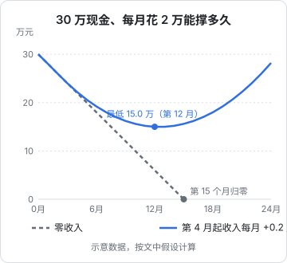
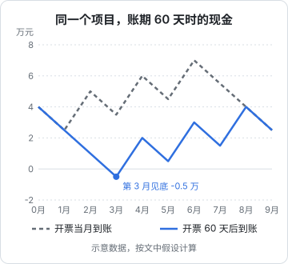
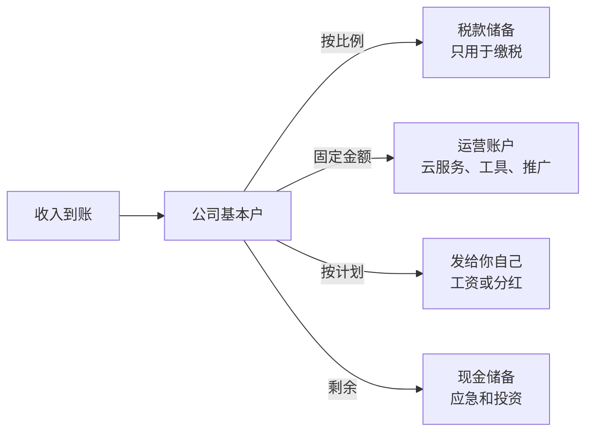

# 现金流

公司不是因为亏损而倒闭的，是因为**没钱了**才倒闭的。账面盈利但现金断裂、发不出工资付不了服务器的公司很多；连续亏损但账上有钱、一直撑到找到方向的公司也很多。对一人公司来说，现金流就是你还能继续做这件事的时间。

这一章是全书唯一不依赖税收政策的一章，讲的是任何时候都成立的道理：利润和现金为什么不同步、怎么算跑道、怎么做一张够用的现金预测表、以及怎么给税款和意外留出余量。

## 利润不等于现金

第 1 章讲过，有限公司按权责发生制记账，利润表反映的是「挣了多少」，而不是「钱进来多少」。两者之间差在哪里？

| 情况 | 对利润的影响 | 对现金的影响 |
|---|---|---|
| 用户预付年费 | 按月分摊确认，当月只算一小部分 | 一次性全额进账 |
| 外包项目开票，客户 60 天后付款 | 开票（交付）时确认收入 | 60 天后才进账 |
| 买一台电脑 | 分几年折旧，每月只算一点费用 | 一次性全额付出 |
| 计提但还没缴的税 | 已经减少利润 | 申报期才付出 |
| 你向公司投入资本 | 不影响利润 | 现金增加 |
| 公司给你分红 | 不影响利润 | 现金减少 |
| App Store 结算 | 按交易确认收入 | 按结算周期，晚一段时间才到账 |

所以看经营要看两张表：利润表告诉你**生意是否成立**，现金表告诉你**还能撑多久**。早期一人公司更该盯的是后者。

## 跑道：你还能撑几个月

**跑道**（runway）是创业圈最常用的现金指标：

$$
\text{跑道（月）} = \frac{\text{当前可用现金}}{\text{月净消耗}}
$$

其中：

$$
\text{月净消耗} = \text{月现金支出} - \text{月现金收入}
$$

当净消耗为负（收入大于支出），跑道就是无限的，这时候叫做**现金流为正**（cash flow positive），也就是常说的「能自己养活自己」。

### 一人公司的「支出」要算全

计算跑道时最常见的错误，是只算了公司账上的支出，忘了**你自己也要吃饭**。对一人公司，月支出应该包括：

- 公司的经营支出：云服务、域名、软件订阅、推广、代账费
- 公司层面的税费：按收入预估的增值税及附加、所得税
- 你自己的生活开支（不管以工资、分红还是其他方式从公司拿）
- 社保、医保（不管是公司缴还是自己以灵活就业方式缴）

[《一人公司方法论》](../opc-playbook/)里讲过「最低可行收入」，这里的生活开支就是它的现金视角。

### 两种场景对比

下图假设可用现金 30 万元、每月总支出 2 万元，对比两种情况：一种是完全没有收入，另一种是从第 4 个月开始有收入，并且每月比上月多 2000 元。



两条线说明了两件事：

1. **零收入时，跑道就是简单的除法**：30 ÷ 2 = 15 个月
2. **哪怕增长很慢，只要持续，就能把跑道拉成无限**。第二种情况在第 13 个月左右收入追平支出（月收入 2 万），之后现金开始回升。但它也消耗掉了一半的储备，如果增长比预期更慢，余量就不多了

跑道最大的作用是**给决策设定截止时间**：「如果第 9 个月时月收入还不到 X，就开始接外包补现金流」比「再坚持看看」好得多。

## 账期：开了票不等于有钱

做 B2B 外包或定制开发的一人公司，最常见的现金危机来自**账期**：工作做完了、发票开了，客户按合同 30 天、60 天甚至更久之后才付款，而你这期间的支出照常发生。

下图是一个例子：期初现金 4 万元，每月支出 1.5 万元，项目在第 2、4、6 个月各有一个里程碑，每次开票 4 万元。



两种情况下项目总收入完全一样，利润表也完全一样，但账期 60 天时，第 3 个月的现金是负数：你需要从别处垫钱，或者那个月的账单付不出去。

还要叠加一个税务因素：第 3 章讲过，开票时就产生了增值税纳税义务。如果你在第 2 个月开票、客户第 4 个月才付款，**中间那个申报期你可能要先垫付这张发票的税**。

应对账期的几种办法：

| 办法 | 怎么做 |
|---|---|
| 预付款 | 合同签订后先收一部分款再开工，这是最有效的 |
| 缩短里程碑间隔 | 把大项目拆成更多、更小的付款节点 |
| 合同里写清付款期限 | 并约定逾期付款的处理方式 |
| 按收款进度开票 | 和客户协商「付款后开票」，前提是客户接受 |
| 跟进催款 | 到期前提醒，到期后立刻跟进，别不好意思 |
| 留足现金缓冲 | 至少能覆盖最长账期内的全部支出 |

## 订阅业务的现金节奏

订阅业务的现金节奏和项目制正好相反：年付订阅让钱**提前**进来。第 1 章的图展示了这一点：用户一次性付了一年的钱，但公司欠着用户 12 个月的服务。

这带来一种危险的错觉：年付用户多的时候，账上的钱看起来很多，但其中一大块是**预收的、尚未提供服务的钱**。如果你按账上余额来安排开支，一旦续费率下滑，就会发现明年的服务成本已经没有钱覆盖。

几条实用原则：

- 区分「可自由支配的现金」和「预收但未消耗的部分」，后者至少要留出覆盖剩余服务期成本的金额
- 年付打折可以改善现金流，但不要为了现金流把折扣打得太深，损失的是长期收入
- 留意退款政策：允许退款的年付，预收部分在退款期内都可能流出

### 平台结算的延迟

通过应用商店收款时，到账时间要比交易时间晚一段时间：通常是在财务月结束后经过一个结算周期才付款，具体以 App Store Connect 等后台的付款说明为准。另外还要扣除平台佣金、可能涉及汇率换算和银行手续费。

做现金预测时，**收入那一行要按「预计到账日」填，而不是按交易日填**。

hatch-counter 走的是另一条路：早期客户少，续费是线下转账，在管理后台手工确认收款。这种方式没有平台佣金和结算延迟，现金到账快，代价是每一笔都要人工处理。客户量小的时候，这是合理的取舍。

## 一张够用的现金预测表

不需要复杂的财务模型。一张按周或按月滚动的表格就够用，它只回答一个问题：**未来每个时间点账上还有多少钱**。

按月的版本如下（金额单位：元，示意）：

| 项目 | 11 月 | 12 月 | 1 月 | 2 月 |
|---|---|---|---|---|
| 期初现金 | 120,000 | 108,500 | 101,000 | 85,500 |
| + 订阅到账（按预计到账月） | 6,000 | 6,500 | 7,000 | 7,500 |
| + 项目回款 | 0 | 10,000 | 0 | 20,000 |
| − 云服务和工具 | 1,500 | 1,500 | 1,500 | 1,500 |
| − 代账费 | 500 | 500 | 500 | 500 |
| − 你的生活开支 | 12,000 | 12,000 | 12,000 | 12,000 |
| − 社保医保 | 3,500 | 3,500 | 3,500 | 3,500 |
| − 季度税款（预估） | 0 | 0 | 5,000 | 0 |
| − 年度支出（域名、设备等） | 0 | 6,500 | 0 | 0 |
| **期末现金** | **108,500** | **101,000** | **85,500** | **95,500** |

几个要点：

- **只填现金**：按钱实际进出的时间填，不按开票时间和确认收入时间
- **年度支出要提前放进去**：域名续费、Apple 开发者年费、年付工具订阅，这些容易被忘记的大额支出最容易造成意外
- **税款单独一行**：按申报周期，在缴款月份填入预估金额
- **每月更新一次**：把上月的预测值换成实际值，再往后滚动一个月

如果你更喜欢代码而不是表格，下面这段 TypeScript 可以从一个 JSON 里算出逐月现金和跑道：

```ts
// cash-forecast.ts：node --experimental-strip-types cash-forecast.ts（Node 22.6+）
type Month = { label: string; inflow: number; outflow: number };

function forecast(opening: number, months: Month[]) {
  let cash = opening;
  return months.map((m) => {
    cash += m.inflow - m.outflow;
    return { ...m, closing: cash };
  });
}

function runwayMonths(cash: number, monthlyNetBurn: number): number {
  if (monthlyNetBurn <= 0) return Infinity; // 现金流为正
  return cash / monthlyNetBurn;
}

const months: Month[] = [
  { label: '2026-11', inflow: 6000, outflow: 17500 },
  { label: '2026-12', inflow: 16500, outflow: 24000 },
  { label: '2027-01', inflow: 7000, outflow: 22500 },
  { label: '2027-02', inflow: 27500, outflow: 17500 },
];

const rows = forecast(120000, months);
console.table(rows);

const last = rows.at(-1)!;
const avgBurn = rows.reduce((s, r) => s + (r.outflow - r.inflow), 0) / rows.length;
console.log(`期末现金 ${last.closing}，平均月净消耗 ${avgBurn.toFixed(0)}，跑道约 ${runwayMonths(last.closing, avgBurn).toFixed(1)} 个月`);
```

用这组数据运行，期末现金是 95,500 元，四个月平均净消耗 6,125 元，跑道约 15.6 个月。

## 给税款单独留钱

税款是一人公司最容易「花掉」的钱：它在你账上躺着，但不属于你。一个简单有效的习惯是**每笔收入到账时，按一个比例转入单独的「税款储备」**。

比例怎么定？按你所在主体类型和规模，让代账帮你估一个**综合税负率**（全年预计各项税费合计 ÷ 全年预计收入），再加一点余量。不需要很精确，宁可多留。到申报期，从储备里缴税，年底多出来的再转回。



这个思路有时叫「先分配再花」：钱进来先分到不同的桶里，每个桶只用于它的用途。银行允许的话，可以开立一般存款账户或者使用银行的子账户功能来物理隔离；不行的话，至少在表格里分开记。

## 留多少应急金

对一人公司，建议同时有两层缓冲：

| 层级 | 放在哪 | 建议覆盖 | 用途 |
|---|---|---|---|
| 公司现金储备 | 公司账户 | 若干个月的公司经营支出 | 收入波动、账期、意外的大额支出 |
| 个人应急金 | 个人账户 | 若干个月的个人生活开支 | 公司暂时发不出钱时，你还能生活 |

具体覆盖几个月，取决于你的收入稳定程度、家庭负担和风险偏好。收入越不稳定（项目制、季节性），缓冲越要厚。重要的是**两层分开**：个人应急金不是公司的备用金，公司缺钱时动用它，应该是一个经过思考的决定，而且要以合规的方式（比如增资或股东借款）投入公司，留下记录。

## 每月的现金复盘

每月花半小时，回答四个问题：

1. 这个月实际进了多少钱、出了多少钱？和预测差多少？为什么？
2. 当前跑道还有几个月？比上个月长了还是短了？
3. 有哪些应收款到期没收到？
4. 未来三个月有哪些已知的大额支出？

把答案写在预测表旁边。坚持几个月，你会对自己的生意有完全不同的掌控感。

## 本章要点

- 公司死于现金断裂，不是死于亏损；早期要盯现金胜过盯利润
- 利润和现金的差异来自预收、账期、折旧、税款计提、结算延迟等
- **跑道 = 可用现金 ÷ 月净消耗**；一人公司的支出要算上你自己的生活费和社保
- 跑道的价值是给决策设定截止时间
- B2B 账期会在利润不变的情况下制造现金缺口，用预付款和小里程碑应对
- 年付订阅让钱提前进来，但预收部分不能当成可自由支配的现金
- 用一张按到账时间填写、每月滚动的现金预测表管理现金
- 收入到账先按比例转入**税款储备**，公司储备和个人应急金分开
