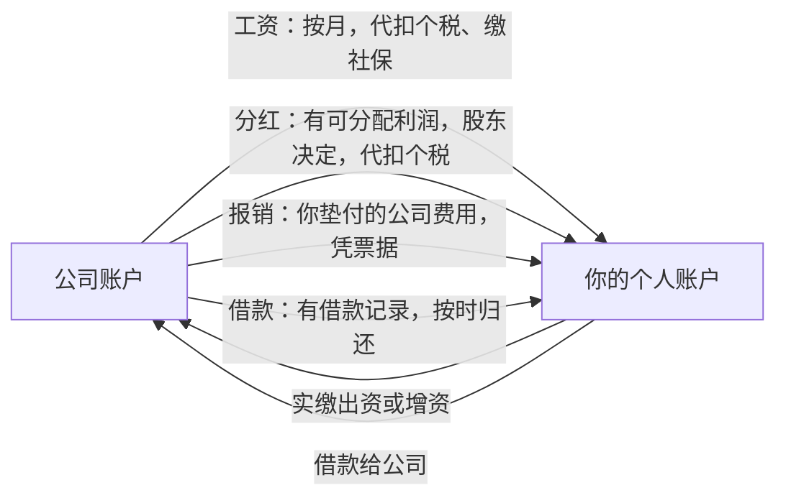

# 个人与公司的钱分开

一人公司最大的财务风险，不是算错税，而是**公私不分**：客户的钱打到你的微信里，公司的服务器用你的信用卡付，月底从公司账户转一笔钱给自己「当生活费」。一个人做事，这些操作都很顺手，也看起来没伤害任何人。但它们会同时带来法律风险、税务风险和管理上的混乱。

这一章讲清楚为什么要分、分到什么程度，以及一套照着做就能分清楚的规则。

## 为什么必须分开

### 法律：有限责任可能失效

> [!WARNING]
> 一人公司股东的举证责任规则按 2024 年 7 月 1 日起施行的《公司法》整理，以国家法律法规数据库的最新文本和法院的裁判口径为准。

注册有限公司的一个重要理由是**有限责任**：公司的债务以公司财产为限，不会追到你个人的房子和存款。但这个保护是有前提的。

《公司法》对只有一个股东的公司有专门的规定：**股东不能证明公司财产独立于股东自己的财产的，应当对公司债务承担连带责任**。也就是说，一旦公司欠了债、被债权人起诉，举证责任在你：你要拿出证据证明公司的钱和你的钱是分开的。证明不了，有限责任就形同虚设。

最有力的证据就是：独立的对公账户、规范的账簿和年度财务报告、每一笔公私之间的资金往来都有合法名目和记录。

个体户本来就是经营者对债务承担无限责任，没有这层「证明」的问题。但这不代表个体户可以混着用：分开管理照样是算清经营成果、应对税务核查的前提。

### 税务：收入和成本都说不清

- **用个人账户收经营款**：这部分收入如果没有申报，就是少报收入；即使你申报了，个人账户里经营款和私人往来混在一起，核查时很难自证
- **用公司的钱付私人开支**：私人消费不能作为公司成本扣除；如果计入了公司费用，就是虚列成本
- **从公司账户随意转钱给自己**：没有工资或分红的名目，税务上可能被认定为变相分配利润，需要补缴个人所得税

第 2 章提过，税务系统的数据比对能力越来越强。个人账户频繁收到大量来自不同人的小额转账，本身就是常见的风险特征。

### 管理：你看不清自己的生意

钱混在一起，你就无法回答最基本的问题：这个月公司到底赚了多少？产品的真实成本是多少？我从公司拿了多少？没有这些数字，定价、扩张、放弃的判断都是在猜。

## 账户怎么设

### 一人有限公司

| 账户 | 用途 | 说明 |
|---|---|---|
| 对公基本存款账户 | 所有经营收入和支出 | 公司开户后的主账户，缴税、发工资、对公转账都走这里 |
| 一般存款账户（可选） | 税款储备、现金储备 | 按需开立，用来物理隔离不同用途的钱；也可以用银行的子账户功能 |
| 支付平台商户账户 | 线上收款 | 以公司主体开通，结算到对公账户 |
| 公司名下的信用卡或外币卡（可选） | 支付海外服务 | 让海外 SaaS 的付款直接从公司走，凭证链更清楚 |
| 你的个人账户 | 你的工资、分红、报销款，以及所有私人开支 | 公司的钱到这里，必须有名目 |

### 个体工商户

个体户可以开对公账户，也有不少直接用经营者个人账户经营。如果用个人账户，**至少专门办一张卡只用于经营**：所有经营收入进这张卡，所有经营支出从这张卡出，私人开支一律用另一张卡。这样经营流水是干净的，记账和核查都简单。

### 数字资产也要归属清楚

对开发者，「钱」之外还有一类经常被忽略的资产：账号。

| 资产 | 建议归属 |
|---|---|
| Apple 开发者账号 | 有公司后，以公司身份注册组织账号（需要相应资质，以 Apple 当前要求为准） |
| 域名 | 注册人信息填写公司 |
| 云服务账号 | 以公司实名认证，发票抬头才能开给公司 |
| 支付平台商户号 | 以公司主体开通 |
| 代码仓库、设计稿 | 放在公司名义的组织下，而不是你的个人账号 |
| 软件著作权、商标 | 以公司名义申请或转让给公司 |

这些资产归属于公司，一方面让对应的费用可以合规地作为公司成本，另一方面将来如果出售业务、引入合伙人，资产边界是清楚的。

## 钱从公司到个人：只有四条路

第 2 章从税的角度讲过这四条路，这里从「怎么操作」的角度再讲一次。

### 工资

> [!WARNING]
> 工资的个税代扣、社保和公积金缴纳要求按截至 2026 年 11 月的规定整理，各地社保基数和公积金政策每年调整；以国家税务总局和当地人社、住房公积金管理部门的最新规定为准。

一人有限公司可以给你（作为员工）发工资。要点：

- 签劳动合同或明确任职关系，按月发放，公司代扣代缴个人所得税
- 同时要按规定缴纳社保和公积金（公积金各地要求不同）
- 工资水平要合理，与你的实际工作和公司的经营状况相符

个体户业主从经营所得里拿钱不叫工资，就是经营所得本身，已经通过经营所得个税交过税了。所以个体户把经营卡里的钱转到个人消费卡，只要经营所得如实申报了，一般没有额外的税务问题。但这仍然应该是一笔有记录的转账，而不是随手刷经营卡买东西。

### 分红

> [!WARNING]
> 利润分配和股息红利个税按截至 2026 年 11 月的《公司法》和个人所得税规定整理，以国家法律法规数据库的最新文本和国家税务总局最新公告为准。

有限公司的税后利润可以分配给股东。流程是：

1. 年度结束、确认有**可分配利润**（弥补以前年度亏损、按规定提取公积金之后）
2. 作出股东决定（一人公司由唯一股东书面作出），写明分配金额
3. 公司代扣代缴股息红利个人所得税
4. 把税后金额转到你的个人账户

分红是从税后利润里分，不能分「还没赚到的钱」，也不能把注册资本当利润分。

### 报销

你用个人的钱替公司付了费用（比如出差时个人卡付了酒店），可以向公司报销。要点：

- 发票抬头是公司，或者有能证明是公司业务支出的合规凭证
- 填写报销单，写明事由
- 公司把钱转回给你，转账备注「报销」

报销的本质是「公司把欠你的钱还给你」，它不是收入。所以**报销必须是真实的公司业务支出**。用发票报销私人消费，是把私人开支变成了公司成本，属于虚列成本。

一个降低报销工作量的做法：尽量让公司直接付款（对公转账、公司卡、在平台上绑定公司支付方式），减少「个人垫付再报销」的情况。

### 借款

> [!WARNING]
> 股东借款年终未还视同分红的规则出自《财政部 国家税务总局关于规范个人投资者个人所得税征收管理的通知》（财税〔2003〕158 号）第二条，按 2026 年 11 月国家税务总局法规库和国务院公报刊载的原文核对；以国家税务总局的最新规定和主管税务机关的认定为准。

你从公司借钱，或者公司向你借钱，都要有借款记录（借款协议或至少一份书面说明，写明金额、用途、期限），并且真的按时归还。

**特别注意**：个人投资者从公司借款，如果在纳税年度终了后既不归还、又没有用于公司经营，按现行规定可能被视为企业对个人投资者的红利分配，要按股息红利缴纳个人所得税。所以，如果年中从公司借了钱，**年底前一定要还上**。

资产负债表上「其他应收款——股东」这一项长期挂着大额余额，是最典型的公私混同信号。

## 工资和分红怎么搭

> [!WARNING]
> 本节只比较结构，不写税率、扣除标准和社保基数；工资与分红各自适用的税目、代扣申报时点按截至 2026 年 11 月的《个人所得税法》《企业所得税法》和新《公司法》整理，具体怎么搭配以国家税务总局、当地人社部门的最新规定和代账的测算为准。

一人有限公司的老板，常见的问题是：每年从公司拿的钱，多少走工资、多少走分红？[第 2 章](02-taxes.md#一人有限公司两层税)从税的角度列过四条路，这里把最常用的两条并排放在一起，只比**结构**，不比数字：

| | 工资 | 分红 |
|---|---|---|
| 公司层面 | 合理的工资可以在企业所得税前扣除，减少公司利润 | 从**交完企业所得税之后**的利润里分，不减少应纳税所得额 |
| 个人层面的税目 | 工资薪金，并入综合所得，适用累进税率 | 利息、股息、红利所得，单独计税，不并入综合所得 |
| 附带的成本 | 要按工资缴社保（也带来养老、医保的权益） | 没有社保 |
| 时点 | 按月发放，公司按月预扣；次年 3 月至 6 月你自己做综合所得汇算 | 年度利润确定后，由股东作出决定再分；公司支付时代扣，次月申报 |
| 前提条件 | 有任职或劳动关系，工资水平和实际工作相符 | 有**可分配利润**（弥补亏损、提取公积金之后），有书面股东决定 |
| 主要风险 | 工资明显偏高、和工作不符，税前扣除可能被调整；只发工资不缴社保 | 没有可分配利润就分，属于违法分配，股东要退还；长期不分红却用借款拿钱，可能被视同分红 |
| 对现金流 | 平稳，每月固定流出 | 一次性，可以等年底看清利润再决定 |

从这张表能看出几条不依赖税率的判断：

- **工资是「先扣再算」，分红是「算完再分」**。工资先减少公司利润，再在个人层面交税；分红在公司层面已经交过一次企业所得税。所以两条路的总税负高低，取决于你的综合所得落在哪一档、公司能不能享受小型微利企业之类的优惠，这两个数每年都可能变，只能每年算
- **工资还买了社保**。只看税负比较工资和分红是不完整的：社保对一个没有其他单位缴费的独立开发者，是养老和医保的主要来源。这件事和个人的情况关系很大，[《过渡期收入与个人保障》第 5 章](../opc-transition/05-social-insurance.md)有专门的讨论
- **分红要等利润确定**。年中不知道全年赚多少时，先按一个合理水平发工资；年底和代账一起估全年利润，再决定要不要分红、分多少（[第 6 章的年度清单](06-tools-and-bookkeeper.md#年度清单)里「下半年」那一行就是这件事）
- **不要用借款代替这两条路**。借款不是收入，但年底不还会被视同分红，而且还多了一层财产混同的风险

实际操作上，最常见的节奏是：每月发一份稳定、合理的工资并缴社保；年度汇算后（[第 7 章](07-annual-filing.md#有限公司企业所得税汇算清缴)）看清税后利润，再和代账商量这一年要不要分红。具体的比例，交给代账按当年的税率表和优惠政策算。

## 反方向：钱从个人到公司

> [!WARNING]
> 认缴出资的缴足期限和存量公司的过渡安排按 2024 年 7 月 1 日起施行的《公司法》及配套规定整理，以国务院、市场监管总局的最新规定为准。

公司缺钱时，你可以往公司里放钱，有两种方式：

| 方式 | 会计处理 | 能否拿回 | 适用场景 |
|---|---|---|---|
| 实缴出资 / 增资 | 增加实收资本 | 不能随意抽回 | 长期投入，增强公司实力 |
| 股东借款给公司 | 公司的负债（其他应付款） | 公司有钱时可以还给你 | 临时周转 |

注册资本要按章程约定的期限实缴。新修订的《公司法》对有限公司认缴出资的缴足期限作了限制，注册时不要为了「看起来有实力」认缴一个远超实际需要的注册资本。主体注册相关的内容见[《国内合规实务》](../opc-compliance-cn/)。

**不要**直接用个人账户替公司付款而不留任何记录。如果确实替公司付了，按报销或股东借款处理，让账上能体现出来。

## 一套照着做的规则

把上面的内容压缩成几条日常规则：

1. **收入只进公司账户**（个体户则是经营专用卡）。客户、用户、平台的钱，一律不进你的个人账户
2. **公司支出只走公司账户或公司卡**。确实个人垫付的，当月走报销
3. **个人开支只走个人账户**。不用公司卡买私人的东西，哪怕「回头再转回来」
4. **公司的钱到你手里，只有工资、分红、报销、借款四种名目**，每笔转账备注写清楚
5. **借款年底前还清**
6. **账号和数字资产归公司**
7. **每月对一次账**：公司账户的每一笔流水都能对应到一张凭证和一个说明

### 常见的混同场景和改法

| 场景 | 问题 | 改成 |
|---|---|---|
| 客户把款打到你的微信或个人卡 | 收入没进公司，可能漏报 | 提供对公账户或公司的收款码；已经收到的，转入公司账户并补记收入 |
| 用个人信用卡买云服务 | 凭证在个人名下，抬头可能是个人 | 云账号改为公司认证，换公司卡支付；已经付的走报销 |
| 月底从公司转一笔钱「当生活费」 | 没有名目，可能被认定为分红或借款 | 改成按月发工资，或者年度分红 |
| 用公司账户付家里的房贷 | 私人开支，不能作为公司成本 | 先以工资或分红的方式转到个人账户，再由个人账户付 |
| 一张卡既收经营款又发红包、收转账 | 流水混杂，无法区分 | 办一张经营专用卡 |

## 副业阶段怎么办

还没注册主体、以个人身份做副业的阶段，也可以提前养成习惯：

- 办一张专用的银行卡，副业收入全部进这张卡
- 副业相关的支出（服务器、域名、工具订阅）也从这张卡付
- 收入按规定如实申报个人所得税（以个人身份取得的收入属于哪一类所得，要看具体业务形式，可以在个人所得税 App 里查看或咨询税务机关）

这样，等到注册主体的那天，你已经有了一份干净的历史流水，知道这个业务真实的收入和成本。

## 本章要点

- 公私不分会同时带来**法律风险**（一人公司股东要自证财产独立）、**税务风险**和**管理混乱**
- 一人有限公司以对公基本户为核心；个体户至少要有一张经营专用卡
- Apple 开发者账号、域名、云服务、仓库等数字资产也要归属公司
- 公司的钱到个人手里只有**工资、分红、报销、借款**四条路，每条都要有名目和记录
- 报销必须是真实的公司业务支出；股东借款年底前要还，否则可能被视同分红
- 往公司投钱用实缴出资或股东借款，并留下记录
- 副业阶段就用专用卡，提前养成分开的习惯
