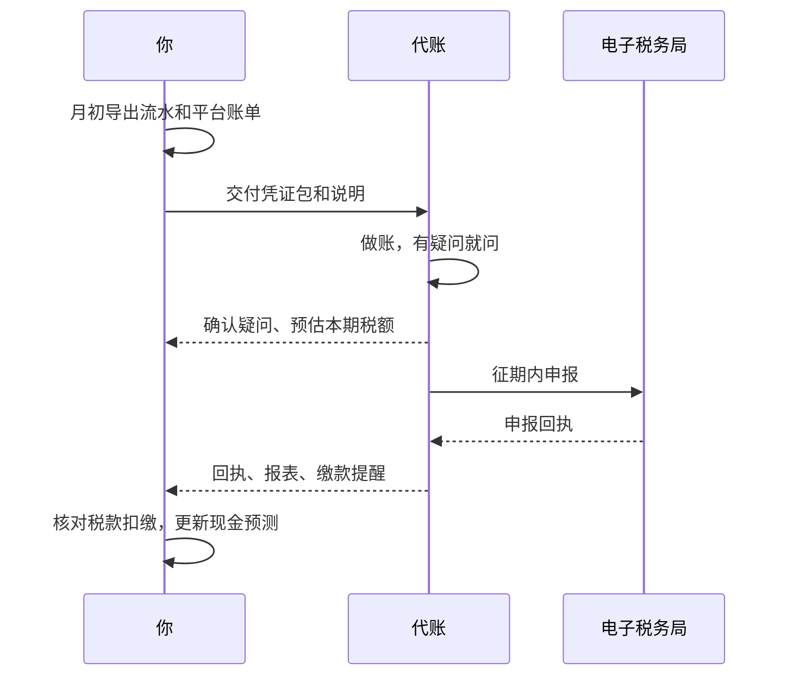

# 记账工具与代账

前五章讲的是「要做什么」，这一章讲「谁来做、用什么做」。对绝大多数一人公司，答案是：**法定的账交给代账，经营的账自己管**。前者保证合规，后者让你看清生意。这一章讲怎么选代账、怎么和代账高效协作、自己的管理账用什么工具记，以及哪些环节可以交给 AI agent。

## 三种模式

| 模式 | 适合 | 优点 | 风险 |
|---|---|---|---|
| 全部自己做 | 有会计背景，或者业务极其简单的个体户 | 省钱，完全掌控 | 政策变化跟不上，出错自己担，耗费大量时间 |
| 全部交给代账 | 不想碰任何财务细节 | 省心 | 你看不懂自己的账，代账出错也发现不了 |
| 代账做法定账 + 自己管经营账 | 大多数一人公司 | 合规有人负责，经营数据自己掌握 | 需要每月花一点时间对接 |

推荐第三种。法定的账（按会计准则做的账、纳税申报、年报）需要专业知识和持续跟进政策，这是代账的价值所在；而「这个月赚了多少、跑道还有多久、哪个产品赚钱」，这些经营问题代账回答不了，也不该由他们回答。

## 代账是什么

代理记账是一个需要资质的行业：代理记账机构要经过财政部门批准、取得代理记账许可。他们的标准服务通常包括：

- 根据你提供的原始凭证做账、出具财务报表
- 按期完成各税种的纳税申报
- 企业所得税或经营所得的年度汇算
- 市场主体年度报告

另外一些服务可能包含在套餐里，也可能单独收费：开票、社保和公积金申报、工商变更、注销、税务异常处理、各类资质认定的辅助材料。签约前要问清楚。

### 怎么选

选代账时可以问这些问题：

| 问题 | 为什么问 |
|---|---|
| 有没有代理记账许可？ | 基本资质 |
| 有没有服务过软件、互联网、App 类的客户？ | 订阅收入、平台分成、海外服务费的处理需要经验 |
| App Store 收入和海外 SaaS 支出你们怎么处理？ | 直接检验专业度，答案含糊的要谨慎 |
| 具体谁负责我的账？换人怎么交接？ | 代账行业人员流动大 |
| 每月我需要提供什么、什么时间之前？ | 看他们有没有清晰的流程 |
| 申报完会不会给我回执或截图？ | 你需要知道每期是否按时申报 |
| 报价包含哪些服务，哪些单独收费？ | 避免后期加价 |
| 出现申报错误导致罚款，责任怎么划分？ | 写进合同 |
| 能不能每月给我利润表和资产负债表？ | 你要看报表，不能只等通知交税 |

最便宜的代账往往只做「零申报」级别的服务。如果你已经有真实收入和复杂一点的支出，选一个愿意解释问题的代账，比省下的那点钱重要得多。

### 合同里写什么

- 服务范围的清单（上面那些项目，逐项列明）
- 双方的义务：你按时提供凭证，他们按时申报
- 交接方式：凭证怎么交、账套归谁、终止合作时如何移交账簿和凭证
- 保密条款：他们会接触到你的全部财务数据
- 责任划分：因对方原因导致的逾期、错报，罚款和滞纳金怎么处理

## 和代账协作的月度流程



### 凭证包的结构

每月给代账一个固定结构的凭证包，能大幅减少来回沟通：

| 文件 | 内容 |
|---|---|
| 银行流水 | 对公账户的月度流水（Excel 或 PDF） |
| 平台账单 | 微信支付、支付宝、App Store、其他收款平台的月度结算单 |
| out/ | 本月开出的发票 |
| in/ | 本月收到的发票 |
| foreign/ | 海外 invoice 和对应的付款记录 |
| 合同 | 本月新签的合同 |
| 工资表 | 本月工资（有发放时） |
| 说明.md | 流水里需要解释的条目 |

`说明.md` 是最有价值的一份，它直接决定了代账做账的准确性：

```markdown
# 2026-10 流水说明

- 10-03 收 客户A 20,000：外包项目第二期，发票 10-01 已开
- 10-08 付 Cloudflare 约 40 元：Workers 付费计划，invoice 在 foreign/
- 10-15 收 支付宝 结算 3,210：10 月上半月订阅收入，平台账单在附件
- 10-20 付 个人 1,280：报销 9 月出差住宿，报销单和发票在 in/
- 10-31 付 个人 8,000：10 月工资
```

### 电子税务局的权限

代账申报需要登录你公司的电子税务局。常见的做法是在电子税务局里把代账人员**添加为办税人员**，让他们用自己的身份登录办理，而不是把法定代表人的个人账号和密码交给对方。这样权限可控，终止合作时取消授权即可。具体的授权方式以当地电子税务局的功能为准。

你自己也要定期登录看一看：申报记录、缴款记录、有没有风险提示或待办事项。**税务上的事，最终责任在纳税人，不在代账。**

## 自己的管理账：纯文本记账

管理账的目标不是符合会计准则，而是**快速回答经营问题**。用什么工具都可以：电子表格、记账 App、自建的小工具。对开发者，有一种特别合适的方式：**纯文本记账**（plain text accounting）。

它的思路是：账本就是一个文本文件，按复式记账的格式写，用命令行工具校验和查询。好处是可以放进 git、可以用脚本批量导入、可以让 agent 帮你整理，而且永远不会被某个 App 锁住数据。最常用的工具是 Beancount（Python）和 hledger（Haskell），下面用 Beancount 举例。

### 安装

```bash
python3 -m venv ~/.venvs/beancount
~/.venvs/beancount/bin/pip install beancount beanquery fava
source ~/.venvs/beancount/bin/activate   # 之后 bean-check、bean-query、fava 都在 PATH 里
```

Beancount 3 把查询工具拆到了单独的 `beanquery` 包里；`fava` 是一个本地运行的网页界面，可以看报表和图表。

### 账本示例

```beancount
option "title" "一人公司管理账"
option "operating_currency" "CNY"

2026-01-01 open Assets:Bank:Company        CNY
2026-01-01 open Assets:Bank:TaxReserve     CNY
2026-01-01 open Assets:Receivable          CNY
2026-01-01 open Liabilities:Deferred       CNY
2026-01-01 open Income:Subscription        CNY
2026-01-01 open Income:Project             CNY
2026-01-01 open Expenses:Cloud             CNY
2026-01-01 open Expenses:Tools             CNY
2026-01-01 open Expenses:Fees              CNY
2026-01-01 open Expenses:Salary            CNY
2026-01-01 open Equity:Capital             CNY

2026-01-05 * "股东" "实缴注册资本"
  Assets:Bank:Company        50000 CNY
  Equity:Capital

2026-01-08 * "支付平台" "年付订阅 10 份，扣手续费后结算"
  Assets:Bank:Company         2370 CNY
  Expenses:Fees                 30 CNY
  Liabilities:Deferred       -2400 CNY

2026-01-08 * "内部" "按比例转入税款储备"
  Assets:Bank:TaxReserve       300 CNY
  Assets:Bank:Company

2026-01-10 * "阿里云" "云服务器 1 月" #invoice
  Expenses:Cloud               300 CNY
  Assets:Bank:Company

2026-01-12 * "Cloudflare" "Workers 付费计划" #foreign
  Expenses:Tools               40 CNY
  Assets:Bank:Company

2026-01-20 * "客户A" "里程碑 1 开票，尚未付款" #invoice
  Assets:Receivable          20000 CNY
  Income:Project

2026-01-31 * "内部" "确认 1 月订阅收入"
  Liabilities:Deferred         200 CNY
  Income:Subscription

2026-01-31 * "自己" "1 月工资（简化，未拆个税社保）"
  Expenses:Salary             8000 CNY
  Assets:Bank:Company

2026-02-01 balance Assets:Bank:Company   43730 CNY
```

几个要点：

- 每笔交易各行金额之和必须为零，最后一行可以省略金额，由工具自动补齐。这就是「有借必有贷，借贷必相等」
- Beancount 的符号约定是收入记负数、费用记正数，查询结果里收入显示为负值，习惯就好
- `balance` 是**余额断言**：声明某天某账户的余额应该是多少，对不上就报错。每月对一次银行余额，写一条断言，账就不会悄悄走偏
- `#invoice`、`#foreign` 这类标签可以用来标记凭证情况，月底查一下哪些海外支出还没处理

### 校验和查询

```bash
# 校验：语法、借贷平衡、余额断言
bean-check ledger.beancount

# 本期收入和费用，按科目汇总
bean-query ledger.beancount "SELECT account, sum(position) AS total WHERE account ~ '^(Income|Expenses)' GROUP BY account ORDER BY account"

# 当前现金（所有银行账户合计）
bean-query ledger.beancount "SELECT sum(position) AS cash WHERE account ~ '^Assets:Bank'"

# 打开网页界面
fava ledger.beancount
```

### 和法定账的关系

管理账和代账做的法定账**不需要逐笔一致**。比如你可以在管理账里把海外 SaaS 统一记到 `Expenses:Tools`，而代账会按凭证情况做专门处理。但两者的**银行余额必须一致**，大类的收入和支出应该大致吻合。每季度拿代账的报表和自己的管理账对一次，差异大的地方问清楚原因，往往能发现问题。

## 让 agent 帮你整理

财务整理是 agent 很擅长的那类活：格式固定、规则明确、重复性高。可以交给 Claude Code 这类编码 agent 的事情包括：

- 把银行流水和平台账单的 CSV 转成 Beancount 记录，按规则自动分类
- 按命名规则重命名、归档每月的发票 PDF
- 根据流水生成 `说明.md` 的草稿，标出看不出用途的条目让你补充
- 更新现金预测表，计算跑道
- 检查哪些支出缺少凭证、哪些发票抬头不是公司

在财务目录里放一份给 agent 的说明，约束它的行为：

```markdown
# finance/ 目录说明（给 agent）

- 只整理和汇总，不做税务判断；遇到不确定如何分类的条目，列出来问我
- 金额以银行流水为准，不要估算或补全
- 不修改 out/ in/ foreign/ 里的原始文件，只能复制和重命名副本
- 不要在任何输出里包含银行卡号、身份证号、税务账号
- 每次修改 ledger.beancount 后运行 bean-check，必须通过
```

几条底线：

- **不要把电子税务局、网银、支付平台的登录凭据交给 agent**。agent 只处理你导出的文件
- **涉及税务判断的结论，以代账和税务机关为准**。agent 可以帮你整理问题清单，但「这笔能不能扣除」「该交多少税」不能听它的
- 财务文件含有大量敏感信息，放在本地加密磁盘或私有仓库里，不要推到公开的地方

更多让 agent 接管日常事务的方法，见[《个人 Agent 工作流》](../personal-agent-workflow/)；把财务作为一人公司的一个「岗位」交给 agent 体系，见[《用 AI 撑起一人公司》](../ai-native-opc/)。

## 年度清单

一年里有几个时间点需要特别注意。下面是一个按顺序的清单，具体日期以当年官方通知为准：

| 时间 | 事项 |
|---|---|
| 年初 | 问代账：今年有哪些政策变化、哪些优惠能用；更新税款储备比例 |
| 一季度 | 个人综合所得年度汇算；个体户经营所得年度汇算 |
| 上半年 | 市场主体年度报告；有限公司企业所得税年度汇算清缴 |
| 年中 | 检查股东借款、对一次管理账和法定账 |
| 下半年 | 估算全年利润，和代账讨论工资与分红的安排 |
| 年底前 | 还清股东借款；整理全年凭证；续签代账合同；检查年度大额支出是否已进现金预测 |

## 写在最后

这本书刻意没有给你任何一个税率数字。原因不是这些数字不重要，而是它们**变化太快**：你读到这里时，书里写的任何数字都可能已经过期，而一个过期的数字比没有数字更危险。

能长期有效的是这些东西：会计恒等式和复式记账、三类税的结构、发票如实开具的原则、现金比利润更重要、公私必须分开、凭证质量决定账的质量。把这些框架装进脑子，每年的具体数字交给代账和官方文件。

## 本章要点

- 推荐模式：**法定账交给代账，经营账自己管**
- 选代账看资质、行业经验、流程清晰度和合同条款，用 App Store 和海外 SaaS 的问题检验专业度
- 每月给代账一个固定结构的凭证包，`说明.md` 决定账的准确性
- 用添加办税人员的方式给代账授权，自己定期登录电子税务局查看；最终责任在纳税人
- 管理账可以用 Beancount 这类纯文本记账工具，余额断言让账不走偏
- agent 适合整理流水和凭证，但不碰登录凭据、不做税务判断
- 每年年初问一次政策变化，按年度清单逐项完成

## 接下来读什么

钱的框架搭好了，接下来要知道钱从哪里来、怎么变多。按导读的顺序，下一本是[《数据分析与埋点》](../product-analytics/)：用指标、漏斗、留存和 LTV 看清增长，它和本书第 4 章的现金预测是同一个问题的两面。如果还没读，[《国内合规实务》](../opc-compliance-cn/)讲主体选择和注册流程，[《定价与商业模式》](../pricing-monetization/)讲怎么收钱；准备做海外市场时读[《出海实务》](../going-global/)。整套书的收尾是《用 AI 撑起一人公司》。
