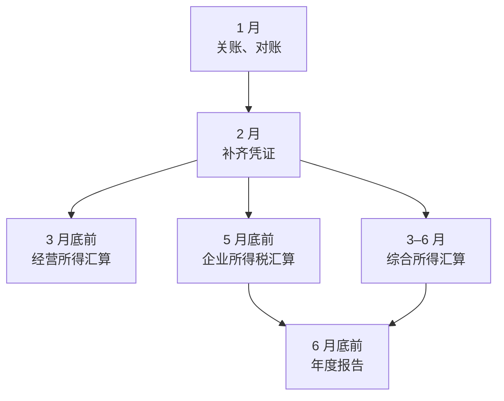
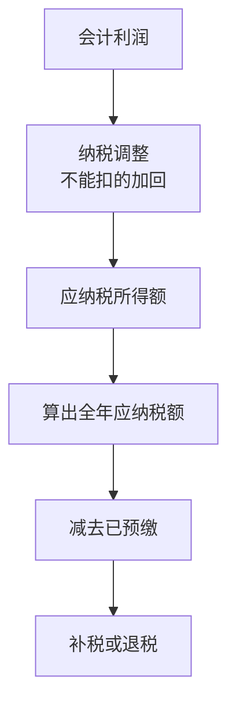

# 年度汇算走查

[第 2 章](02-taxes.md#申报节奏一张年度日历)那张年度日历里，按月、按季的申报交给代账，每期看一眼回执就行；真正需要你本人花时间的，是每年上半年挤在一起的几件**年度事项**。它们有两个特点：一是有一部分只能你自己办（个人所得税的综合所得汇算，代账一般碰不到你的个税 App）；二是它们会把一整年的账翻出来对一遍，平时记账的漏洞会在这时候集中暴露。

这一章不讲税率，只讲流程：每件事是什么、谁来办、在哪办、要准备什么、办完怎么检查。

> [!WARNING]
> 本章的期限按截至 2026 年 11 月查到的法律和官方文件整理：个人综合所得汇算按《个人所得税法》和《个人所得税综合所得汇算清缴管理办法》（国家税务总局令第 57 号，2025 年 2 月 26 日公布施行，中国政府网刊载原文），经营所得汇算按《个人所得税法》，企业所得税汇算按《企业所得税法》，年度报告按《企业信息公示暂行条例》。每年的具体安排（是否预约、遇节假日是否顺延）以国家税务总局当年发布的通告、电子税务局和个人所得税 App 的提示为准。

## 四件年度事项

| 事项 | 谁 | 期限 | 在哪办 | 谁来做 |
|---|---|---|---|---|
| 经营所得个税汇算 | 个体户业主 | 次年 3 月 31 日前 | 电子税务局 / 个人所得税 App | 代账可以代办 |
| 个人综合所得汇算 | 有工资、劳务报酬等综合所得的你 | 次年 3 月 1 日至 6 月 30 日 | 个人所得税 App | **通常你自己办** |
| 企业所得税年度汇算清缴 | 有限公司 | 年度终了之日起 5 个月内，即次年 5 月 31 日前 | 电子税务局 | 代账做，你确认 |
| 年度报告 | 个体户、有限公司 | 每年 1 月 1 日至 6 月 30 日 | 国家企业信用信息公示系统 | 你自己或代账 |

按时间排，就是 1 月开始准备、3 月底个体户收尾、5 月底公司收尾、6 月底个税和年报收尾。有限公司老板通常要碰到后三件，个体户业主碰到第一、二、四件。

## 一月先关账

年度汇算的质量在一月就决定了。代账要拿完整的全年数据才能做汇算，你要做的是把「全年」这件事收干净：

- **对银行流水**：对公账户 12 月 31 日的余额，和账上「银行存款」的余额一致；不一致的，逐笔找出差异
- **对平台收入**：App Store、支付平台、分账平台全年的结算报表，和入账的收入能解释清楚差异（时间差、手续费、退款、汇率），方法见[第 3 章「和收入对账」](03-invoices.md#和收入对账)
- **补齐发票**：全年的成本费用有没有缺票。缺票的支出在企业所得税汇算时通常不能税前扣除，汇算前是最后的补救时间
- **清股东借款**：[第 5 章](05-separate-money.md#借款)讲过，年度终了还挂着的股东借款可能被视同分红，最好在 12 月 31 日前就还上
- **盘一下预收款**：年付订阅这类预收的钱，有多少属于明年，见[第 4 章](04-cash-flow.md#订阅业务的现金节奏)

这些做完，把全年凭证包（[第 6 章的结构](06-tools-and-bookkeeper.md#凭证包的结构)）打包交给代账，附一份 `年度说明.md`，写清楚这一年发生过的非常规事项：买了大额设备、发过分红、借过钱、收过境外款、换过地址、变更过经营范围。代账最怕的不是事多，是不知道有这件事。

## 个体户：经营所得汇算

> [!WARNING]
> 经营所得汇算期限按《个人所得税法》第十二条（取得所得的次年三月三十一日前办理汇算清缴）整理；核定征收的个体户是否需要汇算、怎么汇算，以主管税务机关的认定为准。

个体户平时按月或按季预缴经营所得个税，年度结束后要把全年的收入、成本、费用合起来算一次，多退少补。这就是经营所得汇算。

要准备的东西：

| 材料 | 从哪来 |
|---|---|
| 全年收入、成本、费用 | 代账的账，或你自己的账 |
| 全年已预缴的税款 | 电子税务局的申报记录 |
| 业主本人的专项扣除、专项附加扣除 | 你的社保缴费记录、个税 App 里填报的信息 |
| 从其他地方取得经营所得的情况 | 如果你在两处以上有经营所得，要合并计算 |

流程是：代账（或你自己）在电子税务局填年度申报表，算出全年应纳税额，减去已预缴的，得出补税或退税；补税的在期限内缴款，退税的提交申请。

有一个容易出错的地方：**业主的专项附加扣除只能在一处扣**。如果你同时还在上班，扣除放在工资那边扣了，经营所得这边就不能再扣。这件事要你自己告诉代账，代账不知道你在别处扣了什么。

## 有限公司：企业所得税汇算清缴

> [!WARNING]
> 汇算期限按《企业所得税法》第五十四条（年度终了之日起五个月内报送年度申报表并汇算清缴）整理；年度中间终止经营的，按规定在实际经营终止之日起 60 日内汇算。年度财务报表的报送要求、各项调整的具体口径以国家税务总局当年的申报表填报说明和主管税务机关为准。

有限公司按季（或按月）预缴企业所得税，预缴用的是账面利润的近似数。汇算清缴是把全年的账按税法口径重新算一遍：

中间那一步「纳税调整」是汇算的核心：会计上算作费用的，税法上不一定让扣。一人公司最常见的几类：

| 情况 | 为什么要调整 |
|---|---|
| 没有合规票据的费用 | 税前扣除要凭证，缺票的部分通常要调增 |
| 与经营无关的支出 | 私人消费混进公司账的，税法上不认 |
| 有扣除限额的费用 | 业务招待费、广告费、职工福利费等有比例限制，超出的部分调增 |
| 罚款、滞纳金 | 行政罚款和税收滞纳金不能税前扣除 |
| 以前年度的亏损 | 符合条件的可以用今年的利润弥补，减少应纳税所得额 |

你不需要会填申报表，但汇算前要和代账过一遍这几个问题：

1. 今年有多少费用因为缺票要调增？能不能补票？
2. 有没有符合条件的优惠（小型微利企业、研发费用加计扣除等）？这些优惠要不要另外留资料备查？
3. 以前年度有没有亏损可以弥补？
4. 汇算完，全年的税后利润是多少？今年要不要分红？（见[第 5 章「工资和分红怎么搭」](05-separate-money.md#工资和分红怎么搭)）

汇算清缴通常会和年度财务报表一起报送。报完让代账把**年度申报表、财务报表、汇算的调整明细**都发给你，放进年度档案。第二年做预算、将来注销、遇到税务核查，都会用到。

## 你自己：综合所得汇算

> [!WARNING]
> 办理时间按《个人所得税综合所得汇算清缴管理办法》第五条（次年三月一日至六月三十日）整理；2025 年度汇算在 2026 年 3 月初的前几周实行预约办理（国家税务总局 2026 年第 1 号通告），以后每年是否预约、哪些人需要办理、免予办理的条件，以国家税务总局当年的通告为准。

有限公司给你发工资，公司每月预扣个税，但按月预扣和按年算出来的数往往对不上：比如有的月份有一次性收入、你在两家单位领过工资、有劳务报酬或稿酬、专项附加扣除没在平时填。综合所得汇算就是把全年的工资薪金、劳务报酬、稿酬、特许权使用费合在一起，按年算一次，多退少补。

这件事只能在个人所得税 App（或自然人电子税务局网页）上以你本人的身份办，代账一般不经手。步骤：

1. **先查收入**：在 App 里查「收入纳税明细」，看全年以你名义申报的每一笔收入和扣缴单位。有不认识的单位，可以在 App 里申诉，这也是防止身份被冒用的检查
2. **确认专项附加扣除**：子女教育、继续教育、住房贷款利息或住房租金、赡养老人、婴幼儿照护等，平时没填的这时候补；内容以当年政策为准
3. **选择申报方式**：App 提供预填的「简易申报 / 标准申报」，大多数人用预填数据核对后提交即可
4. **看结果**：应补的在期限内缴款；应退的提交退税申请，填自己的银行卡
5. **留截图**：申报成功的页面和回执截一张，放进年度档案

几个和一人公司老板有关的细节：

- **公司发的年终奖**有单独计税和并入综合所得两种方式，汇算时 App 会让你选，哪种划算 App 会试算，相关政策是否延续以当年规定为准
- **分红不在这里**。股息红利是单独的所得项目，公司支付时已经代扣，不参与综合所得汇算
- **经营所得不在这里**。个体户的经营所得走上一节的经营所得汇算
- 副业阶段同时有工资和劳务报酬的，汇算时合并计算，常见的情况是要补税，预先在现金预测里留好这笔钱（见[第 4 章](04-cash-flow.md#给税款单独留钱)）

## 年度报告：不是报税，但更容易漏

> [!WARNING]
> 报送期限按《企业信息公示暂行条例》第八条（每年 1 月 1 日至 6 月 30 日报送上一年度报告，当年设立的从次年起报送）整理，个体户年报的具体安排以国家企业信用信息公示系统和当地市场监管部门的通知为准。

年度报告是向市场监管部门报的，不是向税务局，所以很多人以为代账报了税就万事大吉，结果漏了年报，被列入经营异常名录。异常名录的后果见[《国内合规实务》第 2 章](../opc-compliance-cn/02-registration.md#每年和每月要做的事)。

年报要填的大致是：通信地址、联系方式、存续状态、股东出资情况、资产负债和经营情况、社保信息。其中**资产总额、营业收入、利润、纳税总额**这几项要和企业所得税汇算的数字对得上，所以顺序上先汇算、后年报。股东的认缴和实缴出资会公示出来，认缴期限的规则见[《国内合规实务》第 1 章](../opc-compliance-cn/01-entity-choice.md#注册资本认缴不等于不用缴)。

## 汇算后的年度档案

每年汇算完，建一个年度文件夹，放进这些东西：

| 文件 | 来源 |
|---|---|
| 年度财务报表（资产负债表、利润表） | 代账 |
| 企业所得税年度申报表和调整明细，或经营所得年度申报表 | 代账 |
| 个人综合所得汇算的申报回执 | 你自己的 App 截图 |
| 年度报告的提交回执 | 公示系统截图 |
| 分红的股东决定和完税凭证 | 如果有分红 |
| 优惠事项的备查资料 | 代账整理 |
| `年度说明.md` | 你自己写的那份 |

这个文件夹的作用，[第 5 章](05-separate-money.md#法律有限责任可能失效)讲过：一人公司的股东要自己证明公司财产独立，每年一套完整的报表和申报记录，就是最直接的证据。

## 本章要点

- 每年上半年有四件年度事项：经营所得汇算（3 月底前）、综合所得汇算（3 月 1 日至 6 月 30 日）、企业所得税汇算（5 月底前）、年度报告（6 月底前），具体安排以当年官方通告为准
- 一月先关账：对银行、对平台、补发票、还股东借款，再把凭证包和 `年度说明.md` 交给代账
- 企业所得税汇算的核心是**纳税调整**：缺票、与经营无关、超限额的费用要调增
- 综合所得汇算通常要你自己在个人所得税 App 上办，先查收入明细，再确认扣除
- 年报是向市场监管部门报的，数字要和汇算对得上，先汇算后年报
- 每年留一套年度档案，它也是一人公司「财产独立」的证据

下一章讲年度汇算里最依赖的那个人：[代账怎么选、怎么验收、怎么换](08-bookkeeper-quotes.md)。
