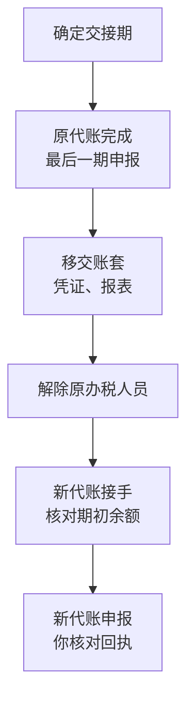

# 代账报价、验收与交接

[第 6 章](06-tools-and-bookkeeper.md#代账是什么)讲了代账是什么、挑代账时问哪些问题、合同里写什么。这一章接着往下走三步：拿到几份报价时怎么比、合作中怎么检查代账做得对不对、要换代账时怎么交接才不丢东西。

这一章不写具体价格。代账费各地差别很大，同一个城市不同机构的报价也能差出好几倍；比价格本身更有用的，是看懂一份报价**包含了什么、没包含什么**。

> [!WARNING]
> 代理记账机构的资质要求按《会计法》和财政部《代理记账管理办法》整理；电子税务局办税人员授权、数电发票等操作按截至 2026 年 11 月的一般做法整理，界面和流程会调整，以财政部门、国家税务总局和当地电子税务局的最新规定和提示为准。

## 一份代账报价由什么构成

代账的报价单上常见的是一个「每月多少钱」或「每年多少钱」的数字，但背后是几层不同的东西：

| 层 | 内容 | 影响价格的因素 |
|---|---|---|
| 基础服务 | 按月做账、按期申报各税种、出报表 | 纳税人身份（小规模还是一般纳税人）、每月票据量、业务类型 |
| 年度服务 | 企业所得税或经营所得汇算、年度报告 | 有的含在基础里，有的单独收费 |
| 按次服务 | 开票、工商变更、社保开户、银行开户辅助、注销 | 通常单独收费 |
| 异常处理 | 税务风险提示应对、非正常户解除、补申报 | 通常单独收费，有的按难度报价 |
| 杂项 | 凭证装订打印、账本、快递 | 有的机构单独列 |

几个让报价变高的常见原因，提前想清楚自己属于哪种：

- **一般纳税人**比小规模纳税人贵，因为要处理进项抵扣，申报更复杂（区别见[第 2 章](02-taxes.md#小规模纳税人还是一般纳税人)）
- **票据量大**：每月几十张和几百张，做账工作量差别很大
- **有境外收支**：App Store 分成、Stripe 收款、海外云服务付款，涉及外汇、代扣代缴判断（见[第 3 章](03-invoices.md#海外服务的发票问题)），不是每家代账都做得来
- **有员工**：多一项工资表、个税代扣和社保

### 比报价时问的问题

拿到两三份报价，把它们按上面那张表拆开，逐项问：

1. 年度汇算和年报含不含？不含的话单独多少？
2. 开票是你自己开，还是他们代开？代开怎么收费、怎么确认开票信息？
3. 每月给不给利润表和资产负债表？（[第 6 章](06-tools-and-bookkeeper.md#怎么选)说过，你要看报表）
4. 一年里最多能问几次问题？是不是有专门的人回复？
5. 从小规模转一般纳税人以后，价格怎么变？
6. 注销的费用大概是什么区间？现在不用，但能看出他们做不做这块
7. 合同期多久？提前终止怎么算？

**最低价的报价通常只覆盖零申报**。如果你的公司已经有真实收入、有境外收支，一份「什么都包」的低价报价要格外小心：要么后面会按次加价，要么做账质量撑不起这个价格。

## 合作中怎么验收

代账做账，你不需要逐笔检查，但要有几个固定的检查点，确认他们按时、按实在做。

### 每期申报后

| 检查什么 | 怎么查 |
|---|---|
| 有没有按时申报 | 自己登录电子税务局，看申报记录和状态 |
| 申报的收入对不对 | 申报的销售额和你的管理账、平台结算对一下（[第 6 章](06-tools-and-bookkeeper.md#和法定账的关系)） |
| 有没有缴款 | 看缴款记录，对公账户的扣款 |
| 有没有异常提醒 | 电子税务局的消息中心、风险提示 |

这一步十分钟就够。重点是**自己登录看**，而不是等代账通知。第 6 章讲过用「添加办税人员」给代账授权，而不是把法人的登录凭据交出去，原因就在这里：你随时能自己看到全部记录。

### 每季度

- 拿利润表和自己的管理账对一下收入、主要费用和利润，差异能解释清楚就行
- 看资产负债表里的「其他应收款」「其他应付款」，有没有莫名其妙挂着的股东往来（[第 5 章](05-separate-money.md#借款)）
- 看「银行存款」和对公账户的实际余额是否一致

### 每年汇算后

按[第 7 章「汇算后的年度档案」](07-annual-filing.md#汇算后的年度档案)的清单，让代账把年度申报表、报表、调整明细都发过来。缺哪份就要哪份。这是你判断代账做得好不好的最好时机：如果他说不清楚哪些费用被调增了、为什么，下一年就该考虑换人。

## 换代账：交接清单

换代账常见的原因是原来的会计离职、服务质量下降、业务复杂了需要更专业的机构，或者价格谈不拢。换代账本身不难，难的是**交接时丢东西**：账套没拿回来、权限没解除、某期申报两边都以为对方会报。

### 交接的时间点

最好在**一个申报周期结束、申报完成之后**交接，最理想的是年度汇算完成以后。年中交接也可以，但要写清楚：哪一期由原代账报，从哪一期开始由新代账报。

### 要拿回来的东西

| 类别 | 内容 |
|---|---|
| 账 | 电子账套的导出文件（问清楚格式，新代账的软件能不能导入）；纸质账簿、凭证 |
| 报表 | 合作期间各期的资产负债表、利润表；年度财务报表 |
| 申报 | 各期申报表和缴款记录（电子税务局里自己也能下载，但拿一份完整的更省事） |
| 年度 | 企业所得税或经营所得年度申报表、汇算调整明细、年报回执 |
| 资料 | 你交过去的原始凭证、合同、银行回单，以及他们手上保存的营业执照复印件等 |
| 未结事项 | 一份书面清单：有没有没处理完的税务提示、待补的发票、待认证的进项、正在办的变更 |

> [!CAUTION]
> 交接完一定要在电子税务局里**解除原代账的办税人员权限**，银行、社保、公积金等系统里如果给过他们账号或授权，也一并收回。权限不收回，等于前一家仍然能以你公司的名义操作。

### 新代账接手时

- **核对期初余额**：新代账建账时，期初的资产、负债、未分配利润要和原代账最后一期的报表一致，不一致的当场查清楚
- **把 `说明.md` 的约定交过去**：你和原代账之间形成的习惯（凭证包怎么组织、哪些支出怎么归类、平台收入怎么确认），写下来交给新代账，见[第 6 章的凭证包](06-tools-and-bookkeeper.md#凭证包的结构)
- **第一期申报后自己看一遍**：确认没有漏报、没有重复申报

## 什么时候不需要代账

如果主体已经确定要停掉，注销本身也是代账常做的一项服务。注销要把最后一期账做完、清税，再办登记注销，流程见下一章[公司注销的财税收尾](09-closing-down.md)。

## 本章要点

- 代账报价拆成基础服务、年度服务、按次服务、异常处理和杂项看；比的是包含什么，不是单价
- 一般纳税人、票据量大、有境外收支、有员工，都会让报价变高
- 每期申报后自己登录电子税务局看记录；每季度对报表；每年汇算后要齐年度档案
- 换代账在一个申报周期结束后交接，写清楚哪一期由谁报
- 拿回账套、报表、申报记录和未结事项清单，**解除原代账的办税人员权限**
- 新代账接手时核对期初余额，把你们的做账约定写下来交过去
