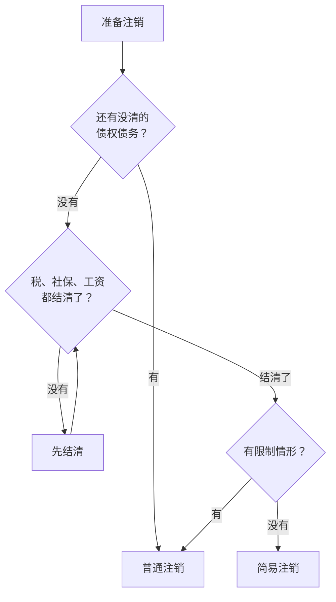

# 公司注销的财税收尾

不做了要注销，不能放着不管。为什么放着不管会越来越麻烦、几种结束方式（股权转让、歇业、简易注销、普通注销）怎么选，[《公司常识》第 8 章](../company-basics/08-endings.md)讲得很完整；备案、开发者账号这些非财税的收尾，在[《国内合规实务》第 2 章](../opc-compliance-cn/02-registration.md#注销最好一开始就知道)。这一章只讲**钱和税这一侧**：注销前要把账做到什么程度、清税是怎么回事、两种注销各要多久、最后剩下的钱怎么拿回来。

> [!WARNING]
> 本章流程和时限按市场监管总局等六部门 2025 年 12 月发布的《企业注销指引（2025 年修订）》（国家税务总局法规库刊载全文）、《企业所得税法》第五十五条和新《公司法》整理，截至 2026 年 11 月。各地「一网通办」的入口、材料和税务口径不同，清算所得和剩余财产分配的税务处理以国家税务总局和主管税务机关的最新规定为准，注销前请让代账或税务师过一遍。

## 先判断走哪条路

财税这一侧，决定走简易注销还是普通注销的，主要是三个问题：

「限制情形」按《企业注销指引》，和一人公司关系较大的有：被列入经营异常名录或严重违法失信名单、股权被冻结或出质、对其他企业有投资、还持有房产土地等资产、**没有依法办理所得税清算申报或者清算所得的税没交**、行政罚款没执行完、正在被立案调查或处于诉讼仲裁中。

这里要特别看第一条：**没报年报、长期没申报的公司，往往已经在异常名录里了**，要先补报、移出名录，才能走简易注销。这也是平时不要断申报的原因之一（见[第 2 章「没有收入也要申报」](02-taxes.md#没有收入也要申报)）。

## 注销前先把账收干净

不管走哪条路，财税上的准备工作是一样的。可以把它看成一次提前的、最后一次的[年度关账](07-annual-filing.md#一月先关账)：

| 事项 | 要做到什么程度 |
|---|---|
| 应收款 | 客户欠的钱收回来，收不回来的要有处理（核销或转让） |
| 应付款 | 欠供应商、云服务、房东的钱付清；**订阅类服务停掉**，免得注销后还在扣费 |
| 预收款 | 用户预付的年费，按约定退款或履行完毕 |
| 员工 | 工资、社保、经济补偿结清 |
| 股东往来 | 股东借款还清，或者公司欠股东的钱处理清楚 |
| 发票 | 没开的票开完，作废或红冲处理完；不再需要的发票额度不再领用 |
| 税 | 每一期申报都报完，没有逾期未申报、欠税、滞纳金和罚款 |
| 年报 | 往年的年度报告都已报送 |

这张表做完，你自己就能判断：有没有一笔「说不清」的债务。说不清的，走普通注销。简易注销要全体股东承诺没有债权债务，**承诺不实的，股东要对注销前的债务承担连带责任**，见[《公司常识》的「简易注销」](../company-basics/08-endings.md#简易注销)。

## 清税：税务这一关

注销登记要以税务上「清了」为前提。按《企业注销指引》，清税时大致是这几种情况：

| 情况 | 结果 |
|---|---|
| 没办过涉税事项，或者办过但没领用过发票、没有欠税和罚款、没有其他未办结的涉税事项 | **免予单独办理清税证明**，可以直接向市场监管部门申请简易注销 |
| 没领用发票、没有欠税罚款、没有未办结事项 | 税务机关可以即时出具清税文书 |
| 资料不齐但符合承诺制条件 | 作出承诺后即时出具清税文书，在承诺时限内补齐资料 |
| 有未办结的涉税事项，又不符合承诺条件 | 不予注销，先把事项办完 |

对一人公司，清税前代账要做的，通常是这几步：

1. **最后一期的增值税及附加、个税代扣申报**：把截至停业时点的全部收入申报完
2. **企业所得税清算申报**：《企业所得税法》第五十五条要求，年度中间终止经营的，自实际经营终止之日起 60 日内办理当期汇算清缴；办理注销登记前，还要就**清算所得**申报缴纳企业所得税。清算期间单独作为一个纳税期间
3. **发票处理**：已领用的发票缴销，数电发票的额度停止使用
4. **缴清**所有税款、滞纳金和罚款

这几步做完，就是「没有未办结的涉税事项」，清税文书才会顺利出来。很多地方的税务注销已经和市场监管的注销登记打通，清税信息共享以后，不用再提交纸质清税证明。

## 两种注销各要多久

下面按《企业注销指引（2025 年修订）》里的法定时限排一下。实际耗时还要加上你自己准备的时间，以及各地办理的速度。

### 简易注销

| 步骤 | 时限 |
|---|---|
| 准备：收账、清税（或确认免予清税证明） | 看你的账有多干净，几天到几周 |
| 在国家企业信用信息公示系统发布简易注销公示 | 公示期 **20 日** |
| 公示期满，向登记机关申请注销登记 | 公示期满之日起 **20 日内**；最长可再宽展 30 日 |

账干净的一人公司，从开始准备到拿到注销结果，一两个月是常见的量级。

### 普通注销

| 步骤 | 时限 |
|---|---|
| 解散事由出现后，成立清算组 | **15 日内** |
| 公告清算组信息 | 清算组成立之日起 **10 日内** |
| 通知债权人 | 清算组成立之日起 **10 日内** |
| 发布债权人公告 | **60 日内**发布，公告期 45 日 |
| 债权人申报债权 | 接到通知的 **30 日内**；没接到通知的，自公告之日起 **45 日内** |
| 清理财产、清偿债务、清税 | 视情况 |
| 申请注销登记 | 提交清算报告和清税信息 |
| 社保注销 | 注销登记之日起 **30 日内** |

光是债权申报期就要一个半月，再加上清算和清税，普通注销通常要几个月。资不抵债的，要转入破产程序，时间更长。

### 个体户

> [!WARNING]
> 个体户简易注销无需公示的规定按《市场主体登记管理条例》第三十三条整理，未逐条核对该条例的最新版本，各地做法以当地市场监管部门为准。

个体户注销相对简单：按《市场主体登记管理条例》，个体工商户按简易程序注销的，**不需要公示**，登记机关把申请推送给税务等部门，有关部门在规定期限内没有提出异议的，直接办理注销登记。税务上同样要先把经营所得的最后一期申报、汇算和发票处理完。

## 剩下的钱怎么拿回来

普通注销的清算中，公司财产按顺序支付：清算费用 → 职工工资、社保和法定补偿金 → 所欠税款 → 公司债务。都付完还有剩余的，才能分给股东。**在清偿债务之前分给股东的，股东要退还**。

剩余财产到了股东手里，税务上大致分两部分看：相当于公司累计未分配利润和盈余公积的部分，按股息性质处理；超过的部分和你当初的投资成本比较，可能产生所得。具体怎么算、要不要代扣、谁来申报，取决于清算报告里的数字和当时的规定，**一定让代账或税务师算**，不要自己按分红处理了事。

一个实用的建议：公司还在正常经营、准备在一两年内停掉的，可以提前和代账讨论**在注销前通过正常分红把税后利润分出来**，还是留到清算时一起分配。两种方式涉及的税种、时点和材料不同，提前规划比临到注销再算要从容（工资和分红的比较见[第 5 章](05-separate-money.md#工资和分红怎么搭)）。

## 注销以后还要留什么

公司注销了，账簿和凭证不能随手扔。会计档案按规定有保管期限，注销前要和代账确认这些档案由谁保管、存在哪里。至少你自己留一份电子版：

- 最后几年的年度档案（见[第 7 章](07-annual-filing.md#汇算后的年度档案)）
- 清算报告、清税文书、注销登记通知
- 股东决定、分红和剩余财产分配的完税凭证

注销完的公司如果日后被追究注销前的问题，这些就是你能拿出来的全部证据。

## 本章要点

- 结束方式怎么选看《公司常识》第 8 章；本章只管钱和税
- 有说不清的债务就走普通注销；简易注销的承诺不实，股东要承担连带责任
- 异常名录里的公司要先补报、移出，才能走简易注销
- 清税前完成最后一期申报、企业所得税清算申报、发票缴销，缴清税款和罚款
- 简易注销公示 20 日，满后 20 日内申请；普通注销仅债权申报期就要 45 日左右，通常几个月
- 剩余财产分给股东涉及个税，让代账算；注销后留好档案

## 写在最后

这本书的正文刻意只讲框架，常用数字集中在[第 2 章末尾的参考表](02-taxes.md#2026-年常用数字参考)，带日期。原因不是这些数字不重要，而是它们**变化太快**：你读到这里时，书里写的任何数字都可能已经过期，而一个过期的数字比没有数字更危险。所以那张表每一项都写了依据和到期日，过了日期就去国家税务总局查最新公告。

能长期有效的是这些东西：会计恒等式和复式记账、三类税的结构、发票如实开具的原则、现金比利润更重要、公私必须分开、凭证质量决定账的质量、每年按时把账收干净、结束时体面地结束。把这些框架装进脑子，每年的具体数字交给代账和官方文件。

## 接下来读什么

钱的框架搭好了，接下来要知道钱从哪里来、怎么变多。按导读的顺序，下一本是[《数据分析与埋点》](../product-analytics/)：用指标、漏斗、留存和 LTV 看清增长，它和本书第 4 章的现金预测是同一个问题的两面。如果还没读，[《国内合规实务》](../opc-compliance-cn/)讲主体选择和注册流程，[《公司常识》](../company-basics/)讲有限责任、股权和公司的终点，[《定价与商业模式》](../pricing-monetization/)讲怎么收钱；准备做海外市场时读[《出海实务》](../going-global/)。整套书的收尾是《用 AI 撑起一人公司》。
