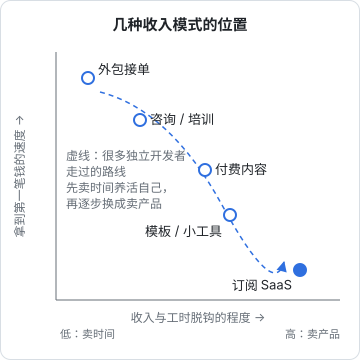
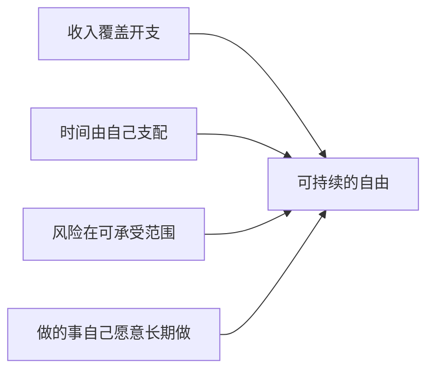
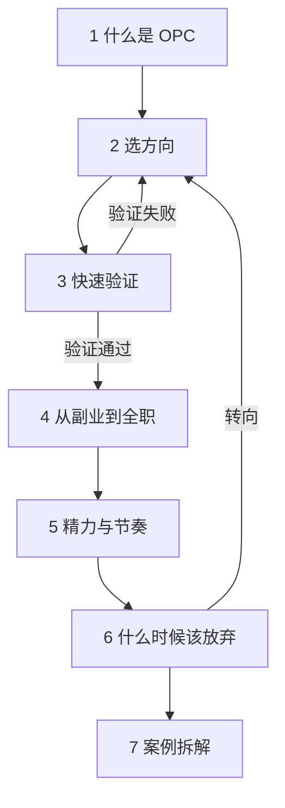

# 什么是 OPC

这本书讲一件事：一个技术出身的人，怎样把「自己写的东西」变成一门能养活自己、并且能长期做下去的生意。

**适合谁**：会写代码、能独立把一个产品从前端做到部署，但没怎么做过生意的独立开发者；正在上班、想用副业试水的人；已经辞职、在摸索方向的人。背景设定在中国，涉及主体、收款、备案的地方会按国内情况讲。

**怎么读**：第 1 章建立概念，第 2、3 章是「选什么、怎么验证」，第 4、5 章是「怎么过渡、怎么持续」，第 6 章讲止损，第 7 章用几种典型模式和作者自己的项目做拆解。前三章建议按顺序读；后面几章可以等到对应阶段再翻。书里不讲具体的定价、财税和备案细节，这些各有专门的书，会在相应位置指出来。

本章先回答三个问题：一人公司到底是什么、为什么现在这条路比以前好走、它和你熟悉的其他工作形态有什么不同。

## 一个定义

OPC 是 One Person Company 的缩写，中文叫「一人公司」。这个词在不同语境里意思不完全一样，本书用的定义是：

> **一个人做全部关键决策，借助代码、内容、平台和 AI 这些杠杆交付价值，收入不和自己的工时直接挂钩。**

拆开看有三个要点：

| 要点 | 含义 | 反例 |
|---|---|---|
| 一个人决策 | 做什么、不做什么、怎么定价，只有你说了算 | 合伙公司里要和人商量每件事 |
| 靠杠杆交付 | 一份工作可以被复制很多次：软件卖给一万个人和卖给一个人，边际成本差不多 | 按人天收费的外包 |
| 收入与工时脱钩 | 你睡觉的时候也可能有人付钱 | 时薪制的自由职业 |

注意「一个人」不等于「什么都自己干」。会计可以外包给代账公司，设计可以买模板，客服可以用 AI 先接一轮。关键是**不雇全职员工、不背组织的固定成本**，所有外包都是可以随时停掉的变动成本。

它也不等于法律意义上的「一人有限责任公司」。法律主体是第 4 章和[《国内合规实务》](../opc-compliance-cn/)要讨论的事，你可以用个人身份、个体工商户或有限公司来承载一人公司，三者都可以。

## 和其他工作形态的区别

技术人常见的几条路放在一起比较：

| | 打工 | 自由职业接单 | 融资创业 | 一人公司 |
|---|---|---|---|---|
| 收入来源 | 工资 | 按项目或工时收费 | 投资人的钱，之后靠营收 | 产品或内容的营收 |
| 收入和工时的关系 | 强绑定 | 强绑定 | 前期不相关 | 逐步脱钩 |
| 风险 | 低，有人兜底 | 中，客户随时可能断 | 高，但失败成本部分由投资人承担 | 中到高，全部自己承担 |
| 目标 | 职业发展 | 稳定的单子 | 规模化、退出 | 可持续的自由 |
| 天花板 | 职级 | 你的工时 × 单价 | 很高 | 取决于杠杆，通常不如融资公司高 |
| 需要的能力 | 专业能力 | 专业能力 + 谈客户 | 组队、融资、管理 | 专业能力 + 产品 + 获客 + 自律 |

最容易混淆的是「自由职业」和「一人公司」。接外包是一人公司很常见的**起点**，但如果一直停留在按人天收费，那本质上是「没有老板的打工」：生病一周，收入就停一周。一人公司要做的，是逐步把卖时间换成卖产品。



图里的规律很朴素：**越快拿到钱的模式，越依赖你的工时；越能脱钩的模式，起步越慢**。订阅产品前期可能几个月都没什么收入，但一旦有了稳定的用户群，收入会比外包稳得多。这条曲线决定了后面几章反复出现的一个主题：怎样用前一种模式的现金流，养后一种模式的成长期。

## 为什么现在这条路好走了

一人公司不是新概念，但过去十年，几样东西的变化让它对技术人格外友好。

### 基础设施几乎不要钱

十多年前，上线一个服务要买或者租服务器、配机房带宽。现在：

- 静态站、Serverless 函数、对象存储都有免费额度，Cloudflare Workers + R2 这类组合可以让一个小产品在初期几乎零成本运行
- 一台入门级云服务器加 Docker Compose 就能承载一个早期的 SaaS，作者的 hatch-counter 就是这样部署的：一台机器上 nginx 反代、systemd 托管、Compose 编排 API 和数据库
- 数据库、认证、邮件、支付都有托管服务可选

结果是**试错成本主要变成了时间，而不是钱**。

### AI 让一个人的产出翻倍

编码 agent 让一个人能同时推进前端、后端、移动端和运维脚本。文案初稿、客服回复、数据分析，也可以先让模型做一版再改。这不意味着「AI 会替你开公司」，而是让过去需要三五个人的执行工作，一个人加几个 agent 就能覆盖。判断做什么、为结果负责，仍然是你。

### 分发渠道是现成的

应用商店、微信小程序、小红书、即刻、B 站、V2EX 这类平台和社区，让一个没有市场预算的人也能接触到第一批用户。渠道当然有它的规则和抽成，但「找不到任何用户」的情况比过去少了。

### 收款变简单了

国内的微信支付、支付宝面向个人和小微商户都有接入方式，各类付费社群、知识付费平台也能代收。海外有 Stripe 这类服务（国内主体使用有额外门槛，见[《出海实务》](../going-global/)）。收款不再是一个必须先注册公司才能解决的问题，但正式经营时仍要考虑主体、发票和税务。

## 一人公司的约束

杠杆是真的，约束也是真的。动手之前要清楚这几条：

1. **带宽等于一**。你同一时间只能把注意力放在一件事上。公司里由不同岗位并行推进的工作，现在都要排队。这意味着**选择不做什么比选择做什么更重要**
2. **没有人兜底**。服务器凌晨挂了，是你起来修；用户投诉，是你去回；税务申报漏了，是你去补。系统设计要以「我一个人能运维」为前提
3. **收入波动**。没有固定工资，几个月没收入是常态，现金流管理比打工时重要得多
4. **孤独与自我怀疑**。没有同事讨论，没有上级反馈，容易长时间在错误方向上闷头干
5. **能力短板会被放大**。技术人通常擅长构建，不擅长获客。在公司里有市场部，在一人公司里，没人帮你卖

第 5 章专门讲怎么在这些约束下安排精力，第 6 章讲怎么避免在错误方向上耗太久。

## 一人公司的目标函数

融资公司追求增长最大化，因为投资人需要回报。一人公司不需要。它的目标更像是同时满足几个约束：



其中最关键、也最可以量化的是第一条。这里引入一个本书会反复用到的概念：

**最低可行收入**（Minimum Viable Income）：让你不必回去打工所需的、每月来自一人公司的税后净收入。它等于你的每月必要开支，加上自己缴纳社保、医保的部分，再留一点储蓄余量。

不同的人这个数差别很大。在一线城市有房贷和孩子，和在老家租房单身，可能差好几倍。**先把你的数字算出来**，它决定了：

- 你需要多少付费用户（第 2 章选方向时用来估算市场够不够大）
- 你的副业做到什么程度才可以辞职（第 4 章）
- 一个项目做多久还没起色就该止损（第 6 章）

一个简单的算法：

```text
最低可行收入（每月）
= 必要生活开支（房租或房贷、吃饭、交通、通讯、保险）
+ 自行缴纳的社保与医保
+ 经营成本（服务器、域名、软件订阅、代账费）
+ 储蓄余量（建议不少于开支的一成到两成）
```

社保的缴费基数和比例各地不同、每年调整，以当地社保部门的规定为准；离职后以灵活就业身份续缴的流程，第 4 章会再提。

## 技术人的优势与盲区

| 优势 | 盲区 |
|---|---|
| 能独立做出完整产品，验证成本低 | 容易把「做出来」当成「做成了」 |
| 熟悉自动化，能把重复工作变成脚本 | 倾向于先搭架构、后找用户 |
| 熟悉开发者工具，天然懂「给开发者的产品」 | 容易只做给开发者的产品，而这个市场竞争激烈、付费意愿分化 |
| 会用 AI 工具，执行力强 | 不习惯谈钱、不习惯推销自己 |
| 理性，愿意看数据 | 用户少的时候数据没有统计意义，容易过度解读 |

整本书其实都在补右边这一列。一句话总结：**写代码是你最舒服的事，所以要警惕用写代码来逃避其他该做的事**。

## 本书的结构



这个图不是一次走完的流程。大多数人会在「选方向 → 验证 → 放弃 → 再选方向」之间循环好几轮，这很正常。一人公司的核心能力之一，就是让每一轮循环都更便宜、更快。

## 本章要点

- 一人公司 = 一个人决策 + 借助杠杆交付 + 收入逐步与工时脱钩；它不等于法律上的一人有限公司，也不等于「什么都自己干」
- 接外包是常见起点，但长期停留在按人天收费就只是「没有老板的打工」
- 基础设施便宜、AI 提效、渠道现成、收款简单，让技术人做一人公司的门槛明显下降
- 主要约束：带宽只有一份、没人兜底、收入波动、孤独、短板被放大
- 目标不是增长最大化，而是可持续的自由；先算出自己的**最低可行收入**
- 技术人最大的陷阱是用写代码逃避获客和验证
