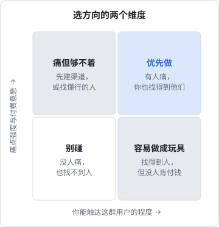

# 选方向

方向选错，后面的执行再好也是白费；方向选对，粗糙的执行也能活下来。这一章讲怎么挑一个**一个人做得动、有人愿意付钱、你又够得着用户**的方向，以及怎么在动手前用一张表把几个候选比较清楚。

选方向不是一次性的灵感，而是一个可以重复的筛选过程：先尽量多地收集候选，再用几道过滤器把明显不行的去掉，最后留下一两个进入第 3 章的验证。

## 好方向的三个条件

一个适合一人公司的方向，至少同时满足三条：

1. **有人痛，而且愿意为此付钱**。「这个挺有用的」不够，要有人觉得「没有它很麻烦」，而且他手里有预算或者愿意自掏腰包
2. **你够得着这群人**。你知道他们在哪里聚集，能用较低的成本把产品放到他们面前
3. **一个人做得动**。产品的开发、运维、客服、销售，在你的带宽内能扛住

很多技术人只检查了第一条的一半：「我觉得这个有用」。剩下两条往往是项目死掉的真正原因。



四个象限分别意味着：

- **右上「优先做」**：有人痛，你也找得到他们。这是理想位置
- **左上「痛但够不着」**：需求真实，但你不认识这群人，也不知道他们在哪。可以先花时间进入这个圈子，或者找一个懂行的人合作
- **右下「容易做成玩具」**：开发者最常掉进的坑。你身边就有很多潜在用户（比如其他程序员），他们也会试用、点赞，但没人付钱，因为不痛或者有免费替代品
- **左下「别碰」**：不用解释

## 方向从哪里来

### 自己的痒处

「解决自己的问题」（scratch your own itch）是独立开发者最常见的起点。好处是你天然理解需求，坏处是**你可能是唯一有这个需求的人**。

作者的 hatch-shelf 就是典型：一个离线读 Markdown 书的 iOS 书架，完全为自己的阅读习惯设计。它解决了真实问题，但目前这个问题的人群有多大、愿不愿付钱，没有验证过，所以它只是一个自用工具，不是一门生意。第 7 章会再拆解它。

用自己的痒处做起点没问题，但要尽快回答：**还有谁和我一样痛？他们在哪？**

### 你熟悉的行业

比起「我会什么技术」，「我了解什么行业」往往是更好的起点。在一家公司做过几年，你会知道这个行业：

- 哪些工作还在靠 Excel 和微信群
- 哪些角色每天重复做同一件事
- 谁有预算、谁拍板、采购流程是什么样

这类知识外人很难获得，是真正的**不公平优势**。

### 已经在付钱的地方

找方向的一个反直觉技巧：**去找已经有人在付钱的市场**，而不是找「还没有人做」的空白。没有竞争对手，往往意味着没有需求。有竞争对手，说明需求被验证过了，你要找的是现有产品没服务好的那部分人：

- 现有产品太贵，小客户用不起
- 现有产品太复杂，只用到其中一个功能
- 现有产品针对大公司设计，忽略了个体户、小门店
- 现有产品没有好好做中文本地化或国内的支付、发票

### 卖铲子

当一个领域在快速变化时，给参与者提供工具往往比直接参与更稳。AI 浪潮里，给做 AI 应用的人做评测、提示词管理、成本监控工具，就是这种思路。风险是热点退潮快，而且大平台随时可能把你的功能做成内置。

### AI 带来的新可能

有些需求以前存在，但实现成本太高；大模型让它变得可行。比如 hatch-counter 用视觉模型识别手写的进货单：过去要么让店员手动录入，要么做定制 OCR，成本都高；现在调用一次模型就能把照片变成结构化数据。

问自己：**我熟悉的行业里，有哪些「非结构化信息转结构化」「重复的判断」「繁琐的文书」，以前没法自动化，现在可以了？**

## 先算一下市场够不够大

第 1 章让你算了最低可行收入。现在用它反推需要多少用户：

$$
\text{需要的付费用户数} = \frac{\text{最低可行收入（每月）}}{\text{每个用户每月贡献的净收入}}
$$

「每个用户每月贡献的净收入」要扣掉渠道抽成、支付手续费、服务器和 API 成本。举个纯演示的算法（用字母，不代入具体数字）：

```text
假设最低可行收入是 M，每用户月费是 P
平台抽成与支付手续费合计占比 r，每用户每月的服务器和模型成本 c
每用户月净收入 = P × (1 − r) − c
需要的付费用户数 = M ÷ [P × (1 − r) − c]
```

然后问两个问题：

1. 这个数量的付费用户，按你估计的付费转化率倒推，需要多少潜在用户？
2. 这个潜在用户池，你能触达吗？

如果算出来需要几万个付费用户，而目标人群总共只有几千人，那这个方向不适合作为主业，最多是副业或者某个大产品里的功能。

这里的转化率、抽成比例要用你实际查到的数字。应用商店的抽成、支付渠道的费率都有官方说明，而且会调整，算的时候以最新公告为准。

## To C 还是 To B

| | To C（卖给个人） | To B（卖给企业、门店、个体户） |
|---|---|---|
| 单价 | 低 | 较高 |
| 需要的用户数 | 多 | 少 |
| 决策 | 个人当场决定 | 可能要老板、财务点头 |
| 获客 | 内容、社区、应用商店 | 熟人介绍、行业渠道、地推、销售 |
| 付费习惯 | 国内个人为软件付费的意愿分化明显 | 习惯为解决经营问题付费，但要发票、对公转账 |
| 客服负担 | 用户多，问题碎 | 用户少，但每个问题更重要 |
| 适合一人公司的点 | 可以完全线上、自动化 | 少量客户就能达到最低可行收入 |

一人公司做 To B，最大的挑战是**销售和服务**：企业客户期待能打电话找到人、出问题当天解决、能开发票。做 To C，最大的挑战是**获客**：你需要大量用户，而流量越来越贵。

没有标准答案，看你的不公平优势在哪边：有行业人脉，To B 更顺；擅长做内容、有一定影响力，To C 更顺。

## 一人公司的「不做清单」

有些方向不是不好，而是**不适合一个人做**。下面这些特征出现得越多，越要谨慎：

| 特征 | 为什么难 |
|---|---|
| 双边市场（同时要拉买方和卖方） | 冷启动需要两边同时有人，投入成倍 |
| 重运营（审核、调度、履约） | 带宽被日常琐事吃光，无法规模化 |
| 用户生成内容（UGC）且公开传播 | 内容审核、相关资质和备案要求重，出问题责任大 |
| 强监管行业（金融、医疗、教育类资质） | 资质门槛高，合规成本可能超过收入 |
| 需要硬件或库存 | 资金占用、物流、售后 |
| 必须 7×24 实时响应 | 一个人做不到真正的全天候 |
| 依赖单一平台的灰色地带接口 | 平台一改规则就归零 |
| 涉及他人版权内容 | 侵权风险，第 7 章拆解 hatch-recordwall 时会再谈 |

这张表不是禁令，而是提醒你：选了这类方向，要提前想好怎么应对，比如 UGC 只做私密分享、不做公开广场。合规要求以《国内合规实务》和主管部门的最新规定为准。

## 给候选方向打分

把候选方向写下来，用一张加权打分表比较。维度和权重可以按自己的情况调，下面是一个起点：

| 维度 | 权重 | 问自己 |
|---|---|---|
| 痛点强度 | 3 | 用户现在怎么解决？有多麻烦？ |
| 付费意愿 | 3 | 有没有人已经在为类似东西付钱？ |
| 触达能力 | 3 | 我知道去哪找到前 100 个用户吗？ |
| 一人可做 | 2 | 开发、运维、客服我扛得住吗？ |
| 不公平优势 | 2 | 我有别人没有的知识、渠道或技术吗？ |
| 自己的兴趣 | 1 | 三年后我还愿意做这件事吗？ |

每项打 1–5 分，加权求和。为了方便反复比较，可以用一个小脚本维护（Node 22.18 及以上默认能直接运行只用了可擦除类型语法的 `.ts` 文件，更早的版本用 `npx tsx score-ideas.ts`）：

```ts
// score-ideas.ts
type Score = 1 | 2 | 3 | 4 | 5;

interface Idea {
  name: string;
  pain: Score;
  willingnessToPay: Score;
  reach: Score;
  soloFeasible: Score;
  unfairAdvantage: Score;
  interest: Score;
}

const weights = {
  pain: 3,
  willingnessToPay: 3,
  reach: 3,
  soloFeasible: 2,
  unfairAdvantage: 2,
  interest: 1,
} as const;

const ideas: Idea[] = [
  { name: "餐饮门店进货单识别", pain: 4, willingnessToPay: 3, reach: 2, soloFeasible: 3, unfairAdvantage: 3, interest: 4 },
  { name: "开发者截图标注工具", pain: 2, willingnessToPay: 2, reach: 4, soloFeasible: 5, unfairAdvantage: 2, interest: 3 },
];

const maxTotal = Object.values(weights).reduce((a, b) => a + b, 0) * 5;

const ranked = ideas
  .map((idea) => {
    const total = (Object.keys(weights) as (keyof typeof weights)[]).reduce(
      (sum, key) => sum + idea[key] * weights[key],
      0,
    );
    return { name: idea.name, total, pct: Math.round((total / maxTotal) * 100) };
  })
  .sort((a, b) => b.total - a.total);

console.table(ranked);
```

```bash
node score-ideas.ts
```

分数本身不重要，重要的是**打分迫使你对每一项给出理由**。如果你发现自己在「触达能力」这一栏只能写「发到社交媒体上」，那这一项就该打低分。

## 让 agent 帮你做功课

候选方向多的时候，可以把调研的体力活交给 AI。下面是一个可以直接用的提示词骨架：

```text
我在考虑做一个产品：<一句话描述>。目标用户是 <谁>，在中国。

请帮我整理：
1. 这类用户现在用什么方式解决这个问题（工具、人工、Excel 等），各自的不便之处
2. 国内外已有的同类产品，它们主要服务哪类客户、怎么收费（只写你有把握的，不确定的标明）
3. 这类用户通常在哪些平台或社区聚集
4. 做这个方向可能涉及的合规事项（只列方向，不要给具体条款）
5. 你认为这个方向对一个人的公司来说最大的三个风险

不要编造数据。不确定的地方请明确说不确定。
```

模型的回答只能当线索，不能当结论：竞品信息要自己去官网核实，用户聚集在哪要自己去看，合规事项要查官方文件。真正的验证在下一章。

## hatch-counter 的方向推演

用本章的框架回看 hatch-counter（产品名「掌柜眼」）：给中小餐饮门店用的经营管理工具，导入收银报表算销量、拍进货单管库存、记开支算盈亏。

| 维度 | 推演 |
|---|---|
| 痛点 | 小馆子老板普遍说不清「今天到底赚没赚钱」，进货靠手写单据和记忆 |
| 付费意愿 | 门店已经在为收银系统等经营软件付费，有为经营工具花钱的习惯 |
| 触达 | 难点所在。餐饮老板不在开发者社区里，要靠熟人介绍、行业群、线下拜访 |
| 一人可做 | 产品是薄客户端 + 单一服务端，一台机器部署；开户、收款先走人工，压低了系统复杂度 |
| 不公平优势 | 视觉模型识别手写进货单，把过去最麻烦的录入环节自动化 |
| 风险 | To B 的服务负担；小餐饮门店本身经营不稳定，客户流失是常态 |

它落在四象限的哪里？痛点和付费意愿较高，触达能力是短板，所以更接近「痛但够不着」偏右的位置。这直接决定了它下一步的重点不是加功能，而是**找到稳定接触餐饮老板的渠道**。第 7 章会把这个推演继续做完。

## 本章要点

- 好方向要同时满足：有人痛且愿付钱、你够得着这群人、一个人做得动
- 开发者最常见的陷阱是「容易做成玩具」：身边很多人会试用，但没人付钱
- 行业知识往往比技术更是不公平优势；去已经有人付钱的市场找没被服务好的那部分人
- 用最低可行收入反推需要的付费用户数，判断市场够不够一个人吃饭
- 有一批方向天然不适合一个人：双边市场、重运营、公开 UGC、强监管、硬件、灰色接口、他人版权
- 用加权打分表强迫自己给出理由；用 AI 做调研的体力活，但结论自己核实
