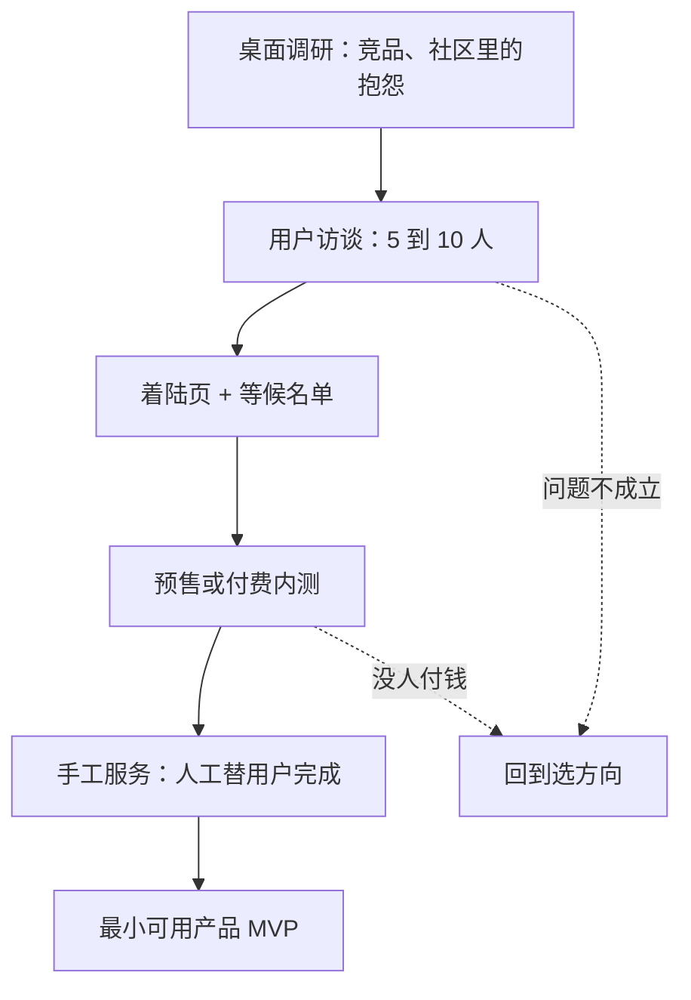

# 快速验证

上一章选出了一两个候选方向。这一章要回答：**在写大量代码之前，怎样用最少的时间和钱确认这个方向值得做**。

技术人最常见的失败模式是：花三个月把产品做得很完整，上线后发现没人用。验证的目的，就是把这个「发现」提前到第一两周，并且让代价从三个月降到几天。

## 验证的是什么

「验证」不是一个笼统的动作，它要依次回答三个问题，顺序不能乱：

| 顺序 | 问题 | 没验证就动手的后果 |
|---|---|---|
| 1 | **问题存在吗**：目标用户真的有这个麻烦，而且在意 | 做了一个解决伪需求的产品 |
| 2 | **有人愿意付钱吗**：不只是「有用」，而是愿意掏钱 | 用户很多，收入为零 |
| 3 | **你能持续触达他们吗**：获取一个用户的成本你负担得起 | 第一批朋友用完就没有下文 |

注意「你的方案好不好」不在这个列表的前面。方案可以改，问题和人群选错了才是致命的。

## 验证阶梯

从便宜到昂贵，有一串可以用的手段。原则是**能用便宜的手段得到答案，就不要上贵的**：



每往下一级，花费的时间更多，得到的信号也更可靠。点赞、收藏、口头说「好想要」都是弱信号；留下联系方式稍强；**真金白银付了钱是最强的信号**。

### 桌面调研

先花半天到一天，看看目标用户在哪里抱怨这个问题：

- 应用商店里同类产品的差评，尤其是写得很长的那种
- 小红书、知乎、V2EX、即刻、行业论坛里的吐槽帖
- 竞品的更新日志和定价页：它们在加什么功能、涨价还是降价
- 招聘信息：如果很多公司在招人做某件重复工作，说明这件事有成本

把看到的原话摘下来，后面写着陆页文案时直接用用户的语言。

### 用户访谈

访谈是性价比最高的验证手段，但要问对问题。核心原则只有一条：**问过去发生的事，不问将来会不会**。

| 不要问 | 改成问 |
|---|---|
| 你会用这样的产品吗？ | 上一次遇到这个问题是什么时候？当时怎么解决的？ |
| 你愿意为这个付多少钱？ | 你现在为解决这件事花了多少钱或时间？ |
| 这个功能你觉得怎么样？ | 解决这件事最麻烦的环节是哪一步？ |

人对未来的预测很不可靠，出于礼貌还会说好听的；但描述过去发生的事时，相对真实。访谈的详细方法见《产品思维》。

访谈 5 到 10 人通常就能看出规律。如果大多数人描述了类似的麻烦、而且已经在用笨办法应付，问题大概率是存在的。如果你需要很努力地引导，对方才「想起来」有这个问题，那它可能不够痛。

### 着陆页与等候名单

一页说明产品解决什么问题、给谁用、大概什么时候上线，再放一个留联系方式的表单。它测的是：**在不认识你的人里，有多少人愿意为这件事留下联系方式**。

对技术人来说，做一个着陆页只需要一两个小时。下面是用 Cloudflare Workers 静态资源加 D1 数据库做等候名单的最小实现，几乎零成本：

```toml
# wrangler.toml
name = "waitlist"
main = "src/index.ts"
compatibility_date = "2025-10-01"

[assets]
directory = "./public"

[[d1_databases]]
binding = "DB"
database_name = "waitlist"
database_id = "<wrangler d1 create 输出的 id>"
```

```ts
// src/index.ts
interface Env {
  DB: D1Database;
}

export default {
  async fetch(request: Request, env: Env): Promise<Response> {
    const url = new URL(request.url);

    if (request.method === "POST" && url.pathname === "/api/waitlist") {
      const form = await request.formData();
      const contact = String(form.get("contact") ?? "").trim();
      const source = String(form.get("source") ?? "").slice(0, 50);

      if (!contact || contact.length > 100) {
        return text("请填写邮箱或微信号", 400);
      }

      await env.DB.prepare(
        "INSERT INTO waitlist (contact, source, created_at) VALUES (?, ?, ?)",
      )
        .bind(contact, source, new Date().toISOString())
        .run();

      return text("已登记，上线时会通知你");
    }

    return text("Not found", 404);
  },
} satisfies ExportedHandler<Env>;

function text(body: string, status = 200): Response {
  return new Response(body, {
    status,
    headers: { "content-type": "text/plain; charset=utf-8" },
  });
}
```

`public/index.html` 放着陆页本身，表单 `POST` 到 `/api/waitlist`，带一个隐藏字段 `source` 标记是从哪个渠道来的（比如在小红书发的链接带 `?from=xhs`，页面脚本把它填进隐藏字段）。配置了 `[assets]` 之后，能匹配到 `public/` 下文件的请求直接返回静态文件，其余的才进 Worker。

```bash
npx wrangler d1 create waitlist
# 把输出的 database_id 填进 wrangler.toml
npx wrangler d1 execute waitlist --remote --command \
  "CREATE TABLE waitlist (id INTEGER PRIMARY KEY AUTOINCREMENT, contact TEXT NOT NULL, source TEXT, created_at TEXT NOT NULL)"
npx wrangler types        # 生成 D1Database 等类型声明
npx wrangler deploy

# 之后查看报名情况
npx wrangler d1 execute waitlist --remote --command \
  "SELECT source, COUNT(*) AS n FROM waitlist GROUP BY source"
```

Wrangler 的配置格式和命令参数会随版本演进，以 Cloudflare 官方文档为准。

两点提醒：

- **收集联系方式就是在处理个人信息**。页面上要写清楚收集什么、用来干什么（「仅用于产品上线时通知你」）、怎么删除，只收必要的字段，不要拿去做别的用途。具体义务见《国内合规实务》中个人信息保护的部分
- **境外托管的页面在国内访问可能不稳定**，验证阶段可以接受；正式面向国内用户时，服务器放在境内需要先完成 ICP 备案

### 预售与付费内测

等候名单只说明「感兴趣」，付钱才说明「需要」。在产品还没完成时就开放预售或付费内测，是最有力的验证：

- 「早鸟价，上线后自动开通一年」
- 「付费内测名额 20 个，参与每周反馈，正式版终身免费升级」
- 面向企业：「先付一个月的试点费用，我们按你们的流程配置好」

国内个人开发者可以用付费社群、知识付费平台或者直接收款加手动登记。不管用什么方式，**要承诺清楚什么时候交付、交付不了怎么退款**，并且真的做到。预售收入在税务上怎么处理，见《财务与税务》。

很多人怕预售「显得不专业」或者「万一做不出来」。但如果你连 10 个人都说服不了提前付钱，产品做完后大概率也说服不了。

### 手工服务

在写自动化代码之前，先**用人工完成产品要做的事**，这在创业圈常被叫作「礼宾式 MVP」（concierge MVP）；用户以为背后是系统、实际是人在操作的变体，叫「绿野仙踪式 MVP」（Wizard of Oz）。

比如你想做一个「自动生成周报」的工具，可以先让几个用户每周把材料发给你，你用 AI 加手工整理好发回去。这个过程会告诉你：

- 用户真正在意的是哪部分
- 哪些步骤可以自动化，哪些其实需要判断
- 用户愿不愿意持续使用、愿不愿意付钱

hatch-counter 在运营上就保留了大量手工环节：账号由内部在管理后台开通，续费是线下转账、财务在后台确认收款，到期提醒也在后台处理。在线支付和自助注册都列在路线图上，但还没做。这是对的：**客户只有个位数到几十个的时候，手工流程的成本远低于开发和维护一套自动化系统**，而且每一次手工接触都是和客户交流的机会。

## 事先写好成功标准

验证最大的敌人是自欺：结果出来之后，总能找到理由说「其实还行」。解决办法是**在开始之前写下成功和失败的标准**，并给自己设一个时间盒。

可以为每个实验写一张卡片：

```yaml
# experiments/2026-11-waitlist.yaml
hypothesis: 中小餐饮门店老板愿意为「拍照自动录进货单」付费
method: 着陆页 + 在三个餐饮老板微信群里发帖，附 source 参数
timebox: 2 周（2026-11-03 至 2026-11-16）
success: 至少 N 个非熟人留下联系方式，且其中至少 M 人同意 15 分钟电话访谈
fail: 少于 N/3 个报名，或报名的人都不是门店老板
next_if_success: 电话访谈，询问现在的录入方式和愿意支付的范围
next_if_fail: 换渠道再试一次；仍失败则回到选方向
result: # 结束后填写，包括意外发现
```

N 和 M 填多少，取决于你的渠道规模和最低可行收入，没有通用标准。重要的是**写下来之后不要改**。如果结果模糊，就设计一个更明确的实验，而不是放宽标准。

## 常见的自欺

| 表现 | 为什么不可靠 |
|---|---|
| 朋友和同事都说好 | 他们在乎你的感受，不在乎你的产品 |
| 帖子点赞很多 | 点赞的成本是零，和付费是两回事 |
| 「等功能更完整再给人看」 | 越晚给人看，沉没成本越高，越听不进反馈 |
| 只访谈愿意聊的人 | 愿意和你聊的人本身就是偏差样本 |
| 用户说「如果有某功能我就买」 | 加了那个功能，他通常还会提下一个 |
| 注册的人很多 | 要看有多少人第二周还在用、有多少人付钱 |
| 竞品融了很多钱，说明市场好 | 融资说明投资人看好，不说明用户在付钱，也不说明一个人能做 |

## 验证到什么程度可以开做

没有绝对的门槛，但下面几条同时成立时，通常值得投入去做 MVP：

- 访谈中多数人描述了相同的麻烦，而且已经在为此花钱或花时间
- 有不认识你的人主动留下了联系方式，并且来自你能持续使用的渠道
- 至少有几个人付了钱，或者明确同意了一个价格并约定了时间
- 你知道下一批用户从哪里来

MVP 的边界怎么划、先做哪些功能，见《产品思维》。在那之前记住一点：**MVP 的目的是继续验证，不是发布一个完整产品**。

## 本章要点

- 验证依次回答三个问题：问题是否存在、有没有人付钱、能否持续触达；方案好不好排在后面
- 按成本从低到高使用验证手段：桌面调研、访谈、着陆页、预售、手工服务、MVP
- 访谈只问过去发生的事，不问将来会不会
- 着陆页加等候名单一两个小时就能搭好，但收集联系方式要遵守个人信息保护的要求
- 付钱是最强的信号；手工服务在客户少时比自动化便宜得多
- 实验开始前写下成功标准和时间盒，结果出来后不改标准
