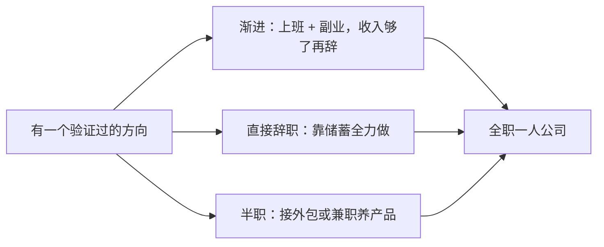
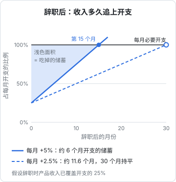
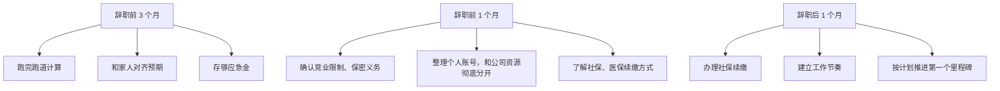

# 从副业到全职

验证通过、产品有了第一批付费用户，接下来最大的决定是：**什么时候辞职，以什么方式辞职**。这一章讲三条过渡路径、怎么算清楚自己的跑道、副业期间的法律边界，以及辞职前后要处理的事务。

这一章没有「勇敢一点，现在就辞职」的鼓励，也没有「千万别辞」的劝阻。目标是把这个决定从情绪变成一道可以计算的题。

## 三条路径



| | 渐进 | 直接辞职 | 半职 |
|---|---|---|---|
| 现金流 | 最稳，有工资 | 只出不进，靠储蓄 | 外包收入覆盖部分开支 |
| 速度 | 慢，每周只有十几到二十小时 | 快，全部时间投入 | 中等 |
| 风险 | 低，但可能「永远在准备」 | 高，跑道耗尽前必须起来 | 中，外包容易吃掉产品时间 |
| 适合 | 有家庭负担、开支高、方向还不太确定 | 储蓄充足、开支低、方向已经验证得比较清楚 | 有稳定的外包客户来源 |

大多数人适合从**渐进**开始，在副业收入证明了方向之后，再切到全职。直接辞职不是不行，但它把验证和生存两件事压在一起：当你每个月都在消耗储蓄时，很难冷静判断一个方向是否该放弃（第 6 章会讲这种压力怎么扭曲判断）。

半职路径看起来是折中，实际上最难把握：外包有截止日期、有客户催，产品没有，**紧急的事总会挤掉重要的事**。如果走这条路，要给外包设硬上限，比如每周最多三天。

## 先算跑道

**跑道**（runway）是指不靠新收入的情况下，你的储蓄还能撑多少个月：

$$
\text{跑道（月）} = \frac{\text{可动用的储蓄}}{\text{每月净消耗}}
$$

其中每月净消耗 = 每月总开支 − 每月收入。「可动用的储蓄」要扣掉应急金：家人生病、意外这类事不会因为你在创业就不发生。

但只算静态跑道不够，因为辞职后产品收入是在变化的。更有用的问题是：**以我现在的收入和增长速度，收入多久能追上开支，在那之前要烧掉多少储蓄？**



图里的假设：辞职时产品收入已经能覆盖每月开支的 25%，之后每个月线性增长。

- 每月增长开支的 5%：第 15 个月收入和开支持平，期间累计吃掉约 6 个月开支的储蓄
- 每月增长开支的 2.5%：要到第 30 个月才持平，期间吃掉约 11.6 个月开支的储蓄

增长速度减半，持平时间翻倍，消耗的储蓄也接近翻倍。**增长速度的估计误差会被放大**，所以计算时要用保守的增长率，并且准备好比算出来更多的储蓄。

### 一个可以照着改的计算脚本

```ts
// runway.ts
interface Plan {
  savings: number;          // 可动用储蓄，已扣除应急金
  monthlyExpense: number;   // 每月总开支（含自缴社保、经营成本）
  revenueNow: number;       // 辞职时的产品月净收入
  monthlyGrowth: number;    // 每月净收入的增量（线性增长假设）
  maxMonths?: number;
}

function simulate(plan: Plan) {
  const { savings, monthlyExpense, revenueNow, monthlyGrowth, maxMonths = 60 } = plan;
  let balance = savings;

  for (let month = 0; month < maxMonths; month++) {
    const revenue = revenueNow + monthlyGrowth * month;
    if (revenue >= monthlyExpense) {
      return { outcome: "持平", month, burned: round2(savings - balance), balance: round2(balance) };
    }
    balance -= monthlyExpense - revenue;
    if (balance <= 0) {
      return { outcome: "跑道耗尽", month, burned: savings, balance: 0 };
    }
  }
  return { outcome: "期限内未持平", month: maxMonths, burned: round2(savings - balance), balance: round2(balance) };
}

const round2 = (n: number) => Math.round(n * 100) / 100;

// 用「每月开支 = 1」做单位，便于和上图对照；换成你自己的真实数字即可
const base = { savings: 12, monthlyExpense: 1, revenueNow: 0.25 };

console.table([
  { 场景: "乐观", ...simulate({ ...base, monthlyGrowth: 0.05 }) },
  { 场景: "保守", ...simulate({ ...base, monthlyGrowth: 0.025 }) },
  { 场景: "停滞", ...simulate({ ...base, monthlyGrowth: 0 }) },
]);
```

```bash
node runway.ts
```

月份从 0 开始计，和上图的横轴一致。用 12 个月开支的储蓄去跑：乐观场景第 15 个月持平，还剩约 6 个月开支；保守场景勉强在第 30 个月持平，只剩不到半个月开支的余量，稍有意外就撑不住；停滞场景在第 15 个月耗尽。**一定要跑一个「停滞」场景**，它告诉你最坏情况下有多少时间做决定。

## 什么时候可以辞职

把计算和几个定性信号结合起来。下面这些条件满足得越多，辞职的理由越充分：

| 信号 | 说明 |
|---|---|
| 副业净收入达到最低可行收入的相当比例 | 比例多少看你的风险承受力，越高越稳 |
| 收入连续几个月增长，而不是一次性的 | 一次爆款带来的收入不可持续 |
| 增长的瓶颈是你的时间 | 有明确的事情要做，但下班后做不完 |
| 跑完保守场景，储蓄仍有余量 | 不是靠乐观场景才撑得住 |
| 家人理解并支持 | 收入波动会影响整个家庭 |
| 你知道接下来三个月要做什么 | 辞职不是为了「有时间想清楚」 |

最后一条特别重要。如果辞职的原因是「上班太累了、想换个活法」，那辞职后你得到的是时间，但不一定是方向。没有方向的自由时间，很容易在焦虑和刷手机中消耗掉。

也有反过来的信号：**如果副业做了很久，收入一直没有起色，辞职不会解决这个问题**。时间多了不一定能解决获客问题，反而会让你更焦虑。这时候应该回到第 3 章和第 6 章，而不是第 4 章。

## 副业期间的边界

在职做副业，有几条线要守住。下面讲的是框架，具体以你的劳动合同、公司制度和现行法律规定为准，拿不准时咨询专业律师。

### 劳动合同和公司制度

先把劳动合同、员工手册、保密协议翻出来看：

- 有没有禁止兼职或要求兼职需报备的条款
- 保密义务覆盖哪些信息
- 有没有约定离职后的**竞业限制**：竞业限制是指离职后一段时间内不得到竞争对手处工作或自营同类业务，依法通常需要公司支付经济补偿，期限有法定上限

如果副业和公司业务存在竞争关系，风险最高。最好的做法是选一个和雇主业务明显不相关的方向。

### 知识产权归属

在职期间完成的作品和发明，如果是执行工作任务、或者主要利用了单位的物质技术条件完成的，可能被认定为职务成果，权利归单位或者由单位享有优先权利。所以：

- **不在上班时间写副业代码**
- **不用公司电脑、公司账号、公司的云资源、公司的付费工具**
- 副业代码放在个人仓库，用个人邮箱提交
- 不使用公司的代码、数据、客户名单，哪怕只是「参考」

这些既是法律风险，也是职业操守。哪天副业做成了，你不会希望有人来主张它的归属。

### 公开身份

在社交媒体上公开构建（build in public）是很好的获客方式，但在职期间要想清楚：同事和老板看到会怎么想？有些人会选择用不关联真名的账号起步，等辞职后再公开。这没有对错，按你的处境决定。

## 主体什么时候注册

一个常见误区是：要做副业，先注册一家公司。其实早期完全可以用个人身份收款，等到出现下面的情况再考虑注册主体：

- 客户要求开发票，或者要对公转账
- 上架应用商店、开通某些支付或平台服务需要企业资质
- 收入规模上来了，需要规范的财务和税务处理
- 想把经营风险和个人财产隔离

可选的主体主要是个体工商户和有限责任公司，两者在责任承担、税务处理、注销难度上差别很大。比如有限公司以出资为限承担责任，但只有一个股东时，公司财产和个人财产混同的风险需要格外注意；个体户设立和注销都简单，但经营者对债务承担无限责任。

主体怎么选、注册流程、税种和发票，分别见《国内合规实务》和《财务与税务》。这里只提醒一点：**相关政策、税率和优惠门槛经常调整，以当地市场监管、税务部门的最新规定为准**。

## 辞职前后的事务清单



几件容易忽略的事：

- **社保和医保**：离职后单位停缴，需要以灵活就业人员身份自行缴纳，或者通过自己注册的主体缴纳。断缴可能影响医保报销、部分城市的购房购车资格和积分，具体规则各地不同，离职前去当地社保经办机构问清楚
- **失业保险金**：领取条件之一通常是非因本人意愿中断就业，主动辞职一般不符合，不要把它算进跑道
- **公积金**：离职后可以选择个人缴存（部分城市支持）或封存，影响以后的贷款额度
- **贷款和信用卡**：没有工资流水后，申请房贷、车贷、提额都会变难。有计划要办的，尽量在辞职前办完
- **医疗和意外保险**：失去了公司的补充医疗，考虑自己配置商业保险

## 心理上的落差

辞职后头几个月，很多人会遇到意料之外的状态：

- **没有发工资的那一天**：每个月固定到账的安全感消失了，即使储蓄充足，看着余额下降也会焦虑
- **没有同事**：没有人可以随口讨论问题，没有午饭时的闲聊
- **没有外部节奏**：没有周会、没有截止日期，一天很容易就过去了
- **身份感的变化**：别人问「你在哪上班」，回答「我在做自己的产品」时，会感到被怀疑

这些都正常。应对办法在下一章：给自己建立节奏、找到同行者、把进展变得可见。

## 本章要点

- 三条路径：渐进、直接辞职、半职；大多数人适合先渐进，用副业收入证明方向后再全职
- 不只算静态跑道，要算「收入多久追上开支、期间烧掉多少储蓄」，并且一定跑一个停滞场景
- 增长率的估计误差会被放大，用保守假设，准备比计算结果更多的储蓄
- 辞职的好理由是「时间成了增长瓶颈」，不是「上班太累」
- 副业期间：看清劳动合同和竞业条款，不用公司的时间、设备和资源，代码和账号与公司彻底分开
- 早期可以个人收款，有开票、资质、风险隔离需求时再注册主体；政策以最新官方规定为准
- 辞职前处理好社保续缴、贷款、保险，并准备好心理落差
