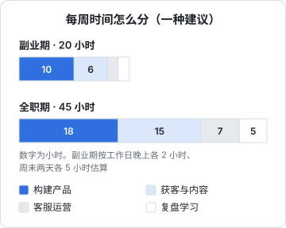
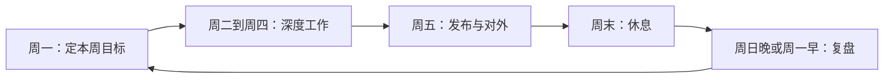

# 精力与节奏

一人公司没有老板安排任务，没有同事推着你走，也没有下班时间。自由的另一面是：**所有的节奏都要自己建立，所有的精力都要自己管理**。

这一章讲一个人怎么分配有限的时间和注意力、怎么用周和季度的节奏推进工作、怎么和 AI agent 分工，以及怎么识别和避免倦怠。它不是效率技巧大全，而是一套能让你坚持几年的工作方式。

## 瓶颈是注意力，不是时间

全职做一人公司后，很多人发现：时间多了，产出并没有按比例增加。原因是真正稀缺的不是小时数，而是**能做出好判断、能进入深度工作的那几个小时**。

一天里能高质量专注的时间通常只有几个小时。把它花在哪里，决定了公司的走向：

| 高价值、需要深度专注 | 低价值、可以碎片化或交出去 |
|---|---|
| 决定做什么、不做什么 | 回复常见问题 |
| 设计核心功能和数据模型 | 改样式、修小 bug |
| 写着陆页的核心文案 | 发布已经写好的内容 |
| 和关键用户深聊 | 整理账单、报销 |
| 审查 agent 交付的关键代码 | 让 agent 跑测试、补类型 |

原则是：**把精力最好的时段留给左边一列，右边一列集中处理或者交给工具**。

## 时间怎么分

技术人做一人公司，最常见的失衡是：几乎所有时间都在写代码，因为那是最舒服、最有掌控感的事。但产品不会自己找到用户。



这张图是一种起点建议，不是标准答案：

- **副业期**：时间很少，以构建为主，但每周至少留出几个小时做获客和用户沟通，否则产品做完了也没人知道
- **全职期**：获客和内容的比例明显提高。很多独立开发者回头看都会说，早期应该花更多时间在「卖」上，而不是「做」上

不同阶段比例会变：刚开始做 MVP 时构建多一些，产品稳定后获客多一些。关键是**有意识地分配**，而不是任由写代码吃掉一切。

一个简单的做法是每周记录一下时间实际花在哪里，和计划对比。不需要精确到分钟，按半天为单位标记就够了。

## 周节奏

没有外部节奏时，最有效的办法是给自己一个固定的周循环：



- **周一**：看上周复盘，定本周最多三个目标。目标要能判断完成与否，比如「上线导出功能」「访谈 3 个用户」，而不是「优化体验」
- **周二到周四**：上午做最需要专注的事，下午处理沟通、客服、杂务
- **周五**：把本周成果发出去：更新日志、给用户发通知、在社交媒体写进展。**每周都发一点东西**，能逼自己把工作推到可交付的状态
- **周末**：真正休息。一人公司最大的风险之一是工作和生活的边界消失

### 周复盘模板

复盘不用长，十分钟就够，关键是每周都做。可以放在一个固定的 Markdown 文件里，让 agent 帮你汇总：

```markdown
## 2026-W45 复盘

### 本周目标完成情况
- [x] 上线进货单批量导入
- [ ] 访谈 3 个门店老板（完成 1 个）
- [x] 写一篇使用教程

### 关键数字
- 新注册 / 活跃 / 付费：填实际数字
- 收入：本周 / 本月累计
- 时间分配：构建 _ 天，获客 _ 天，运营 _ 天

### 学到了什么
- 门店老板更在意「这个月进货花了多少」，而不是单张单据的明细

### 下周最重要的一件事
- 再约 2 个访谈，重点问月底对账怎么做
```

坚持几个月后，这些记录本身就是很好的素材：可以写成公开构建的帖子，也可以在第 6 章判断是否该放弃时提供依据。

## 季度目标

周节奏解决「这周做什么」，季度目标解决「这些周加起来要走到哪」。每个季度开始时回答三个问题：

1. 这个季度结束时，什么结果出现了，就说明进展顺利？用可衡量的结果描述，比如付费用户数、月收入、留存
2. 为了这个结果，最重要的两三件事是什么？
3. 这个季度**明确不做**什么？

第三个问题往往最有价值。一个人的带宽有限，把「不做」写下来，在诱惑出现时（一个看起来很酷的新技术、一个用户提的大需求）就有了拒绝的依据。

季度末要做一次比周复盘更深的回顾：目标达成了吗？没达成的原因是执行问题还是方向问题？方向问题要进入第 6 章的流程。

## 和 agent 分工

编码 agent 改变了一人公司的产能结构。过去一个人的瓶颈是「写不完」，现在越来越多地变成「想不清」和「审不完」。

### 交出去什么

适合交给 agent 的工作有一个共同特征：**目标清楚、结果可验证**。

- 按照已经想清楚的设计实现功能，附带测试
- 跨端的重复改动：改了接口，同步更新 Web、移动端、类型定义
- 写脚本、迁移数据、补文档
- 夜间或离开电脑时跑长任务，回来检查结果
- 整理客服记录、汇总用户反馈、起草更新日志

### 自己留着什么

- **决定做什么**：哪个功能值得做、哪个用户需求应该拒绝
- **关键设计**：数据模型、核心业务口径、安全边界
- **对外承诺**：给用户的回复、定价、退款决定
- **最终审查**：特别是涉及数据、钱、权限的改动

### 新的瓶颈

当 agent 可以并行产出大量代码时，你的审查能力成了瓶颈。几个经验：

- **把规则写进仓库**：项目的 `CLAUDE.md` 或 `AGENTS.md`、按路径加载的规则文件，让 agent 一开始就按你的约定做，减少返工。作者的几个项目都把「为什么这么定」写在文档里，就是为了让 agent 和未来的自己少踩坑
- **让测试和类型检查替你审一部分**：`pnpm typecheck`、`pnpm test`、lint 规则跑通，再看业务逻辑
- **一次只开几条线**：同时开太多 agent 任务，切换上下文的成本会吃掉并行的收益

怎么写这些规则文件、怎么组织并行任务，见《编码 Agent 实战》和《个人 Agent 工作流》。

## 碎片工作集中处理

客服、社群回复、邮件、账单这类事务，单个都很小，但如果随来随处理，会把一整天切成碎片。几个做法：

- **固定时段处理**：比如每天下午四点集中回复消息。在产品里写清楚响应时间，比如「工作日 24 小时内回复」，降低用户对即时响应的期待
- **常见问题文档化**：同一个问题回答过三次，就写进帮助文档，下次直接给链接
- **先让 AI 起草**：把用户问题和产品文档一起交给模型，生成回复草稿，自己改一下再发。涉及退款、数据、隐私的问题自己处理
- **通知分级**：只有「服务挂了」「支付失败」这类真正紧急的事才推送到手机，其余的进收件箱

## 健康和倦怠

一人公司是长跑。你就是公司唯一的核心资产，资产坏了，公司就停了。

### 底线

- **睡眠**：长期睡眠不足会直接损害判断力，而判断力是你最值钱的东西
- **运动**：坐一整天写代码，几年后颈椎、腰椎会找你算账。每天至少有一段离开屏幕的活动
- **休息日**：每周至少一天完全不碰工作。服务器出事的告警可以例外，但要让这种例外真的少见：系统要设计成一个人能运维、能自动恢复

### 倦怠的信号

| 信号 | 可能意味着 |
|---|---|
| 打开电脑就想刷手机，迟迟不开始 | 目标不清楚，或者对方向失去信心 |
| 对用户反馈感到烦躁 | 精力透支，或者产品方向和你的兴趣脱节 |
| 一直在做「准备工作」：重构、换框架、调工具 | 在逃避真正困难的事，通常是获客 |
| 连续几周复盘都是「目标没完成」 | 目标定得太多，或者执行出了问题 |
| 休息日也停不下来想工作 | 焦虑，往往和现金流压力有关 |

出现这些信号时，先休息几天，再回来看复盘记录。如果是方向问题，进入第 6 章；如果是节奏问题，砍掉一半目标。

### 找到同行者

孤独是一人公司的慢性病。几个办法：

- 加入独立开发者社群，线上的即刻、V2EX 相关节点，或者线下的城市聚会
- 找一两个同样在做一人公司的朋友，每周或每两周互相同步进展，彼此当「董事会」
- 公开构建：定期在社交媒体上分享进展、数字和教训。它既是获客渠道，也是一种外部约束和反馈来源

公开构建也有代价：竞争对手能看到你的思路，数字不好看时有心理压力，花在写帖子上的时间也是成本。可以只公开过程和教训，不公开敏感的数字。

## 本章要点

- 一人公司的瓶颈是能做出好判断的注意力，不是时间；精力最好的时段留给决策和深度工作
- 有意识地分配时间，警惕写代码吃掉获客和沟通的时间
- 用固定的周循环和季度目标替代外部节奏；每周发布一点东西，每周做十分钟复盘
- 季度目标里写下「明确不做」的事
- 把目标清楚、可验证的工作交给 agent，自己保留决策、关键设计、对外承诺和最终审查；把规则写进仓库来降低审查成本
- 碎片事务集中处理、文档化、让 AI 起草
- 睡眠、运动、休息日是底线；识别倦怠信号，找到同行者
