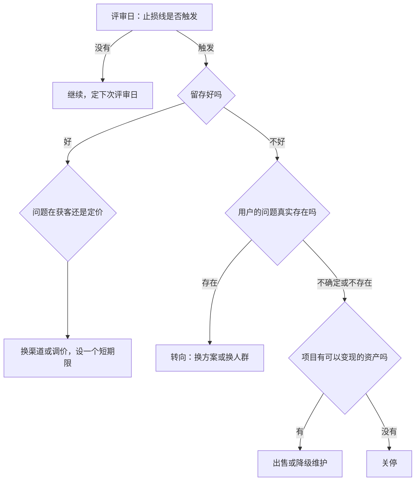

# 什么时候该放弃

坚持是美德，但在一人公司里，**不知道何时放弃比放弃本身代价更大**。一个没有前途的项目，每多做一个月，你就少一个月去尝试下一个方向，而一个人的时间是最不可再生的资源。

这一章讲怎么在开始时就设好止损线、怎么区分「暂时困难」和「方向错了」、放弃之外还有哪些选项（转向、降级、出售），以及真的决定关停时怎样体面地收尾。

## 为什么放弃这么难

几种心理机制会让人在错误方向上停留太久：

| 机制 | 表现 |
|---|---|
| 沉没成本 | 「已经做了一年了，现在放弃太可惜」 |
| 幸存者偏差 | 「某某也是坚持了三年才起来的」，但你没看到坚持了三年仍然失败的大多数人 |
| 身份绑定 | 项目成了「我是谁」的一部分，放弃项目像是否定自己 |
| 模糊的进展 | 每个月都有一点点增长，足够让你不放弃，但不够让你活下去 |
| 再试一次 | 「再加一个功能」「再换一个渠道」，每次都觉得下一次会不同 |

其中**模糊的进展**最危险。完全没人用的项目很容易放弃，真正吞噬时间的是那些「有一点起色」的项目：有几十个用户，收入能付服务器费，偶尔还有用户夸你。它们不会死，但也活不好。

## 在开始时写好止损线

最有效的办法，是**在情绪还没投入之前**，就写下什么情况下停止。和第 3 章的实验卡片一样，止损线要具体、可衡量、有时间限制：

```yaml
# projects/xxx/kill-criteria.yaml
project: 门店进货单识别
started: 2026-11-01
review_dates: [2027-02-01, 2027-05-01, 2027-11-01]

# 任一条成立，就进入「放弃或转向」评审
kill_if:
  - 到 2027-02-01，付费客户少于 A 家
  - 到 2027-05-01，月净收入低于最低可行收入的 B%
  - 连续 3 个月，付费客户净增长为零或负
  - 累计投入超过 C 元（服务器、模型调用、推广）
  - 连续 2 个季度复盘，我都不想继续做这件事

# 写给未来的自己
note: 到了评审日不许临时修改上面的数字；可以有新的判断，但要先承认旧标准没达到
```

A、B、C 是你根据最低可行收入和跑道算出来的数字。几个要点：

- **评审日要写进日历**，到了那天专门留出半天来做这件事
- **只评审，不自动执行**：止损线触发的是一次认真的评审，而不是机械地关停。但评审时要先承认「标准没达到」，再讨论要不要例外
- **把自己的意愿也列进去**：如果你已经不想做了，再好的数据也撑不了多久

## 区分三种放弃

「放弃」至少有三个层次，不要混为一谈：

| 层次 | 意思 | 例子 |
|---|---|---|
| 放弃一个功能或渠道 | 方向不变，换做法 | 小红书获客不行，改做行业社群 |
| 放弃一个产品 | 换一个问题或人群 | 门店管理做不起来，改做门店进货单识别的单点工具 |
| 放弃一人公司这条路 | 回去打工，或者加入别人的团队 | 跑道耗尽，回到职场 |

很多人在该放弃第一层时，放弃了第二层；或者在该放弃第二层时，硬撑在第一层不停地换渠道。做判断时先问清楚：**问题出在做法上，还是出在问题和人群本身？**

## 看哪些信号

单个数据点说明不了什么，要看趋势和组合。下面这些信号可以帮助判断问题出在哪一层：

| 信号 | 更可能指向 |
|---|---|
| 新用户来了，但很快就不用了（留存差） | 产品没解决问题，或者解决的不是他们真正的问题 |
| 用户在用，但不付钱 | 不够痛，或者定价和价值不匹配，或者有免费替代 |
| 付费用户满意，但新用户来得太少 | 渠道问题，或者市场本身太小 |
| 获取一个用户的成本高于他带来的收入 | 渠道或定价问题，规模化后会更糟 |
| 用户都来自你的熟人圈 | 还没有被真正验证 |
| 你对这个领域越来越没兴趣 | 很难坚持到起色那一天 |

其中最有诊断价值的是**留存**。如果用过的人会持续使用、会推荐给别人，即使增长慢，方向通常是对的，问题在获客；如果用户来了就走，再多的获客也只是把水倒进漏桶。留存怎么算、怎么分析，见[《数据分析与埋点》](../product-analytics/)。

## 决策流程

到了评审日，可以按这个流程走一遍：



「设一个短期限」很重要：换渠道或调价不是无限期的再试一次，而是一个新的、更短的实验，比如六到八周，同样事先写好成功标准。

## 转向的几种方式

转向（pivot）不是从头再来，而是保留一部分已经验证的东西，换掉另一部分：

| 转向类型 | 保留 | 换掉 | 例子 |
|---|---|---|---|
| 换人群 | 产品能力 | 目标用户 | 门店库存工具从餐饮转向小型零售 |
| 换问题 | 目标用户、渠道 | 解决的问题 | 还是服务餐饮老板，但从记账转向排班 |
| 缩小范围 | 核心能力 | 其余功能 | 完整的门店管理缩小成只做进货单识别 |
| 换模式 | 产品 | 收费方式 | 订阅改为按识别次数计费，或改为买断 |
| 换渠道 | 产品、人群 | 获客方式 | 从线上内容转向和收银系统服务商合作 |

转向要问自己：**这次转向利用了我们已经学到的什么？**如果答案是「什么都没利用」，那它不是转向，是重新开始，就应该按第 2 章从头选方向。

## 放弃以外的选项

不是所有不再继续投入的项目都必须关掉。

### 降级维护

如果产品有少量稳定的付费用户，收入能覆盖成本，但不值得继续投入时间，可以进入「维护模式」：

- 停止开发新功能，只修严重问题
- 把运维做到尽量自动化，降低每月需要投入的时间
- 在产品里如实告知用户「进入维护期」

它可以成为一个小的被动收入来源，但要注意：维护模式的产品仍然占用一部分注意力，服务器出问题时你还是要处理。而且如果产品处理用户数据，你的合规义务并不会因为进入维护期而减少。

### 出售

有用户、有收入的小产品，可能对别人有价值：同行业的公司、想快速进入某个领域的开发者。国内外都有交易小型网站、应用和 SaaS 的平台和中介，交易时要注意用户数据的转移是否合规、合同怎么约定交接和后续支持。

### 开源

如果代码有价值但没有商业前景，可以考虑开源。这能保留一部分声誉资产，也让还在用的用户可以自行部署。开源前检查代码里没有密钥、没有用户数据，许可证选好。

## 体面地关停

决定关停后，要对用户负责。这关乎你的声誉，也关乎法律义务。

### 用户和数据


- **提前通知**：给用户留出足够的迁移时间，通知里写清楚停止服务的日期、怎么导出数据、退款怎么处理
- **数据导出**：让用户能把自己的数据带走，导出成通用格式（CSV、JSON、Markdown）
- **退款**：预付了年费的用户，按剩余时间退款。即使法律上没有明确要求，这也是基本的诚信
- **删除数据**：服务停止后，按照隐私政策的约定删除用户个人信息，具体义务见[《国内合规实务》](../opc-compliance-cn/)

### 基础设施

用一张清单逐项关掉，避免几个月后还在为忘记的服务付费：

```bash
# 1. 最后一次完整备份，自己留存一段时间后再销毁
#    以 Docker Compose 部署的 Postgres 为例，服务名、用户名、库名按实际替换
docker compose exec -T db pg_dump -U <user> -Fc <database> > final-$(date +%F).dump

# 2. 确认备份能恢复：本地起一个临时库试一下，镜像主版本与线上保持一致
docker run --rm -d --name restore-test -e POSTGRES_PASSWORD=test postgres:<线上的主版本>
sleep 5
docker exec -i restore-test pg_restore -U postgres -d postgres --create --no-owner < final-$(date +%F).dump
docker exec restore-test psql -U postgres -c '\l'   # 看到原库名即恢复成功
docker stop restore-test

# 3. 停服务、关定时任务
docker compose down
sudo systemctl disable --now <your-service>.service
```

然后逐项检查：

- 云服务器、对象存储、CDN
- 第三方 API（模型调用、短信、邮件）的 key 撤销，避免泄露后被盗刷
- 域名：可以保留一段时间，放一个说明页，避免被人抢注后冒用
- 应用商店里的应用下架
- 订阅的 SaaS 工具、付费服务取消自动续费
- 如果有专门为这个项目注册的主体，评估是否需要注销，以及注销的流程

### 复盘

关停后写一份复盘，哪怕只给自己看：

- 当初的假设是什么？哪些被证实了，哪些被推翻了？
- 如果重来，在哪个时间点就应该发现问题？
- 留下了什么资产？

最后一个问题值得认真想。一个失败的项目通常会留下：可复用的代码和基础设施、对一个行业的理解、一批认识你的用户和同行、写过的内容和积累的受众、更熟练的技能。**下一个项目会从这些资产开始，而不是从零开始**。

## 本章要点

- 不知道何时放弃比放弃本身代价更大；最危险的是「有一点起色」的模糊进展
- 在情绪投入之前写好止损线：具体、可衡量、有评审日期；触发的是认真评审，不是自动关停
- 区分放弃功能、放弃产品、放弃一人公司三个层次，先判断问题出在做法还是方向
- 留存是最有诊断价值的信号：留存好说明方向对、问题在获客；留存差说明产品没解决问题
- 转向要利用已经学到的东西；降级维护、出售、开源都是关停之外的选项
- 关停时提前通知、开放导出、按剩余时间退款、按约定删除数据，并逐项关掉基础设施和 API key
- 失败项目留下的代码、行业理解、受众和技能，是下一个项目的起点
