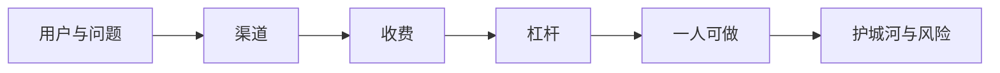

# 案例拆解

前六章讲的是方法。这一章把方法用到具体的对象上：先给出一个拆解框架，然后分析几种在独立开发者中常见的模式，最后用作者自己的三个项目做推演。

一个说明：这里**不引用任何具体公司或个人的收入数字**。网上流传的独立开发者收入截图，来源和口径大多无法核实，而且只代表幸存者。我们关心的是结构：这门生意靠什么成立、风险在哪、哪些部分可以借鉴。

## 拆解框架

拆解任何一个一人公司，都可以问这八个问题：

| 维度 | 问题 |
|---|---|
| 用户 | 谁在用？谁在付钱？两者是同一个人吗？ |
| 问题 | 解决了什么麻烦？用户之前怎么解决？ |
| 渠道 | 用户从哪里知道这个产品？这个渠道能持续吗？ |
| 收费 | 怎么收钱？订阅、买断、按量还是服务费？ |
| 杠杆 | 收入为什么能和工时脱钩？靠代码、内容还是平台？ |
| 一人可做 | 日常运营需要多少人工？哪些环节最耗时间？ |
| 护城河 | 别人为什么不能轻易复制？ |
| 风险 | 什么事情发生，这门生意会受重创？ |

前四个对应第 2、3 章的「选方向」和「验证」，后四个决定了它能不能长期活下去。

## 模式一：多产品组合 + 公开构建

**典型做法**：同时或先后做很多个小产品，每个都快速上线、快速验证，留下有起色的，放弃没起色的；全程在社交媒体上公开进展、数字和教训。海外独立开发者圈里，Pieter Levels 早年「12 个月做 12 个产品」的挑战是这种模式最常被引用的例子。

| 维度 | 分析 |
|---|---|
| 用户 | 通常是远程工作者、创作者、其他独立开发者这类在线活跃的人群 |
| 渠道 | 个人影响力是核心渠道：公开构建积累的关注者，就是每个新产品的首批用户 |
| 收费 | 各产品不同，订阅、一次性付费、广告都有 |
| 杠杆 | 个人品牌是跨产品复用的杠杆；技术上往往刻意保持简单，以便快速上线和一个人维护 |
| 风险 | 高度依赖个人影响力和社交平台；早期没有关注者时，这个模式的优势很难发挥 |

**可借鉴的**：小步快跑，把每个产品当一个实验；公开构建让获客和产品开发同步进行；技术选型服务于速度和可维护性，而不是简历。

**要警惕的**：它最难复制的部分是「已经有很多关注者」。没有受众时，发十个产品可能只是十次没人看见。国内的平台环境、用户付费习惯也不同，照搬时要先回答「我的首批用户从哪来」。

## 模式二：单点效率工具

**典型做法**：做一个解决单一问题的小工具，比如 macOS 菜单栏工具、截图标注、剪贴板管理、iOS 上的某个垂直记录类应用。功能克制，体验打磨得很好，通过应用商店或官网销售。

| 维度 | 分析 |
|---|---|
| 用户 | 有明确工作流痛点的个人用户，常常是知识工作者、开发者、设计师 |
| 渠道 | 应用商店搜索与推荐、口碑、科技博主测评、效率工具推荐合集 |
| 收费 | 买断、订阅，或者「免费 + 高级功能付费」 |
| 杠杆 | 典型的软件杠杆：边际成本接近零，没有服务器或很少 |
| 一人可做 | 很适合：多数是本地应用，客服量相对可控 |
| 风险 | 操作系统把同类功能做成内置；平台政策和抽成变化；同类免费替代品 |

**可借鉴的**：做窄而深。一个只做一件事、但比所有人都做得好的工具，比一个什么都能做的工具更容易被记住和推荐。

**要警惕的**：「我觉得好用」不等于市场需要，这个模式特别容易掉进第 2 章说的「容易做成玩具」象限。另外买断制意味着收入随新用户增长，老用户不再贡献收入，要么持续获客，要么设计升级付费。买断还是订阅的取舍见《定价与商业模式》。

## 模式三：内容驱动

**典型做法**：先通过技术博客、视频、开源项目积累受众，再基于受众推出付费产品：课程、电子书、模板、付费社群、咨询，或者面向受众的软件工具。

| 维度 | 分析 |
|---|---|
| 用户 | 认可你专业能力的读者和观众 |
| 渠道 | 内容本身就是渠道，搜索、推荐算法和转发把新读者带进来 |
| 收费 | 一次性的课程和电子书、持续的社群会员、按次的咨询 |
| 杠杆 | 一份内容可以被无限次阅读；受众可以跨产品复用 |
| 一人可做 | 内容生产是持续投入，停更会导致关注度下降 |
| 风险 | 平台规则和算法变化；内容同质化；个人精力是上限 |

**可借鉴的**：先有受众再做产品，大幅降低了冷启动难度。对技术人来说，把自己做项目的过程写出来，就是天然的内容。

**要警惕的**：内容模式容易滑回「卖时间」：咨询和定制服务的收入是和工时绑定的。另外，内容平台的流量不属于你，要尽量把读者沉淀到自己能触达的地方，比如邮件列表、自己的网站、社群。

## 模式四：垂直 To B SaaS，以 hatch-counter 为例

垂直 SaaS 是指只服务一个行业的软件。作者的 hatch-counter（产品名「掌柜眼」）是一个具体样本：给一家到几家店的中小餐饮门店用，导入收银报表算销量、拍进货单管库存、记开支算盈亏。

下面的拆解基于它的公开文档和代码结构；涉及市场和收入的部分是推演，用字母代替数字。

### 八个维度

| 维度 | 分析 |
|---|---|
| 用户 | 店主和店员是使用者，店主是付费决策者，两者基本重合 |
| 问题 | 说不清每天赚没赚钱；进货靠手写单据，库存靠估计 |
| 渠道 | 主要短板。餐饮老板不在线上技术社区，需要行业群、熟人介绍、线下拜访 |
| 收费 | 当前是按门店开户、线下转账续期，后台管理到期日 |
| 杠杆 | 软件杠杆，加上视觉模型把录入环节自动化 |
| 一人可做 | 架构上刻意收敛：数据只在服务端一份，网页端和移动端都是薄客户端，一台机器用 Docker Compose 部署 |
| 护城河 | 行业口径的积累：配方扣库存、套餐拆分、开支摊销、保本线，这些细节需要和真实门店反复打磨 |
| 风险 | 客户本身经营不稳定，流失是常态；To B 服务负担；模型调用成本由自己承担 |

### 做对了什么

从一人公司的角度看，有几个设计决策值得注意：

- **开户只从管理后台来，收款先走线下**。在客户数量不多时，这比开发自助注册和在线支付便宜得多，而且每次开户都是一次和店主直接沟通的机会。在线续费在路线图上，但不急着做
- **门店到期后仍能登录，只拦在业务操作上**。文档里写了原因：如果做成登录失败，店主会以为系统坏了。这类细节直接减少了客服量，对一个人运营的产品很关键
- **报错文案由服务端写、各端原样显示**。错误信息只维护一处，用店主能看懂的话说清后果，同样是在降低客服负担
- **对不上的数据交给人拍板，不自动猜**。宁可多问一句，也不替用户做错误的决定。对涉及钱和库存的 To B 产品，一次算错带来的信任损失，远比多一步确认的麻烦大
- **识别服务的费用自己出，其余第三方服务免费优先**。把识别作为核心价值主动承担成本，但这也意味着成本要在定价中覆盖，路线图里已经列了「识别的费用按店算」

### 单位经济推演

To B SaaS 能不能成立，可以用一个简化的模型来判断。设：

- 每家店每月贡献的收入为 $P$
- 每家店每月的可变成本（模型调用、存储、分摊的服务器）为 $c$
- 每月有比例为 $\rho$ 的门店流失（停用或闭店）
- 获取一家新店的成本为 $A$，包括你花在拜访、演示、开户培训上的时间折算

那么一家店在整个生命周期里贡献的毛利（LTV）约为：

$$
\text{LTV} \approx \frac{P - c}{\rho}
$$

一门健康的生意要求 LTV 明显大于 $A$。由此可以读出几个结论：

1. **流失率在分母上**，影响最大。餐饮门店本身就有较高的开关店频率，这部分流失不是产品能控制的。所以要特别关注可控的流失：用不明白、觉得没价值而不续费的那部分
2. **获客成本 $A$ 在一人公司里主要是时间**。如果每签一家店都需要你上门半天，那客户数量的上限就是你的时间。降低 $A$ 的办法包括：让产品能自助上手（模板一次导齐菜品和配方）、和能批量接触门店的伙伴合作、让老客户转介绍
3. **可变成本 $c$ 中，模型调用是主要变量**。识别量大的门店成本更高，这就是为什么按店或按量计费需要考虑进来

具体数字要等积累了真实客户后才能填进去。但即使没有数字，这个公式已经告诉你精力应该放在哪：**先压低可控的流失，再想办法降低获客的时间成本**。

### 下一步推演

按第 6 章的思路，如果到某个评审日客户增长不达预期，可能的转向方向有：

| 方向 | 思路 | 代价 |
|---|---|---|
| 缩小范围 | 只做「拍进货单记库存和开支」这一个最有差异化的功能 | 放弃已有的分析能力 |
| 换渠道 | 找已经服务大量门店的伙伴，比如收银系统、供应链服务商，作为插件或增值服务 | 依赖合作方，议价能力弱 |
| 换人群 | 把进货单识别用到其他有类似票据录入问题的小商户 | 行业口径要重新积累 |

这些都只是推演，哪个方向对，要回到第 3 章用实验来回答。

## 模式五：自用工具，以 hatch-shelf 为例

hatch-shelf 是一个 iOS 离线 Markdown 书架：书以 Markdown 写在仓库里，推到手机上读，支持代码高亮、公式和 Mermaid 图。你正在读的这本书就是在它上面读的。

| 维度 | 分析 |
|---|---|
| 用户 | 目前只有作者自己 |
| 问题 | 想在手机上离线、舒服地读自己整理或让 AI 写的技术书 |
| 渠道 | 无 |
| 收费 | 无 |
| 一人可做 | 设计上就是一个人维护：App 不联网，文件即真相，数据库只存可重建的索引和用户数据 |

它解决了一个真实的问题，但这个问题目前只被验证了**一个人**有。如果要把它变成产品，按本书的框架需要先回答：

- **还有谁有这个需求**？可能是重度使用 AI 生成学习资料的人、写技术文档的团队、喜欢 Markdown 的笔记用户。这些人群在哪里聚集？
- **他们愿意付钱吗**？手机上的阅读器和笔记应用竞争激烈，大量免费替代品存在
- **内容从哪来**？书架本身不提供内容，用户需要自己有 Markdown 书。这决定了它只能服务「已经有内容的人」，人群天然较窄
- **上架的成本**：面向国内 App Store 分发需要完成 App 备案，见《国内合规实务》；付费的话要处理应用内购买和退款，见《定价与商业模式》

结论很可能是：它作为自用工具是成功的，作为生意则还没开始验证。**这不是失败**。很多好产品起步于自用工具，关键是要清楚自己处在哪个阶段，不要把「我用着很好」当成市场验证。

自用工具对一人公司还有另一个价值：它是你练手新技术栈、积累可复用基础设施的地方。hatch-shelf 里的共享校验包、WebView 阅读器、局域网导入，将来都可能出现在别的产品里。

## 模式六：依赖第三方内容的个人工具

hatch-recordwall 是作者的个人音乐播放器：从自建的私人曲库挑歌，下到手机上离线听，曲库架在 Cloudflare R2 前面的一个 Worker 上，桌面端用 Electron。

技术上它完全具备产品化的条件：多端、云端存储、离线播放都已经跑通。但它的歌曲来源依赖第三方平台，**涉及他人的版权内容和平台的服务条款**。这类项目作为个人自用和作为商业产品，面临的法律风险完全不同。

这对应第 2 章「不做清单」里的两条：依赖单一平台的灰色地带接口、涉及他人版权内容。教训是：**技术上做得出来，不等于可以拿来做生意**。评估方向时，合规是一票否决项，而不是事后补救项。

## 六种模式放在一起

| 模式 | 起步速度 | 与工时脱钩 | 获客难点 | 主要风险 | 适合谁 |
|---|---|---|---|---|---|
| 多产品 + 公开构建 | 快 | 中到高 | 没有受众时很难 | 依赖个人影响力 | 擅长表达、愿意公开 |
| 单点效率工具 | 中 | 高 | 应用商店竞争 | 系统内置、免费替代 | 产品品味好、注重细节 |
| 内容驱动 | 慢 | 中 | 前期积累时间长 | 平台规则、停更 | 擅长写作或讲解 |
| 垂直 To B SaaS | 慢 | 高 | 行业渠道 | 服务负担、客户流失 | 有行业知识和人脉 |
| 自用工具 | 快 | 未知 | 尚未验证 | 只有自己需要 | 所有人，作为起点 |
| 依赖第三方内容 | 快 | 不适用 | 不适用 | 版权与平台条款 | 只适合自用 |

很多成功的一人公司是几种模式的组合：用内容积累受众，用受众验证工具，用工具的收入支撑更长周期的 To B 产品。第 1 章那张收入模式图里的虚线，说的就是这种组合路径。

## 本章要点

- 用八个维度拆解一人公司：用户、问题、渠道、收费、杠杆、一人可做、护城河、风险
- 不轻信网上的收入截图，关注结构而不是数字
- 多产品 + 公开构建的核心是个人影响力，没有受众时优势难以发挥
- 单点工具要做窄而深，警惕「容易做成玩具」；内容驱动先有受众再做产品，但要防止滑回卖时间
- 垂直 To B SaaS 看单位经济：LTV ≈ 月毛利 ÷ 月流失率，先压可控流失，再降获客的时间成本
- hatch-counter 的手工开户、线下收款、服务端统一报错、到期不拦登录，都是在为一个人运营降低成本
- 自用工具是好起点，但要清楚「自己好用」不是市场验证；合规是一票否决项

## 接下来读什么

这本书搭好了一人公司的骨架，具体的血肉在后面几本里：

- 想把「选方向」和「验证」做得更细：读《产品思维》，讲需求来源、用户访谈和 MVP 的边界
- 想知道怎么收钱、怎么定价：读《定价与商业模式》
- 产品有了，用户在哪：读《获客与增长》和《文案与内容》
- 准备注册主体、正式经营：读《国内合规实务》和《财务与税务》
- 想让 AI 承担更多岗位：最后读《用 AI 撑起一人公司》，它是整套书单的收尾
