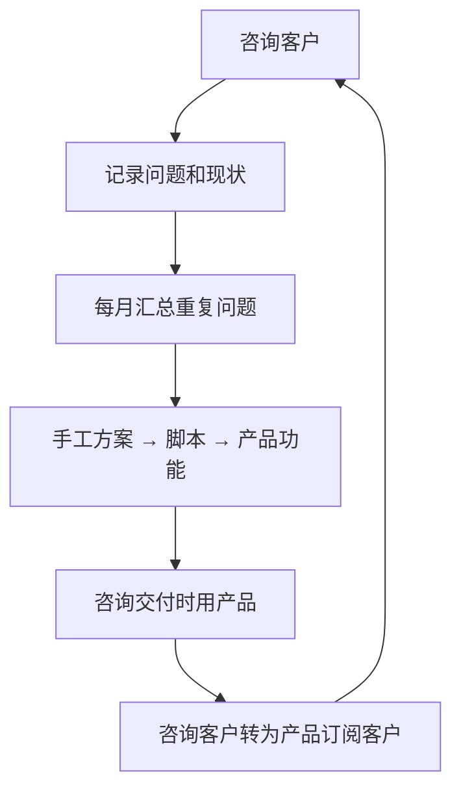

# 咨询与培训

外包卖的是你的时间和代码，咨询和培训卖的是你的判断和经验。后者有两个好处：单位时间收入通常更高，而且不产生需要长期维护的代码。对正在做 hatch-counter 的你来说，还有第三个好处——咨询让你坐在目标客户对面，听他们讲真实的问题。

这一章讲咨询和培训的几种形式、怎么定价、怎么把咨询「产品化」、怎么让它反哺产品，以及容易踩的坑。

## 几种形式

| 形式 | 交付物 | 单次时长 | 收入稳定性 | 适合谁 |
|---|---|---|---|---|
| 单次付费咨询 | 一次通话或面谈 + 简短建议 | 1–2 小时 | 低 | 起步试水、建立口碑 |
| 诊断项目 | 现场或远程调研 + 一份书面报告 | 2–5 天 | 中 | 有明确问题、愿意为「看清楚」付钱的客户 |
| 按月顾问 | 每月固定时长 + 日常答疑 | 每月若干小时 | 高 | 已经建立信任的老客户 |
| 企业内训 | 一天到两天的课程 | 1–2 天 | 中 | 有技术专长、能讲清楚的人 |
| 公开课 / 训练营 | 多次课程 + 作业点评 | 数周 | 中 | 有一定受众基础 |
| 线上课程 / 付费专栏 | 录好的视频或文章 | 前期投入大 | 低到中，长尾 | 有持续获客渠道 |
| 写作出版 | 书或长篇内容 | 数月 | 低 | 积累专业声誉，收入是次要的 |

过渡期最实用的是前三种。它们不需要先有大量受众，只需要几个信任你的客户。后几种更像是内容生意，前期投入大、回本慢，适合把它当成长期的个人品牌建设（见[《文案与内容》第 6 章](../copywriting-content/06-personal-brand.md)「个人品牌」），而不是指望它填补眼前的缺口。

## 对 hatch-counter 来说，咨询什么

你的产品是给中小餐饮门店用的经营管理工具。围绕它，至少有两类咨询可以做：

**面向门店老板的经营数字化咨询。** 很多小餐馆老板知道自己「账不清」，但不知道从哪下手：收银系统导出来的报表看不懂、进货靠手写单据、月底算不清赚没赚钱。你能提供的是：

- 帮老板把收银、进货、库存、开支几本账理清楚
- 设计一套适合这家店的每周对账流程
- 找出损耗、毛利异常的菜品和原料

**面向技术团队的技术咨询。** 如果你在原来的工作里积累了某个方向的专长（比如 NestJS 后端架构、Postgres 性能、AI 工程化），可以给小团队做架构评审、代码评审、技术选型建议。这类咨询和产品协同度低，但单价高，适合作为收入补充。

前者是高协同度的工作：你在咨询中遇到的每一个问题，都可能是 hatch-counter 的下一个功能。后者更像纯粹的收入来源。按第 1 章的协同度原则，**优先做前者，用后者补缺口**。

## 定价

### 单次咨询：按小时，但比日费率高

单次咨询的小时价应该明显高于你外包日费率折算的小时价，原因是：

- 每次咨询前要准备、之后要整理建议，实际花的时间是通话时长的两倍左右
- 单次咨询的客户获取成本高，一次只能收一次钱
- 咨询卖的是判断，不是工时

一个可操作的起点：**咨询小时价 = 外包日费率 ÷ 8 × 2 到 3 倍**。按第 2 章 1800 元 / 天的日费率，咨询小时价在 450–675 元之间。然后根据成交情况调整：如果每个问价的人都毫不犹豫地付钱，说明报低了。

面向小餐馆老板时要现实一点：一家夫妻店老板很难接受一小时几百元的咨询费。对这类客户，与其卖小时，不如卖下面的「产品化咨询」。

### 诊断项目：固定范围、固定价格

把一类常见问题的解决过程标准化，打包成一个固定价格的服务。比如：

```text
门店经营体检（示例）
- 范围：1 家门店，最近 3 个月的收银报表、进货单、开支记录
- 过程：远程收集数据 → 半天到店观察 → 整理分析
- 交付：
  1. 一份经营体检报告：毛利结构、损耗最高的 10 种原料、异常的菜品
  2. 一套每周 30 分钟的对账流程，配好表格或工具
  3. 30 天内 2 次线上跟进
- 价格：固定价，事先付清
- 不包含：代做账、税务建议、长期驻店
```

产品化的好处：

- **客户容易决策**：知道花多少钱、得到什么，不用担心按小时计费失控
- **你容易交付**：做过两三次之后，流程、模板、分析脚本都可以复用，实际耗时越来越短，有效时薪越来越高
- **天然连接产品**：交付里的「每周对账工具」可以直接是 hatch-counter，体检结束后顺势转成订阅客户

定价方法：先按你估计的实际耗时乘以咨询小时价得到底价，再看客户能从中获得多少价值（比如每月减少多少损耗），在两者之间定一个客户容易接受的价格。做了几次后，根据实际耗时和成交率调整。

### 按月顾问：用响应承诺换稳定收入

按月顾问是咨询里最稳定的收入形式。关键是把边界写清楚：

| 条款 | 示例 |
|---|---|
| 每月包含的时间 | 每月 4 小时会议或远程协助 |
| 日常答疑 | 工作日 24 小时内回复微信或邮件问题 |
| 不包含 | 写代码、代做报表、现场驻店 |
| 超出部分 | 按小时另计，事先确认 |
| 付款 | 每月月初预付，或按季度预付打折 |
| 退出 | 任一方提前 30 天书面通知即可终止 |

算一下时薪：假设 3 个客户、每家每月 2000 元，每家每月实际花 5 小时（4 小时会议加零散答疑），总共 15 小时、收入 6000 元，每干一小时收 400 元，比按天外包（1800 元 / 天，折合每小时 225 元）高出近八成。这里比的都是干活那几个小时的收入，还没扣找客户等不计费的时间，扣完的「有效时薪」算法见[《把职场技能变成生意》第 4 章](../skills-to-business/04-capacity-and-ceiling.md#有效时薪扣掉成本以后)。更重要的是**收入可预测**，这对过渡期比单价更有价值。

按月顾问的风险是「答疑」会悄悄膨胀。每个月末看一下每个客户实际花的时间，持续超出的，下个周期要么涨价、要么收窄范围。

## 培训：讲一次，卖多次

### 企业内训

如果你在某个技术方向有扎实的实战经验，企业内训是单价较高的选择。常见的形式是一到两天的课程，按天收费。企业内训的特点：

- 客户往往要求发票，以个人身份承接时需要代开或通过培训机构合作（第 8 章）
- 通过培训机构对接时，机构会拿走相当比例的费用，但帮你解决了获客和开票
- 课程内容如果涉及你在原公司的工作，要特别小心保密义务——**只讲通用方法和公开知识，不讲原公司的系统、数据和具体做法**

### 线上课程和付费专栏

线上课程的诱惑在于「做一次、卖很久」，但现实往往是：

- 录一门像样的课程要花几十到上百小时，相当于一个中等规模的外包项目
- 没有现成受众的话，课程上线后很可能卖不动
- 平台分成、推广费用、退款都会吃掉不少收入
- 技术类内容过时很快，需要持续更新

过渡期如果想做，建议**先用直播或小班课验证**：招 10–20 个人，讲一次，收集反馈和问题，确认有人愿意付钱后再做成录播课。不要先花两个月闭门录课。

### 写作

写技术文章、出书，在收入上通常是最不划算的，但在建立专业声誉上效果很好。写作收入的税务处理也比较特殊：个人所得税法规定稿酬所得的收入额在减除费用的基础上再减按 70% 计算，比劳务报酬更低。但「稿酬」特指作品以图书、报刊等形式出版发表取得的所得，在内容平台上获得的收入属于哪类所得，要看具体形式，不要自行套用（第 8 章）。

## 让咨询反哺产品

咨询对一人公司最大的价值，不是它带来的收入，而是它带来的**信息**。做法：

1. **每次咨询结束后花 10 分钟写记录**：客户是谁、问了什么、现在怎么解决的、痛点在哪、愿意为什么付钱
2. **每月汇总一次，统计重复出现的问题**。同一个问题被三个以上客户问到，就是产品功能的候选
3. **把咨询中反复用到的工具和模板产品化**。第一次手工做的分析表，第三次就该变成脚本，第五次就该成为产品里的一个页面
4. **在咨询中自然地展示产品**，但不强推。「我平时用这个工具帮客户做对账」比「你要不要买我的产品」有效得多

这个过程和[《产品思维》第 1 章](../product-thinking/01-where-needs-come-from.md)「需求从哪来」、第 2 章「用户访谈」讲的方法一致，只是你在被付钱的同时做了用户研究。



## 咨询的边界和坑

**一、不要给建议超出你的专业范围。** 门店老板问你「这样记账税务上有没有问题」「员工社保怎么交」，这是会计和律师的领域。你可以说「这个问题建议问你的代账会计」，而不是凭印象回答。给错了建议，客户的损失可能远超你的咨询费。

**二、不要承诺结果。** 咨询能帮客户看清问题、给出方法，但执行在客户手里。合同和沟通中都写清楚：你提供的是分析和建议，不保证经营结果。

**三、把「产品客户的上线支持」和「咨询」分开。** 一个 hatch-counter 订阅客户需要帮忙导入数据、配置配方，这是产品服务的一部分，可以包含在订阅里，也可以单独收实施费，但要事先定好规则。不要今天免费帮这家做、明天对那家收费，客户之间会互相传话。

**四、免费咨询要有上限。** 早期为了获客做一些免费咨询是合理的，但每周设一个上限（比如两次），并且明确告诉对方「这次是免费的初步交流，后续深入分析是收费服务」。

**五、在职期间公开讲课要先看规定。** 有些公司要求员工对外演讲、授课需要事先报备，尤其是涉及公司所在行业时。即使公司没有规定，也不要在公开场合以公司员工身份讲你的副业。

**六、记录每一笔收入，按规定申报。** 咨询费、课酬常常是小额、零散的，很容易被忽略。这些收入的税务处理见第 8 章。

## 一个月的咨询起步计划

如果你决定在过渡期试试咨询，可以按这个节奏开始：

| 周 | 要做的事 |
|---|---|
| 第 1 周 | 选定一个方向（门店经营数字化或某个技术专长），写一页服务说明：给谁、解决什么、怎么交付、多少钱 |
| 第 2 周 | 给 20 个潜在客户或介绍人发消息，约 5 次免费的 30 分钟交流 |
| 第 3 周 | 根据交流结果调整服务说明，向其中最有意向的 2–3 个人报价 |
| 第 4 周 | 交付第一单；结束后写记录、要反馈、请对方介绍同行 |

一个月后看三个数字：交流了多少人、成交了几单、每单实际花了多少小时。如果交流了十几个人还没有一单成交，问题通常在于方向或表达不对，而不是价格；如果成交了但实际耗时远超预期，问题在于范围没有收住。

如何系统地找客户、跟进和成交，见[《销售与 To B 成交》](../b2b-sales/)。

## 本章要点

- 过渡期最实用的是单次咨询、诊断项目、按月顾问三种形式；课程和写作更像长期的品牌建设
- 优先做面向目标客户（门店老板）的咨询，用技术咨询补充收入
- 咨询小时价可以从外包日费率的 2–3 倍起步；面向小商户时卖「产品化咨询」而不是小时
- 按月顾问的收入最稳，关键是写清包含的时间、响应承诺、不包含的内容和退出方式，并每月检查实际耗时
- 每次咨询都记录问题，每月汇总，把重复出现的问题和反复用到的工具变成产品功能
- 不越出专业范围、不承诺结果、把产品上线支持和咨询分开、免费咨询设上限
