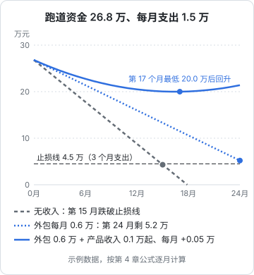

# 个人安全垫与跑道

《一人公司方法论》第 4 章讲了跑道的基本公式和「收入追上开支」的动态算法，《财务与税务》第 4 章讲了公司层面的现金预测。这一章往下再走一步，只看**你个人和你的家庭**：

- 每月支出到底该怎么算，离职后哪些会变
- 存款不能全算成跑道，要分层
- 止损线怎么定，跌到止损线之前要准备什么
- 每月怎么检查，遇到意外怎么调整

这一章所有的数字都是示例，用来演示计算方法。你要做的是把自己的数字填进去。

## 第一步：把月支出算对

跑道计算里误差最大的不是存款（存款是确定的），而是**月支出**。大多数人低估自己的支出，原因是只记得每月固定的那几笔。

### 三类支出

| 类别 | 内容 | 怎么算进月支出 |
|---|---|---|
| 刚性月支出 | 房租或房贷、吃饭日用、交通通讯、赡养费、已有保险的月缴 | 直接按月计 |
| 年度性支出 | 年缴保险、车险、物业费、取暖费、过年回家、人情往来、设备更换 | 全年加总后除以 12 |
| 弹性支出 | 外出吃饭、旅行、娱乐、非必需购物 | 按最近 6 个月平均值计，单独列出 |

年度性支出最容易漏。翻一遍去年的银行和支付记录，把一年里所有超过 1000 元的非月度支出都列出来，加总后除以 12，通常会比你以为的多出一截。

### 离职后会变的支出

在职时和离职后的支出结构不一样，必须重新算：

| 变化 | 项目 | 说明 |
|---|---|---|
| 新增 | 自缴社保医保 | 单位缴的部分没了，以灵活就业身份自己缴要付全额（第 5 章） |
| 新增 | 商业保险 | 原来的团体补充医疗、意外险随离职终止，需要自己补（第 7 章） |
| 新增 | 工作相关开支 | 电脑、软件订阅、云服务、偶尔的联合办公费用 |
| 新增 | 医疗自付 | 原来的补充医疗报销掉的部分，现在要自己掏 |
| 减少 | 通勤 | 交通、午餐、咖啡 |
| 减少 | 工作社交 | 同事聚餐、份子钱 |
| 可能变化 | 公积金 | 不再缴存，但如果在用公积金还房贷，月供的支付方式可能要调整（第 6 章） |

### 示例：一个双人家庭的月支出

```text
刚性月支出（离职后）
  房贷                     5000
  吃饭日用                 3000
  交通通讯                  600
  给父母的赡养费           1000
  商业保险（年缴折月）       400
  自缴社保医保（示例数）    2000
  ─ 必要月支出合计         12000

弹性支出（近 6 个月平均）   3000

月总支出                   15000
```

自缴社保医保的 2000 元只是示例。你当地的实际金额取决于缴费基数和费率，第 5 章讲怎么查。

把**必要月支出**和**月总支出**分开记，后面两个数各有用处：应急金按必要支出算（紧急情况下你会砍掉弹性支出），跑道按总支出算（正常情况下你不会天天紧衣缩食）。

## 第二步：把存款分层

假设这个家庭可动用的存款是 40 万。不能直接用 40 万 ÷ 1.5 万 = 26.7 个月当跑道，因为这 40 万里有些钱不应该用来做产品：


### 第一层：应急金

用途只有一个：**应对你无法控制的意外**——家人生病、突发的大额医疗、意外事故、房子出了问题。它不是用来「创业失败时撑一撑」的，那是止损线的事。

应急金按**必要月支出**的若干倍来定。倍数取决于你的风险敞口：

| 情况 | 建议倍数 |
|---|---|
| 单身、无房贷、父母不需要你负担 | 3–6 个月 |
| 有配偶且对方有稳定收入 | 6 个月左右 |
| 有房贷、有孩子、或者家庭只有你一份收入 | 9–12 个月 |
| 家人有慢性病、或父母年事已高需要照护 | 在上面基础上再加 |

示例家庭取 6 个月：1.2 万 × 6 = 7.2 万。

应急金放在**随时能取、不会亏本**的地方。它追求的是确定性，不是收益。具体放在哪种产品里，请根据自己的情况判断或咨询持牌专业人士，本书不提供投资建议；唯一的原则是：急用时能在几天内取出来，而且金额不会少。

### 第二层：已知的大额支出

未来 12 个月内**确定会发生**的大额支出，要单独留出来：

- 年缴的商业保险保费
- 综合所得或经营所得汇算时可能要补的税（第 6、8 章）
- 已经计划好的事：孩子的学费、父母的手术、一次必须去的婚礼

示例家庭留了 1 万。这些钱如果混在跑道里，到时候会突然让跑道少掉一两个月。

### 第三层：不动的钱

已经有明确长期用途、你和家人都同意不动的钱，比如给孩子存的教育金、给父母准备的养老备用金、计划中的购房首付。

这一层最容易引起家庭矛盾。**哪些钱属于这一层，必须和配偶一起确定**（第 9 章），而不是你自己在心里划一条线。示例家庭留了 5 万。

### 第四层：跑道资金

剩下的才是跑道资金：40 − 7.2 − 1 − 5 = 26.8 万。

$$
\text{跑道（月）} = \frac{\text{跑道资金}}{\text{月总支出} - \text{稳定月收入}}
$$

无收入时，26.8 ÷ 1.5 ≈ 17.9 个月。这比直接用 40 万算出的 26.7 个月少了将近 9 个月——这 9 个月就是你给家庭留的保障。

## 第三步：定止损线

止损线是一个**事先约定的余额**：跑道资金跌到这个数，就启动回到稳定收入的计划（找工作、接长期合同），而不是继续硬撑。

止损线不能定成 0。原因是从决定找工作到拿到第一份工资，中间需要时间：

$$
\text{止损线} = \text{预计找到工作的月数} \times \text{月总支出}
$$

开发者找工作的周期因城市、年龄、方向、市场行情而差别很大。保守一点，假设 3 个月：3 × 1.5 万 = 4.5 万。如果你对回职场没把握（比如年龄偏大、或者离开行业很久），就要设得更高。

止损线是给跑道资金设的，**应急金不在其中**。也就是说，跌破止损线时，你手里还有完整的应急金，不会因为同时遇上意外而陷入困境。

## 第四步：跑几个场景

现在加入过渡期收入。用第 1–3 章的方法，假设三种情况：



图里的计算方法是逐月递推：

$$
\text{余额}_{m} = \text{余额}_{m-1} - (\text{月总支出} - \text{当月收入}_m)
$$

| 场景 | 月收入假设 | 结果 |
|---|---|---|
| 无收入 | 0 | 每月消耗 1.5 万；第 15 个月余额 4.3 万，跌破 4.5 万止损线，第 18 个月归零 |
| 只有外包 | 每月稳定 0.6 万（到手） | 每月消耗 0.9 万；24 个月后还剩 5.2 万，大约第 25 个月触及止损线 |
| 外包 + 产品 | 外包 0.6 万；产品第 1 个月 0.1 万，之后每月 +0.05 万 | 第 17 个月产品收入达到 0.9 万，加外包正好覆盖 1.5 万支出，余额在 20.0 万见底后回升 |

几个读法：

- **每月 6000 元外包，把跑道从 15 个月（到止损线）拉长到 2 年以上。** 这是过渡收入最直接的价值：它不需要替代工资，只要把消耗速度降下来
- **第三个场景的产品增长非常缓慢**（每月只增长 500 元净收入），但因为有外包垫底，两年后余额反而在上升。这说明「慢而持续的增长 + 一份稳定的过渡收入」是一个相当安全的组合
- 第三个场景依赖外包**持续 17 个月以上**。如果中间外包断了，曲线会立刻变成介于第一、第二条之间的样子。所以要再跑一个「外包中断 3 个月」的压力场景

### 压力测试清单

至少跑下面几种情况，看余额最低点会不会跌破止损线：

| 压力场景 | 怎么模拟 |
|---|---|
| 外包断档 | 选一段时间把外包收入设为 0，持续 2–3 个月 |
| 产品停滞 | 产品收入增长率设为 0 |
| 家人大病 | 某个月一次性支出 3–5 万（先动用应急金，再看是否需要从跑道补回应急金） |
| 收款延迟 | 外包收入整体推迟 2 个月到账 |
| 支出上涨 | 月总支出上调 10% |

如果某个压力场景下余额会在 12 个月内跌破止损线，说明你的计划太紧：要么推迟离职、多存几个月钱，要么在离职前先把稳定的外包或顾问客户谈下来。

## 离职前要准备的事

### 先办需要工资流水的事

没有工资流水后，申请房贷、车贷、信用卡提额都会变难。《一人公司方法论》第 4 章已经提醒过。从个人保障的角度再补充两点：

- **房贷转贷、调整还款方式**：如果有计划，在职期间办
- **不要为了「增加跑道」去借消费贷**。借来的钱有利息、有还款期限，它不是跑道，而是把未来的压力提前

### 降低固定支出

离职前 3–6 个月，开始按离职后的预算生活。这样做有两个好处：一是多存了钱，二是提前验证你算出来的月支出是否真实。如果按新预算生活三个月都很难受，说明数字算得太乐观了。

可以考虑的调整：

- 停掉不常用的订阅和会员
- 重新评估车的必要性（车贷、保险、停车、油费加起来往往比想象的多）
- 租房的，评估是否换一个更便宜的地方，但要把搬家成本和对家人的影响算进去

### 把应急金先存满

离职前，应急金和已知大额支出两层必须先存满。跑道资金不够可以晚点离职，应急金不够不要离职。

## 每月检查

离职后每月花 15 分钟，更新一张简单的表：

| 项目 | 本月 | 说明 |
|---|---|---|
| 跑道资金余额 | | 银行和各账户合计，减去应急金、大额预留、不动的钱 |
| 本月总支出 | | 和预算比，超出的找原因 |
| 本月外包 / 咨询收入（到手） | | 按实际到账计，不按合同额 |
| 本月产品净收入 | | |
| 本月净消耗 | | 总支出 − 全部到手收入 |
| 最近 3 个月平均净消耗 | | 用平均值算跑道，避免被单月波动误导 |
| 剩余跑道（月） | | 余额 ÷ 平均净消耗 |
| 距离止损线（月） | | (余额 − 止损线) ÷ 平均净消耗 |
| 应急金是否完整 | | 动用过的要先补回 |

最后两行最重要。**「距离止损线还有几个月」比「跑道还有几个月」更能指导行动**：当它降到 6 个月以下时，就该开始准备简历、联系前同事、看看市场了——准备不等于放弃，只是让你在真正到达止损线时有选择。

什么时候该放弃一个方向，《一人公司方法论》第 6 章「什么时候该放弃」讲了判断方法。止损线是一个财务上的硬约束，它和方向判断是两件事：方向可能是对的，但钱不够了，也要先回去补充弹药。

## 本章要点

- 月支出分刚性、年度性、弹性三类，年度性支出除以 12 计入；离职后新增自缴社保、商业保险、工作开支，减少通勤
- 分别记**必要月支出**（算应急金）和**月总支出**（算跑道）
- 存款分四层：应急金、已知大额支出、不动的钱、跑道资金；只有最后一层用来算跑道
- 应急金按必要支出的 3–12 倍，视家庭风险敞口而定；放在随时可取、不会亏本的地方
- 止损线 = 预计找工作月数 × 月总支出，不能定成 0；跌破就启动回到稳定收入的计划
- 逐月递推跑几个场景，并做外包断档、产品停滞、大病、收款延迟、支出上涨的压力测试
- 每月更新跑道表，重点看「距离止损线还有几个月」，降到 6 个月以下就开始准备
