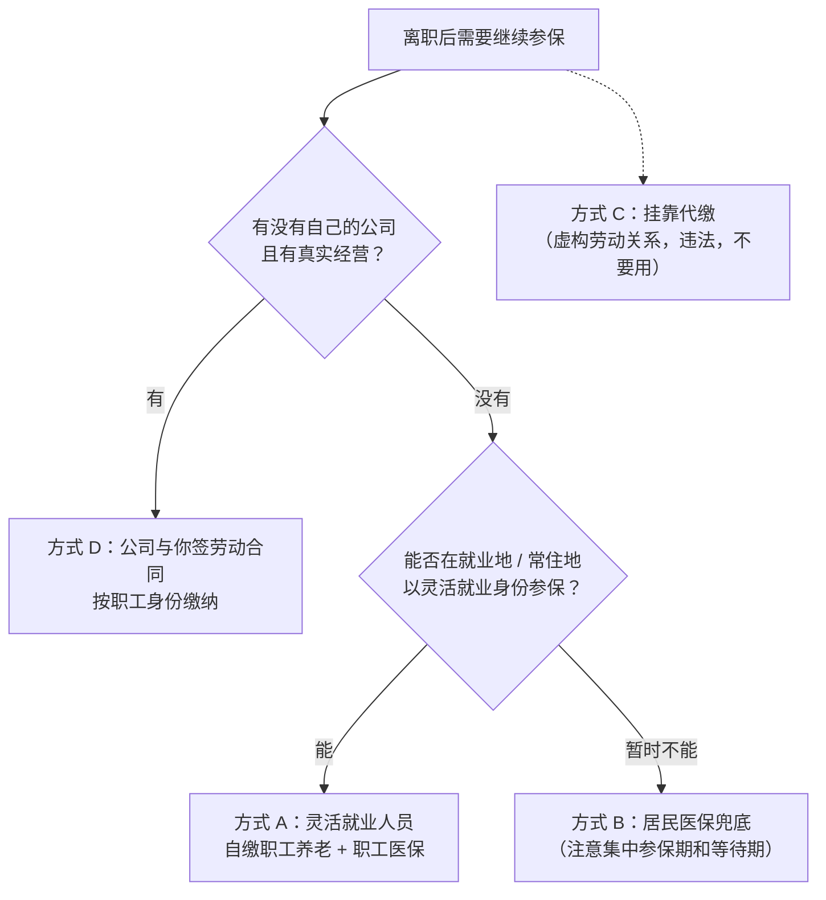
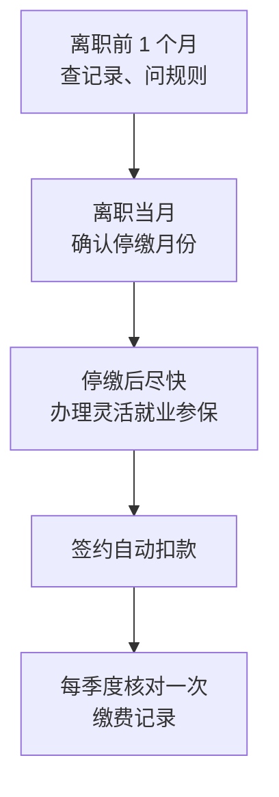

# 离职后的社保与医保

在职时，社保是「工资条上被扣掉的那几行」，很少有人认真看。离职后，它变成了一件必须自己决策、自己办理、自己掏钱的事。而且处理不好的后果往往要过很久才显现：生病时报不了销、买房时资格不够、退休时年限差几个月。

这一章讲清楚三件事：断缴会影响什么、有哪几种继续缴的方式、各自的条件和风险。

> [!WARNING]
> 社保和医保属地管理，缴费基数、费率、待遇等待期、补缴规则各地不同且每年调整；本章只讲全国性框架（含延迟退休后最低缴费年限的调整），按截至 2026 年 11 月的规定整理，具体金额、天数、比例以参保地人社、医保、税务部门的最新规定为准。

## 离职那一刻发生了什么

单位为你缴的「五险」，离职后会被单位办理减员、停止缴纳。每一项受到的影响不同：

| 险种 | 离职后单位停缴的影响 | 能不能自己续 |
|---|---|---|
| 基本养老保险 | 缴费年限暂停累计，**已缴的年限和个人账户不清零** | 能，以灵活就业人员身份 |
| 基本医疗保险（职工） | 停缴后统筹基金待遇暂停，个人账户余额仍可用；断缴时间长了可能有等待期、连续年限被重新计算 | 能，以灵活就业人员身份，或改参居民医保 |
| 失业保险 | 停止累计 | 灵活就业人员一般不参加 |
| 工伤保险 | 终止 | 灵活就业人员一般不参加 |
| 生育保险 | 终止 | 部分地区已把参加职工医保的灵活就业人员纳入 |

关于**失业保险金**：《社会保险法》第四十五条把「非因本人意愿中断就业」列为领取条件之一，主动辞职一般不符合。[《一人公司方法论》第 4 章](../opc-playbook/04-side-to-fulltime.md)已经提醒过，不要把它算进跑道。

## 断缴会影响什么

「断缴」不是一个笼统的坏事，它对每项的影响程度差别很大。

### 养老：累计制，断缴不清零，但会推迟和减少

基本养老保险是**累计缴费年限**的。中间断几年，前后的年限可以合并计算，不会清零。断缴的代价是：

- **领取时间可能推迟**：按月领取基本养老金需要累计缴满最低年限。根据全国人大常委会 2024 年 9 月通过的渐进式延迟法定退休年龄的决定，最低缴费年限从 2030 年 1 月 1 日起由 15 年逐步提高到 20 年，每年提高 6 个月
- **待遇会降低**：养老金和缴费年限、缴费基数、个人账户积累都有关，断缴期间这些都不增长

对一个三十多岁、已经缴了十来年的开发者来说，断缴一两年对养老的影响主要是「少累计了一两年」，不是灾难。但如果断缴变成了长期状态，就要认真对待。

### 职工医保：影响最直接，各地规则差异最大

医保断缴的影响最快显现：**停缴之后生病住院，统筹基金可能不报销**。

各地常见的规则框架（具体以参保地规定为准）：

- **停缴后统筹待遇暂停**，个人账户里的钱一般还可以用
- **短期中断可补缴衔接**：不少地方规定，中断在一定期限内（常见的是 3 个月）补缴的，待遇可以连续、中断期间的医疗费可以按规定报销。超过期限的，按重新参保处理
- **重新参保可能有等待期**：超过补缴期限后再参保，可能要经过一段时间才能享受统筹待遇
- **连续缴费年限可能重新计算**：有的地方大病报销比例、最高支付限额和连续缴费年限挂钩

还有一条长期影响：**退休后终身享受职工医保待遇，通常要求累计缴满一定年限**，不少地方还要求在本地实际缴费满一定年限。年限要求各地不同，不够的退休时要一次性补足。所以职工医保的年限，比养老更值得保持连续。

### 居民医保：2025 年起有了全国统一的等待期框架

> [!WARNING]
> 等待期规则出自国办发〔2024〕38 号，按截至 2026 年 11 月的规定整理，具体时长由各省确定，以国家医保局和参保地医保局的最新通知为准。

如果离职后改参城乡居民医保，或者断缴后想用居民医保兜底，要知道一项全国性的新规则。国务院办公厅《关于健全基本医疗保险参保长效机制的指导意见》（国办发〔2024〕38 号）规定，自 2025 年起：

- 除新生儿等特殊群体外，未在居民医保集中参保期内参保、或未连续参保的人员，参保后设置**固定待遇等待期 3 个月**
- 未连续参保的，**每多断保 1 年，原则上增加 1 个月变动待遇等待期**
- 可以通过补缴缩短变动等待期；连续断保 4 年及以上的，固定加变动等待期原则上不少于 6 个月
- 大病保险的最高支付限额和连续参保年数挂钩，断保后再参保的，连续参保年数重新计算

具体等待期时长由各省确定。重点是：**居民医保有集中参保期**（通常在上一年秋冬季到当年年初），错过了不能随时参保，即使参保了也要等。

### 购房、购车、落户、入学：看「连续」两个字

> [!WARNING]
> 购房、落户、入学的社保条件按截至 2026 年 11 月的公开信息整理，北京的调整按科技日报 2026-08-08 对北京市住建委等三部门《关于进一步优化调整本市房地产政策的通知》的报道整理（没打开住建委官网原文），各城市规则变动频繁；以当地住建、公安、人社、教育部门发布的正式文件为准（北京以北京市住房城乡建设委员会的文件为准）。

很多城市把社保（或个税）缴纳记录作为非户籍人口购房、购车摇号、积分落户、子女入学的条件。规则千差万别，但有几个共同点：

- **常要求「连续」缴纳若干年**，中间断一个月就可能要重新计算
- **补缴的月份往往不被认可**，或者只认可有限的补缴
- 不少城市允许**社保或个税二选一**。比如北京市住建委等三部门 2026 年 8 月 7 日印发、8 日起施行的《关于进一步优化调整本市房地产政策的通知》，把非京籍家庭购买五环内商品住房的条件调整为「在本市缴纳社会保险或个人所得税的年限，购房之日前**连续**缴纳满 1 年及以上」；据同期报道，五环外此前已是 1 年，至此全市统一为 1 年。注意原文仍是「连续」
- 规则变动频繁：近两年多个城市在放松购房的社保年限要求，但积分落户、入学的社保要求通常没有放松

所以离职前要做一件事：**列出你未来三到五年在哪个城市、可能要办哪些事**，逐项到当地主管部门（住建、公安交管或小客车指标管理、人社、教育）的官网或 12345 热线查清楚条件。如果某件事必须保持社保连续，那么离职后续缴就不是可选项。

## 四种续缴方式

离职后要继续有社保和医保，主要有四种方式：



### 方式 A：以灵活就业人员身份自缴

> [!WARNING]
> 缴费基数区间和费率是多数地方的常见做法，按截至 2026 年 11 月的情况整理，各地每年调整；以参保地人社局、医保局和税务局当年公布的标准为准。

这是大多数离职创业者的默认选择。

**法律依据。** 《社会保险法》第十条规定，无雇工的个体工商户、未在用人单位参加基本养老保险的非全日制从业人员以及其他灵活就业人员可以参加基本养老保险，由个人缴纳；第二十三条对职工基本医疗保险作了同样的规定。所以，离职后没有新单位的你，本身就属于可以自己参保的范围。

**户籍限制在逐步取消。** 过去很多城市只允许本地户籍的灵活就业人员参保。这几年的政策方向是放开：

- 人社部等八部门 2021 年的《关于维护新就业形态劳动者劳动保障权益的指导意见》（人社部发〔2021〕56 号）提出放开灵活就业人员在就业地参加基本养老保险的户籍限制
- 国家医保局 2025 年 1 月要求推动超大、特大城市全面取消灵活就业人员在就业地参保的户籍限制
- 据新华社 2026 年 9 月报道，国家医保局表示超大城市已基本取消就业地、常住地参保的户籍限制，并在推进灵活就业人员职工医保缴费年限按月累计、按季或半年预缴等便利措施

但「放开」的具体条件（是否需要居住证、是否要求一定的居住时间）仍由各地规定，办理前要确认。

**缴多少。** 灵活就业人员的缴费由三部分决定：

| 要素 | 规则 | 去哪查 |
|---|---|---|
| 缴费基数 | 多数地方在本省全口径城镇单位就业人员平均工资的 60%–300% 之间自选 | 当地人社局、医保局每年公布的缴费基数上下限 |
| 养老费率 | 多数地方为 20%，其中 8% 计入个人账户（个别地方不同） | 当地人社局 |
| 医保费率 | 各地不同，有的分档、有的不含大病或生育部分 | 当地医保局 |

每月缴费 = 基数 × 费率，全部由你个人承担（在职时单位承担了大头，这就是为什么离职后感觉「社保变贵了」）。

**选多高的基数？** 这是个权衡：基数高，将来养老金高，但现在要多掏钱；过渡期现金宝贵，很多人选最低档。几个考虑因素：

- **连续比高基数更重要**。对医保来说，待遇和基数关系不大，保持连续才是关键；对养老来说，断缴几年的损失通常比低基数几年的损失更难弥补
- 产品收入稳定后，可以再调高基数
- 这是个人决策，取决于你的年龄、已缴年限和家庭情况；需要详细测算可以咨询当地社保经办机构

**怎么办理。** 社保费目前由税务部门征收，各地流程大同小异：

1. 在人社部门办理灵活就业人员参保登记（很多地方可以在网上或手机上办）
2. 在税务渠道（电子税务局、税务 App 或小程序、合作银行）确认缴费档次并缴费
3. 签约按月自动扣款，避免忘缴造成断档

**灵活就业的局限**：一般不能参加失业保险和工伤保险；生育保险看当地（比如上海自 2025 年 1 月 1 日起把参加本市职工医保的灵活就业人员纳入生育保险，见沪医保规〔2025〕1 号）。

### 方式 B：居民医保兜底

如果当地暂时不能以灵活就业身份参加职工医保，或者现金极度紧张，可以参加城乡居民基本医疗保险。

- **便宜**：据媒体对各省通知的统计，2026 年度居民医保个人缴费全国最低标准维持在每人每年不低于 400 元，各地实际标准不同（有的大城市分年龄段、明显更高）
- **待遇低于职工医保**：报销比例、支付限额通常更低，也没有个人账户
- **年限不互通**：居民医保的参保年限通常不计入职工医保年限（国家医保局在探索折算，以后续政策为准）
- **有集中参保期和等待期**：见前文国办发〔2024〕38 号

居民医保适合作为**短期兜底**，或者给家里没有工作的成员参保，不适合作为长期方案——尤其是你还需要职工医保的退休待遇年限时。

养老方面对应的是城乡居民基本养老保险，缴费低、待遇也低，和职工养老是两个体系。已经缴了多年职工养老的，一般应继续以灵活就业身份缴职工养老。

### 方式 C：挂靠代缴——不要用

> [!WARNING]
> 处罚依据按人社部令第 48 号和《社会保险法》第八十八条整理（截至 2026 年 11 月），以人力资源社会保障部发布的最新规定为准。

市面上有一些机构提供「社保挂靠」「社保代缴」：你付钱给它，它把你登记成它的员工，以单位名义给你缴社保。吸引力在于：按职工身份参保，有些地方还能满足「单位缴纳」的购房、落户条件。

**这是违法的。** 核心问题是你和这家机构之间**没有真实的劳动关系**：

- 人社部《社会保险基金行政监督办法》（人社部令第 48 号，2022 年 3 月 18 日起施行）第三十二条规定，通过虚构个人信息、劳动关系等手段虚构社会保险参保条件、违规补缴并骗取社会保险待遇的，依照《社会保险法》第八十八条处理：责令退回骗取的社会保险金，处骗取金额二倍以上五倍以下的罚款
- 据媒体报道，人社部官网 2025 年 2 月发文明确，社保「挂靠」代缴属于违法行为
- 《社会保险基金监督举报工作管理办法》自 2023 年 5 月 1 日起施行，以提供虚假证明材料等手段虚构参保条件的，可以被举报

除了法律风险，还有实际风险：

| 风险 | 后果 |
|---|---|
| 被认定为虚构劳动关系 | 已享受的待遇被追回，并处罚款 |
| 用挂靠记录办了购房、落户、入学 | 资格可能被认定为不符合，后果视当地处理 |
| 机构跑路或停缴 | 钱付了、社保没缴，你还发现不了 |
| 社保单位和个税扣缴单位对不上 | 被税务、人社比对出来，引起核查 |
| 发生工伤、生育等需要单位配合的事 | 机构不会配合，或者借机要钱 |

要和挂靠区分开的是**合法的代理服务**：有些人力资源服务机构或人才服务中心，为灵活就业人员提供代办参保手续的服务，你仍然是以**灵活就业人员**的身份参保、缴费，机构只是代你跑腿。判断标准很简单：**社保记录上的参保单位是不是一个和你签了劳动合同、实际给你发工资的单位**。不是，就是挂靠。

### 方式 D：用自己的一人公司给自己缴

如果你已经注册了一人有限公司并且有真实经营，可以由公司和你签订劳动合同，按职工身份给你缴纳社保。

**为什么这是合法的。** 你作为股东和你作为员工是两种身份。有限公司是独立法人，它可以雇用任何人，包括它的股东。只要劳动关系真实——公司有实际经营、你实际在为公司工作、公司实际给你发工资并依法申报个税——按职工身份参保就有真实的基础。

**它和灵活就业有什么不同。**

| 维度 | 灵活就业自缴 | 一人公司给自己缴 |
|---|---|---|
| 身份 | 灵活就业人员 | 职工 |
| 险种 | 一般只有养老、医保 | 五险齐全 |
| 费用 | 个人按灵活就业费率承担 | 单位部分 + 个人部分，合计通常更高 |
| 配套要求 | 无 | 要发工资、代扣代缴个税、做账、按月申报 |
| 隐性成本 | 无 | 公司本身的维持成本：代账费、年报、银行账户费 |
| 适合 | 还没有公司，或公司还没真实经营 | 公司有真实收入，本来就要给自己发工资 |

**几个注意点：**

- **不要为了交社保而注册公司**。如果公司本身没有经营的必要，维持它的成本（代账、年报、账户）加上职工身份更高的缴费，通常比灵活就业贵得多。主体怎么选见[《国内合规实务》第 1 章](../opc-compliance-cn/01-entity-choice.md)「主体选择：个体户还是一人有限公司」
- **工资、社保基数、个税申报要一致**。社保按工资确定基数，个税按工资薪金代扣，三者对不上会引起关注
- **公司没收入时给你发工资**，钱只能来自你的注资或借款，这在法律上不违规，但要有清楚的记录。钱在公司和个人之间怎么走，见[《财务与税务》第 5 章](../opc-finance/05-separate-money.md)「个人与公司的钱分开」
- **个体工商户不适用**：个体户业主不能和自己的个体户建立劳动关系。个体户业主以灵活就业人员身份参保（《社会保险法》第十条、第二十三条明确把无雇工的个体工商户列入可自行参保的范围）

## 医保个人账户的家庭共济

一个和家庭相关的规则：根据国务院办公厅 2021 年建立职工医保门诊共济保障机制的指导意见，职工医保个人账户可以用于支付参保人本人及其**配偶、父母、子女**在定点医疗机构就医发生的个人负担费用，以及他们参加城乡居民医保等的个人缴费。

对过渡期的家庭来说，这意味着：

- 如果配偶有职工医保，其个人账户的钱可以用来给你缴居民医保（如果你选择方式 B），或者支付你看病的自付部分
- 你离职后改为灵活就业参保，自己个人账户的划入规则可能和在职时不同（各地不同），但已有的余额仍然可以继续给家人用

具体开通方式（通常要在医保 App 或经办窗口绑定共济关系）以当地医保部门为准。

## 离职前后的操作时间线



**离职前 1 个月：**

- [ ] 在国家社会保险公共服务平台、掌上 12333、国家医保服务平台 App 或当地人社 / 医保官网，导出自己的养老、医保缴费记录，确认没有漏缴月份
- [ ] 问人事：单位从哪个月开始停缴？最后一个月是否足月缴纳？
- [ ] 打 12333（人社）和 12393（医保）或当地 12345，问清下面这些问题

```text
1. 我是非本地户籍 / 本地户籍，离职后能否在本市以灵活就业人员身份参加职工养老和职工医保？需要什么条件？
2. 今年灵活就业人员的缴费基数上下限和费率是多少？
3. 单位停缴后，我最晚什么时候办理灵活就业参保，医保待遇可以不中断？
4. 如果中间断了几个月，能补缴吗？补缴期限和等待期是多少？
5. 灵活就业参保后，医保个人账户怎么划入？生育保险是否覆盖？
6. 我在本市买房 / 落户 / 孩子入学，对社保连续缴纳有什么要求？灵活就业缴纳是否认可？
```

**离职当月和次月：**

- [ ] 单位减员后，尽快办理灵活就业参保登记并缴费，**不要等到「想起来再说」**
- [ ] 如果要换城市，先办理医保、养老的关系转移接续（国家医保服务平台和掌上 12333 都有线上入口），确认转出地停缴、转入地续上，中间不留空档
- [ ] 签约自动扣款，银行卡里留足余额

**之后每季度：**

- [ ] 核对一次缴费记录，确认每个月都缴上了
- [ ] 当地公布新年度缴费基数后，核对扣款金额是否随之调整

## 本章要点

- 离职后单位停缴：养老年限累计不清零；医保统筹待遇暂停，影响最直接；主动辞职一般领不到失业金
- 养老最低缴费年限从 2030 年起由 15 年逐步提高到 20 年；职工医保退休后的终身待遇也要求累计年限，各地标准不同
- 居民医保自 2025 年起有固定 3 个月等待期，每多断保 1 年原则上加 1 个月（国办发〔2024〕38 号）
- 购房、购车、落户、入学常要求社保**连续**缴纳，补缴不一定认；离职前把未来三五年要办的事逐项查清
- 四种方式：灵活就业自缴（默认选择，户籍限制在逐步取消）、居民医保兜底、挂靠代缴（虚构劳动关系，违法，可处骗取金额 2–5 倍罚款）、一人公司给自己缴（劳动关系真实时合法，但不要为交社保而开公司）
- 职工医保个人账户可以给配偶、父母、子女共济使用
- 离职前打 12333 / 12393 把六个问题问清楚，离职后尽快续上并签约自动扣款
