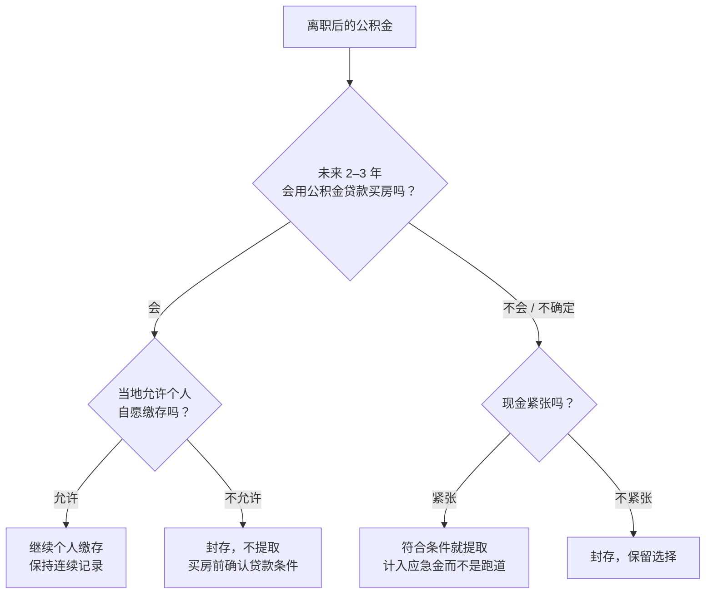

# 公积金、个税与专项扣除

上一章讲了社保和医保。这一章处理离职后另外两件「原来单位帮你办、现在要自己管」的事：住房公积金，以及你作为自然人的个人所得税——尤其是离职当年的汇算和各项扣除。

公司层面的税（增值税、企业所得税、经营所得的申报节奏）见[《财务与税务》第 2 章](../opc-finance/02-taxes.md)「税种与申报」；副业收入（外包、咨询）怎么归类和缴税见本书第 8 章。本章只讲**工资收入中断前后，个人这一侧要处理的事**。

> 本章引用的税收政策都标注了文号和执行期限，写作时间为 2026 年 11 月。个税政策每年都可能调整，尤其是带有执行期限的优惠，办理前以国家税务总局和个人所得税 App 里的最新规定为准。

## 公积金：离职后的四个选项

### 离职时发生什么

单位停止为你缴存后，你的公积金账户通常会被**封存**：由原单位办理封存，或者转入公积金中心的集中封存户。封存不是清空，**余额还在、照常计息**，只是不再有新的缴存。

离职后有四个方向，可以组合：

| 选项 | 做法 | 好处 | 代价 |
|---|---|---|---|
| 封存 | 什么都不做 | 余额保留，以后新单位可以接续 | 不再增长；连续缴存记录中断 |
| 个人自愿缴存 | 以灵活就业人员身份继续缴 | 保持缴存记录，保留公积金贷款的可能 | 单位那一半也要自己付；不是所有城市都开放 |
| 提取 | 符合条件时提取余额 | 增加流动资金 | 有的情形会销户；之后申请公积金贷款要重新积累 |
| 转移 | 去新城市后转入新账户 | 在新城市接续 | 需要新城市有缴存账户 |

### 个人自愿缴存：开放的城市越来越多

过去公积金基本只有单位职工能缴。这几年灵活就业人员自愿缴存的试点在扩大：

- 据新华社 2025 年 4 月报道，截至 2024 年末全国已有 36 个城市开展灵活就业人员缴存住房公积金试点
- 上海自 2025 年 6 月 1 日起施行的灵活就业人员缴存办法不设户籍条件，缴存额在规定范围内自定
- 住房城乡建设部 2026 年 6 月发布的《住房公积金管理条例（修订征求意见稿）》提出个体工商户和灵活就业人员可以自愿参加住房公积金制度。截至写作时仍是**征求意见稿**，不是正式生效的法规

你所在的城市是否开放、条件如何（年龄、户籍、居住证、缴存额范围、是否能贷款），要看当地住房公积金管理中心的公告。

### 怎么选：看你未来两三年要不要用公积金贷款

公积金对个人最大的价值是**贷款利率通常低于商业贷款**。所以决策的关键问题是：未来两三年，你会不会用公积金贷款买房？

几个容易忽略的点：

- **公积金贷款通常要求连续缴存一定月数**（常见 6 个月或 12 个月），贷款额度也常和账户余额、缴存基数挂钩。离职断缴后，这两个条件可能都不满足
- **已有公积金贷款的**，离职不影响贷款本身，但如果你一直是用公积金账户余额按月冲还月供，离职后余额用完，就要从银行卡还款了。把这部分月供算进第 4 章的必要支出
- **提取的规则各地差别很大**：有的城市对离职后户籍不在本地、离开本市的职工允许销户提取；有的要求封存满一定时间且没有继续缴存。提取前问清楚是**部分提取**还是**销户提取**——销户后再申请公积金贷款，就要从头积累
- 提取出来的钱，建议计入**应急金**而不是跑道。公积金本来就是你为住房存的长期储备，把它烧在产品上，等于动用了第三层「不动的钱」

查询和办理：全国住房公积金小程序、当地住房公积金管理中心的官网或 App 可以查余额、缴存记录，办理部分提取和异地转移接续。

## 个税：离职当年要做的三件事

### 一、离职当年大概率可以退税

在职时，单位按**累计预扣法**每月预扣你的工资个税。它的逻辑是：把你从 1 月到当月的累计收入，减去累计的基本减除费用（每月 5000 元）、专项扣除、专项附加扣除，按年度税率表算出累计应缴，再减去已经预扣的部分。

问题在于：如果你年中离职、下半年没有工资，单位只按你在职的几个月扣了基本减除费用，而年度汇算时可以扣满全年 6 万元。于是预扣的税往往比你全年真正应缴的多。

举例：月薪 3 万，在职 6 个月后离职，每月个人缴的三险一金 4500 元，专项附加扣除每月 3000 元，下半年没有其他收入。

$$
\text{在职 6 个月累计预扣的应纳税所得额} = 6 \times (30000 - 5000 - 4500 - 3000) = 105000
$$

按综合所得税率表（10% 档，速算扣除数 2520），累计预扣 $105000 \times 10\% - 2520 = 7980$ 元。

全年汇算时：

$$
\text{全年应纳税所得额} = 180000 - 60000 - 27000 - 18000 = 75000
$$

全年应纳税额 $75000 \times 10\% - 2520 = 4980$ 元。**可以退 3000 元。**

这还没算下半年的外包、咨询收入。如果有劳务报酬，它会并入综合所得一起汇算，劳务报酬预扣的税也会一起多退少补（第 8 章有完整的例子）。

综合所得年度汇算的办理时间是**次年 3 月 1 日至 6 月 30 日**，在个人所得税 App 里办。根据财政部、税务总局公告 2023 年第 32 号，年度综合所得收入不超过 12 万元且需要补税的、或者年度汇算需补税金额不超过 400 元的，可以免于办理汇算，执行至 2027 年 12 月 31 日。但**要退税，就必须自己去办**，不办不会自动退。

### 二、年终奖和补偿金的处理

**年终奖。** 离职前如果拿到全年一次性奖金，根据财政部、税务总局公告 2023 年第 30 号，可以选择不并入当年综合所得、单独计税，也可以选择并入综合所得，执行至 2027 年 12 月 31 日。离职当年综合所得偏低时，并入综合所得有时反而更划算——这正是年度汇算时可以重新选择的事。个人所得税 App 在汇算时通常会提示两种方式的结果，选税额低的那个。

**经济补偿金。** 主动辞职一般没有经济补偿。如果是协商解除或被解除劳动合同、拿到了一次性补偿收入，按现行规定，在当地上年职工平均工资 3 倍数额以内的部分免征个人所得税，超过部分单独计税（财税〔2018〕164 号）。适用条件和计算以当年规定和单位的扣缴为准。

### 三、离职后专项附加扣除要自己报

在职时，你在个人所得税 App 里填的专项附加扣除，通常选择「通过扣缴义务人申报」，单位每月预扣时就帮你扣了。离职后没有了扣缴单位：

- 外包、咨询的**劳务报酬在预扣预缴时不能扣专项附加扣除**，只能等年度汇算时扣
- 所以离职后，专项附加扣除基本都要在**次年汇算时自己填报**
- 每年年底前，个人所得税 App 会提醒你确认下一年度的专项附加扣除信息，记得把申报方式从「通过扣缴义务人」改成「综合所得年度自行申报」

## 专项附加扣除：逐项核对

目前有七项专项附加扣除。其中三项的标准由《国务院关于提高个人所得税有关专项附加扣除标准的通知》（国发〔2023〕13 号）自 2023 年 1 月 1 日起提高。截至写作时没有查到 2026 年再次调整的官方文件，以个人所得税 App 中的现行标准为准。

| 项目 | 标准 | 离职创业者要注意的 |
|---|---|---|
| 3 岁以下婴幼儿照护 | 每个婴幼儿每月 2000 元 | 父母可以选一方全额扣，或双方各扣 50%；你收入下降后，可以考虑改由配偶全额扣 |
| 子女教育 | 每个子女每月 2000 元 | 同上 |
| 继续教育 | 学历（学位）教育每月 400 元，最长 48 个月；职业资格证书取得当年定额 3600 元 | 过渡期考了相关证书的别忘了 |
| 大病医疗 | 一年内医保目录范围内的自付部分累计超过 15000 元的部分，限额 80000 元内据实扣除 | 只能在汇算时扣；在国家医保服务平台可以查到全年自付金额 |
| 住房贷款利息 | 首套住房贷款利息每月 1000 元，最长 240 个月 | 和住房租金不能同时享受 |
| 住房租金 | 按城市分为每月 1500、1100、800 元三档 | 和住房贷款利息不能同时享受 |
| 赡养老人 | 独生子女每月 3000 元；非独生子女与兄弟姐妹分摊，每人每月不超过 1500 元 | 分摊方式一年内不能变更 |

### 夫妻之间怎么分配

几项可以在夫妻之间分配的扣除（子女教育、婴幼儿照护、住房贷款利息），原则是**让边际税率高的一方扣**。过渡期你的收入大幅下降、甚至全年应纳税所得额为负时，你扣多少都省不了税，这些扣除应该全部给配偶。

注意：分配方式一个纳税年度内通常不能变更，要在年初（或上一年年底确认信息时）就想好。如果离职发生在年中，当年的分配可以在汇算时根据实际情况处理的空间有限，以 App 中的规则为准。

## 其他可以扣的项目

### 自缴的社保医保

以灵活就业人员身份自己缴纳的基本养老保险、基本医疗保险，属于个人所得税的「专项扣除」范围。离职后没有单位帮你扣，一般可以在年度汇算时自行填报。同时有综合所得和经营所得的，只能在其中一处扣，不能重复。

把每年的缴费凭证（在税务渠道缴费后可以下载）存好，汇算时用得上。填报入口和要求以当年个人所得税 App 为准。

### 个人养老金

个人养老金制度自 2024 年 12 月 15 日起在全国全面实施。缴费每年 12000 元以内可以在综合所得或经营所得中据实扣除，投资收益暂不征税，领取时单独按 3% 计税。

对过渡期的你来说，有一个更重要的提醒：**个人养老金账户里的钱，一般要到退休才能领取**（完全丧失劳动能力、出国定居、患重大疾病等少数情况可以提前）。它的税收优惠是用流动性换来的。过渡期你的边际税率很低甚至为零，抵税效果有限，而流动性正是你最缺的东西。**不要把跑道资金或应急金放进个人养老金账户。**

是否参加以及缴多少，取决于你的长期规划，这里不提供个人化建议。

## 一张年度个税日历

离职后你作为自然人，一年里要关注的时间点：

| 时间 | 事项 |
|---|---|
| 每年 12 月 | 在个人所得税 App 确认下一年度专项附加扣除信息，改为「年度自行申报」 |
| 次年 3 月 1 日–6 月 30 日 | 综合所得年度汇算（工资、劳务报酬、稿酬、特许权使用费合并），退税或补税 |
| 次年 3 月 31 日前 | 如果有经营所得（比如注册了个体户），办理经营所得年度汇算（见第 8 章和《财务与税务》第 2 章） |
| 每季度 | 在 App 的「收入纳税明细」里看一眼，确认没有不认识的单位以你的名义申报收入 |
| 随时 | 外包、咨询客户支付劳务报酬时是否代扣了个税，留好凭证 |

最后一条很重要：查「收入纳税明细」不只是为了防冒用。如果你的外包客户扣了你的税、却没有给你申报，或者申报的金额不对，你可以在 App 里提出异议。

## 本章要点

- 公积金离职后会封存，余额保留计息；四个选项：封存、个人自愿缴存（36 个城市以上已试点，条例修订仍是征求意见稿）、提取、转移
- 决策关键是未来两三年会不会用公积金贷款：会就尽量保持缴存，不会且现金紧张可以提取，但提取的钱计入应急金
- 年中离职后，因为累计预扣法只扣了在职月份的基本减除费用，汇算时大概率能退税；退税必须自己办
- 年终奖可单独计税或并入综合所得（执行至 2027 年底）；被解除劳动合同的补偿金在当地上年职工平均工资 3 倍以内免税
- 离职后劳务报酬预扣时不扣专项附加，专项附加和自缴社保都要在次年汇算时自行填报
- 收入下降后，可在夫妻间分配的扣除应该给边际税率高的一方
- 个人养老金有税收优惠但一般要到退休才能领取，不要把跑道资金和应急金放进去
