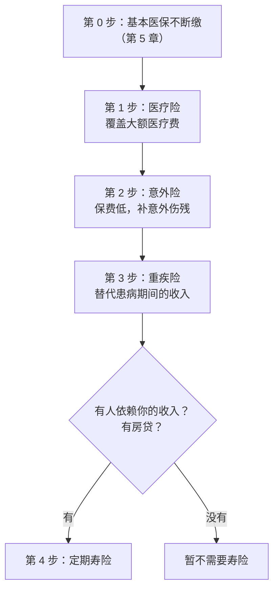

# 商业保险

社保和医保是底座，但它们只保「基本」。离职做一人公司之后，你失去了三样原来没注意到的东西：单位给你买的团体补充医疗和意外险、生病时照发的病假工资、以及「我病了公司还在运转」的安全感。对一人公司来说，**你生病了，收入就停了**。

这一章讲商业保险在过渡期的作用：每类保险解决什么风险、按什么顺序配置、保额怎么估、条款里要看什么。

> [!WARNING]
> 本章只讲原则和方法，**不推荐具体产品，也不提供个性化的保险或投资建议**。保险产品条款差异大、更新快，本章按截至 2026 年 11 月的情况整理，投保前完整阅读条款，以保险合同和国家金融监督管理总局的最新规定为准，必要时咨询持牌的保险专业人士。

## 先搞清楚：离职后少了什么

在职时你身上的保障，通常有三层：

| 层次 | 在职时 | 离职后 |
|---|---|---|
| 社会保险 | 单位缴职工养老、职工医保等 | 自己以灵活就业身份续缴（第 5 章） |
| 单位福利 | 团体补充医疗、团体意外险，有的公司还有团体寿险、重疾 | **随离职终止**，一般不能带走 |
| 收入保障 | 病假期间有病假工资，长期病假有医疗期保护 | **没有**，生病期间收入为零 |

第三层是最容易被忽视的。员工生病住院，医药费靠医保和商业医疗险，生活费靠病假工资。一人公司的创始人生病住院，医药费同样可以报销，但**这几个月的生活费、房贷、自缴社保从哪来**？产品没人维护、客户没人回复，收入可能在你康复之前就开始流失。

商业保险在过渡期的作用，就是补上第二层和第三层。

## 四类保险各管什么

| 类型 | 保什么风险 | 怎么赔 | 对一人公司的意义 |
|---|---|---|---|
| 医疗险 | 生病或意外住院产生的大额医疗费 | **报销型**：花多少报多少，扣掉免赔额和医保已报部分 | 补医保报销不了的部分，防止一场大病掏空应急金 |
| 意外险 | 意外导致的身故、伤残，以及意外医疗 | 身故伤残按保额**给付**；意外医疗多为报销 | 保费低，覆盖面窄，作为补充 |
| 重疾险 | 确诊合同约定的重大疾病 | 确诊即按保额**一次性给付**，钱怎么用你自己定 | **替代收入**：覆盖治疗和康复期间的生活费、房贷、社保 |
| 定期寿险 | 保障期内身故（多数也含全残） | 按保额给付给受益人 | 保证家人在你不在时能还清房贷、维持生活 |

两个关键区别：

- **报销型 vs 给付型**：医疗险是报销型的，它只赔医疗费，赔多少取决于你花了多少；重疾险、寿险是给付型的，赔一笔固定的钱，不管你花在哪里。对一人公司来说，给付型的钱可以用来**付生活费、付房贷、付社保**，这是报销型保险做不到的
- **保的对象不同**：医疗险和重疾险保的是你自己的生活，定期寿险保的是**你家人**的生活。如果没有人依赖你的收入，寿险的必要性就很低

## 配置顺序

预算有限时，按这个顺序考虑：

为什么是这个顺序：

1. **基本医保是一切的前提**。很多商业医疗险的赔付和医保挂钩（下面讲），而且基本医保覆盖面最广、性价比最高，断了它再买多少商业保险都补不上
2. **医疗险先于重疾险**：一场大病的医疗费可能是几十万，这是最直接的财务冲击；而医疗险保费通常比重疾险低得多，单位预算的保障杠杆最大
3. **意外险便宜**，补上意外伤残这个缺口的成本很低
4. **重疾险对一人公司比对上班族更重要**，因为你没有病假工资。但它的保费明显更高，在预算紧张时可以先配一个较低保额，以后再加
5. **定期寿险只在有人依赖你时才必要**。单身、没有房贷、父母不靠你养，可以暂时不买

## 保额怎么估

保额的估算有一些常见的思路，下面给的是**算法**，不是建议的数字。

### 重疾险：按「生病期间的收入缺口」估

$$
\text{重疾保额} \approx \text{必要月支出} \times \text{治疗加康复的月数} - \text{可动用的应急金}
$$

治疗加康复的时间，常见的估算口径是 3–5 年。用第 4 章的示例家庭：必要月支出 1.2 万，按 3 年估算是 43.2 万；如果应急金 7.2 万可以动用，缺口约 36 万。

这个算法的思路是：重疾险赔的钱用来**替代你生病期间的收入**，让家庭在你治疗和康复期间不需要动用跑道资金、不需要卖房、也不需要你带病工作。

### 定期寿险：按「家人需要多少钱」估

$$
\text{寿险保额} \approx \text{未还清的负债} + \text{家人若干年的必要生活费} + \text{子女教育等确定支出} - \text{已有可动用资产}
$$

保障期限一般覆盖到负债还清、子女独立。比如房贷还有 20 年，子女还小，那么保到孩子成年或房贷还清中较晚的那个时间点。

### 医疗险：看覆盖范围，不只看保额

医疗险的保额（几百万）通常远超实际可能的花费，重点不在保额，而在**覆盖范围、免赔额和续保条件**，下一节讲。

### 预算的约束

保险的保费是长期的固定支出，要计入第 4 章的必要月支出。一个常见的经验是总保费不超过家庭年收入的一定比例，但过渡期收入波动大，更实际的做法是：**先确定每年能稳定拿出来的保费预算，在预算内按上面的顺序配**，保额不够就先低后高，等产品收入稳定后再加。

## 条款里要看什么

保险的坑大多在条款里。买之前至少看这几项：

### 健康告知

投保时要回答一系列健康问题。**如实告知是最重要的一条**：不如实告知的，保险公司可能在理赔时拒赔甚至解除合同，你交的保费也可能拿不回来。

几个常见情况：

- 体检报告里的异常（结节、指标偏高、脂肪肝）也属于需要告知的内容，看清问题问的是什么
- 健康告知只回答被问到的问题，没问的不需要主动说
- 有异常不一定不能买，可能是加费、除外责任承保，或者换一款告知更宽松的产品

一个推论：**健康状况越好，可选的产品越多、条件越好**。如果计划离职，可以在在职期间用好单位的年度体检，了解自己的健康状况，然后在离职前后完成投保规划。但无论何时投保，告知都必须基于你当时真实的健康状况。

### 等待期

合同生效后的一段时间内，因疾病出险不赔或者只退保费。不同险种、不同产品的等待期长短不同，以条款为准。意外险通常没有等待期。

这意味着保险**不能临时抱佛脚**：等到感觉身体不对再买，可能已经过不了健康告知，或者落在等待期里。

### 免赔额和赔付比例（医疗险）

- **免赔额**：一年内自付的医疗费超过这个数之后，保险才开始赔
- **赔付比例**：免赔额以上的部分按多少比例报销
- **和医保挂钩的条款**：很多百万医疗险规定，以「有社保」身份投保、但就医时没有使用社保结算的，只按应赔金额的一定比例（常见 60%）赔付。所以第 5 章讲的医保不断缴，也直接影响商业医疗险的赔付

如果你的医保状态发生变化（比如断缴后改参居民医保），看一下保单是否要求变更或通知，按条款处理。

### 续保条件（医疗险）

> [!WARNING]
> 医疗险的续保规则受金融监管部门对短期健康险的规定约束，按 2025 年前后的规定整理，可能调整；以国家金融监督管理总局的最新规定和具体产品条款为准。

一年期的医疗险，有的写「保证续保」若干年，有的不保证续保。不保证续保的产品，可能因为你生过病、产品停售等原因无法续保，而那时候你可能已经买不到别的了。比较医疗险时，**续保条件比价格更重要**。

### 疾病定义（重疾险）

> [!WARNING]
> 疾病定义规范按 2020 年修订版整理，行业规范可能再次修订；以中国保险行业协会发布的最新版本和具体产品条款为准。

国内重疾险的常见重疾和轻症定义有行业统一的规范（中国保险行业协会、中国医师协会 2020 年修订的《重大疾病保险的疾病定义使用规范》）。规范之外的病种、轻症中症的赔付比例、多次赔付的条件，各产品不同。

## 城市定制型医疗保险（惠民保）

> [!WARNING]
> 惠民保的保费、承保条件按 2025 年前后各地产品的常见情况整理，每年随产品更新调整；以当地医保局公布的信息和具体产品的投保须知为准。

很多城市都有政府指导、商业保险公司承保的城市定制型医疗保险，通常叫「惠民保」。它的特点：

- **保费低**，一年通常几十到一两百元
- **健康告知宽松**，一些产品对已有疾病（既往症）也能承保，只是赔付比例更低
- **通常和当地基本医保挂钩**：很多产品要求投保人是当地基本医保的参保人
- 免赔额通常较高，保障范围比百万医疗险窄

它适合两类情况：一是身体有既往症、买不了普通百万医疗险的人；二是给父母补充保障。对健康的年轻人，它可以作为补充，但不建议替代普通医疗险。

## 家人的保障

做家庭保障时的几个原则：

- **先保家庭经济支柱，再保孩子**。孩子的医疗险很便宜、值得买，但家庭支柱倒下的冲击远大于孩子生病
- **配偶如果有单位团险**，也要看清楚覆盖范围，不要以为有团险就不需要自己的保险——它同样会随离职终止
- **父母**年龄大了，很多商业医疗险已经买不了或很贵。可选的通常是当地惠民保、针对特定疾病的医疗险，以及给自己多留一些应急金
- 给配偶的保障同样重要。如果配偶是家庭在过渡期的主要收入来源，他 / 她的重疾和寿险保障甚至比你的更关键

## 过渡期不建议做的事

- **不要把保险当理财**。返还型、分红型、年金类等兼具储蓄功能的保险，保费高、前期退保损失大，会锁住你过渡期最需要的流动性。它们是否适合你的长期规划是另一个问题，本书不做评价；但在过渡期，现金流比什么都重要
- **不要只买意外险就以为够了**。意外险只赔意外，而大多数重大的健康风险来自疾病
- **不要因为预算紧张断掉已有的保单**。尤其是医疗险和重疾险，断了再买可能要重新过健康告知，等待期也会重新计算
- **不要听信「离职前赶紧买」的营销话术**而仓促决定。投保时机和你是否在职关系不大，关键是你的健康状况和预算

## 一张保单清单

把家里所有的保单整理成一张表，存在家人能找到的地方：

| 被保险人 | 保险类型 | 保险公司 | 保额 | 年保费 | 缴费日 | 保障期限 | 续保条件 | 受益人 | 保单存放位置 |
|---|---|---|---|---|---|---|---|---|---|
| | | | | | | | | | |

几件事：

- **告诉配偶这张表在哪**。出险时往往是家人去办理赔，他们不知道有哪些保单就无从办起
- 把**年缴保费的日期**加进日历，并在第 4 章的「已知大额支出」里预留
- 每年复查一次：家庭情况变了（结婚、生孩子、买房、还清贷款）时，保额和受益人可能需要调整

## 本章要点

- 离职后失去的不只是社保：单位团体保险随离职终止，生病期间也没有病假工资——一人公司生病，收入就停了
- 医疗险是报销型，补大额医疗费；重疾险和寿险是给付型，可以用来替代收入、付房贷、付社保
- 配置顺序：基本医保不断 → 医疗险 → 意外险 → 重疾险 → （有人依赖你时）定期寿险
- 重疾保额按「必要月支出 × 治疗康复月数 − 可动用应急金」估；寿险按「负债 + 家人生活费 + 确定支出 − 已有资产」估
- 看条款：如实健康告知、等待期、免赔额与社保结算比例、续保条件、疾病定义
- 惠民保保费低、告知宽松，通常要求是当地医保参保人，适合补充和给父母兜底
- 过渡期不要把保险当理财、不要断已有保单；整理一张保单清单，告诉家人放在哪
