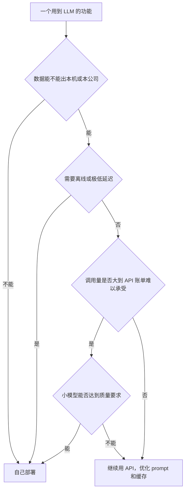

# 开源模型版图

这本书讲「自己跑模型」这件事：怎么在 Mac 上、在一台租来的 GPU 上把开源模型跑起来，怎么选量化格式和硬件，什么时候值得微调，微调又该怎么做。它是实操书，原理只在需要做决策时点到为止：量化的数学、DPO 的推导、KV Cache 的细节都在[《大模型原理进阶》](../llm-deep-dive/)里，这里只讲怎么用、怎么取舍。

**适合谁**：已经会调模型 API（读过[《大模型应用工程》](../llm-app-engineering/)），对 Transformer 有基本概念，想知道「我的产品能不能、该不该换成自己部署的模型」的开发者。微调那几章会用到 Python，不熟的话先翻[《面向 AI 的 Python》](../python-for-ai/)。

**怎么读**：前五章是部署线（版图 → 本地 → 服务端 → 量化 → 硬件），后四章是微调线（要不要微调 → LoRA → 数据 → 偏好优化与蒸馏）。只想在本地跑个模型，读完前两章就能上手；要上生产，读到第 5 章；真要微调，第 6 章一定要先读，它会劝退大部分场景。

这一章先回答三个问题：开源模型到底「开」了什么、主要有哪些家族、许可证要看哪几条。最后给一张「要不要自己跑」的判断清单。

## 「开源」到底开了什么

日常说的「开源模型」，绝大多数其实是**开放权重**（open weights）：你能下载训练好的参数文件，在自己的机器上运行、修改、微调。但通常拿不到：

| 组成部分 | 开放权重模型通常 | 真正完全开源的模型 |
|---|---|---|
| 权重文件 | 提供 | 提供 |
| 推理代码 | 提供（或已被主流框架支持） | 提供 |
| 训练代码 | 少数提供 | 提供 |
| 训练数据 | 几乎不提供，最多给个配比描述 | 提供或给出可复现的清单 |
| 许可证 | 各家自定，可能有使用限制 | OSI 认可的开源许可证 |

对做产品的人来说，**权重 + 许可证**才是关键：权重决定你能不能跑，许可证决定你能不能拿来赚钱。训练数据不公开影响的主要是可复现性和合规审查，日常使用感受不到。

少数机构会发布完全开源的模型（数据、代码、中间检查点全公开），主要价值在科研和可审计性。本书说「开源模型」时泛指开放权重模型。

## 主要家族

开源模型的版图变化极快，几个月就会有新一代发布、排名洗牌。下面只列写作时（2026 年 11 月）已经存在较长时间、生态成熟的家族，**不做强弱排名**：

| 家族 | 发布方 | 特点 | 许可证特征（以具体版本的模型卡为准） |
|---|---|---|---|
| Llama | Meta | 生态最早成熟，工具链支持最全 | 自定义社区许可证，有月活用户数门槛和使用政策 |
| Qwen（通义千问） | 阿里 | 尺寸覆盖全，中文好，有代码、视觉、embedding 等分支 | 多数尺寸为 Apache 2.0，个别版本例外 |
| DeepSeek | 深度求索 | 大规模 MoE，推理模型；R1 发布时附带了蒸馏到小模型的版本 | 近期主力版本多为 MIT |
| Mistral | Mistral AI | 欧洲厂商，中小尺寸效率高 | 部分 Apache 2.0，部分为研究或商业许可 |
| Gemma | Google | 中小尺寸，端侧友好 | 不同代际许可证不同，早期为自定义使用条款 |
| Phi | 微软 | 小模型，强调数据质量 | 多为 MIT |
| gpt-oss | OpenAI | 2025 年发布的开放权重 MoE 推理模型 | Apache 2.0，附使用政策 |
| GLM、Kimi 等 | 智谱、月之暗面等 | 国产大尺寸 MoE，Agent 和代码能力受关注 | 各版本不同，多为 MIT 或修改版 MIT |

几点说明：

- **同一家族不同版本的许可证可能不同**，比如某一代的某个尺寸单独用了更严格的条款。永远以你要下载的那个仓库的 LICENSE 文件为准
- 「哪个最强」的答案每个月都在变。选型时去看当下的排行榜（LMArena 这类人工盲评榜、Open LLM Leaderboard 这类自动评测榜、各家技术报告），再**用自己的任务测一遍**，后者才是决定性的
- 中文场景下国产家族普遍有优势，但差距在缩小，同样要实测

> [!NOTE]
> **关于本书的示例模型**：后面几章的命令以 `Qwen3-8B`（2025 年发布）为例。按 Hugging Face 上 Qwen 官方组织的仓库记录，截至 2026 年 11 月已经有了 Qwen3.5（2026 年 2 月，0.8B 到 397B-A17B）、Qwen3.6（2026 年 4 月）和 Qwen3.8（2026 年 8 月）几代。新一代的中小尺寸（如 `Qwen3.5-9B`、`Qwen3.6-27B`）多为 Apache 2.0，但都是图文多模态模型，最大的几个旗舰尺寸改用了自定义许可证。
>
> 示例仍用 `Qwen3-8B`，是因为它是纯文本模型，推理框架、量化工具、微调库对它的支持都已稳定，适合学流程。流程学会之后换成新一代模型，通常只需要改模型名；多模态模型做纯文本微调时，留意训练脚本是否要换成对应的模型类和处理器，以模型卡的说明为准。

### 怎么读模型名

模型仓库名里通常编码了大量信息：

以 `Qwen3-30B-A3B-Instruct-2507-GGUF` 为例拆开看：

| 片段 | 含义 |
|---|---|
| `Qwen3` | 家族与代际 |
| `30B` | 总参数 300 亿 |
| `A3B` | 每个 token 只激活 3B 参数（MoE） |
| `Instruct` | 指令微调版，能对话；另一种是 Base，只会续写 |
| `2507` | 版本日期（2025 年 7 月） |
| `GGUF` | 文件格式，给 llama.cpp / Ollama 用 |

要点：

- **Base 与 Instruct / Chat**：Base 是只做过预训练的模型，只会续写；Instruct 做过 SFT 和对齐，能按指令对话。部署直接用 Instruct；微调时两者都可以做底座，后面第 7 章再讨论
- **稠密与 MoE**：`30B-A3B` 这种写法表示 MoE，总参数 30B 都要装进内存，但每个 token 只算 3B，所以**内存按总参数算、速度按激活参数算**。MoE 在显存大、带宽一般的设备上（比如大内存 Mac）性价比很高
- **推理模型**：名字里带 `R1`、`Thinking`、`Reasoning` 等，会先输出很长的思考过程再回答。效果好，但输出 token 多、延迟高，有的模型支持开关思考模式
- **格式后缀**：`GGUF`、`AWQ`、`GPTQ`、`FP8`、`MLX`、`4bit` 表示这是一个量化好的版本，第 4 章细讲

### 尺寸分档

参数量大致决定了能力上限和硬件门槛：

| 档位 | 典型用途 | 4 位量化后权重大小 | 能跑的设备 |
|---|---|---|---|
| 1B–4B | 分类、抽取、补全、端侧 | 1–3 GB | 手机、任何 Mac |
| 7B–14B | 通用对话、简单 RAG、微调后的专用任务 | 4–9 GB | 16 GB 内存的 Mac，单张消费级显卡 |
| 24B–35B | 复杂指令、代码、工具调用 | 14–20 GB | 32 GB 以上的 Mac，24–32 GB 显卡 |
| 70B 级 | 接近上一代闭源旗舰的通用能力 | 约 40 GB | 64 GB 以上的 Mac，双卡或 80 GB 数据中心卡 |
| 数百 B 的 MoE | 开源阵营的旗舰 | 数百 GB | 多卡服务器 |

估算方法很简单：**权重大小 ≈ 参数量 × 每参数字节数**，4 位量化按每参数约 0.55–0.6 字节估（含缩放因子），再加上 KV Cache 和运行开销。本机是一台 18 GB 内存的 M3 Pro，后面的例子会以它为准：8B 跑得很舒服，14B 可以，32B 就装不下了。

## 许可证：看这几条

拿一个开源模型做商业产品前，打开它的 LICENSE 和模型卡，至少确认以下几项：

| 检查项 | 为什么重要 |
|---|---|
| 能否商用 | 部分模型只许研究用途，或者商用需要另行授权 |
| 用户规模门槛 | 有的许可证规定月活超过某个量级要单独申请 |
| 使用政策（AUP） | 列出禁止的用途，违反即失去授权 |
| 署名要求 | 有的要求在产品里注明「基于 某模型 构建」，或要求衍生模型名带上原名 |
| 衍生模型的许可证 | 微调后的模型是否必须沿用原许可证 |
| 输出的使用限制 | 有的禁止用输出训练其他模型 |

Apache 2.0 和 MIT 是最宽松的，基本只要求保留版权声明。自定义许可证要逐条读。这不是法律意见：许可证条款会随版本更新，金额和规模门槛以当时的原文为准，产品规模起来之后值得请律师看一遍。

另一个容易忽略的点：**闭源 API 的服务条款通常禁止用它的输出训练竞争模型**。第 8、9 章用强模型生成训练数据时要注意这一条。

## 要不要自己跑

先说结论：**对一个人的公司，默认用 API**。自己跑模型的理由要足够硬：



几个常见的「自己跑」理由，按说服力排序：

1. **数据不能外发**：医疗、法律、企业内部文档，客户合同明确要求数据不出境或不出内网
2. **离线或端侧**：没有网络的环境，或者需要在用户设备上运行
3. **规模化后的成本**：一个窄任务调用量巨大，用微调过的小模型替代大模型 API，单次成本能降一个数量级（第 5 章算账）
4. **可控性**：模型版本永远不会被供应商下线或悄悄更新，行为可复现
5. **学习和实验**：本地跑模型几乎零成本，适合理解模型行为

不太成立的理由：「API 太贵」但调用量其实很小（一台 GPU 的月租可能比一年的 API 账单还多）；「想要最强效果」（开源旗舰需要多卡服务器，个人很难跑得起，而且通常仍落后闭源旗舰一段）。

### 一个现实的例子

hatch-counter 用视觉模型识别进货单照片，服务端调的是一个 **OpenAI 兼容接口**，测试时用环境变量把地址指到本地假端点。这个设计带来一个很大的好处：后面几章讲的 Ollama、llama.cpp、vLLM 都提供 OpenAI 兼容接口，**换成自己部署的模型只是换一个 base URL**。哪天门店客户要求单据照片不出内网，或者识别量大到 API 账单不划算，切换成本很低。

这也是本书反复会提到的原则：**应用代码只依赖 OpenAI 兼容这层协议，不依赖具体供应商**，自己部署才是一个随时可以做的选项，而不是一次重写。

## 本章要点

- 「开源模型」大多是**开放权重**：能下载能改，但训练数据通常不公开；做产品看权重和许可证
- 主要家族有 Llama、Qwen、DeepSeek、Mistral、Gemma、Phi、gpt-oss 等，**版图变化快，选型看当下排行榜，再用自己的任务实测**
- 模型名里编码了参数量、MoE 激活参数、Base / Instruct、格式；MoE 的**内存按总参数算、速度按激活参数算**
- 4 位量化后权重约为每参数 0.55–0.6 字节，18 GB 的 Mac 能舒服地跑 8B、勉强跑 14B
- 许可证重点看：能否商用、用户规模门槛、使用政策、署名、衍生模型和输出限制；以具体版本原文为准
- 一人公司默认用 API；数据不能外发、离线、规模化成本、可控性才是自己跑的硬理由
- 应用只依赖 OpenAI 兼容协议，换成自部署模型就只是换 base URL

## 动手练习

1. **估算权重再对照实物**：按「参数量 × 每参数 0.55–0.6 字节」用 Python 算出 8B、14B、30B（MoE，激活 3B）三个尺寸 4 位量化后的权重大小，判断哪些能放进一台 18 GB 内存的 Mac。然后用 Ollama 拉一个 8B 模型，和实际大小对照。

   验证：`ollama list` 的 SIZE 列应落在你估算的 8B 区间附近（相差一两百 MB 属正常，嵌入层和输出层精度不同）。

   参考答案：8B 约 4.4–4.8 GB，14B 约 7.7–8.4 GB，30B-A3B 约 16.5–18 GB。macOS 只让 GPU 用约三分之二到四分之三的内存，18 GB 机器大约 12–13 GB 可用，所以 8B、14B 能跑，30B-A3B 装不下；它每 token 只算 3B 参数，速度快，但内存要按 30B 算。

   ```python
   for name, params in [("8B", 8), ("14B", 14), ("30B-A3B", 30)]:
       lo, hi = params * 0.55, params * 0.6
       print(f"{name}: {lo:.1f}–{hi:.1f} GB")
   ```

2. **读两份许可证**：在 Hugging Face 上分别打开一个 Qwen 仓库和一个 Llama 仓库的 LICENSE（Llama 是受限仓库，需要先登录同意条款才能看全文），按[许可证：看这几条](#许可证看这几条)里的六项各填一行。

   验证：两张表填完后，Llama 那张在「用户规模门槛」「使用政策」两行能指出原文中对应的段落；Apache 2.0 那张这两行应为「无」。

   参考答案：Apache 2.0 只要求保留版权和许可声明、注明改动，没有规模门槛和用途清单；Llama 社区许可证有月活门槛、独立的使用政策和署名要求。具体数字以你读到的那一版原文为准。

3. **走一遍判断流程**：用[要不要自己跑](#要不要自己跑)的流程图判断两个场景：A. 给一家律所做合同摘要，合同约定文件不能离开对方内网，每天约 50 次调用；B. 一个营销文案小工具，每天约 200 次调用，你觉得 API 有点贵。

   验证：两个场景各写出流程图上经过的节点和最终落点。

   参考答案：A 在第一个判断「数据能不能出本机或本公司」就走向自己部署，调用量多少无关；B 数据能外发、不需要离线、调用量远不到 API 账单难以承受的程度，落在「继续用 API」，该做的是优化 prompt 和缓存。
