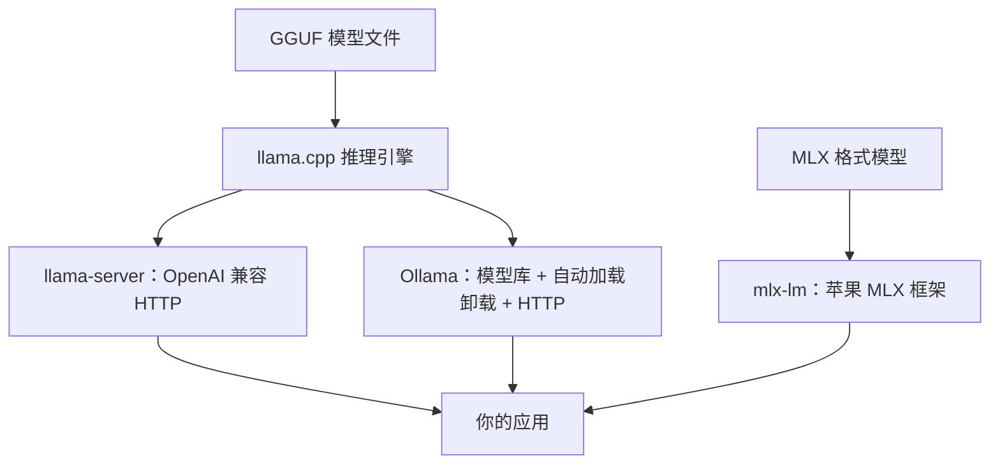

# Ollama 与 llama.cpp

在自己的电脑上跑模型，最省事的两条路是 Ollama 和 llama.cpp。它们是上下游关系：**llama.cpp 是推理引擎，Ollama 是在它之上包了一层模型管理和服务**。这一章在一台 Apple Silicon Mac 上把两者都跑起来，接到 TypeScript 代码里，再讲清楚几个最容易踩的参数：上下文长度、GPU 层数、并发和常驻时间。最后介绍苹果自家的 MLX，它在 Mac 上是另一个值得了解的选择。

## 三者的关系



| 工具 | 定位 | 适合 |
|---|---|---|
| Ollama | 一条命令拉模型、跑服务，自动管理内存 | 日常本地使用、开发联调、给团队内部用 |
| llama.cpp | 底层引擎，参数全部暴露 | 想精确控制、自己做量化、嵌入其他程序 |
| MLX（mlx-lm） | 苹果的数组框架，专为 Apple Silicon 设计 | Mac 上追求速度、在 Mac 上做 LoRA 微调 |

还有 LM Studio 这类图形界面工具，底层同样是 llama.cpp 或 MLX，适合不想碰命令行时试模型。

为什么 Mac 跑模型体验好？因为 Apple Silicon 是**统一内存**：CPU 和 GPU 共用同一块内存，不存在「显存只有 8 GB」的问题，18 GB 的机器里大部分都能给模型用。代价是带宽比独立显卡低（M3 Pro 约 150 GB/s，RTX 4090 约 1 TB/s），第 5 章会算这对速度意味着什么。

## Ollama

### 安装与第一个模型

```bash
brew install ollama        # 或从官网下载 macOS 应用（自带菜单栏图标和后台服务）
ollama serve               # 用 brew 装的需要手动起服务；用应用的话已经在后台跑了
ollama --version           # 本章命令在 0.x 版本上验证，Ollama 迭代很快，以官方文档为准
```

另开一个终端：

```bash
ollama pull qwen3:8b       # 下载模型，标签格式是 模型:尺寸，可以去 Ollama 官网的模型库搜
ollama run qwen3:8b        # 进入交互对话，/bye 退出
ollama list                # 已下载的模型
ollama ps                  # 当前加载在内存里的模型，以及它跑在 GPU 还是 CPU 上
ollama show qwen3:8b       # 看参数量、量化格式、上下文长度、模板
ollama rm qwen3:8b         # 删除
```

模型标签会随时间增减，书里的 `qwen3:8b` 只是示例，换成你在模型库里看到的任何模型都行。Ollama 官方库里的默认标签一般是 4 位量化（`Q4_K_M` 一类），想要别的量化等级就选带后缀的标签。

也可以直接拉 Hugging Face 上的 GGUF 仓库：

```bash
ollama run hf.co/<用户名>/<仓库名>-GGUF:Q4_K_M
```

### 接到代码里

Ollama 默认监听 `localhost:11434`，同时提供自己的 API 和 **OpenAI 兼容接口**（路径前缀 `/v1`）。用 OpenAI 的 Node SDK 就能调：

```typescript
import OpenAI from "openai";

const client = new OpenAI({
  baseURL: "http://localhost:11434/v1",
  apiKey: "ollama", // 必填但不校验，随便写
});

const res = await client.chat.completions.create({
  model: "qwen3:8b",
  messages: [
    { role: "system", content: "你是一个简洁的助手，用中文回答。" },
    { role: "user", content: "用一句话解释什么是统一内存。" },
  ],
  temperature: 0.3,
});

console.log(res.choices[0].message.content);
```

流式输出、`response_format` 的 JSON 模式、工具调用也都支持，具体能力取决于模型本身是否训练过工具调用。这意味着你在《大模型应用工程》里写的代码，把 `baseURL` 和 `model` 换掉就能跑在本地模型上，**开发和测试阶段可以完全不花 API 钱**。

用 curl 快速验证：

```bash
curl http://localhost:11434/v1/chat/completions \
  -H "Content-Type: application/json" \
  -d '{"model":"qwen3:8b","messages":[{"role":"user","content":"你好"}]}'
```

### 必须知道的几个参数

**上下文长度**是第一大坑。Ollama 默认的上下文窗口比模型支持的最大值小得多（默认值随版本变化过），超出部分会被**静默截断**：你塞进去一份长文档，模型只看到了后半截，回答莫名其妙，却没有任何报错。

有三种设置方式：

```bash
# 1. 服务级默认（较新版本支持）
OLLAMA_CONTEXT_LENGTH=16384 ollama serve

# 2. 交互模式里临时设置
ollama run qwen3:8b
>>> /set parameter num_ctx 16384
```

```text
# 3. 写进 Modelfile，做成一个新模型（推荐，见下一节）
PARAMETER num_ctx 16384
```

上下文越长，KV Cache 占内存越多，所以不是越大越好。按实际需要设，然后用 `ollama ps` 看模型是否仍然 100% 在 GPU 上。

其他常用环境变量：

| 变量 | 作用 |
|---|---|
| `OLLAMA_HOST` | 监听地址，默认 `127.0.0.1:11434`；设 `0.0.0.0:11434` 才能被局域网访问 |
| `OLLAMA_KEEP_ALIVE` | 模型空闲多久后卸载，默认 5 分钟；设 `-1` 常驻，`0` 用完即卸 |
| `OLLAMA_NUM_PARALLEL` | 单个模型同时处理几个请求；每多一路就多一份 KV Cache |
| `OLLAMA_MAX_LOADED_MODELS` | 同时加载几个模型 |
| `OLLAMA_FLASH_ATTENTION` | 设为 `1` 开启 Flash Attention，省内存 |
| `OLLAMA_KV_CACHE_TYPE` | KV Cache 量化，如 `q8_0`，长上下文时显著省内存（需开启 Flash Attention） |

用 macOS 应用运行时，环境变量要用 `launchctl setenv OLLAMA_HOST "0.0.0.0:11434"` 设置后重启应用；用 brew 起的服务直接在命令前加变量即可。

**注意安全**：Ollama 的 API 没有鉴权。把它监听到 `0.0.0.0` 或者部署到服务器时，必须放在防火墙或带鉴权的反向代理后面，不要直接暴露到公网。

### Modelfile：把配置固化成模型

Modelfile 类似 Dockerfile，描述「基于哪个模型、用什么参数和系统提示」：

```text
FROM qwen3:8b

PARAMETER num_ctx 16384
PARAMETER temperature 0.2

SYSTEM """
你是门店进货单的校对助手。只根据用户给出的文字回答，不确定就说不确定。
"""
```

```bash
ollama create receipt-helper -f Modelfile
ollama run receipt-helper
```

`FROM` 后面也可以是本地 GGUF 文件路径（`FROM ./my-model-Q4_K_M.gguf`），或者用 `ADAPTER` 叠加 LoRA 适配器，第 9 章导出微调模型时会用到。

## llama.cpp

Ollama 隐藏的那些细节，在 llama.cpp 里全部可以调。它的版本号是递增的构建编号（`b` 加数字），更新非常频繁，命令行参数偶尔会改名，遇到报错先看 `--help`。

### 安装

```bash
brew install llama.cpp     # 自带 Metal 加速
llama-server --version
```

也可以从源码用 CMake 编译，自己做量化转换时需要仓库里的 Python 脚本（第 4 章）。

### 直接从 Hugging Face 跑

```bash
llama-server -hf <用户名>/<仓库名>-GGUF:Q4_K_M --port 8080
```

`-hf` 会下载并缓存模型。启动后浏览器打开 `http://localhost:8080` 有一个内置的聊天页面，`/v1/chat/completions` 是 OpenAI 兼容接口，上面的 TypeScript 代码把 `baseURL` 换成 `http://localhost:8080/v1` 就能用。

### 常用参数

```bash
llama-server \
  -m ~/models/qwen3-8b-Q4_K_M.gguf \
  -c 16384 \
  -ngl 99 \
  -np 2 \
  --jinja \
  --host 127.0.0.1 --port 8080
```

| 参数 | 说明 |
|---|---|
| `-c` | 上下文长度，也就是总的 KV Cache 容量。`-np 2 -c 16384` 时每个槽位只有 8192 |
| `-ngl` | 放到 GPU 上的层数，99 表示全部。显存不够时调小，剩下的层在 CPU 上算，速度会明显下降 |
| `-np` | 并行槽位数，配合连续批处理提升吞吐 |
| `--jinja` | 使用模型自带的 chat template，工具调用需要 |
| `-fa` | Flash Attention。新版本取值 `on` / `off` / `auto`，旧版本是不带值的开关，以 `--help` 为准 |
| `-ctk` / `-ctv` | K / V 缓存的类型，如 `q8_0` |
| `--api-key` | 给 HTTP 接口加一个简单的 Bearer 密钥 |

### 测速

```bash
llama-bench -m ~/models/qwen3-8b-Q4_K_M.gguf
```

它会分别报告 `pp`（prompt processing，预填充速度）和 `tg`（text generation，生成速度），单位 tokens/s。对比量化格式、调参数时，用它比用体感靠谱得多。

## MLX：Mac 上的另一条路

MLX 是苹果为 Apple Silicon 做的数组计算框架，`mlx-lm` 是它的大模型工具包。社区（Hugging Face 上的 mlx-community 组织）会把热门模型转成 MLX 格式并量化好。

```bash
uv tool install mlx-lm     # 或 pip install mlx-lm
mlx_lm.generate --model mlx-community/<模型名>-4bit --prompt "你好"
mlx_lm.server --model mlx-community/<模型名>-4bit --port 8081   # OpenAI 兼容服务
```

和 llama.cpp 相比，MLX 在 Mac 上的生成速度通常相当或略快，新模型的支持有时也更早；它的另一个优势是**能在 Mac 上直接做 LoRA 微调**（第 7 章）。缺点是只能在 Apple Silicon 上用，部署到 Linux 服务器时还得换回 GGUF 或 vLLM。

## 本机能跑什么

以 18 GB 统一内存的 M3 Pro 为例。macOS 默认只允许 GPU 使用一部分内存（大约三分之二到四分之三），还要给系统和其他应用留空间：

| 模型 | 4 位权重 | 体验 |
|---|---|---|
| 3B–4B | 2–3 GB | 很快，适合补全、分类 |
| 8B | 约 5 GB | 流畅，日常对话和开发联调的主力 |
| 14B | 约 9 GB | 可用，上下文别开太大 |
| 30B 级 MoE（激活约 3B） | 约 17–19 GB | 装不下或极其勉强 |
| 32B 稠密 | 约 19 GB | 装不下 |

内存不够时最明显的信号是 `ollama ps` 里显示部分在 CPU 上，或者生成速度掉到每秒几个 token。这时宁可换小一档的模型，也不要硬塞。

## 本章要点

- llama.cpp 是引擎，Ollama 在其上做了模型管理和服务；MLX 是 Mac 专用的另一套框架
- 三者都提供 **OpenAI 兼容接口**，应用代码换 `baseURL` 和 `model` 即可切到本地模型
- Ollama 最大的坑是**默认上下文偏短且超出会静默截断**，务必显式设置 `num_ctx`
- 并行路数和上下文长度都在吃 KV Cache 内存；`ollama ps` 确认模型全在 GPU 上
- Ollama 的 API 没有鉴权，暴露到局域网或服务器前要加防护
- llama.cpp 用 `-c`、`-ngl`、`-np`、`-fa` 精细控制，用 `llama-bench` 测速
- 18 GB 的 Mac 上 8B 是舒适档，14B 是上限；内存不够就降一档模型
