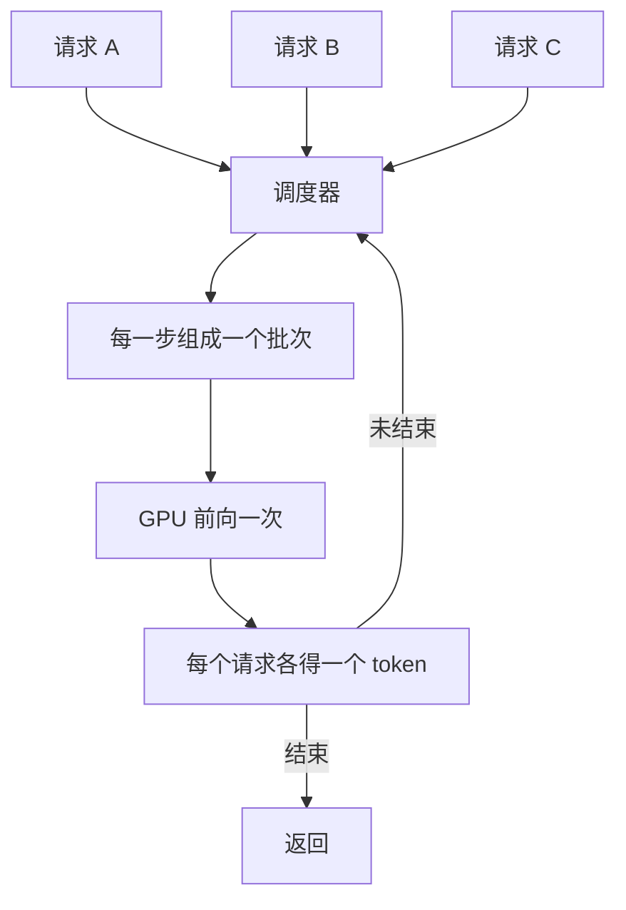

# vLLM 推理服务

Ollama 适合一个人用，但当你要把模型当成**服务**提供给一个产品，同时有几十个请求打进来时，关心的指标就从「单条回答快不快」变成了「每秒能处理多少 token、排队的请求等多久」。vLLM 是为这种场景设计的推理引擎。这一章讲它为什么吞吐高、怎么在一台 GPU 服务器上用 Docker Compose 部署、几个关键参数怎么定，以及上线后看哪些指标。

vLLM 主要面向 Linux + NVIDIA GPU（也支持 AMD 等其他加速器），Mac 不是它的主场：本地开发用 Ollama，上服务器用 vLLM，两者都是 OpenAI 兼容接口，应用代码不用改。

## 为什么吞吐能高这么多

[《大模型原理进阶》第 3 章](../llm-deep-dive/03-kv-cache.md)讲过：解码阶段受显存带宽限制，每生成一个 token 都要把全部权重读一遍。**一次读权重，如果能同时给 32 个请求各算一个 token，代价和只算 1 个差不多**。所以服务端吞吐的关键是把尽量多的请求塞进同一个批次。vLLM 做了三件事：

| 技术 | 解决什么问题 |
|---|---|
| PagedAttention | KV Cache 按固定大小的块分配，像操作系统的分页内存，几乎没有碎片，同样的显存能容纳更多并发请求 |
| 连续批处理 | 不等一批请求全部结束，每一步都可以有请求退出、新请求加入，GPU 不空转 |
| 前缀缓存 | 多个请求共享同一段开头（system prompt、工具定义）时，这段的 KV Cache 只算一次 |

结果是：单条请求的速度和 llama.cpp 差别不大，但并发上来之后，总吞吐可以高出数倍。



### 和 Ollama 怎么选

| | Ollama / llama.cpp | vLLM |
|---|---|---|
| 目标 | 单用户、低门槛 | 多用户、高吞吐 |
| 硬件 | Mac、CPU、消费级显卡 | 数据中心或消费级 NVIDIA GPU |
| 模型格式 | GGUF | Hugging Face 原始格式、AWQ、GPTQ、FP8 等 |
| 启动 | 秒级，按需加载卸载 | 较慢（加载、编译、预分配显存），常驻 |
| 显存 | 按需占用 | 启动时预占一大块给 KV Cache |
| 并发 | 能用，但吞吐提升有限 | 核心优势 |

经验：同时在线的请求经常超过几个、或者需要稳定的 SLA，就上 vLLM。另一个同类选择是 SGLang，思路相近，在某些场景（复杂的结构化生成、多轮共享前缀）表现更好，可以都测一下。

## 跑起来

### 直接安装

```bash
# 在一台装好 NVIDIA 驱动的 Linux 机器上
uv venv --python 3.12 && source .venv/bin/activate
uv pip install vllm
vllm serve Qwen/Qwen3-8B --max-model-len 16384
```

第一次会从 Hugging Face 下载模型（受限模型需要先 `export HF_TOKEN=...`，令牌不要写进代码和仓库）。启动完成后默认监听 8000 端口：

```bash
curl http://localhost:8000/v1/models
curl http://localhost:8000/v1/chat/completions \
  -H "Content-Type: application/json" \
  -d '{"model":"Qwen/Qwen3-8B","messages":[{"role":"user","content":"你好"}]}'
```

vLLM 的版本迭代很快（写作时仍是 0.x，大约每月一个小版本），参数偶有改名或默认值调整。生产环境一定**固定版本号**，升级前在测试环境跑一遍。

### 关键参数

```bash
vllm serve Qwen/Qwen3-8B \
  --served-model-name chat \
  --max-model-len 16384 \
  --gpu-memory-utilization 0.90 \
  --max-num-seqs 64 \
  --api-key "$VLLM_API_KEY"
```

| 参数 | 含义与取值思路 |
|---|---|
| `--served-model-name` | 对外暴露的模型名。用一个稳定的别名，换底层模型时客户端不用改 |
| `--max-model-len` | 单个请求的最大上下文。默认取模型支持的最大值，可能大到显存放不下导致启动失败；按业务需要设 |
| `--gpu-memory-utilization` | vLLM 预占的显存比例，默认 0.9。权重之外的部分全部给 KV Cache。同卡跑其他进程时调低 |
| `--max-num-seqs` | 同时处理的最大请求数。太大会导致单请求变慢，太小浪费吞吐 |
| `--tensor-parallel-size` | 张量并行的卡数。模型一张卡放不下时用，例如 2 张卡写 2 |
| `--quantization` | 一般不用写，vLLM 会从模型配置里识别 AWQ、GPTQ、FP8 等；`fp8` 可在线把 BF16 权重量化成 FP8 |
| `--kv-cache-dtype` | 设为 `fp8` 可把 KV Cache 减半 |
| `--api-key` | 要求请求带 `Authorization: Bearer <key>` |

### KV Cache 能装多少

启动日志里会打印 KV Cache 能容纳多少 token，这决定了并发上限。可以自己估算每个 token 的 KV Cache 大小：

$$
\text{每 token 字节数} = 2 \times \text{层数} \times \text{KV 头数} \times \text{头维度} \times \text{每元素字节数}
$$

以 Llama 3 8B 为例（32 层、8 个 KV 头、头维度 128、BF16 每元素 2 字节）：

$$
2 \times 32 \times 8 \times 128 \times 2 = 131072 \text{ 字节} = 128 \text{ KiB}
$$

一个 16K token 的请求就要 2 GiB KV Cache。在一张 24 GB 的卡上，BF16 权重占 16 GB，按 0.9 利用率剩下约 5 GB 给 KV Cache，只够两三个满长度请求同时跑。所以：

- 显存紧张时，**先把权重量化**（AWQ 或 FP8），省下的全部变成 KV Cache
- `--max-model-len` 不要无脑开到最大
- 用 `--kv-cache-dtype fp8` 再翻一倍容量

这些参数可以从模型目录里的 `config.json` 读到（`num_hidden_layers`、`num_key_value_heads`、`head_dim` 或 `hidden_size / num_attention_heads`）。

## 用 Docker Compose 部署

这和 hatch-counter 的部署方式一致：Docker Compose 管服务，nginx 做入口。宿主机需要装 NVIDIA 驱动和 NVIDIA Container Toolkit。

```yaml
# compose.yaml
services:
  vllm:
    image: vllm/vllm-openai:v0.x.y   # 固定到你验证过的具体版本，不要用 latest
    restart: unless-stopped
    ipc: host                        # PyTorch 多进程需要较大的共享内存
    environment:
      HF_TOKEN: ${HF_TOKEN}
      VLLM_API_KEY: ${VLLM_API_KEY}
    volumes:
      - hf-cache:/root/.cache/huggingface
    command:
      - --model=Qwen/Qwen3-8B
      - --served-model-name=chat
      - --max-model-len=16384
      - --gpu-memory-utilization=0.90
    expose:
      - "8000"                       # 只在 compose 网络内可见，由 nginx 对外
    deploy:
      resources:
        reservations:
          devices:
            - driver: nvidia
              count: all
              capabilities: [gpu]
    healthcheck:
      test: ["CMD", "python3", "-c", "import urllib.request; urllib.request.urlopen('http://localhost:8000/health')"]
      interval: 30s
      start_period: 300s             # 首次下载和加载模型很慢

  nginx:
    image: nginx:1.27
    restart: unless-stopped
    ports:
      - "443:443"
    volumes:
      - ./nginx.conf:/etc/nginx/conf.d/default.conf:ro
      - ./certs:/etc/nginx/certs:ro
    depends_on:
      - vllm

volumes:
  hf-cache:
```

镜像的入口已经是 OpenAI 兼容服务，`command` 里直接写参数。`HF_TOKEN` 和 `VLLM_API_KEY` 放在同目录的 `.env` 里，不进 Git。vLLM 会读取 `VLLM_API_KEY` 环境变量作为鉴权密钥。

nginx 这边要注意流式输出：

```nginx
server {
    listen 443 ssl;
    http2 on;
    server_name llm.internal.example;

    ssl_certificate     /etc/nginx/certs/fullchain.pem;
    ssl_certificate_key /etc/nginx/certs/privkey.pem;

    client_max_body_size 20m;          # 长 prompt 和图片输入

    location /v1/ {
        proxy_pass http://vllm:8000;
        proxy_http_version 1.1;
        proxy_set_header Host $host;
        proxy_buffering off;           # 关掉缓冲，否则流式输出会攒成一大块才返回
        proxy_read_timeout 600s;       # 长回答、推理模型的思考时间都很长
    }
}
```

`proxy_buffering off` 和足够长的 `proxy_read_timeout` 是 LLM 服务最常被忘的两行，细节见[《Nginx 与反向代理》](../nginx-gateway/)。

## 一台服务挂多个 LoRA

如果你给不同客户或不同任务各微调了一个 LoRA 适配器（第 7 章），不需要每个都起一份服务。vLLM 可以在同一个底座上同时挂多个适配器，请求里用 `model` 字段选择：

```bash
vllm serve Qwen/Qwen3-8B \
  --enable-lora \
  --max-lora-rank 16 \
  --lora-modules receipt=/models/receipt-lora support=/models/support-lora
```

```typescript
await client.chat.completions.create({ model: "receipt", messages });
```

底座权重只占一份显存，每个适配器只有几十 MB。这对一人公司是个很实用的架构：一张卡服务多个细分任务。

## 压测与观测

上线前一定要压测，而且用**接近真实的输入输出长度**。vLLM 自带基准工具（较新版本是 `vllm bench serve`，早期版本是仓库里的 `benchmarks/benchmark_serving.py`），也可以用任何能发并发 HTTP 请求的工具。关注这几个指标：

| 指标 | 含义 | 关注点 |
|---|---|---|
| TTFT | 首 token 延迟 | 用户感受到的「卡不卡」，受排队和预填充影响 |
| TPOT / ITL | 每个输出 token 的间隔 | 流式输出的流畅度 |
| 吞吐 | 每秒输出 token 总数 | 决定一台机器能服务多少用户 |
| 请求并发 | 同时在跑的请求数 | 超过 KV Cache 容量后开始排队 |

并发从 1 往上加，你会看到吞吐先近似线性增长，然后趋平，同时 TTFT 开始飙升。**拐点附近就是这台机器的合理容量**。

vLLM 在 `/metrics` 暴露 Prometheus 指标（运行中和排队中的请求数、KV Cache 使用率、各类延迟直方图），接到 Prometheus 和 Grafana 就能看板化，做法见[《可观测性与性能》](../observability-performance/)。最该设告警的两个：排队请求数持续大于 0、KV Cache 使用率长期接近 100%。

## 算一笔账

自己部署是否划算，可以这样估算：

$$
\text{每百万 token 成本} = \frac{\text{GPU 每小时租金}}{\text{实际吞吐（tokens/s）} \times 3600} \times 10^6
$$

关键在「实际吞吐」：它取决于并发，而并发取决于你**真有多少流量**。一台 GPU 在压测时能跑出很高的吞吐，但如果大部分时间只有零星请求，实际每百万 token 成本会比 API 贵得多，因为空闲的小时也在计费。

所以对流量不大、波动大的一人公司，通常的结论是：

- 流量小：用 API，或者按秒计费的 Serverless GPU 平台（第 5 章）
- 流量稳定且大、任务窄：自部署微调过的小模型，成本优势最明显
- 数据不能外发：成本是次要的，按合规要求来

## 本章要点

- vLLM 用 PagedAttention、连续批处理和前缀缓存把多个请求塞进同一批次，**并发场景**吞吐远高于 llama.cpp
- 本地开发用 Ollama，服务端用 vLLM，两者都是 OpenAI 兼容接口
- 关键参数：`--max-model-len`、`--gpu-memory-utilization`、`--max-num-seqs`、`--served-model-name`；生产环境固定版本
- 每 token 的 KV Cache = 2 × 层数 × KV 头数 × 头维度 × 字节数；显存紧张先量化权重和 KV Cache
- Docker Compose 部署时 nginx 要关 `proxy_buffering`、加长超时，vLLM 必须加 API key 且不直接暴露
- 一个底座可以同时挂多个 LoRA，按 `model` 字段路由
- 压测找吞吐趋平、TTFT 飙升的拐点；划算与否取决于真实流量能否把 GPU 用满

## 动手练习

1. **从 config.json 算 KV Cache**：在 Mac 上下载 Qwen3-8B 的配置文件（不需要令牌），用[KV Cache 能装多少](#kv-cache-能装多少)的公式算每 token 的 KV Cache 和一个 16K 请求的占用。

   ```python
   import json, urllib.request
   url = "https://huggingface.co/Qwen/Qwen3-8B/resolve/main/config.json"
   c = json.load(urllib.request.urlopen(url))
   head_dim = c.get("head_dim") or c["hidden_size"] // c["num_attention_heads"]
   per_token = 2 * c["num_hidden_layers"] * c["num_key_value_heads"] * head_dim * 2  # BF16
   print(c["num_hidden_layers"], c["num_key_value_heads"], head_dim)
   print(per_token / 1024, "KiB/token;", per_token * 16384 / 2**30, "GiB/16K")
   ```

   验证：写作时这份配置是 36 层、8 个 KV 头、头维度 128，算出 144 KiB/token、16K 请求 2.25 GiB；配置若已更新，以你下载到的数字为准。

   参考答案：比 Llama 3 8B 多 4 层，所以每 token 多 1/8。在 24 GB 卡上 BF16 权重约 16 GB，剩余 5 GB 多一点，只够两个 16K 满长请求，和正文的结论一致。

2. **复现 nginx 缓冲对流式输出的影响**：在 Mac 上用 Ollama 当上游，Docker 起一个 nginx 反代它，分别用 `proxy_buffering on` 和 `off` 两份配置，用 `curl -N` 发 `"stream": true` 的请求。

   ```nginx
   server {
       listen 80;
       location /v1/ {
           proxy_pass http://host.docker.internal:11434;
           proxy_http_version 1.1;
           proxy_buffering on;   # 第二次改成 off
       }
   }
   ```

   验证：`docker run --rm -p 8088:80 -v $PWD/nginx.conf:/etc/nginx/conf.d/default.conf:ro nginx:1.27` 后请求 `http://localhost:8088/v1/chat/completions`。`on` 时短回答的 `data:` 行往往在最后一起出现（长回答会一阵一阵地出现）；`off` 时逐行连续出现。容器连不上 Ollama 时，先确认 Ollama 在跑，必要时临时用 `OLLAMA_HOST=0.0.0.0:11434` 起服务，测完改回。

   参考答案：nginx 默认把上游响应攒进缓冲区再转发，SSE 的小块数据就被攒住了。生产配置里关掉 `proxy_buffering`、加长 `proxy_read_timeout`。

3. **算一笔账**（纯计算）：一张 GPU 每小时租金 2 美元，压测吞吐 1500 tokens/s；但真实流量折算下来全天平均只有 20 tokens/s。用[算一笔账](#算一笔账)的公式分别算每百万 token 成本。可选：租一台 NVIDIA GPU，用 `vllm bench serve` 从并发 1 往上加，自己找出拐点（参数名以 `--help` 为准）。

   验证：两个结果约为 0.37 美元和 27.8 美元。

   参考答案：差了 75 倍，原因全在利用率：GPU 按小时计费，空闲时间分摊到了少量 token 上。流量撑不满 GPU 时，API 或按秒计费的平台更便宜。
