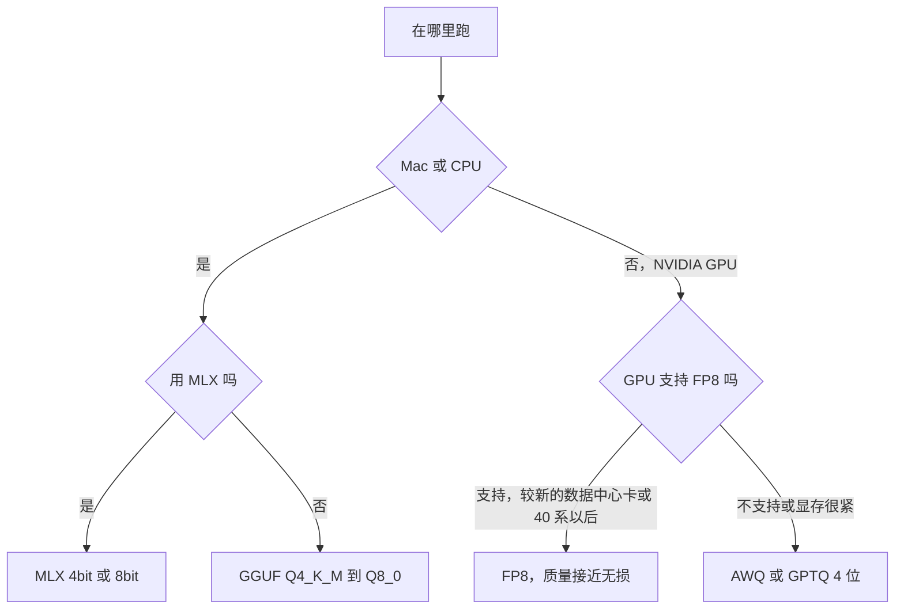
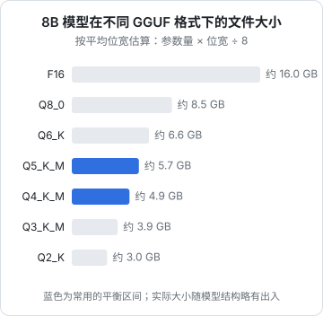

# 量化格式与取舍

打开任何一个热门模型的 Hugging Face 页面，旁边总挂着一串衍生仓库：`-GGUF`、`-AWQ`、`-GPTQ-Int4`、`-FP8`、`-MLX-4bit`，每个 GGUF 仓库里又有十几个文件，从 `Q2_K` 到 `Q8_0`。这一章回答一个实际问题：**我的硬件和场景该下载哪个文件**。量化的数学（缩放因子、离群值、GPTQ 和 AWQ 的原理、k-quants 命名的含义）在《大模型原理进阶》第 8 章已经讲过，这里只讲怎么选、怎么验证、怎么自己做。

## 先按运行时选格式

格式和推理引擎是绑定的，第一步是看你用什么跑：

| 运行时 | 用的格式 | 说明 |
|---|---|---|
| Ollama、llama.cpp、LM Studio | GGUF | 一个文件打包权重、分词器和元数据 |
| MLX | MLX 格式（`-4bit`、`-8bit` 等） | 只能在 Apple Silicon 上用 |
| vLLM、SGLang | 原始 safetensors、AWQ、GPTQ、FP8、compressed-tensors 等 | GPU 服务端；GGUF 支持有限，不建议 |
| Transformers 直接加载 | 原始权重，或配合 bitsandbytes 在加载时量化 | 主要用于微调和实验 |



FP8 需要硬件原生支持（NVIDIA Ada、Hopper 及之后的架构）；老一些的卡上 vLLM 也能加载 FP8 权重，但走的是仅权重的方式，收益变小。

## GGUF：该下哪个文件



图中大小按「参数量 × 平均位宽 ÷ 8」估算，平均位宽包含缩放因子等开销。实际文件会因为嵌入层、输出层用了不同精度而略有出入。

选择的经验规则：

| 格式 | 什么时候选 |
|---|---|
| `Q8_0` | 内存充裕，想要几乎无损；做评测基线 |
| `Q6_K` | 介于两者之间，追求质量又想省一点 |
| `Q5_K_M` | 质量和大小的平衡点，内存稍有余量时的首选 |
| `Q4_K_M` | **最常用的默认值**，大多数任务损失很小 |
| `Q3_K_M`、`Q2_K` | 只在「否则根本装不下」时用，质量明显下降 |
| `IQ` 系列（如 `IQ4_XS`） | 同等大小下质量通常优于传统 k-quants，在 Mac 和 CPU 上速度可能稍慢 |

还有一条比上表更重要的规律：**同样的内存，大模型的低位量化通常胜过小模型的高位量化**。18 GB 的 Mac 上，14B 的 `Q4_K_M` 一般比 8B 的 `Q8_0` 更好用。但到了 `Q3` 以下就不一定了，要实测。

### imatrix：同样位宽，更好的质量

社区量化仓库里常见「使用 imatrix 量化」的说明。imatrix（重要性矩阵）是先用一段校准文本跑一遍模型，统计哪些权重对输出影响大，量化时让这些权重误差更小。思路和 AWQ 相近。**低位宽（4 位及以下）时差别明显**，选仓库时优先选带 imatrix 的版本。

一个小提醒：imatrix 的校准文本通常以英文为主。如果你的任务是中文或某个窄领域，自己用领域文本做一次 imatrix 量化（见下文），在低位宽时可能更好。

## GPU 服务端：AWQ、GPTQ 还是 FP8

| 格式 | 位宽 | 质量 | 速度 | 适用 |
|---|---|---|---|---|
| BF16 原始权重 | 16 | 基准 | 基准 | 显存充足、要求最高质量 |
| FP8（W8A8） | 8 | 接近无损 | 预填充和解码都加速 | 支持 FP8 的新卡，**服务端首选** |
| INT8（W8A8） | 8 | 接近无损 | 加速 | 不支持 FP8 的卡 |
| AWQ / GPTQ（W4A16） | 4 | 小幅损失 | 解码加速，大批量时优势变小 | 显存紧张，单卡塞大模型 |

为什么 4 位在大批量时优势变小？仅权重量化的收益来自「少读数据」，适合带宽受限的解码阶段。批次很大时计算开始成为瓶颈，而 W4A16 计算前要把权重解压回 16 位，反而多了开销。所以**高并发服务优先 FP8，显存装不下才退到 4 位**。

vLLM 一般能从模型目录的配置文件自动识别量化方式，直接 `vllm serve <AWQ 仓库名>` 即可。手上只有 BF16 权重又想用 FP8，可以加 `--quantization fp8` 在线量化，权重会在加载时转换，省去自己准备文件，但每次启动都要转一次。

## KV Cache 也能量化

长上下文、高并发时，KV Cache 可能比权重还大（第 3 章的算法：Llama 3 8B 每 token 128 KiB，100 个 8K token 的请求就是 100 GiB）。各引擎都支持把 KV Cache 量化到 8 位：

| 引擎 | 设置 |
|---|---|
| Ollama | `OLLAMA_FLASH_ATTENTION=1 OLLAMA_KV_CACHE_TYPE=q8_0` |
| llama.cpp | `-ctk q8_0 -ctv q8_0`（V 缓存量化需要开启 Flash Attention） |
| vLLM | `--kv-cache-dtype fp8` |

8 位 KV Cache 对质量的影响通常很小，换来一倍的上下文或并发容量，是性价比很高的一招。4 位 KV Cache 损失更明显，长上下文检索类任务尤其敏感，谨慎使用。

## 自己量化

什么时候要自己做：微调完的模型要部署（第 9 章）、社区没有你要的格式、想用领域数据做 imatrix。

### GGUF

需要 llama.cpp 的源码仓库（里面有转换脚本）和编译好的工具：

```bash
git clone https://github.com/ggml-org/llama.cpp
cd llama.cpp
uv venv && source .venv/bin/activate
uv pip install -r requirements.txt

# 1. Hugging Face 格式 → GGUF（F16 或 BF16）
python convert_hf_to_gguf.py /path/to/hf-model --outfile model-f16.gguf --outtype f16

# 2. （可选）用自己的领域文本生成 imatrix
llama-imatrix -m model-f16.gguf -f calib.txt -o imatrix.dat

# 3. 量化
llama-quantize --imatrix imatrix.dat model-f16.gguf model-Q4_K_M.gguf Q4_K_M
```

`calib.txt` 放几百 KB 到几 MB 有代表性的文本即可：你的真实 prompt、领域文档、目标语言的语料。量化好的文件可以直接 `llama-server -m model-Q4_K_M.gguf`，或者写进 Ollama 的 Modelfile。

Ollama 也能一步完成转换和量化：Modelfile 里 `FROM /path/to/hf-model`（safetensors 目录），然后 `ollama create my-model --quantize q4_K_M -f Modelfile`。支持的模型架构有限，失败时退回上面的 llama.cpp 流程。

### MLX

```bash
mlx_lm.convert --hf-path /path/to/hf-model --mlx-path ./model-mlx-4bit -q --q-bits 4
```

### AWQ / GPTQ / FP8

GPU 端的量化推荐用 vLLM 项目维护的 **LLM Compressor**，它能产出 vLLM 直接加载的 compressed-tensors 格式，支持 FP8、INT8、AWQ、GPTQ 等方案。它的 API 版本变化较快，照官方仓库 `examples/` 目录里对应方案的脚本改模型名和校准数据集最稳妥。FP8 的动态量化方案甚至不需要校准数据。

## 怎么验证没量坏

量化后的模型「能对话」不代表没问题。按成本从低到高：

**1. 困惑度**：衡量模型对一段文本的预测能力，越低越好。和原始模型比相对变化：

```bash
llama-perplexity -m model-f16.gguf    -f eval.txt
llama-perplexity -m model-Q4_K_M.gguf -f eval.txt
```

困惑度涨幅很小（比如几个百分点以内）一般没问题；涨得多就该换更高的位宽。但困惑度只是粗筛。

**2. 用你自己的任务评测**：这是唯一可靠的判断。准备几十到几百条带标准答案的真实样例，原始模型和量化模型各跑一遍，比较准确率。数学、代码、长上下文、中文这类任务往往比通用问答更敏感。怎么搭评测集见《评测与质量》。

**3. 看失败样例**：量化引入的错误常常是「格式偶尔不对」「JSON 少个括号」「长文档后半段信息丢失」。平均分没掉多少，但线上偶发的格式错误足以让解析失败，所以要逐条看错例，不只看分数。

## 本章要点

- 先按运行时选格式：Ollama / llama.cpp 用 GGUF，Mac 可选 MLX，vLLM 用 FP8、AWQ、GPTQ
- GGUF 默认 `Q4_K_M`，有余量选 `Q5_K_M` 到 `Q8_0`，`Q3` 以下只在装不下时用；优先带 imatrix 的版本
- 同样内存下，大模型低位量化通常胜过小模型高位量化，但 `Q3` 以下要实测
- GPU 服务端优先 FP8；显存装不下才用 4 位 AWQ / GPTQ，高并发时 4 位的速度优势会变小
- KV Cache 量化到 8 位几乎无损，换来一倍上下文或并发
- 自己量化：llama.cpp 的 `convert_hf_to_gguf.py` + `llama-quantize`，MLX 用 `mlx_lm.convert`，GPU 端用 LLM Compressor
- 验证用困惑度粗筛，**用自己的任务评测**定夺，并逐条看格式类错误
