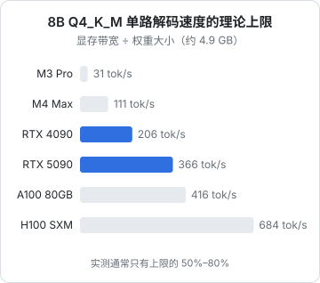
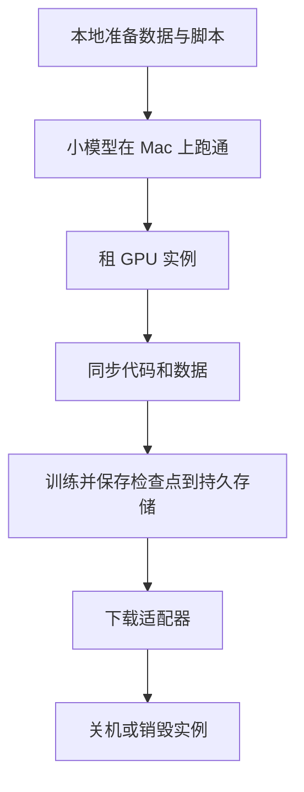

# GPU 选型与租用

前几章的命令都假设你「有一台合适的机器」。这一章讲怎么判断什么机器合适：先用两个公式估出显存需求和速度上限，再对照常见硬件，最后讨论对一人公司最现实的问题：**买还是租，租的话怎么租**。

硬件的价格和型号更新很快，本章不写具体价格，只给估算方法和判断框架；下单前去各平台看实时报价。

## 两个公式

### 显存够不够

$$
\text{显存需求} \approx \text{权重} + \text{KV Cache} + \text{运行开销}
$$

- **权重** = 参数量 × 每参数字节数（BF16 为 2，FP8 / INT8 为 1，4 位约 0.55–0.6）
- **KV Cache** = 每 token 大小 × 上下文长度 × 并发数（每 token 大小的算法见第 3 章）
- **运行开销**：CUDA 上下文、激活值、框架缓冲，粗估 1–2 GB，大模型更多

例子：在单卡上跑一个 8B 模型，FP8 权重 8 GB，Llama 3 8B 结构下 FP8 的 KV Cache 每 token 64 KiB，希望同时服务 16 个 8K 上下文的请求：

$$
8 + \frac{64 \times 8192 \times 16}{1024^2} + 2 = 8 + 8 + 2 = 18 \text{ GB}
$$

一张 24 GB 的卡够用。如果是 70B，FP8 权重就要 70 GB，只能上 80 GB 级别的卡或者多卡。

### 速度上限

解码受带宽限制，单路生成速度的理论上限是：

$$
\text{tokens/s} \approx \frac{\text{显存带宽}}{\text{每个 token 需要读取的权重字节数}}
$$

稠密模型每个 token 读全部权重；MoE 只读激活的那部分专家（加上共享部分），所以 MoE 在带宽一般的设备上快得多。



图中带宽取各设备的公开规格（M3 Pro 150 GB/s、M4 Max 最高配置 546 GB/s、RTX 4090 约 1008 GB/s、RTX 5090 约 1792 GB/s、A100 80GB 约 2039 GB/s、H100 SXM 约 3350 GB/s）。实测通常只能达到上限的一半到八成。

这个公式解释了很多现象：为什么 Mac 能装下大模型但生成不快（容量大、带宽中等）；为什么数据中心卡贵（贵在带宽和互联，不只是容量）；为什么量化能提速（读的字节少了）。

注意它是**单路**上限。并发时多个请求共享一次权重读取，总吞吐可以远超这个数字，这正是第 3 章 vLLM 的价值。

## 常见硬件

| 类别 | 代表型号 | 显存 | 特点 |
|---|---|---|---|
| Apple Silicon | M 系列 Pro / Max / Ultra | 统一内存 18–512 GB | 容量大、安静省电；带宽中等，预填充慢；不适合做服务端 |
| 消费级 | RTX 4090 / 5090 | 24 / 32 GB | 带宽高、性价比高；显存小；数据中心使用受驱动许可限制 |
| 推理卡 | L4、A10、L40S | 24 / 24 / 48 GB | 云上常见，功耗低，适合中小模型推理 |
| 数据中心 | A100、H100、H200 | 40–141 GB | 带宽和互联最强，训练和大模型推理的主力 |

几条选型经验：

- **推理看显存容量和带宽，训练还要看算力**。只做推理的话，带宽高、显存够的卡就是好卡
- **先装得下，再谈速度**。模型一旦部分卸载到 CPU，速度会掉一个数量级
- 只用来跑 7B–14B 的推理服务，24 GB 的卡往往够了；要跑 70B 或者微调 30B 以上，直接看 80 GB 级别
- 多卡之间的互联（NVLink 还是只走 PCIe）会显著影响张量并行的效率，租多卡机器时留意

## 买还是租

对一人公司，**绝大多数情况租**：

| | 买 | 租 |
|---|---|---|
| 前期投入 | 高 | 零 |
| 利用率 | 自己负责，闲置就是浪费 | 按需，用完就关 |
| 升级 | 换卡麻烦，旧卡贬值 | 换个实例类型 |
| 运维 | 散热、电费、噪音、故障 | 平台负责 |
| 适合 | 7×24 稳定满载、或长期大量实验 | 偶尔训练、流量不稳定的推理 |

买的情况大多是：已经有一台高配 Mac（本地开发和小规模实验足够），或者长期大量做实验、自己算过租金累计已超过整机价格。

### 租用的几种形态

| 形态 | 计费 | 适合 |
|---|---|---|
| GPU 云主机 / 容器（按小时） | 开机即计费 | 训练任务、需要完整控制的推理服务 |
| 社区 / 市场型平台 | 价格低，机器质量参差 | 实验、短期训练，对稳定性要求不高 |
| Serverless GPU | 按实际运行秒数，冷启动有延迟 | 流量波动大的推理、批处理任务 |
| 托管推理 API（托管开源模型） | 按 token | 想用开源模型但不想运维 |

国外常见的有 RunPod、Lambda、Vast.ai、Modal 等，国内有 AutoDL 等平台以及各大云厂商的 GPU 实例。平台格局变化快，选之前看几个维度：

- **计费粒度**：按秒、按分钟还是按小时；关机后磁盘是否继续收费
- **存储**：模型和数据集放在哪，实例销毁后是否保留；持久卷的价格
- **网络**：从 Hugging Face 下载模型的速度（国内平台通常有镜像或加速）
- **合规**：数据存放在哪个国家或地区，是否满足你的客户要求
- **可用性**：热门卡型经常没货，可以选按需和竞价两种实例

最后一种「托管推理 API」常被忽略：很多平台按 token 提供 Llama、Qwen、DeepSeek 等开源模型的 OpenAI 兼容接口。如果你需要的只是「开源模型的许可证和可迁移性」，而不是「数据不出自己的机器」，它往往是最省事、最便宜的选择。

### 租用的工作流

以「租一台 GPU 做一次 LoRA 微调」为例：



几个省钱的习惯：

1. **在本地把流程跑通再租卡**。用 0.5B–1.5B 的小模型、几十条数据在 Mac 上跑完整流程（MLX 或 CPU），确认脚本没 bug；GPU 时间不应该花在调试 import 错误上
2. **模型和缓存放持久卷**，设置 `HF_HOME` 指向它，避免每次开机重新下载几十 GB
3. **检查点定期写到持久存储**，竞价实例可能随时被回收
4. **训练脚本跑完自动关机**，或者在平台上设置空闲自动停止。忘关机是最常见的浪费
5. 用 `tmux` 或 `nohup` 跑长任务，SSH 断开不影响训练

```bash
# 训练完自动关机的一种写法（实例允许关机命令时）
nohup sh -c 'python train.py > train.log 2>&1; shutdown -h now' &
```

不同平台关机和停止计费的方式不同（有的要调平台 API 才算真正停止），以平台文档为准。

## 推理服务的部署形态

把模型部署成产品的一部分时，常见三种形态：

| 形态 | 做法 | 优点 | 缺点 |
|---|---|---|---|
| 常驻 GPU 实例 | 一台 GPU 主机跑 vLLM，前面挂 nginx | 延迟稳定，完全可控 | 闲时也计费 |
| Serverless GPU | 平台按请求拉起容器 | 没流量不花钱 | 冷启动可能几十秒到几分钟 |
| 混合 | 平时调 API 或托管推理，大流量或敏感数据时走自部署 | 灵活 | 需要一层网关做路由 |

第三种靠的正是「应用只依赖 OpenAI 兼容协议」：在网关层按租户、按任务把请求路由到不同后端，失败时降级到另一个。网关的具体做法在[《LLM 应用上线》](../llmops/)里讲。

## 本章要点

- 显存需求 ≈ 权重 + KV Cache + 运行开销；先确保装得下，部分卸载到 CPU 会慢一个数量级
- 单路解码速度上限 ≈ 带宽 ÷ 每 token 读取的权重字节数；MoE 只读激活部分，所以更快
- 推理看显存容量和带宽，训练还要看算力和多卡互联
- 一人公司默认租：按小时的 GPU 实例做训练，Serverless 或托管推理 API 应对波动流量
- 租卡前在本地用小模型跑通流程；模型放持久卷，检查点定期保存，跑完自动关机
- 价格和型号变化快，按估算方法选型，以平台实时报价为准

## 动手练习

1. **算出自己机器的解码上限，再实测**：查到你这台 Mac 的内存带宽（Apple 官网技术规格），用 `ls -l` 取一个 8B `Q4_K_M` GGUF 文件的实际字节数，按[速度上限](#速度上限)的公式算单路上限；再跑 `llama-bench -m <文件>`。

   验证：`tg` 那一行的实测值应低于你算出的上限，通常在上限的一半到八成之间。

   参考答案：M3 Pro 按 150 GB/s、文件约 4.8 GB 算，上限约 31 tokens/s。达不到上限是因为除了读权重还有计算、KV Cache 读取和调度开销。

2. **MoE 为什么快**（纯计算）：同样在 M3 Pro（150 GB/s）上，比较 8B 稠密模型和 30B-A3B MoE 模型 4 位量化（按每参数 0.6 字节）的单路解码上限和内存需求。手上有 32 GB 以上的 Mac 的话，用 `llama-bench` 对两个模型各测一次。

   验证：算出 8B 约 31 tokens/s、权重约 4.8 GB；30B-A3B 约 83 tokens/s（只按激活的 3B 算）、权重约 18 GB。实测时 MoE 的 `tg` 应明显高于 8B，但达不到 2.7 倍那么多。

   参考答案：每 token 只读激活专家的权重，所以快；但全部专家都要常驻内存，18 GB 的机器装不下。实际还要读共享层和路由，加上专家访问不连续，提速会打折扣。

3. **估一张卡能撑多少并发**（纯计算）：一张 24 GB 的卡跑一个 14B 模型，FP8 权重 14 GB、运行开销按 2 GB；假设结构是 40 层、8 个 KV 头、头维度 128，KV Cache 也用 FP8（每元素 1 字节）。每个请求 8K 上下文，最多能同时跑几个？再按 vLLM 默认的 0.9 显存利用率算一次。

   验证：每 token 80 KiB，每个 8K 请求 0.625 GiB；按 24 GB 全用约 12 个，按 0.9 利用率约 8 个（单位口径和正文例子一样，不细分 GB 与 GiB）。

   参考答案：

   ```python
   per_token = 2 * 40 * 8 * 128 * 1           # 字节
   per_req = per_token * 8192 / 1024**3        # GiB
   for budget in (24 - 14 - 2, 24 * 0.9 - 14 - 2):
       print(f"KV 预算 {budget:.1f} GB → {int(budget // per_req)} 个请求")
   ```
