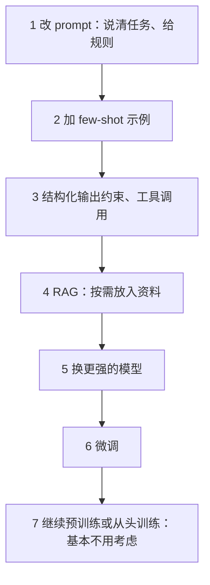

# 什么时候需要微调

「微调」听起来像是让模型变成自己的专属模型的必经之路，实际上它是最后才该考虑的手段。这一章先讲清楚微调**能改变什么、不能改变什么**，再给一个从便宜到昂贵的决策阶梯，最后用 hatch-counter 的进货单识别做一次完整的推演：这个场景该不该微调、如果要做，数据从哪来、怎么判断成功。

## 微调改变的是什么

预训练让模型学会语言和世界知识，SFT 和对齐让它学会按指令对话（[《大模型原理科普》](../llm-fundamentals/)第 5、6 章）。在此基础上再做一轮微调，本质上是**用你的数据把模型的输出分布往某个方向推**。它擅长改变的是「怎么说」，不擅长的是「知道什么」：

| 微调擅长 | 微调不擅长 |
|---|---|
| 固定的输出格式和结构（严格的 JSON、特定的标注体系） | 注入新知识（新产品手册、最新政策） |
| 语气、风格、话术的一致性 | 处理频繁变化的信息 |
| 窄任务上让小模型追上大模型（分类、抽取、改写） | 提升通用推理能力 |
| 缩短 prompt：把长长的规则和示例「烧」进权重 | 修复底座模型本身做不到的事 |
| 降低延迟和成本：小模型替代大模型 | 让模型「不胡说」（反而可能更自信地胡说） |

为什么不擅长注入知识？研究和实践都发现，用微调教模型新事实效率很低，还容易让它学会「自信地编造类似风格的内容」。知识类需求应该用 RAG（[《RAG 与知识系统》](../rag-systems/)），每次把相关资料放进上下文，资料更新时也不用重新训练。

## 决策阶梯

从下往上，每一级都比上一级便宜、快、好维护。**只有确认下一级解决不了，才往上走**：



每一级值得问的问题：

1. **prompt**：任务说清楚了吗？边界情况写了吗？很多「模型做不好」其实是没说清楚
2. **few-shot**：放 3–10 个精心挑选的示例，格式和风格问题大多能解决
3. **结构化输出**：需要 JSON 时用 `response_format` 或 JSON Schema 约束（Ollama、vLLM 都支持约束解码），比微调格式可靠得多
4. **RAG**：缺的是知识就检索
5. **换模型**：试一下更大的模型。如果大模型也做不好，说明任务定义或数据本身有问题，微调小模型更不可能做好
6. **微调**：到这一步，你应该已经有一个**用大模型 + 好 prompt 能做好**的任务，微调是为了让它更便宜、更快、更稳定，或者满足部署约束

第 6 步那句话很关键。微调最常见的成功模式是：**先用强模型把任务做通，再用它的输出（经过人工校正）训练一个小模型**。这其实就是蒸馏，第 9 章展开。

### 值得微调的信号

满足其中几条，微调才值得认真考虑：

- 任务**窄且稳定**：输入输出形式固定，规则半年内不会大改
- 调用量**大**：prompt 里的长规则和示例每次都要付费，或者大模型的延迟不可接受
- **部署约束**：必须本地或端侧运行，而能跑的小模型直接用效果不够
- 已经**积累了数据**：几百到几千条高质量的输入输出对，或者有持续产生数据的机制
- 有**评测集**：能用数字说明微调前后的差别

最后一条是硬门槛。没有评测集就开始微调，你无法知道它变好了还是变坏了，也无法在几个检查点之间做选择。

## 代价不只是训练费

训练本身往往是最便宜的部分。一次 8B 模型的 LoRA 微调，在一张租来的 GPU 上可能只要一两个小时。真正的成本在后面：

| 成本 | 说明 |
|---|---|
| 数据 | 收集、清洗、标注、校对，通常占总工作量的大头 |
| 评测 | 搭评测集，每次训练后跑评测 |
| 部署 | 自己托管模型（第 2–5 章的全部内容），或者找支持自定义模型的平台 |
| 维护 | 底座模型更新了要不要重训？任务规则变了要重新造数据 |
| 机会成本 | 同样的时间花在产品上，或者等下一代 API 模型变得更便宜更强 |

最后一条在 AI 领域尤其现实：你花两个月微调出来的效果，下一代通用模型可能直接就达到了。所以一人公司做微调，最好选**和你的业务数据强绑定、通用模型很难自然学会**的任务。

## 案例推演：进货单识别

hatch-counter 让店主拍一张供货商的进货单照片，用视觉模型把表格的每一行读出来，再按这家供货商的模板对应到「品名、单位、数量、单价、金额」。设计上有个关键选择：**认字归模型、归类归模板**：模型只负责把格子里的字原样交回来，哪一列是数量、单价含不含税，由店主事先配好的模板决定。

现在假设有两个触发条件：一是某些客户要求单据照片不出内网，二是识别量增长后 API 成本变得可观。按阶梯推演：

**1–3 级已经做过了**：prompt 里告诉模型「表格列依次是……」、要求逐行原样交回、结构化输出。这套方案在大模型上效果不错。

**4 级 RAG 不适用**：缺的不是知识。

**5 级的反面**：问题恰恰是不想用大模型，想要一个能本地部署的小视觉模型。直接换小模型试一下，假设发现手写体、褶皱照片、合并单元格的识别率明显下降。

**6 级微调有了理由**，而且数据条件异常好：

- 每张单子在入库前都要经过人工「核单」，店主会修正识别错误。**原图 + 核对后的结果**天然就是高质量的训练样本
- 任务窄而稳定：输入是一张表格照片 + 列名，输出是逐行的格子内容
- 已有明确的评测口径：按格子算准确率，尤其关注数量、单价这些错了会出大事的列

需要提前想清楚的事：

- **数据授权**：店主的单据能否用于训练，需要在用户协议里写明并取得同意，细节见[《国内合规实务》](../opc-compliance-cn/)
- **评测集按供货商分层**：不能全是同一家的单子，否则模型只学会了一种版式
- **对照组**：微调后的小模型要和「大模型 API」「未微调的小模型」放在同一个评测集上比
- **兜底**：模型输出仍要经过现有的列名对齐和人工核单，微调只是降低错误率，不是取消校对

这个案例的数据构建在第 8 章继续。

## 底座怎么选

决定要微调后，选底座的考虑：

| 考虑 | 建议 |
|---|---|
| 尺寸 | 从能满足部署约束的最大尺寸开始；先用 1B–3B 跑通流程，再上目标尺寸 |
| Base 还是 Instruct | 数据量少（几百到几千条）时用 Instruct，它已经会对话、会遵循格式；数据量很大且要彻底改变行为时才考虑 Base |
| 许可证 | 微调后的模型是衍生作品，沿用原许可证的约束（第 1 章） |
| 生态 | 选微调框架、vLLM、llama.cpp 都支持良好的架构，少踩坑 |
| 语言 | 中文任务优先中文语料充足的家族 |

## 本章要点

- 微调擅长改变「怎么说」（格式、风格、窄任务能力），不擅长注入「知道什么」，知识用 RAG
- 决策阶梯：prompt → few-shot → 结构化输出 → RAG → 换更强模型 → 微调，下一级解决不了才往上走
- 微调最常见的成功模式：**强模型做通任务，再用校正过的输出训练小模型**
- 值得微调的信号：任务窄且稳定、调用量大、有部署约束、有数据、**有评测集**（硬门槛）
- 训练费只是小头，数据、评测、部署、维护和机会成本才是大头
- 有人工校正环节的业务（如 hatch-counter 的核单）天然产生高质量训练数据
- 数据少时用 Instruct 版做底座，先用小尺寸跑通流程

## 动手练习

1. **先爬阶梯第 3 级**：准备 20 行形如「土豆 斤 30 2.5 75」的进货单文字，用 Ollama 上的一个 3B–4B 小模型把每行整理成 JSON（字段 `name`、`unit`、`qty`、`price`、`amount`）。先只用 prompt 跑一遍，再加上 `response_format: { type: "json_object" }` 跑一遍，各统计 `JSON.parse` 成功的行数。

   ```typescript
   import OpenAI from "openai";
   const client = new OpenAI({ baseURL: "http://localhost:11434/v1", apiKey: "ollama" });
   const lines = ["土豆 斤 30 2.5 75", "白菜 斤 20 1.8 36" /* …补到 20 行 */];
   let ok = 0;
   for (const line of lines) {
     const res = await client.chat.completions.create({
       model: "<小模型标签>",
       messages: [{ role: "user", content: `把这一行整理成 JSON（name/unit/qty/price/amount）：${line}` }],
       response_format: { type: "json_object" }, // 第一遍注释掉这一行
     });
     try { JSON.parse(res.choices[0].message.content ?? ""); ok++; } catch {}
   }
   console.log(`${ok}/${lines.length} 行能解析`);
   ```

   验证：加了 `response_format` 后能解析的行数应达到或接近 20/20；不加时可能夹杂代码块标记或说明文字导致解析失败。

   参考答案：格式问题在第 3 级就能解决，不需要微调。剩下的错误如果是字段值错（数量和单价对调），先试 few-shot 和换大一点的模型，再考虑往上走。

2. **判断该不该微调**：用[决策阶梯](#决策阶梯)和[值得微调的信号](#值得微调的信号)分析两个场景，各写出结论和依据：A. SaaS 客服机器人，产品功能每月更新，想通过微调「让模型知道新功能」；B. 工单分类，每天 50 万条，现在用大模型 API 加长 prompt 准确率令人满意，已有 3000 条人工复核过的标注和一份 300 条的评测集。

   验证：A 和 B 各写出停在阶梯哪一级，以及满足或不满足哪几条信号。

   参考答案：A 缺的是知识且变化频繁，停在第 4 级 RAG，微调既学不牢又要每月重训。B 任务窄且稳定、调用量大、有数据、有评测集，已经是「大模型 + 好 prompt 能做好」的状态，适合用这些数据微调一个小模型，并和现有 API 方案在同一评测集上对比。
