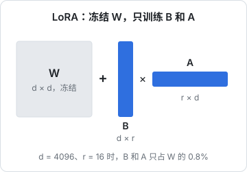
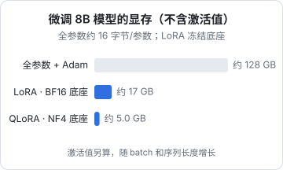

# LoRA 与 QLoRA

全参数微调一个 8B 模型，光是权重、梯度和优化器状态就要上百 GB 显存。LoRA 让你只训练不到 1% 的参数，QLoRA 再把冻结的底座压到 4 位，于是一张消费级显卡、甚至一台 Mac 就能微调。这一章讲 LoRA 的核心思路（够做决策即可）、几个超参数怎么定、显存怎么估，然后给出两套能照着跑的流程：Mac 上用 MLX，GPU 上用 Hugging Face 的 TRL + PEFT。

## LoRA 在做什么

微调时，一个权重矩阵 $W$ 会变成 $W + \Delta W$。LoRA（Hu 等，2021）的观察是：微调带来的变化 $\Delta W$ 是**低秩**的，可以用两个瘦矩阵的乘积近似：

$$
W' = W + \frac{\alpha}{r} BA,\qquad B \in \mathbb{R}^{d \times r},\ A \in \mathbb{R}^{r \times d},\ r \ll d
$$

训练时 $W$ 冻结不动，只训练 $B$ 和 $A$。$B$ 初始化为全零，所以训练开始时模型和原来完全一样。



$d = 4096$、$r = 16$ 时，$B$ 和 $A$ 一共 $2 \times 4096 \times 16$ 个参数，只有 $W$ 的 0.8%。对整个 8B 模型的所有线性层都加上 LoRA，可训练参数大约 4000 万，约占 0.5%。

这带来几个实际好处：

- **显存省**：冻结的权重不需要梯度和优化器状态
- **文件小**：适配器只有几十到几百 MB，可以给不同任务各训一个，部署时共享底座（第 3 章的多 LoRA 服务）
- **可合并**：训练完把 $\frac{\alpha}{r}BA$ 加回 $W$，推理时没有任何额外开销
- **不容易破坏原有能力**：底座没动，灾难性遗忘比全参数微调轻

## 显存估算



| 方式 | 每参数开销 | 8B 模型（不含激活值） |
|---|---|---|
| 全参数 + Adam（混合精度） | BF16 权重 2 + 梯度 2 + FP32 主权重 4 + Adam 两个状态 8 = 16 字节 | 约 128 GB |
| LoRA | 冻结的 BF16 权重 2 字节 + 少量适配器参数和它们的优化器状态 | 约 17 GB |
| QLoRA | 冻结的 4 位权重约 0.5 字节 + 适配器 | 约 5 GB |

**激活值另算**，它和 batch 大小、序列长度成正比，长序列时可能比权重还大。两个常用手段：**梯度检查点**（不保存中间激活、反向时重算，用约 20%–30% 的时间换大量显存）和**梯度累积**（小 batch 跑多步再更新一次，等效于大 batch）。

## QLoRA

QLoRA（Dettmers 等，2023）在 LoRA 基础上加了三件事：

1. 冻结的底座用 **NF4**（4 位正态分位格式，原理见《大模型原理进阶》第 8 章）存储，计算时临时解压到 BF16
2. **双重量化**：把量化用的缩放因子再量化一次，进一步省内存
3. **分页优化器**：显存峰值时把优化器状态临时挪到 CPU 内存

效果上，QLoRA 和 LoRA 的差距通常很小，但速度会慢一些（每次计算都要解压）。经验：**显存够就用 LoRA，不够才用 QLoRA**。

QLoRA 依赖的 bitsandbytes 库主要面向 NVIDIA GPU。在 Mac 上，MLX 对已经量化成 4 位的模型做 LoRA，就是事实上的 QLoRA。

## 超参数怎么定

| 参数 | 含义 | 起点 |
|---|---|---|
| `r` | 秩，决定适配器的容量 | 8–16；任务复杂或数据多时试 32–64 |
| `lora_alpha` | 缩放系数，实际缩放为 $\alpha / r$ | 常设为 `r` 或 `2r` |
| `target_modules` | 给哪些层加 LoRA | 所有线性层（注意力 + FFN）效果通常好于只加注意力的 Q、V |
| `lora_dropout` | 适配器上的 dropout | 0–0.1 |
| 学习率 | | LoRA 约 1e-4 到 2e-4，比全参数微调大一个数量级 |
| epoch | 数据过几遍 | 1–3；数据少时容易过拟合，宁少勿多 |
| 有效 batch | 单步 batch × 梯度累积步数 | 16–64 |
| 最大长度 | 截断长度 | 覆盖 95% 以上样本的长度即可，越长越费显存 |

这些只是起点。**调参的依据是验证集 loss 和你的评测集分数，不是训练 loss**。

### 看懂 loss 曲线

- 训练 loss 下降、验证 loss 也下降：正常
- 训练 loss 持续下降、验证 loss 开始上升：**过拟合**，减少 epoch、降低学习率或增加数据；选验证 loss 最低处的检查点
- 两者都不怎么降：学习率太小，或者数据格式有问题（比如 chat template 没套对，模型在学一堆特殊符号）
- loss 突然变成 NaN 或暴涨：学习率太大，或者有异常样本

训练 loss 很低不代表效果好。一定要用评测集跑几个检查点，选分数最好的那个。

## 选框架

| 框架 | 特点 | 适合 |
|---|---|---|
| TRL + PEFT（Hugging Face） | 官方库，SFT、DPO 等训练器齐全，文档最多 | 想理解每一步、要定制 |
| Unsloth | 针对 LoRA / QLoRA 做了大量内核优化，省显存、速度快 | 单卡微调，追求效率 |
| LLaMA-Factory | 配置文件或网页界面驱动，支持的模型和方法很多 | 不想写代码 |
| Axolotl | YAML 配置驱动，多卡训练成熟 | 规模稍大的训练 |
| mlx-lm | Apple Silicon 原生 | 在 Mac 上实验和小规模微调 |

这些框架的 API 都迭代很快。下面的代码按写作时的 TRL 和 mlx-lm 写法给出，跑之前对照所装版本的官方文档，尤其是参数名。

## 流程一：在 Mac 上用 MLX

先在本机用小模型把流程跑通，这一步零成本。数据放在一个目录里，`train.jsonl` 和 `valid.jsonl`，每行一个对话（格式第 8 章细讲）：

```json
{"messages": [{"role": "system", "content": "把进货单的一行整理成 JSON。"}, {"role": "user", "content": "土豆 斤 30 2.5 75"}, {"role": "assistant", "content": "{\"name\":\"土豆\",\"unit\":\"斤\",\"qty\":30,\"price\":2.5,\"amount\":75}"}]}
```

```bash
uv tool install mlx-lm

mlx_lm.lora \
  --model mlx-community/<小模型>-4bit \
  --train \
  --data ./data \
  --batch-size 4 \
  --iters 600 \
  --learning-rate 1e-4 \
  --num-layers 16 \
  --mask-prompt \
  --adapter-path ./adapters
```

- 传入的是 4 位量化模型，所以实际是 QLoRA
- `--num-layers` 表示给最后多少层加 LoRA（旧版本叫 `--lora-layers`），-1 表示全部
- `--mask-prompt` 只在 assistant 的回答上计算 loss（第 8 章解释为什么）
- 训练过程中会定期打印训练和验证 loss，适配器保存在 `./adapters`

试用和合并：

```bash
# 带适配器生成
mlx_lm.generate --model mlx-community/<小模型>-4bit --adapter-path ./adapters \
  --prompt "白菜 斤 20 1.8 36"

# 合并成一个独立模型
mlx_lm.fuse --model mlx-community/<小模型>-4bit --adapter-path ./adapters --save-path ./fused
```

18 GB 内存的 Mac 上，1B–4B 模型微调很轻松，8B 的 4 位模型配合小 batch 和较短的序列也能跑，只是慢。

## 流程二：在 GPU 上用 TRL

流程跑通后，租一张 GPU 训练目标尺寸的模型。环境：

```bash
uv venv --python 3.12 && source .venv/bin/activate
uv pip install torch transformers datasets peft trl accelerate bitsandbytes
```

LoRA 训练脚本：

```python
# train_sft.py
from datasets import load_dataset
from peft import LoraConfig
from trl import SFTConfig, SFTTrainer

BASE = "Qwen/Qwen3-8B"  # 换成你选定的底座

dataset = load_dataset(
    "json",
    data_files={"train": "data/train.jsonl", "validation": "data/valid.jsonl"},
)

peft_config = LoraConfig(
    r=16,
    lora_alpha=32,
    lora_dropout=0.05,
    target_modules="all-linear",
    task_type="CAUSAL_LM",
)

args = SFTConfig(
    output_dir="out/receipt-lora",
    num_train_epochs=2,
    per_device_train_batch_size=4,
    gradient_accumulation_steps=4,
    learning_rate=2e-4,
    lr_scheduler_type="cosine",
    warmup_steps=20,
    max_length=2048,
    gradient_checkpointing=True,
    bf16=True,
    logging_steps=10,
    eval_strategy="steps",
    eval_steps=50,
    save_steps=50,
    save_total_limit=5,
    report_to="none",
)

trainer = SFTTrainer(
    model=BASE,
    args=args,
    train_dataset=dataset["train"],
    eval_dataset=dataset["validation"],
    peft_config=peft_config,
)
trainer.train()
trainer.save_model()  # 只保存适配器
```

要点：

- 数据是 `messages` 格式时，`SFTTrainer` 会自动套用底座分词器的 chat template
- 只在回答部分计算 loss 的开关在不同 TRL 版本里名字不同（如 `assistant_only_loss`、`completion_only_loss`），且依赖 chat template 的支持，按所装版本的文档设置
- 老版本 TRL 的长度参数叫 `max_seq_length`，分词器参数叫 `tokenizer`（新版本是 `processing_class`），报错时先查这些改名

改成 QLoRA，只需自己加载 4 位底座再传给训练器：

```python
import torch
from transformers import AutoModelForCausalLM, BitsAndBytesConfig

bnb = BitsAndBytesConfig(
    load_in_4bit=True,
    bnb_4bit_quant_type="nf4",
    bnb_4bit_use_double_quant=True,
    bnb_4bit_compute_dtype=torch.bfloat16,
)
model = AutoModelForCausalLM.from_pretrained(BASE, quantization_config=bnb, device_map="auto")

trainer = SFTTrainer(
    model=model,
    args=args,
    train_dataset=dataset["train"],
    eval_dataset=dataset["validation"],
    peft_config=peft_config,
)
```

长任务用 `nohup python train_sft.py > train.log 2>&1 &` 在后台跑，`tail -f train.log` 看 loss。

### 合并适配器

部署前通常把适配器合并回底座，得到一个完整模型（vLLM 也可以不合并、直接挂适配器）：

```python
# merge.py
import torch
from peft import PeftModel
from transformers import AutoModelForCausalLM, AutoTokenizer

BASE = "Qwen/Qwen3-8B"
base = AutoModelForCausalLM.from_pretrained(BASE, dtype=torch.bfloat16)  # 旧版 transformers 用 torch_dtype
model = PeftModel.from_pretrained(base, "out/receipt-lora")
merged = model.merge_and_unload()

merged.save_pretrained("out/merged")
AutoTokenizer.from_pretrained(BASE).save_pretrained("out/merged")
```

注意：**合并要在 BF16 底座上做**，即使训练时用的是 QLoRA。把适配器合并进 4 位权重会引入额外误差。合并后的模型可以按第 4 章的流程转成 GGUF 或 FP8，第 9 章把整条导出链路串起来。

## 本章要点

- LoRA 冻结原权重，只训练低秩矩阵 $B$ 和 $A$，可训练参数约占 0.5%，适配器只有几十 MB，训练后可合并、零推理开销
- 8B 模型：全参数约 128 GB，LoRA 约 17 GB，QLoRA 约 5 GB（不含激活值）；激活值用梯度检查点和梯度累积控制
- QLoRA = NF4 冻结底座 + 双重量化 + 分页优化器；显存够就用 LoRA
- 起点超参：`r` 8–16、`alpha` 为 `r` 或 `2r`、所有线性层、学习率 1e-4 到 2e-4、1–3 个 epoch
- 看验证 loss 和评测集选检查点，不看训练 loss
- 先在 Mac 上用 mlx-lm 和小模型跑通，再租 GPU 用 TRL + PEFT 训练目标尺寸；框架 API 变化快，对照所装版本的文档
- 合并适配器要在 BF16 底座上做
