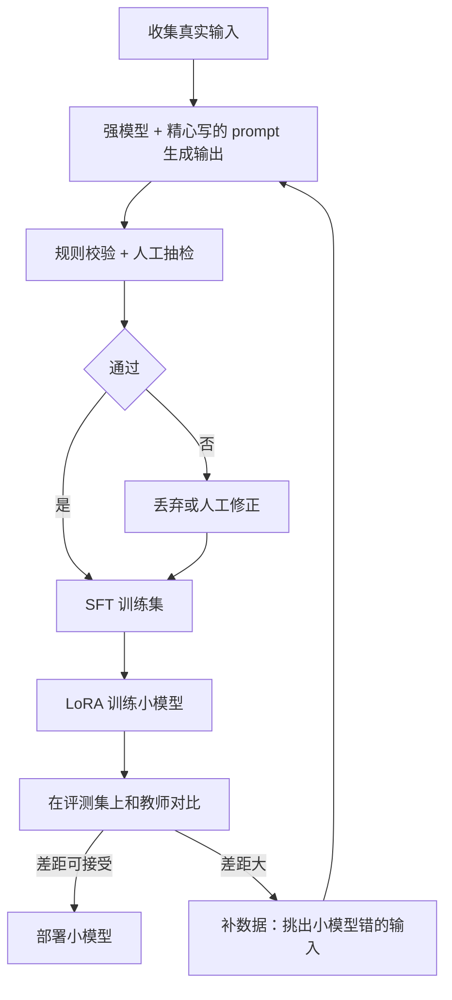
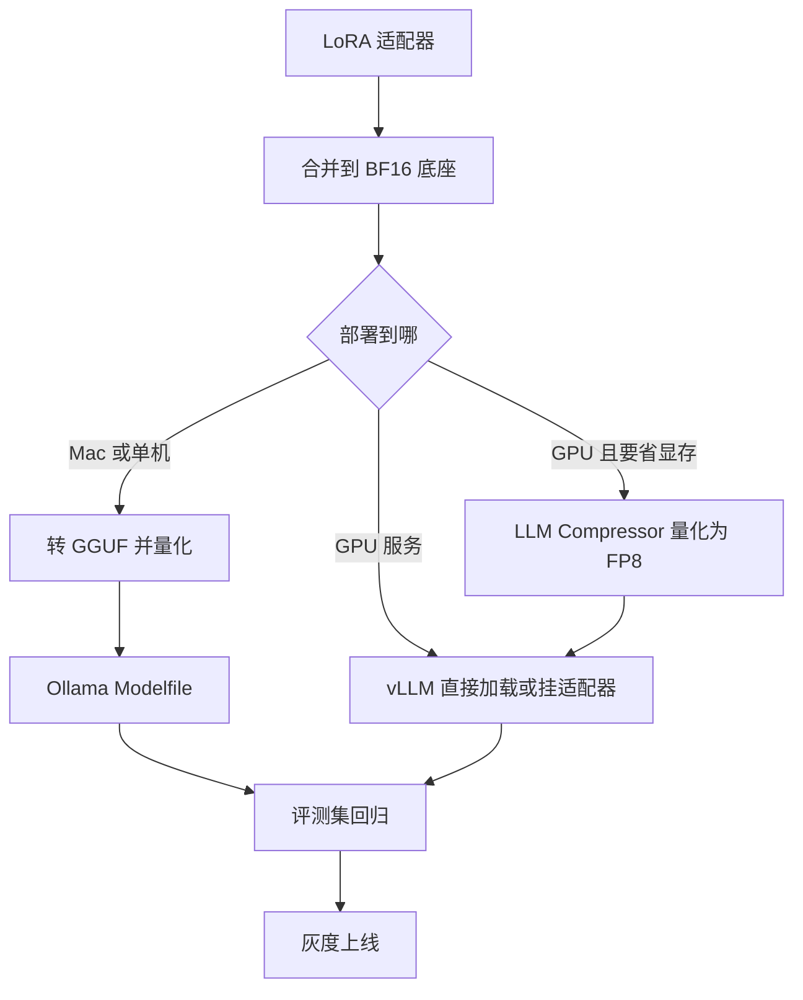

# DPO 与蒸馏

SFT 教模型「照着这个答案说」。但有些要求很难写成标准答案，却很容易判断好坏：两个回答里哪个更简洁、哪个没编造、哪个格式更规范。**DPO** 就是用「这个比那个好」的成对数据继续训练。另一条路是**蒸馏**：让大模型当老师，把它在你的任务上的能力迁移到一个便宜的小模型里，这也是一人公司做微调最常见的实际形态。

这一章讲两者的实操：偏好数据怎么构造、TRL 怎么跑 DPO、两种蒸馏的区别和流程。最后把整本书串起来：从训练好的适配器，一路导出、量化、部署到 Ollama 和 vLLM，再灰度上线。DPO 的推导（为什么一个分类损失能替代强化学习）见[《大模型原理进阶》第 7 章](../llm-deep-dive/07-alignment.md)，这里不重复。

## DPO 用在哪

| 适合 | 不适合 |
|---|---|
| 有明确的好坏偏好，但难以写出唯一标准答案（语气、简洁度、拒答边界） | 模型根本不会做这个任务（先 SFT） |
| SFT 之后还有某类反复出现的错误（啰嗦、格式偶尔不对、过度道歉） | 缺知识（用 RAG） |
| 能低成本拿到成对比较（人工二选一、规则判断） | 偏好本身很模糊、标注者之间分歧大 |

标准流程是**先 SFT，再 DPO**：SFT 让模型学会任务的基本形态，DPO 在此基础上做细调。直接在没学会任务的模型上做 DPO，效果通常不好。

## 偏好数据从哪来

每条样本是一个 prompt 加一对回答：`chosen`（更好）和 `rejected`（更差）。常见的构造方式：

| 方式 | 做法 |
|---|---|
| 人工修改 | 模型原始输出作 `rejected`，人工修改后的版本作 `chosen` |
| 采样后挑选 | 同一个 prompt 让 SFT 模型采样多次，人工或规则挑出最好和最差的 |
| 规则判定 | 输出能被程序校验（JSON 能否解析、数字是否和原图一致、是否超长），通过的当 `chosen` |
| 强模型评判 | 用更强的模型当裁判二选一，再人工抽检（裁判的偏差见[《评测与质量》](../llm-evals/)） |

第一种和第 8 章的数据飞轮完全吻合。hatch-counter 的核单记录里，`model_rows` 和 `final_rows` 不一致的那些样本，天然就是一对 `rejected` / `chosen`：

```python
# 把核单记录里人工改过的样本转成偏好数据（接第 8 章的 records.jsonl）
import json

def to_preference(rec, system: str):
    prompt_text = "表格列依次是：" + "、".join(rec["columns"]) + "。请逐行抄写。"
    return {
        "prompt": [
            {"role": "system", "content": system},
            {"role": "user", "content": prompt_text},
        ],
        "chosen": [{"role": "assistant", "content": json.dumps(rec["final_rows"], ensure_ascii=False)}],
        "rejected": [{"role": "assistant", "content": json.dumps(rec["model_rows"], ensure_ascii=False)}],
    }
```

这里为了简洁省略了图像输入。真正用于视觉模型时，`prompt` 里要带上图片，格式按框架的视觉 DPO 约定。

构造偏好数据的几条经验：

- **`chosen` 和 `rejected` 最好来自同一个模型**（或分布接近的模型）。如果 `chosen` 是 GPT 级别模型写的、`rejected` 是小模型写的，模型学到的可能只是「风格差异」而不是你关心的质量差异
- **差异要集中在你想纠正的点上**。人工修改的版本只改了一个数字，模型就能精确地学到「这类数字要读对」
- 几百到几千对通常足够看到效果

## 用 TRL 跑 DPO

接第 7 章，在合并好的 SFT 模型上再加一个新的 LoRA 做 DPO：

```python
# train_dpo.py
import torch
from datasets import load_dataset
from peft import LoraConfig
from transformers import AutoModelForCausalLM, AutoTokenizer
from trl import DPOConfig, DPOTrainer

MODEL = "out/merged"  # 第 7 章 SFT 后合并的模型

model = AutoModelForCausalLM.from_pretrained(MODEL, dtype=torch.bfloat16)
tokenizer = AutoTokenizer.from_pretrained(MODEL)

dataset = load_dataset(
    "json",
    data_files={"train": "data/pref_train.jsonl", "validation": "data/pref_valid.jsonl"},
)

args = DPOConfig(
    output_dir="out/receipt-dpo",
    beta=0.1,
    learning_rate=2e-5,
    num_train_epochs=1,
    per_device_train_batch_size=2,
    gradient_accumulation_steps=8,
    gradient_checkpointing=True,
    bf16=True,
    logging_steps=10,
    eval_strategy="steps",
    eval_steps=50,
    report_to="none",
)

trainer = DPOTrainer(
    model=model,
    args=args,
    train_dataset=dataset["train"],
    eval_dataset=dataset["validation"],
    processing_class=tokenizer,  # 旧版 TRL 用 tokenizer=
    peft_config=LoraConfig(r=16, lora_alpha=32, target_modules="all-linear", task_type="CAUSAL_LM"),
)
trainer.train()
trainer.save_model()
```

传了 `peft_config` 时不需要单独提供参考模型：训练器会把「关掉适配器的模型」当作参考模型，省一份显存。

### 参数与监控

| 参数 | 作用 | 起点 |
|---|---|---|
| `beta` | 偏离参考模型的约束强度；越小越敢改变，越大越保守 | 0.1，常见范围 0.05–0.5 |
| 学习率 | DPO 比 SFT 敏感得多 | LoRA 约 1e-5 到 5e-5；全参数常见 5e-7 到 5e-6 |
| epoch | | 1 个通常就够，多了容易过拟合 |

训练日志里重点看这几项：

| 指标 | 含义 | 健康的样子 |
|---|---|---|
| `rewards/accuracies` | 隐式奖励认为 `chosen` 更好的比例 | 逐步上升，但验证集上不是一下子到 100% |
| `rewards/margins` | `chosen` 与 `rejected` 的奖励差 | 逐步变大 |
| `rewards/chosen` | `chosen` 相对参考模型的对数概率变化 | 不应大幅下降 |

最后一条是 DPO 的常见陷阱：它只优化「两者的差」，有时会出现 `chosen` 和 `rejected` 的概率**一起下降**、只是 `rejected` 降得更多的情况，模型整体输出变得奇怪。如果 `rewards/chosen` 持续明显变负，降低学习率、增大 `beta`，或者在 SFT 数据上混合训练。

### 变体

TRL 里还有几个相关的训练器，遇到具体问题时再查：ORPO 把 SFT 和偏好优化合成一步、不需要参考模型；KTO 只需要「这个回答好或不好」的单条标注，不需要成对数据，适合点赞点踩这类反馈；SimPO 用平均对数概率做奖励、也不需要参考模型。它们的取舍在《大模型原理进阶》第 7 章有对比。

## 蒸馏

蒸馏是让一个小的**学生**模型去模仿一个大的**教师**模型。有两种：

| | 数据蒸馏（序列级） | logits 蒸馏 |
|---|---|---|
| 学生学什么 | 教师生成的文本 | 教师在每个位置的完整概率分布 |
| 需要什么 | 只要能调教师（API 也行） | 教师的权重，且师生分词器一致 |
| 做法 | 用教师的输出做 SFT 数据 | 训练时让学生的分布贴近教师的分布（KL 散度） |
| 门槛 | 低 | 高 |

对个人开发者，**数据蒸馏是主流**，它本质上就是「用强模型造 SFT 数据」，第 7、8 章的流程完全适用。一个公开的例子：DeepSeek-R1 发布时，附带了用 R1 生成的推理样本对 Qwen 和 Llama 小模型做 SFT 得到的蒸馏版本，小模型的推理能力因此大幅提升。

logits 蒸馏信息量更大（不仅知道正确答案，还知道其他候选的概率），但要求能拿到教师的完整输出分布，通常只在同一家族内、自己有权重时使用。TRL 里有 GKD 这类在线蒸馏训练器可以参考。

### 数据蒸馏的流程



要点：

1. **输入用真实数据**，不要让教师自己编输入，否则分布和线上不一致
2. **教师的 prompt 可以很长很贵**：带详细规则、大量示例、甚至让它先思考再回答。这些成本只在造数据时付一次，学生学到的是结果，上线时用短 prompt
3. **过滤比生成更重要**：能用程序校验的一律校验（JSON 结构、数字合计是否等于金额），教师也会错
4. **迭代补难例**：找出学生答错的输入，让教师重新生成、人工确认，加回训练集
5. **合规**：再次提醒，确认教师模型的服务条款或许可证允许这种用法

蒸馏的预期要实际：学生在**你这个窄任务**上可以接近教师，但通用能力不会因此变强，换个任务就打回原形。这正是它适合一人公司的原因：你需要的本来就只是那一个任务。

## 从训练到上线

最后把整本书串起来：



### 导出到 Ollama

```bash
# 在 llama.cpp 仓库目录下（第 4 章）
python convert_hf_to_gguf.py ../out/merged --outfile receipt-f16.gguf --outtype f16
llama-quantize receipt-f16.gguf receipt-Q4_K_M.gguf Q4_K_M
```

```text
FROM ./receipt-Q4_K_M.gguf
PARAMETER num_ctx 8192
PARAMETER temperature 0
```

```bash
ollama create receipt -f Modelfile
ollama show --template receipt     # 检查 chat template 是否与训练时一致
```

**最后一步不能省**。GGUF 文件里一般带着从分词器转过来的模板，Ollama 会据此选择模板，但偶尔会对不上。模板不一致的典型症状是：回答停不下来、输出里混着特殊标记、或者效果明显不如训练时的评测。发现不一致就在 Modelfile 里用 `TEMPLATE` 显式写出与训练一致的模板。

也可以不合并：把适配器单独转成 GGUF（llama.cpp 仓库里的 `convert_lora_to_gguf.py`），在 Modelfile 里用 `FROM 底座` 加 `ADAPTER ./adapter.gguf`。

### 部署到 vLLM

```bash
# 合并后的完整模型
vllm serve ./out/merged --served-model-name receipt

# 或者底座 + 适配器，一个底座服务多个任务（第 3 章）
vllm serve Qwen/Qwen3-8B --enable-lora --lora-modules receipt=./out/receipt-lora
```

### 上线前后

1. **量化后再评测一次**。评测的对象是最终部署的那个文件，不是训练时的 BF16 模型。第 4 章说过，格式类错误对量化很敏感
2. **影子模式**：新模型和现有方案（比如 API）同时跑，只记录不采用，对比一段时间的真实流量
3. **灰度**：按租户或比例切一部分流量，保留一键切回的开关
4. **保留兜底**：低置信度或校验失败的请求自动转给大模型 API，人工核对环节不撤
5. **持续回收数据**：线上的人工修正继续进入数据飞轮，定期重新训练和评测

## 本章要点

- DPO 用「这个比那个好」的成对数据训练，适合难写标准答案但易判好坏的要求；**先 SFT 再 DPO**
- 偏好数据最好来源是「模型原始输出 vs 人工修改版」，两者来自同一模型、差异集中在要纠正的点上
- TRL 的 `DPOTrainer` 配 `peft_config` 时不需要单独的参考模型；`beta` 从 0.1 起，学习率比 SFT 小，1 个 epoch
- 监控 `rewards/accuracies`、`margins`，警惕 `rewards/chosen` 持续下降
- 蒸馏分数据蒸馏和 logits 蒸馏；个人开发者以**数据蒸馏**为主：真实输入 + 贵的教师 prompt + 严格过滤 + 迭代补难例
- 导出链路：合并 → GGUF 量化 → Ollama，或 vLLM 直接加载 / 挂适配器；**检查 chat template**，量化后重新评测
- 上线走影子模式和灰度，保留 API 兜底和人工核对，线上修正继续回流成训练数据

## 动手练习

1. **从核单记录造偏好对，并检查差异是否集中**：沿用[第 8 章练习](08-datasets.md#动手练习)造的 `records.jsonl` 和 `build_dataset.py`，把正文的 `to_preference` 存成 `pref_fn.py`，运行下面的脚本。

   ```python
   import json
   from pathlib import Path
   from build_dataset import SYSTEM, load, valid
   from pref_fn import to_preference

   pairs = []
   for rec in load(Path("records.jsonl")):
       if valid(rec) and rec["model_rows"] != rec["final_rows"]:
           p = to_preference(rec, SYSTEM)
           good = json.loads(p["chosen"][0]["content"])[0]
           bad = json.loads(p["rejected"][0]["content"])[0]
           print(rec["id"], "差异格子数", sum(a != b for a, b in zip(good, bad)))
           pairs.append(p)
   print(len(pairs), "对")
   ```

   验证：共 17 对；其中 16 对只差 1 个格子（数量），`r-02` 差 3 个格子。

   参考答案：`r-02` 是练习里人为制造的「重复提交」，它的 `final_rows` 被换成了另一张单子的内容，于是 `chosen` 和 `rejected` 根本不是同一张单子。这种对教给模型的不是「数字要读对」，而是噪声。构造偏好数据前也要像 SFT 数据一样去重、过滤，差异超过阈值的对单独人工看。

2. **复现模板不一致**：拿一个 Ollama 上的小 Instruct 模型（如 `qwen3:0.6b` 一类，以模型库为准），先 `ollama show --template <模型>` 看它自带的模板，再写一个 Modelfile：`FROM <模型>` 加一行 `TEMPLATE "{{ .Prompt }}"`，`ollama create bad-tpl -f Modelfile`，用同一个问题分别问原模型和 `bad-tpl`。

   验证：`bad-tpl` 的回答出现正文说的典型症状之一：停不下来、自己续写出下一轮对话、或答非所问；原模型正常。

   参考答案：`{{ .Prompt }}` 把问题原样送进去，没有角色标记和结束标记，模型不知道该以 assistant 身份回答、何时停止。导出微调模型时用 `ollama show --template` 核对，就是为了防止这种情况。

3. **为数据蒸馏写一个过滤器**：写函数 `check(output, columns)`，要求 JSON 能解析、每行列数和 `columns` 一致、`数量 × 单价 = 金额`（误差 0.01 内）。先预测下面 5 个教师输出哪些能通过，再运行验证：①`[["1","土豆","斤","30","2.5","75"]]` ②`[["1","土豆","斤","30","2.5","57"]]` ③`[["1","土豆","斤","30","2.5"]]` ④`[["1","土豆","斤","30","2.5","75"]`（少一个括号） ⑤`[["1","土豆","斤",null,"2.5","75"]]`。

   验证：只有 ① 通过。

   参考答案：② 合计不符，③ 列数不对，④ 解析失败，⑤ 的 `null` 转数字失败。注意 ⑤：system prompt 允许看不清写 `null`，所以真实使用时 `null` 行应该放行给人工审，而不是直接丢弃，按你的业务决定。

   ```python
   import json

   def check(output: str, columns: list[str]) -> bool:
       try:
           rows = json.loads(output)
       except json.JSONDecodeError:
           return False
       if not isinstance(rows, list) or not all(isinstance(r, list) and len(r) == len(columns) for r in rows):
           return False
       try:
           return all(abs(float(r[3]) * float(r[4]) - float(r[5])) < 0.01 for r in rows)
       except (TypeError, ValueError):
           return False
   ```

## 接下来读什么

到这里，你已经能判断一个功能该不该自己部署模型、该不该微调，也能把整条链路跑通。接下来：

- 《评测与质量》：本书反复强调「用自己的任务评测」，那本书讲怎么系统地搭评测集、做回归测试
- [《LLM 应用上线》](../llmops/)：自部署模型和 API 并存时，模型网关、多供应商降级、成本监控怎么做
- [《多模态应用》](../multimodal-ai/)：hatch-counter 进货单识别的完整设计，视觉模型的原理和 prompt 技巧
