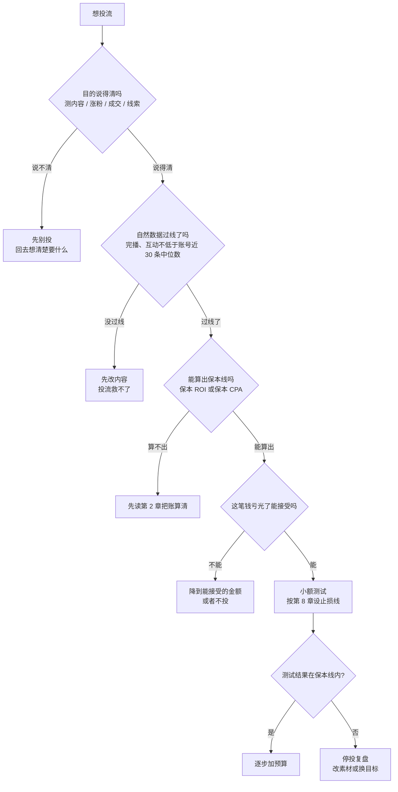

# 投流是什么，什么时候该投

刷抖音时看到一条视频右下角写着「DOU+」，或者朋友说「这条我投了 500」，指的都是同一件事：**花钱买平台的推荐流量**。这本书讲的就是这件事——怎么投、怎么算账、怎么在预算很小的时候不亏钱，以及怎么把各平台的数据收拢到一张表里看清楚。

这一章不碰任何后台操作，先回答三个问题：投流到底买的是什么；它和自然流量是什么关系；你现在该不该投。

## 这本书讲什么、适合谁、怎么读

读者设定：在职开发者，下班做自媒体或短剧副业，每月能拿出几百到几千元试投流，亏不起大钱，但愿意算账。

| 章 | 内容 | 什么时候读 |
|---|---|---|
| 1 | 投流是什么、什么时候该投 | 先读 |
| 2 | 投流的账：CPM、CPC、CPA、ROI、保本 ROI、LTV | 先读，后面各章都用它的公式 |
| 3 | DOU+ | 做抖音内容号 |
| 4 | 巨量千川与随心推 | 在抖音带货、卖课、做直播 |
| 5 | 小红书薯条与聚光 | 做小红书 |
| 6 | 视频号加热与微信广告 | 做视频号 / 私域 |
| 7 | 快手粉条与磁力金牛 | 做快手 |
| 8 | 小预算测试：变量、样本量、止损线 | 每次开新计划前 |
| 9 | 数据看板：导出、字段、汇总 | 投了两周以上、平台超过一个时 |
| 10 | 常见亏钱方式与复盘 | 每月复盘时翻一遍 |

第 3–7 章是平台手册，只读自己在用的平台即可；第 2、8、9、10 章是通用方法，每个平台都适用。

和其他书的分工：

- 指标体系、漏斗、A/B 测试的统计学，在《数据分析与埋点》第 1、5、6 章讲过，这里只用结论
- 渠道怎么选、要不要做付费渠道，见《获客与增长》第 8 章
- 短剧付费 / 免费剧的投流测算（充值回收、分账、IAA 广告收益）归《短剧发行、投流与备案》，本书只讲通用方法
- 直播间的话术、排品，见《直播实战》；选品与佣金，见《带货与选品》
- 广告法、标注、资质，见《自媒体与短剧合规财税》

关于平台规则：投流产品改版很频繁，起投金额、出价方式、目标选项每年都在变。本书里所有平台规则都标了出处和查询时间（2026-11-03），**动手前以后台页面为准**。行业 CPM、ROI 这类「基准值」网上很多，但几乎都没有可靠来源，本书不给，只教你用自己的数据算。

## 投流买的是什么

推荐型平台（抖音、快手、小红书、视频号）的分发逻辑大致相同：新内容先给一小批人看，看的人反应好（看完、点赞、评论、转发、关注），再推给更多人；反应差就停在小流量池里。平台各自的推荐机制见《抖音与快手》和《小红书、视频号与 B 站》。

投流就是**在这个过程里插一笔钱**：你付钱，平台额外把内容推给一批人。不同产品插钱的位置不同：

| 类型 | 代表产品 | 你买的东西 | 典型用途 |
|---|---|---|---|
| 内容加热 | DOU+、薯条、视频号加热、快手粉条 | 一批额外曝光，按你选的目标（播放、点赞、涨粉）优化人群 | 测内容、给好内容加速、涨粉 |
| 电商广告 | 巨量千川、随心推、磁力金牛 | 按成交 / ROI 优化的流量 | 带货、卖课、直播间拉人 |
| 效果广告 | 小红书聚光、腾讯广告、巨量引擎广告 | 按点击、私信、表单、下载等转化优化 | 获客、留资、私信咨询 |

这三类的门槛依次升高：内容加热个人号就能用，几十到一百元起；电商广告要有店铺或带货权限；效果广告一般要企业或个体户资质、开户、预存（各平台具体要求见第 3–7 章）。

### 付费流量不会「污染」自然流量，但也不会救活差内容

有两个常见误解：

1. **「投了 DOU+ 以后自然流量就没了」**。没有平台公开说过这种机制。视频号的官方说明写得很明确：加热会增加视频曝光，但不影响作品本身的自然流量获取（见第 6 章出处）。真实情况通常是：投流期间你看到的「自然流量」下降，是因为原本该来的流量被计入了付费部分，或者内容本来就到了衰减期
2. **「投钱能把一条视频推成爆款」**。投流买来的是**曝光**，不是**反应**。一条完播率很低的视频，花钱推给 1 万人，这 1 万人照样划走，系统不会因此把它推进更大的流量池。付费流量只是让好内容更快被验证、更快放大

可以把一条内容的总流量拆成：

$$
\text{总曝光} = \text{自然曝光} + \text{付费曝光} + \text{付费带来的二次自然曝光}
$$

第三项才是投流的「杠杆」：付费流量里的人互动了，系统判断内容不错，于是追加自然推荐。好内容投 100 元可能撬动几倍于付费部分的自然播放；差内容投 100 元就只有这 100 元买到的曝光。**投流放大的是内容本身的质量，正负都放大。**

## 什么时候该投，什么时候不该

把决策拆成几个问题，从上往下回答：

逐条解释。

### 目的说得清

「想让账号火」不是目的。能落到后台选项上的目的只有几类：

| 目的 | 衡量指标 | 对应的投放目标 |
|---|---|---|
| 测内容：这条值不值得做成系列 | 付费流量下的完播率、互动率 | 播放量 / 点赞评论 |
| 涨粉：账号冷启动或要接商单 | 单个粉丝成本、粉丝的后续活跃 | 粉丝量 |
| 成交：带货、卖课 | ROI、单笔订单成本 | 商品成交 / 直播间成交 |
| 线索：咨询、私信、表单 | 单条线索成本、线索转化率 | 私信 / 表单 / 主页访问 |

一次投放只服务一个目的。「既要涨粉又要成交」的计划，最后两个都看不清。

### 自然数据过线

投之前先看这条内容在没花钱时的表现。拿账号最近 30 条内容的完播率、互动率算中位数，新内容的自然数据不低于中位数，才值得投。原因上面说过：投流放大内容质量。低于中位数的内容，钱花出去买到的是「更多人确认它不好看」。

例外是测试：你刚起号、没有历史数据，或者故意用小钱测几个方向。这种情况投的目的是买数据，而不是买效果，要事先说好上限（第 8 章）。

### 能算出保本线

投成交和线索之前，必须先算出「每单 / 每条线索最多能花多少钱」。算不出来就投，等于不看价格买东西。第 2 章专门讲这个。

投涨粉和测内容，没有直接收入，保本线换成**预算上限**：「这个月测内容最多花 300 元」。

### 亏光能接受

副业投流的第一原则：**投的每一笔钱，都按全部亏掉来做心理准备**。如果 2,000 元亏掉会影响生活或让你焦虑到睡不着，就降到 200 元。小预算也能得到有用的数据，只是要更讲究测试方法。

## 投流不能解决的问题

列在这里，免得把钱花在错的地方：

- **账号定位不清**：投流会把内容推给系统认为合适的人，账号定位混乱时，系统找到的人也是混乱的，涨来的粉丝和你后面的内容对不上。定位见《账号定位与对标拆解》
- **承接不行**：带货时商品详情页、评价、价格没竞争力；卖课时主页没有说清楚课程是什么。流量进来了接不住，ROI 再怎么调也上不去
- **违规内容**：夸大功效、虚假对比、未授权素材，过不了审核，过了也有被处罚的风险。本书不讲、也不建议任何「绕审核」的做法
- **限流的号**：账号被限流时，先查违规记录、按平台申诉流程处理，而不是用投流去「冲」。投流订单在违规内容上通常审核不通过

## 自然流和付费流的配合节奏

对小预算的个人号，一个可行的节奏是：

1. **日常只发不投**：每周发几条，积累自然数据，找到哪类内容的完播和互动明显高于平均
2. **对跑出来的内容小额加热**：发布后 2–24 小时内，自然数据过线的那条，投一笔小额内容加热，目标选和你的目的一致的那项
3. **把付费数据当信号**：付费流量下的完播率、互动率如果和自然流量接近，说明这条内容对更广的人群也成立，可以做成系列；如果付费人群的数据明显差，说明它只对你的老粉有效
4. **有了变现链路再上电商 / 效果广告**：有商品、有课、能接私信咨询，并且算得出保本线以后，才进入第 4、5 章讲的那类产品

预算分配的起点可以是：

| 阶段 | 内容加热 | 电商 / 效果广告 | 说明 |
|---|---|---|---|
| 起号（0–1 千粉） | 每月 100–300 元 | 0 | 主要用来测方向，不追求涨粉 |
| 有稳定内容（1 千–1 万粉） | 每月 300–1,000 元 | 0–按保本线小测 | 给跑出来的内容加速 |
| 有变现链路 | 视情况 | 按第 8 章的测试→放量流程 | 一切以 ROI 为准 |

这些金额只是起点参考，没有任何平台依据，按你自己的承受能力调整。

## 本章要点

- 投流是**花钱买推荐流量**，分三类：内容加热、电商广告、效果广告，门槛依次升高
- 付费流量买的是**曝光**，不是**反应**：它放大内容质量，正负都放大；好内容的杠杆来自付费流量带来的二次自然推荐
- 该不该投，依次回答：目的说得清吗、自然数据过线了吗、保本线算得出吗、亏光能接受吗
- 一次投放只服务一个目的：测内容、涨粉、成交或线索
- 投流解决不了定位、承接和违规问题
- 平台规则变化快，本书的平台信息都标了查询时间，以后台为准；行业基准值不可靠，用自己的数据算
