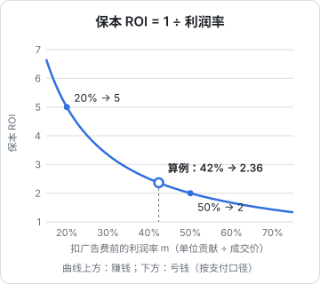

# 投流的账怎么算

投流后台会给你一堆数字：消耗、展现、点击率、千次展现费用、转化成本、支付 ROI……这些数字本身没有好坏，**只有和你的保本线比较才有意义**。同样是 ROI 2，卖高毛利的课是大赚，卖低毛利的日用品是亏本。

这一章把投流用到的指标一次讲清：每个指标的公式、它们之间怎么换算，然后用三个完整算例（带货、卖课、线索）算出保本 ROI 和保本 CPA。后面各平台章节和测试、看板章节都直接用这里的公式。

## 指标定义

先统一口径。各平台叫法不同，但本质就这几个：

| 指标 | 公式 | 读法 | 平台上常见的叫法 |
|---|---|---|---|
| 消耗 | 实际花掉的钱 | — | 消耗、花费、实际消耗 |
| 展现（曝光） | 内容被展示的次数 | — | 展现、曝光、播放 |
| CPM | 消耗 ÷ 展现 × 1000 | 每千次展现花多少钱 | 千次展现费用、千展成本 |
| CTR | 点击 ÷ 展现 | 看到的人里多少点了 | 点击率 |
| CPC | 消耗 ÷ 点击 | 每次点击花多少钱 | 平均点击单价 |
| CVR | 转化 ÷ 点击 | 点了的人里多少完成目标 | 转化率 |
| CPA | 消耗 ÷ 转化 | 每次转化花多少钱 | 转化成本、单次成交成本、粉丝成本、线索成本 |
| ROI（ROAS） | 成交金额 ÷ 消耗 | 每花 1 元带回多少成交额 | 支付 ROI、投产比 |
| 净成交 ROI | （成交金额 − 退款金额）÷ 消耗 | 扣掉退款后的 ROI | 净成交 ROI、结算 ROI |

两个容易混的点：

1. **国内平台的「ROI」通常是成交额 ÷ 消耗**，也就是英文里的 ROAS，**不是利润 ÷ 投入**。ROI 为 2 的意思是花 1 元卖了 2 元的货，扣掉成本后很可能是亏的。本书说 ROI 时都指平台口径；要说利润回报，会明确写「利润」
2. **「转化」是你在后台选的那个目标**。目标选涨粉，转化就是关注；选成交，转化就是支付订单。同一个计划换目标后 CPA 不能直接比较

### 指标之间的换算

从展现到转化是一个漏斗，所以：

$$
\text{CPC} = \frac{\text{CPM}}{1000 \times \text{CTR}}, \qquad
\text{CPA} = \frac{\text{CPC}}{\text{CVR}} = \frac{\text{CPM}}{1000 \times \text{CTR} \times \text{CVR}}
$$

这个式子告诉你：**降 CPA 只有三条路**——降 CPM（流量更便宜）、提 CTR（素材更吸引人）、提 CVR（承接更好）。

| 杠杆 | 主要由什么决定 | 你能做的 |
|---|---|---|
| CPM | 平台竞价、定向宽窄、时段、行业竞争 | 放宽定向、避开大促高峰、提高内容质量（多数平台对优质内容的流量价格更友好） |
| CTR | 开头 3 秒、封面、标题 | 换素材、换开头（见《选题与爆款结构》） |
| CVR | 商品价格、详情页、评价、直播承接、私信回复速度 | 改承接页面、改话术、选对商品 |

**算例**：CPM 40 元，CTR 1.5%，点击到支付的 CVR 4%：

$$
\text{CPA} = \frac{40}{1000 \times 0.015 \times 0.04} = \frac{40}{0.6} \approx 66.7 \text{ 元}
$$

每出一单，广告费约 66.7 元。值不值，要看下一节的保本线。

（这里的 CPM、CTR、CVR 都是为了演示随手取的，不代表任何平台的行业水平。你的真实数字从后台拿。）

## 单位经济：一单能赚多少

保本线的计算起点是：**不算广告费，一单能留下多少钱**。这个数我们叫「单位贡献」，记作 $c$。

### 带货的单位贡献

设：

| 符号 | 含义 | 算例取值 |
|---|---|---|
| $P$ | 成交价（用户实付） | 99 元 |
| $f$ | 平台扣点：技术服务费、佣金、支付通道费等，按实收比例 | 5% |
| $C$ | 商品成本（含包装） | 35 元 |
| $s$ | 发货运费 | 8 元 |
| $r$ | 退款率（支付订单中最终退款的比例） | 15% |
| $d$ | 每笔退款的额外损失：来回运费、损耗 | 10 元 |

不退款的订单留下 $P(1-f) - C - s$；退款的订单收入为零，还亏 $d$（这里简化为商品能完好回收，否则把商品成本也算进 $d$）。每笔支付订单的期望贡献：

$$
c = (1-r)\big[P(1-f) - C - s\big] - r \cdot d
$$

代入：

$$
c = 0.85 \times (94.05 - 35 - 8) - 0.15 \times 10 = 0.85 \times 51.05 - 1.5 \approx 41.89 \text{ 元}
$$

注意分母是**支付订单**，不是最终成交订单。因为后台的「转化数」「支付 ROI」也是按支付订单统计的，两边口径一致才能比。

各平台的实际扣点（技术服务费比例、是否收佣金、支付通道费）因类目和店铺类型而异，去你自己店铺后台的「费用」或「结算明细」里查，不要用网上的数字。

### 保本 CPA 与保本 ROI

每笔支付订单最多能花 $c$ 元广告费，多花就亏：

$$
\text{保本 CPA} = c
$$

ROI 是成交额 ÷ 消耗，每单成交额 $P$，每单消耗为 CPA：

$$
\text{保本 ROI（支付口径）} = \frac{P}{c}, \qquad
\text{保本 ROI（净成交口径）} = \frac{P(1-r)}{c}
$$

代入算例：

| 指标 | 计算 | 结果 |
|---|---|---|
| 保本 CPA | $c$ | 41.89 元 |
| 保本支付 ROI | 99 ÷ 41.89 | 2.36 |
| 保本净成交 ROI | 84.15 ÷ 41.89 | 2.01 |

前面算出的 CPA 66.7 元远高于 41.89 元——这样投，每出一单亏约 25 元。要回到保本，三条路任选：

- CVR 从 4% 提到 $40 / (1000 \times 0.015 \times 41.89) \approx 6.4\%$
- 或者 CPM 降到 $41.89 \times 1000 \times 0.015 \times 0.04 \approx 25.1$ 元
- 或者 CTR、CVR、CPM 各改善一点

同一个商品，**两种口径的保本 ROI 差了 0.35**。巨量千川等平台已经在用净成交 ROI 出价（第 4 章），设目标时一定先看清后台用的是哪个口径。

### 保本 ROI 只看一个数：利润率

把上式变形，令 $m = c / P$，即**每 1 元成交额（支付口径）在扣广告费之前能留下的钱**：

$$
\text{保本 ROI} = \frac{1}{m}
$$



从曲线能读出投流生意的第一条规律：**利润率低于 25% 的商品，保本 ROI 在 4 以上，靠投流很难赚钱**。利润率高的商品（课程、虚拟服务、自有品牌）才有投流的空间。选品时就该把这件事算进去，见《带货与选品》。

### 加上目标利润

保本只是不亏。如果你希望每单至少赚 $g$ 元，允许的广告费就是 $c - g$：

$$
\text{目标 CPA} = c - g, \qquad \text{目标 ROI} = \frac{P}{c - g}
$$

算例里希望每单净赚 15 元：目标 CPA = 26.89 元，目标支付 ROI = 99 ÷ 26.89 ≈ 3.68。

这里的「赚」还没算你的时间、剪辑外包、样品等固定成本，也没算税（见《自媒体与短剧合规财税》）。月底复盘时要用总账核对（第 10 章）。

## 卖课：首单保本与 LTV 保本

知识产品的特点是边际成本低、可能有复购。

**算例**：199 元的入门课，平台和支付通道合计扣 10%，退款率 8%，交付边际成本近似为零：

$$
c = (1 - 0.08) \times 199 \times (1 - 0.10) \approx 164.77 \text{ 元}
$$

首单保本 CPA 164.77 元，保本支付 ROI = 199 ÷ 164.77 ≈ 1.21。

再假设历史数据显示：买入门课的人里，30% 会在 6 个月内买 599 元的进阶课（同样扣 10%、退款 8%，每单贡献约 495.97 元）。那么一个首单用户的预期总贡献：

$$
\text{LTV} = 164.77 + 0.3 \times 495.97 \approx 313.56 \text{ 元}
$$

按 LTV 算，CPA 可以放宽到约 313 元。但这有两个前提：

1. **复购率是你自己的数据算出来的**，并且样本不能太小（几十个用户算出的 30%，误差可能是 ±15 个百分点）。没有数据就只按首单保本
2. **你扛得住回款的时间差**：首单每单亏最多 150 元，要等几个月复购才回来。副业现金流有限时，建议设一个**首单保本率下限**，比如首单至少回收 70% 的广告费

所以卖课的实用规则是：

| 阶段 | CPA 上限 | 说明 |
|---|---|---|
| 没有复购数据 | 首单保本 CPA | 只按首单算 |
| 有 3 个月以上复购数据 | 首单保本 CPA ~ LTV 保本 CPA 之间 | 用最保守的复购率 |
| 现金流紧 | 首单保本 CPA × 1.0 | 不赌未来 |

LTV 的严谨算法（按批次的累计贡献曲线）见《数据分析与埋点》第 4 章，这里不重复。

## 线索：从「一条私信值多少钱」倒推

线索类投放（私信、表单、加企业微信）买到的不是钱，而是一个可能成交的人。每条线索的价值：

$$
\text{线索价值} = \text{线索到成交的转化率} \times c
$$

**算例**：在小红书投私信，每条私信线索 25 元；历史上私信到购买 199 元课程的转化率 10%：

$$
\text{线索价值} = 0.10 \times 164.77 \approx 16.48 \text{ 元} < 25 \text{ 元}
$$

每条线索亏约 8.5 元。要么把私信转化率提到 15.2% 以上（25 ÷ 164.77），要么把线索成本压到 16.48 元以下。

线索到成交的转化率通常是**你最能控制的环节**：回复速度、话术、是否及时跟进。投线索之前，先把承接流程跑顺。另外各平台对把用户从站内导到站外（比如直接要微信号）都有限制，承接要在平台允许的方式内做，规则见第 5、6 章和《国内私域与内容平台》。

## 涨粉：一个粉丝值多少钱

涨粉没有直接收入，粉丝价值只能估算。一个粗略但诚实的算法：

$$
\text{每粉每月价值} \approx \frac{\text{近 3 个月账号变现总收入}}{3 \times \text{近 3 个月平均粉丝数}}
$$

比如近 3 个月商单加橱窗佣金共 6,000 元，平均粉丝 2 万：每粉每月约 0.1 元。如果你预期一个新粉丝平均在 12 个月里还保持关注且活跃，那么一个粉丝的价值上限大约是 1 元。

这个估算偏乐观，因为：

- **付费涨来的粉丝活跃度通常低于自然粉**，付费粉丝的后续互动要单独观察（看投流后几周新粉的互动有没有拉低整体数据）
- 账号收入和粉丝数不是线性关系，商单报价更多看互动和垂直度

所以涨粉投放更实际的做法是**定预算不定 ROI**：「这个月起号阶段，涨粉投放最多 300 元，单粉成本超过 X 元就停」，X 用上面的估算取一个保守值。还没有任何变现的账号，没法估算，就只看预算。

## 一张保本计算表

把上面的公式做成表格，每个商品 / 课程一行，开新计划前先填：

| 字段 | 公式 | 带货算例 | 卖课算例 |
|---|---|---|---|
| 成交价 $P$ | 填 | 99 | 199 |
| 平台扣点 $f$ | 填 | 5% | 10% |
| 商品成本 $C$ | 填 | 35 | 0 |
| 运费 $s$ | 填 | 8 | 0 |
| 退款率 $r$ | 填（用历史数据） | 15% | 8% |
| 退款额外损失 $d$ | 填 | 10 | 0 |
| 单位贡献 $c$ | $(1-r)[P(1-f)-C-s]-rd$ | 41.89 | 164.77 |
| 保本 CPA | $c$ | 41.89 | 164.77 |
| 保本支付 ROI | $P / c$ | 2.36 | 1.21 |
| 保本净成交 ROI | $P(1-r)/c$ | 2.01 | 1.11 |
| 目标利润 $g$ | 填 | 15 | 50 |
| 目标 CPA | $c - g$ | 26.89 | 114.77 |
| 目标支付 ROI | $P/(c-g)$ | 3.68 | 1.73 |

在表格软件里，假设 B2–B7 依次是 $P, f, C, s, r, d$：

```text
单位贡献 c       = (1-B6)*(B2*(1-B3)-B4-B5) - B6*B7
保本支付 ROI     = B2 / B8
保本净成交 ROI   = B2*(1-B6) / B8
目标 CPA         = B8 - B12
目标支付 ROI     = B2 / (B8 - B12)
```

用同样的逻辑写成函数，第 9 章的看板脚本会直接用到：

```ts
export type UnitInput = {
  price: number;        // P 成交价
  feeRate: number;      // f 平台扣点
  cost: number;         // C 商品成本
  shipping: number;     // s 运费
  refundRate: number;   // r 退款率
  refundLoss: number;   // d 每笔退款额外损失
};

export function unitContribution(u: UnitInput): number {
  const kept = u.price * (1 - u.feeRate) - u.cost - u.shipping;
  return (1 - u.refundRate) * kept - u.refundRate * u.refundLoss;
}

export function breakevenRoi(u: UnitInput, net = false): number {
  const c = unitContribution(u);
  const gmv = net ? u.price * (1 - u.refundRate) : u.price;
  return gmv / c;
}

// 带货算例：unitContribution(...) ≈ 41.89，breakevenRoi(...) ≈ 2.36
```

## 常见算错的地方

- **用 GMV 算利润**：成交额 1 万、广告费 4 千，不等于赚了 6 千。先扣成本、扣点、退款
- **退款率用了「当天」数据**：退款要几天甚至几周后才发生，投放当天的 ROI 一定偏高。退款率用 30 天前那批订单的实际值
- **口径不一致**：后台 ROI 是支付口径，保本线按结算口径算，比出来的结论是错的
- **忘了自然成交**：投流期间的订单不全是广告带来的，有的本来就会买。部分平台的「全域」类产品会把自然成交也算进 ROI 里（第 4、7 章），这时候保本线要更严。判断增量的方法见第 8 章
- **把「平均 CPA」当「边际 CPA」**：预算从 200 加到 1,000，新增的 800 元通常比前 200 元贵。加预算后要单独看新增部分的效果

## 本章要点

- 国内平台的 ROI = 成交额 ÷ 消耗，是营收回报不是利润回报
- $\text{CPA} = \text{CPM} / (1000 \times \text{CTR} \times \text{CVR})$，降成本只有降 CPM、提 CTR、提 CVR 三条路
- 单位贡献 $c = (1-r)[P(1-f)-C-s] - rd$，保本 CPA $= c$，保本 ROI $= P/c$，利润率越低保本 ROI 越高
- 先确认后台 ROI 是支付口径还是净成交口径，再和对应的保本线比
- 卖课先按首单保本，有可靠复购数据再适度放宽到 LTV
- 线索价值 = 线索成交率 × 单位贡献；涨粉没法精确算，定预算上限
- 退款率用成熟批次的数据，加预算看边际成本
