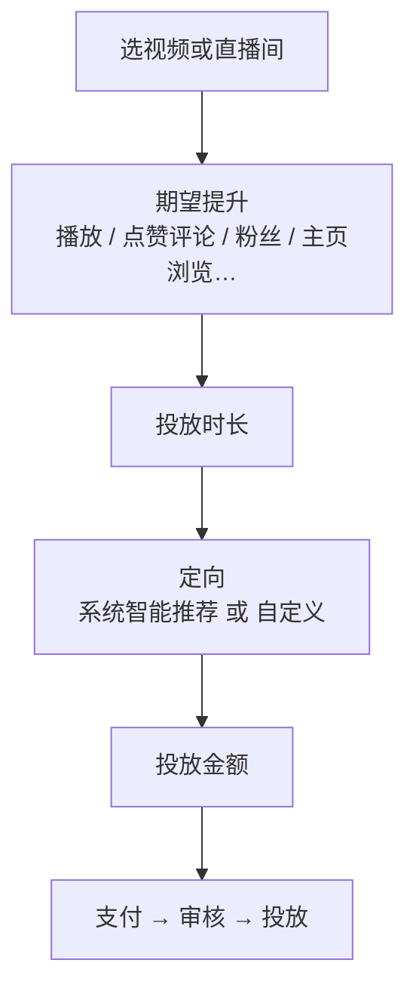
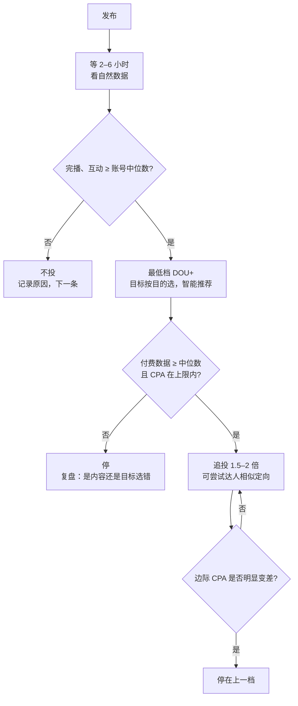

# DOU+：给抖音内容加热

DOU+ 是抖音的内容加热工具，个人号在 App 里就能用，不用开户，也不用企业资质。它是大多数抖音创作者接触的第一个投流产品，也是最容易「随手投、随手亏」的一个。

这一章讲 DOU+ 能做什么、各项设置怎么选、怎么看结果，以及它和巨量千川、随心推的分工。

> [!WARNING]
> DOU+ 的界面和规则这几年改过多次（入口、目标选项、最低金额、时长选项都变过），网上的教程大部分是两三年前的。本章是 2026-11-03 查询时多份第三方资料的交叉对照（没能访问到巨量引擎帮助中心 DOU+ 规则正文，出处列在本章末尾），**动手前以 App 里 DOU+ 下单页的实际显示和巨量引擎官方帮助中心为准**。

## DOU+ 能做什么、不能做什么

| 能做 | 不适合做 |
|---|---|
| 给一条视频买额外播放，按你选的目标（播放、互动、涨粉、主页浏览等）找人 | 带货、卖课的成交优化：用随心推或巨量千川（第 4 章） |
| 给直播间拉人气、拉互动 | 大规模稳定获客：用巨量引擎的效果广告 |
| 测试一条内容在更广人群里的表现 | 救活自然数据很差的内容（第 1 章） |
| 给自己或别人的视频投（可以帮别人投） | 推广违规、夸大宣传的内容：会审核不通过 |

第三方资料提到的一个细节值得注意：DOU+ 买来的流量**不带广告标识**，和自然流量共享频控规则（出处 [1]）。也就是说，看到你视频的人不知道这是付费推的，这也是它适合「测内容」的原因——付费人群的反应和自然人群接近。

## 下单页的几个设置

DOU+ 下单时要选的东西，大致是这四项（名称可能随版本变化）：

### 期望提升（目标）

官方页面上的流程是先选「期望提升」，常见选项包括播放量、点赞评论量、粉丝量、主页浏览量等（出处 [2]）。目标决定了系统把内容推给什么样的人：

| 选什么 | 系统找的人 | 适合 |
|---|---|---|
| 播放量 | 愿意看的人，最便宜但最泛 | 纯测内容、需要曝光基数 |
| 点赞评论 | 容易互动的人 | 想撬动二次自然推荐（互动是推荐信号） |
| 粉丝量 | 容易关注的人 | 起号、准备接商单 |
| 主页浏览 | 会点进主页的人 | 主页有合集、橱窗或其他转化入口 |

**选目标的原则：选你真正想要的那个动作。** 很多人觉得「播放量最便宜，先买播放，涨粉自然会来」——不会。买播放的人群就是不爱关注的那批人，涨粉成本反而高。

### 投放时长

时长决定钱花多快。第三方资料里出现过 2、6、12、24 小时等选项，部分产品支持更长（出处 [3]、[4]）。经验上：

- 金额小（100–300 元），时长可以短一点，让系统集中花完，数据好读
- 金额大，时长拉长，给系统找人的空间，避免短时间内抢量把单价推高
- 有第三方基于约 6 万元投放数据的文章认为直播引流场景下 24 小时的转化成本最低（出处 [4]）。这是单一样本，场景也有限，把它当一个值得自己验证的假设，而不是结论

### 定向

两种方式：

- **系统智能推荐**：平台根据视频内容找人。新手、测内容时首选，因为你还不知道谁是你的观众
- **自定义定向**：自己选性别、年龄、地域、兴趣，部分版本还有「达人相似粉丝」（选几个对标账号，推给与它们粉丝相似的人）等进阶选项（出处 [1]、[3]）

自定义定向的常见坑是**选得太窄**：性别 + 年龄段 + 3 个城市 + 2 个兴趣，人群太小，CPM 被抬高，钱也可能花不完。除非你有明确依据（比如本地生意只能做本城），先用智能推荐跑一轮，再用后台数据里的观众画像决定要不要收窄。

「达人相似」适合起号阶段：选 3–5 个和你内容高度相似、粉丝量级不要差太多的对标账号（怎么找对标见[《账号定位与对标拆解》](../account-positioning/)）。

### 投放金额

> [!WARNING]
> 起投金额来自 2026-11 前的第三方资料，说法不一，以 DOU+ 下单页显示的金额为准。

多份资料提到 DOU+ 最低 100 元起投，但也有资料给出了不同的数字，部分特殊产品（如「账号速推」）规则不同（出处 [3]、[5]）。

金额怎么定，用第 1 章的原则：这笔钱亏光了能不能接受。测内容建议从最低档开始；放大一条已验证的内容，每次加到上一次的 1.5–2 倍，而不是一次翻十倍。

### 出价

DOU+ 一般**不让你手动出价**，由系统按你选的目标自动竞价（出处 [6]，这是 2024 年的资料）。你能控制的只有目标、时长、定向和金额。想控制单个转化的成本，要用千川这类支持出价的产品。

## 审核

下单后有审核，审核通过才开始投。常见的不通过原因（来自第三方经验总结，未见官方完整清单）：

- 营销属性太强：硬广口播、直接报价、引导站外交易
- 内容质量问题：搬运、画面模糊、拼接素材
- 违规内容：夸大功效、医疗健康类无资质宣传等
- 账号状态异常

对审核结果有疑问，按 App 内「反馈与帮助」提交。有用户投诉审核不通过后退款纠纷的个案（出处 [7]），所以下单后记得在订单页确认状态，未通过的订单关注退款是否到账。

审核不通过时，**改内容，而不是想办法「过审」**。被判营销属性强的视频，本来就该用电商或效果广告产品投，那边有对应的资质和审核流程。

## 怎么看结果

投放结束后，在 DOU+ 订单详情里能看到消耗、播放、互动、新增粉丝等数据。需要记下来的数字：

| 字段 | 怎么算 | 用来判断什么 |
|---|---|---|
| 消耗 | 订单详情 | — |
| 付费播放 | 订单详情 | 和消耗一起算 CPM |
| 目标转化数 | 订单详情（新增粉丝 / 互动 / 主页浏览） | 算 CPA |
| 付费流量完播率、互动率 | 订单详情（如有）或视频数据页 | 内容在更广人群里是否成立 |
| 投放期间自然播放增量 | 视频数据页：总播放 − 付费播放，和投放前同时长对比 | 有没有撬动二次推荐 |
| 投放后 7 天新粉的活跃 | 粉丝数据页，或看后续几条内容的互动率是否被拉低 | 付费粉丝质量 |

每一单都按第 9 章的字段记到看板里。DOU+ 在 App 里能看订单数据，但导出功能不确定，可能只能手动抄录——这也是为什么建议投的单数少、每单记全。

### 判断标准

用你自己的历史数据作基准，不用网上的「行业均值」：

- **测内容**：付费流量的完播率、互动率 ≥ 账号近 30 条自然流量中位数 → 内容在更广人群里成立，可以做成系列；明显低于 → 只对老粉有效，别再投
- **涨粉**：单粉成本 ≤ 第 2 章估算的粉丝价值上限，且投后两周新粉互动没明显拖低整体数据 → 继续；否则停
- **主页浏览**：主页浏览后的下一步（看合集、点橱窗、发私信）比例要单独看，主页浏览本身不赚钱

## 投放节奏：一条内容的生命周期

几个细节：

- **不要在刚发布时立刻投**：先让自然流量跑一会儿，你才有「自然数据」可比。例外是时效性很强的热点内容
- **追投看边际**：第二单的 CPA 比第一单高很多，说明合适的人群已经被覆盖得差不多了，再加钱只会更贵
- **老视频也能投**：一条几周前的视频如果持续有搜索流量或自然长尾，说明它有长期价值，投它往往比投新视频更稳

## DOU+、随心推、千川怎么选

| 产品 | 面向 | 优化目标 | 出价 | 什么时候用 |
|---|---|---|---|---|
| DOU+ | 所有创作者，App 内 | 播放、互动、粉丝、主页浏览等 | 系统自动 | 内容加热、涨粉、测内容 |
| 小店随心推 | 有商品橱窗 / 小店的创作者和商家，App 内 | 商品成交、直播间成交等 | 以千川体系为准（第 4 章） | 小额带货、直播间小额推广 |
| 巨量千川 | 商家、达人，PC 后台 | 成交、ROI | 支持按 ROI 等出价（第 4 章） | 规模化带货 |

简单的分界：**挂了商品车 / 想要成交，就别用 DOU+**，用随心推或千川——它们优化的是成交，DOU+ 优化的是内容指标。

## 常见坑

- **每条都投**：钱分散在大量平庸内容上，数据也没有可比性。只投过线的内容
- **用播放目标期望涨粉**：目标和期望不一致，见上文
- **定向太窄**：CPM 被抬高，钱花不出去或者很贵
- **只看「播放涨了多少」**：要拆成付费播放和自然增量，否则会高估效果
- **对着热门视频买「互动」**：买来的互动如果和内容不匹配（比如泛娱乐人群给专业内容点赞），对后续推荐没帮助
- **找第三方「代投」「保证上热门」**：官方 DOU+ 是自助的，不需要中间人。承诺保证结果的服务，多半是在卖刷量，违反平台规则

## 本章出处

查询时间均为 2026-11-03。第三方资料仅作参考，规则以 App 内 DOU+ 下单页为准。

1. 数英、人人都是产品经理等关于 DOU+ 定向与流量属性的文章：[数英](https://www.digitaling.com/articles/1524228.html)、[人人都是产品经理](https://www.woshipm.com/share/6033796.html)
2. DOU+ 官方站点：[doujia.douyin.com](https://doujia.douyin.com/)（下单流程：选期望提升、时长、定向、金额后支付）
3. 知乎 DOU+ 投放攻略（金额范围、时长选项、速推版与定向版，发布时间较早）：[知乎](https://zhuanlan.zhihu.com/p/464743714)
4. 《烧钱 6 万得出的 Dou+ 最佳投放设置》，个人博客，单一样本：qianling.pw（查询时原链接已失效，信息来自搜索摘要）
5. 简书《2026 年投流抖音 DOU+ 账号速推的收费标准》（第三方）：[简书](https://www.jianshu.com/p/427522f69e9c)
6. AMZ123 问答（DOU+ 系统自动出价、千川可手动出价，2024 年）：[AMZ123](https://www.amz123.com/ask/tKWXIboh)
7. 黑猫投诉中关于 DOU+ 审核未通过的退款个案：[黑猫投诉](https://tousu.sina.com.cn/complaint/view/17354289408/)

## 本章要点

- DOU+ 是内容加热工具，个人号可用，优化的是播放、互动、粉丝、主页浏览等内容指标，**不优化成交**
- 目标选你真正想要的动作；先用智能推荐，有数据后再考虑自定义或达人相似定向
- 一般不能手动出价，你能控制的是目标、时长、定向、金额
- 只投自然数据过线的内容，发布后先等几个小时再决定
- 结果要拆成付费播放和自然增量，看付费流量的完播与互动是否达到账号中位数
- 追投每次 1.5–2 倍，看边际 CPA；想要成交就换随心推或千川
- 起投金额、目标选项等规则变动频繁，以 App 下单页为准
