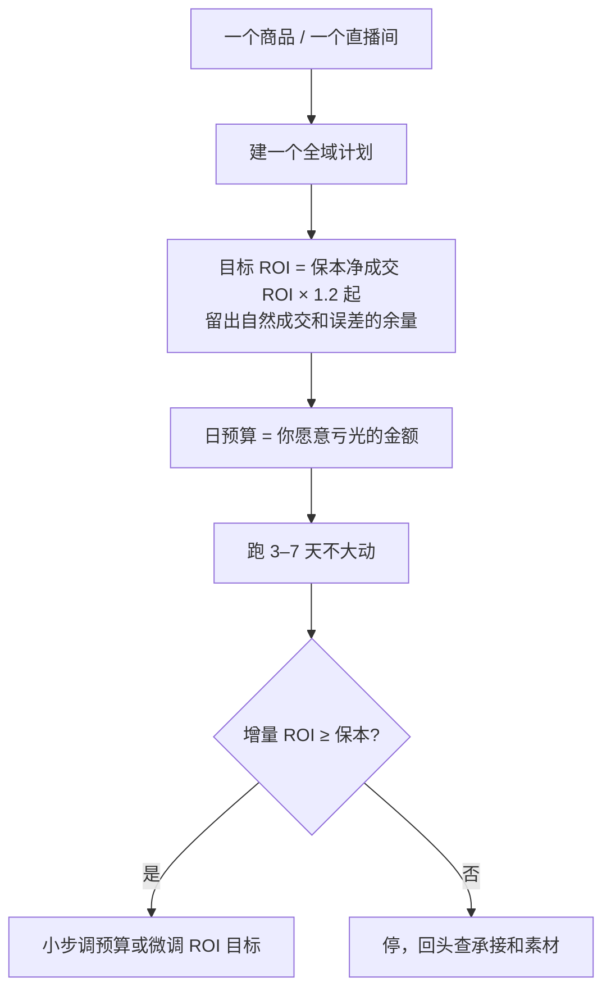

# 巨量千川与随心推：抖音电商投流

在抖音上带货、卖课、做直播，投流用的是巨量千川体系：PC 端的巨量千川后台，以及手机端的「小店随心推」。和 DOU+ 不同，它们优化的是**成交**，可以按 ROI 设目标，花的每一分钱都应该能对上一笔订单。

这一章讲 2025–2026 年千川最大的变化（全域推广与净成交 ROI）、个人和小团队怎么用、计划怎么搭、素材怎么准备、怎么看数据和止损。直播间的话术、排品见[《直播实战》](../live-streaming/)，选品和佣金见[《带货与选品》](../ecommerce-selling/)。

> [!WARNING]
> 千川变化很快，网上大量「2026 最新攻略」来自代运营和卖课机构，数字互相矛盾。本章只采用巨量千川帮助中心公开的文档标题和日期、以及多个来源一致的说法，服务商文章里的具体数字（预算建议、调价间隔、赔付比例）标为「第三方说法」；查询时间 2026-11-03，**以千川后台和巨量千川帮助中心的最新文档为准**。

## 2025–2026 年的变化：全域推广成为主流

> [!WARNING]
> 「标准推广下线」的时间各家说法不一（2025-05-22 推商品、2025-12-29 全面下线），2026 年 11 月在巨量千川帮助中心、规则中心和抖音电商学习中心都没有找到对应的下线公告原文，只有媒体转述的官方升级计划；以巨量千川后台新建计划页和帮助中心的产品公告为准。

标准推广被全域推广取代，是一个分步发生的过程，不同来源给的时间点不同：

- **2025-03**：品玩、动点科技等报道（2025-03-18）巨量千川宣布当年内完成「推商品客群 100% 升级使用商品全域推广」，并上线从标准推广迁移到全域推广的搬家工具（出处 [6]）。这是能找到的、最接近官方口径的说法，范围只说了推商品
- **2025-05**：蝉妈妈发在亿邦动力的文章（2025-05-07）称 5 月 22 日起不再支持「推商品-标准推广」的计划操作，没有引用通知原文（出处 [7]）
- **2025-12**：一篇 2026 年的搜狐文章称 2025 年 12 月 29 日起标准推广下线、全域推广成为新建计划的唯一入口（出处 [1]、[2]）

所以能确定的是方向，不能确定的是某一天：**推商品已经以全域推广为主，标准推广在新建计划里基本看不到**；推直播是否还有标准推广入口、老计划还能不能跑，看你自己后台的新建计划页。巨量千川帮助中心的文档列表也印证了这个方向：随心推有「全域投放-推商品」「全域投放-推直播」的产品手册（2026-09-28），「全域推广净成交出价」升级指南（2026-05-14），以及 2025-11-05 更新的《巨量千川"全域推广"服务协议》（出处 [3]）。同时规则中心里仍挂着「标准投放」的成本保障规则，说明标准投放这个名字没有从所有规则里消失。

两种模式的核心区别：

| | 标准推广（旧） | 全域推广（新） |
|---|---|---|
| 你控制什么 | 定向、出价、素材、预算、多个计划 | 主要是目标 ROI 和预算 |
| 系统优化什么 | 广告流量里的转化 | 店铺 / 直播间整体成交，广告流量与自然流量统一调度 |
| ROI 怎么算 | 广告带来的成交 ÷ 消耗 | **整体**成交（含自然成交）÷ 消耗；当前主流为净成交 ROI |
| 计划结构 | 多计划、多定向测试 | 一个商品 / 直播间一个计划为主 |

**净成交 ROI** 的定义在多个来源中一致：

$$
\text{净成交 ROI} = \frac{\text{成交金额} - \text{退款金额}}{\text{广告消耗}}
$$

也就是第 2 章说的「净成交口径」。这对商家是好事——退款不再让 ROI 虚高；但也意味着**你的保本线必须按净成交口径算**。

### 全域 ROI 包含自然成交，保本线要更严

全域推广把自然成交也算进分子。假设一个直播间不投流时每天也有 2,000 元自然成交，开了全域推广后日成交 8,000 元、消耗 2,000 元：

- 后台全域 ROI = 8,000 ÷ 2,000 = 4
- 但如果投流真正带来的增量只有 6,000 − 2,000 = 4,000 元（自然部分里也可能有一部分被广告「接管」），**增量 ROI 只有 2**

所以用全域推广时，要额外看**增量**：对比投流前后同类时段的总成交，或者按第 8 章的方法隔天开关对比。目标 ROI 不能直接设成第 2 章算出的保本 ROI，而应该在保本 ROI 之上留出余量，余量大小取决于你的自然成交占比。

一个简化的估算：设投流前日均自然净成交为 $N$，投流后日总净成交为 $T$、日消耗为 $S$：

$$
\text{增量 ROI} \approx \frac{T - N}{S}
$$

增量 ROI 要高于保本净成交 ROI 才是真赚钱。这个估算忽略了季节、选品变化等因素，只用于粗判；数据越多越准。

## 个人和小团队能用什么

| 产品 | 入口 | 适合谁 | 特点 |
|---|---|---|---|
| 小店随心推 | 抖音 App 内 | 有橱窗或小店的达人、小商家 | 手机下单、金额小、操作简单，由系统托管；同样在往全域 / 净成交出价升级（出处 [3]） |
| 巨量千川（PC） | 千川后台 | 有一定预算、要精细管理多个商品 / 直播间 | 计划管理、数据报表、素材管理更完整 |

开通千川需要抖店或达人带货权限，具体资质和开户流程见千川帮助中心。起投金额网上说法不一（有说日预算 300 元起，有说建议首充 3,000 元），都是第三方说法（出处 [2]、[4]），以后台为准。

副业起步建议从随心推开始：金额小、能在手机上随时停。等你搞清楚了自己商品的转化数据，再考虑千川 PC 端。

## 投之前：三件准备

### 1. 算保本净成交 ROI

用第 2 章的保本计算表，每个要投的商品算一行。没算出来之前不要开计划。

服务商文章里流传一个净成交 ROI 目标公式，把毛利率、复购率、退款率和目标盈利比放在一起（出处 [5]）。它的思路和第 2 章一致，但把复购也算进当期，会让目标偏松。建议先用第 2 章的「首单保本」，有复购数据后再调整。

### 2. 承接过关

全域推广「控结果」：系统按成交来分配流量。商品详情页、价格、评价、直播间话术接不住，系统给的量就会越来越少。投之前检查：

- 商品主图、详情页能在 3 秒内说清卖点
- 评价区没有集中的差评（尤其是质量、发货问题）
- 价格在同类商品里有竞争力
- 直播间：主播在开播前 30 分钟能稳定讲品，有固定的讲解节奏

### 3. 素材准备

短视频带货的素材（推商品）质量决定 CTR。小团队的素材来源：

| 来源 | 说明 |
|---|---|
| 自己拍的带货视频 | 主力；按[《短视频脚本与分镜》](../video-script-storyboard/)的结构写 |
| 直播切片 | 讲解效果好的片段剪出来；要确认切片内容和商品信息一致 |
| 自然流量跑出来的视频 | 自然数据好的视频，优先作为投流素材 |

素材要合规：不夸大功效、不用无授权的音乐和画面、价格和优惠信息与实际一致。合规细节见[《自媒体与短剧合规财税》](../media-compliance/)。**不要准备「审核版」和「投放版」两套内容**——这是规避审核，被发现会处罚账户。

## 计划怎么搭

全域推广的计划结构比标准推广简单很多：服务商文章普遍提到「一个计划包揽全场」，之前多计划测试的做法不再适用（出处 [5]）。对小预算的实际做法：

「× 1.2」是本书给的起点，不是平台规则。自然成交占比越高，余量要越大。

### 调整的节奏

第三方经验里关于调价的说法比较一致：

- 冷启动期不要频繁改。服务商普遍建议前几天不动计划，每天改价不超过 1–2 次（出处 [2]、[4]）
- 每次调 ROI 目标幅度小一点，比如 5%–10%（快手磁力金牛的官方白皮书也有类似建议，见第 7 章）
- 部分来源提到千川有「成本保障」类规则：在规定次数内修改出价和定向，实际成本超出目标一定比例时可获赔付。但不同文章对次数、比例的描述互相矛盾（出处 [4]），**以后台和帮助中心的赔付规则为准**，不要依赖二手说法

为什么不能频繁改：系统每次改价都要重新探索人群，改得越勤，越难稳定。你看到的「今天 ROI 掉了」往往只是正常波动。判断要看 3 天以上的累计数据。

## 和直播配合

直播间投流（推直播）和短视频带货（推商品）的节奏不同：

| | 推商品（短视频） | 推直播 |
|---|---|---|
| 数据周期 | 天 | 场 |
| 主要看 | 净成交 ROI、CTR、商品点击率 | 进房成本、停留时长、成交密度、净成交 ROI |
| 调整时机 | 每 2–3 天 | 场后复盘，下一场再调 |
| 风险 | 素材衰减 | 主播状态、排品节奏 |

推直播的几个要点：

- **开播先拉人再投**：开播前 10–20 分钟用自然流量和预热视频拉基础人气，等讲品节奏稳定了再加投放
- **讲品高峰时投放效率最高**：主力款讲解时进来的人最容易成交。过款、闲聊时段可以降预算
- **场后看分时段数据**：哪个时段 ROI 高、对应在讲什么、谁在讲，记进复盘表（第 10 章）

直播间的进房成本、停留、成交密度这些指标的完整定义见《直播实战》。

## 看数据

千川后台的报表比 DOU+ 详细得多，一般支持下载（以后台功能为准）。每天要看的字段：

| 字段 | 读法 | 警戒信号 |
|---|---|---|
| 消耗 | — | 预算没花完：可能 ROI 目标设得太高，或承接差 |
| 净成交金额 | 扣除退款 | 和支付金额差距在扩大：退款率在上升 |
| 净成交 ROI | 全域口径，含自然成交 | 低于保本 × 1.2 连续 3 天 |
| 退款率 | 退款金额 ÷ 成交金额 | 比历史高很多：查商品或发货问题 |
| CTR（素材） | 点击 ÷ 展现 | 主力素材 CTR 连续下滑：素材衰减，准备新素材 |
| 商品点击转化率 | 成交订单 ÷ 商品点击 | 下降：查价格、评价、详情页 |
| 投流前后日总净成交 | 自己算 | 增量 ROI 低于保本 |

退款是滞后的：今天的订单可能一两周后才退。所以看「今天」的净成交 ROI 也会偏高，第 9 章的看板会对此做处理（按订单日期回填退款）。

## 止损规则

在开计划之前写下来：

1. **单日止损**：当天消耗达到 X 元，净成交 ROI 仍低于保本 → 当天停
2. **累计止损**：连续 3 天增量 ROI 低于保本 → 停计划，复盘
3. **总额止损**：这个商品累计亏损（按第 2 章单位贡献算）达到 Y 元 → 不再投这个商品
4. **退款异常**：退款率比过去 30 天平均高出 50% 以上 → 先停投查原因

X、Y 用你的承受能力定。止损规则的完整设计方法见第 8 章。

## 常见坑

- **用支付 ROI 的保本线去对净成交 ROI 的目标**：口径混用，见第 2 章
- **看到全域 ROI 很高就加预算**：可能大部分是自然成交，增量很小
- **冷启动期频繁改价**：系统一直在重新学习，数据永远不稳定
- **素材只有一条**：主力素材衰减后没有接替，量会断崖下跌。保持每周补新素材
- **低毛利商品硬投**：利润率 20% 的商品保本 ROI 是 5（第 2 章），全域推广也救不了
- **买课程学「黑科技」**：所谓的「卡审核」「起号秘籍」多半是规避平台规则的做法，账户风险很高

## 本章出处

查询时间均为 2026-11-03，第 6、7 条为 2026-11-04 补查。

1. 搜狐《新一轮流量洗牌开始了，千川标准计划下线……》（第三方，提到 2025-12-29 标准推广下线）：[搜狐](https://m.sohu.com/a/961000068_254058/)
2. 新浪《2026 年千川投流完整攻略》（第三方）：[新浪](https://k.sina.com.cn/article_7857201856_1d45362c001905aero.html)
3. 巨量千川帮助中心（小店随心推相关文档标题与日期）：[巨量千川帮助中心](https://qianchuan.jinritemai.com/help/mobile/?pageId=221&spaceId=122)、[小店随心推帮助中心](https://support.oceanengine.com/support/?spaceId=185&visitor_source=help_main_site)
4. 搜狐《巨量千川全域推广 ROI 设置完全指南：2026 新规下的投放策略》，2026-07-05，服务商内容：[搜狐](https://www.sohu.com/a/1046115920_122920010)
5. 数英，互动派科技（服务商）关于全域推广与净成交 ROI 的文章，2026-02-04：[数英](https://www.digitaling.com/articles/1460556.html)
6. 品玩《巨量千川推商品或将只能使用商品全域推广 建议商家尽快迁移》，2025-03-18：[品玩](https://www.pingwest.com/a/303168)
7. 亿邦动力《千川「标准推广」5 月下线！》，蝉妈妈创意，2025-05-07，作者观点文章：[亿邦动力](https://m.ebrun.com/578944.html)

## 本章要点

- 千川在 2025–2026 年转向**全域推广 + 净成交 ROI**，推商品的标准推广已基本退出；具体下线日期各家说法不一，没找到官方公告原文
- 净成交 ROI =（成交 − 退款）÷ 消耗；保本线按净成交口径算
- 全域 ROI 含自然成交，要额外看**增量 ROI** ≈（投后日成交 − 投前日自然成交）÷ 消耗
- 副业从小店随心推起步，一个商品一个计划，目标 ROI 在保本之上留余量
- 冷启动期少改价，每次小幅调整，看 3 天以上累计数据
- 推直播在讲品高峰投，场后按分时段数据复盘
- 开计划前写好单日、累计、总额、退款异常四条止损线
