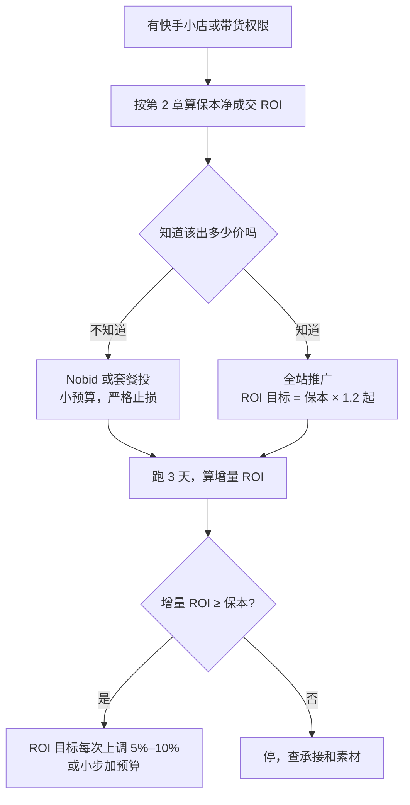

# 快手粉条与磁力金牛

快手的投流产品和抖音一一对应：**粉条**是作品推广（内容加热），对应 DOU+；**磁力金牛**是电商广告，对应巨量千川，也在往「全站推广」（相当于千川的全域推广）方向走。快手的用户和内容风格与抖音有差异（下沉市场占比高、老铁关系、直播带货文化更重），生态差异见[《抖音与快手》](../douyin-kuaishou/)。

这一章不再重复第 3、4 章讲过的通用做法（目标选择、保本线、计划节奏、止损），只讲快手的不同之处。

## 先说清楚：本章的平台信息从哪来

查询时间 2026-11-03。快手是本书五个平台里公开资料最少的：粉条的起投金额、目标选项、计费细节没有查到官方文档，只有零星第三方说法；磁力金牛的信息来自一份 2026 年的《磁力金牛投放实战白皮书》转载（转载方是服务商）和 2026 年快手电商商家大会的报道。**以快手 App 内作品推广页和磁力金牛后台为准。** 本章的不确定之处比前几章多，读的时候请留意标注。

## 粉条：作品推广

### 能确定的

- 粉条是快手 App 内的作品推广工具，个人可用，可以给短视频和直播间加热
- 有第三方文章称粉条起投 100 元（出处 [1]），未见官方确认

### 没能确认的

本次查询没有找到粉条当前版本的目标选项、时长选项、是否用快币支付、充值比例和审核规则的可靠说明。可以推测它和 DOU+ 类似（播放、涨粉、互动、直播间人气等目标，系统自动出价），但这是推测，**下单前在 App 里逐项看清楚**。

### 怎么投

方法完全沿用第 3 章：

1. 只投自然数据过线的作品（完播、互动 ≥ 账号近 30 条中位数）
2. 第一单用最低档，目标选你真正要的动作，定向先用系统推荐
3. 结果拆成付费部分和自然增量，按第 9 章字段记录
4. 追投每次 1.5–2 倍，看边际 CPA

快手的一个特殊点是**老铁关系**：快手的粉丝黏性和私信互动通常被认为强于抖音（这是行业的普遍说法，未见量化来源）。如果你的变现依赖直播和粉丝复购，涨粉目标在快手可能更值得投——但还是要用第 2 章的粉丝价值估算去验证，而不是凭印象。

## 磁力金牛

### 是什么

磁力金牛是快手的电商广告平台，面向快手小店商家和带货达人，优化目标是成交和 ROI。第三方资料称它支持 CPC、CPM、OCPM 等计费方式（出处 [1]、[2]）。

### 全站推广

和千川的全域推广一样，快手也在推「全站推广」：覆盖直播和商品两类（白皮书里称「全站直播推广」和「全站商品推广」），支持搜索抢首屏、全店托管等功能（出处 [3]）。2024 年快手对磁力金牛和全站推广做过改版，据报道全站推广的客户渗透增长了 4.9 倍、消耗增长了 3.6 倍（出处 [1]，引自快手电商发布会）。

**全站推广的 ROI 和千川全域一样包含自然成交**，第 4 章讲的增量 ROI 估算在这里同样适用：

$$
\text{增量 ROI} \approx \frac{T - N}{S}
$$

$T$ 是投流后日总净成交，$N$ 是投流前日均自然净成交，$S$ 是日消耗。

### 白皮书里的几个官方说法

以下来自 2026 年 1 月转载的《2026 磁力金牛投放实战白皮书》（出处 [3]）。转载方是服务商，下面只列白皮书里的产品描述部分，转载方自己的建议另行标注：

| 说法 | 对你的意义 |
|---|---|
| 智能出价产品 Nobid：只设预算和投放时长，不设成本（出价） | 适合不知道该出多少价的新手；但你失去了对单个转化成本的控制，必须靠止损线兜底 |
| 全站 ROI 计划的 ROI 目标可以逐步上调，建议每次上调 5%–10%，尽量在夜间小流量时段调整 | 和第 4 章的小步调整原则一致 |
| 「套餐投」：面向小额多笔投放，先付预算，可用优惠券 | 小预算可用 |
| 新品有专属流量扶持，全站商品推广场景下新品冷启动有流量倾斜 | 新上架商品可以留意冷启动期的数据 |

转载方额外给出的建议（如冷启动前 2 小时出价高于行业均价 20%、日预算参考近 7 日消耗的 1.2 倍、预算大于 10 个客单）属于服务商经验，没有平台依据，不建议照搬。

### 2026 年的变化

据 2026 年快手电商商家大会的报道（出处 [4]）：

- 磁力金牛的出价决策升级为「多维智能决策」，综合历史数据、当日流量趋势和场域定价预测出价策略，目标是在保障全天 ROI 的前提下扩大跑量
- 流量排序从单一价值升级为「经营 + 投流」双价值：经营指标好的商家（如 GPM 高）也可能获得广告流量倾斜

第二条的意思是：**快手也在往「承接好的商家拿到更便宜的量」方向走**。和千川一样，商品、价格、评价、直播间承接比投放技巧更重要。

### 小预算怎么用

用 Nobid 这类「只设预算」的产品时，止损线是唯一的成本控制手段。开计划前写下：

- 单日：消耗达到当日预算的一半时，如果还没有成交或 ROI 低于保本的一半，当天停
- 累计：3 天增量 ROI 低于保本，停计划

## 快手和抖音同时做时

很多带货的副业会两个平台都做。同一商品在两个平台的保本线不一样，因为平台扣点、退款率、客群都可能不同：

| 字段 | 抖音 | 快手 |
|---|---|---|
| 平台扣点 $f$ | 查抖店结算明细 | 查快手小店结算明细 |
| 退款率 $r$ | 各自历史数据 | 各自历史数据 |
| 保本净成交 ROI | 分别算 | 分别算 |

**不要用一个平台的保本线去管另一个平台的计划**。第 9 章的看板按「平台 × 商品」分行，就是为了这个。

## 一份快手投放计划表

假设你在快手卖一款自有品牌的小商品，同时在抖音也有销售。先按第 2 章分别算两个平台的保本线（下表的扣点和退款率是演示用的假设值，用你自己店铺后台的数据替换）：

| 字段 | 抖音 | 快手 |
|---|---|---|
| 成交价 $P$ | 79 | 79 |
| 平台扣点 $f$ | 5% | 5% |
| 商品成本 + 运费 $C + s$ | 32 | 32 |
| 退款率 $r$ | 12% | 18% |
| 退款额外损失 $d$ | 8 | 8 |
| 单位贡献 $c$ | 36.92 | 33.86 |
| 保本支付 ROI | 2.14 | 2.33 |
| 保本净成交 ROI | 1.88 | 1.91 |

算法：$c = (1-r)[P(1-f) - C - s] - rd$。抖音：$0.88 \times (75.05 - 32) - 0.96 \approx 36.92$；快手：$0.82 \times 43.05 - 1.44 \approx 33.86$。

同一个商品，只是退款率不同，保本支付 ROI 就差了约 0.2。这就是为什么不能混用两个平台的保本线。

然后写第一周的计划：

| 项 | 内容 |
|---|---|
| 产品 | 全站商品推广（若后台提供 Nobid，先用 Nobid 小额探一下成本水平） |
| 目标 ROI | 保本净成交 ROI 1.91 × 1.2 ≈ 2.3 |
| 日预算 | 150 元（按自己承受能力） |
| 投前基准 | 过去 14 天日均自然净成交 $N$ |
| 观察期 | 3 天不改设置 |
| 止损 | 单日消耗过半仍零成交当天停；3 天增量 ROI < 1.91 停 |
| 放量规则 | 增量 ROI ≥ 2.3 且累计成交 ≥ 20 单，ROI 目标或预算按 5%–10% 小步调整 |
| 记录 | 按第 9 章字段，平台写快手，工具写磁力金牛 |

## 直播间用粉条拉人气怎么算

快手带货直播很普遍，用粉条给直播间加热是常见做法。加热直播间买到的通常是「进入直播间的人」，它的价值取决于后面的成交：

$$
\text{每个进房的价值} = \text{进房到成交的转化率} \times c
$$

如果历史场次里，每 100 个进房的观众平均成交 1.5 单，$c = 33.86$ 元，那么每个进房的价值约 0.51 元，粉条拉一个进房的成本超过 0.5 元就不划算。

这只是粗算：进房的人质量差异很大，加热来的观众停留时长、互动可能都不如自然进入的观众，场后要单独比较加热时段和非加热时段的成交密度。直播间指标的完整定义和复盘表见[《直播实战》](../live-streaming/)。

## 常见坑

- **照搬抖音的打法**：快手的用户习惯、内容风格不同，抖音跑通的素材在快手不一定成立，要单独测
- **用 Nobid 不设止损**：系统只保证花完预算，不保证你赚钱
- **相信服务商的「出价公式」**：比如「出价高于行业均价 20%」——你根本不知道行业均价是多少，这类建议没法验证
- **只看全站 ROI**：包含自然成交，要算增量

## 本章出处

查询时间均为 2026-11-03。

1. 简书等第三方文章（粉条起投、磁力金牛计费方式）及快手电商 2025 年发布会相关报道：[简书](https://www.jianshu.com/p/c5aeea4a679f)、[亿邦动力](https://www.ebrun.com/20250403/576568.shtml)
2. 《2025 快手磁力金牛起量指南》（第三方）：[kuai-ad.com](https://www.kuai-ad.com/jd/9063.html)
3. 《2026 磁力金牛投放实战白皮书（上）》，2026-01-12 转载，转载方为服务商：[kuai-ad.com](https://www.kuai-ad.com/zixun/10160.html)
4. DoNews 关于快手电商 2026 商家大会、磁力金牛增长引擎的报道：[DoNews](https://www.donews.com/news/detail/4/6528735.html)

## 本章要点

- 粉条对应 DOU+，磁力金牛对应千川，全站推广对应全域推广
- 粉条的公开规则很少，第三方称 100 元起投，目标、支付、审核细节以 App 为准
- 全站推广 ROI 含自然成交，用增量 ROI 判断
- 白皮书说法：Nobid 只设预算和时长；ROI 目标每次上调 5%–10%；新品有冷启动扶持
- 2026 年快手的流量排序加入「经营价值」，承接好的商家更占优
- 两个平台分别算保本线，不混用
