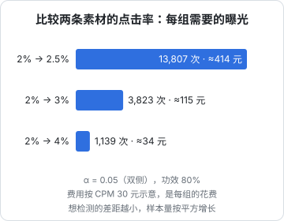
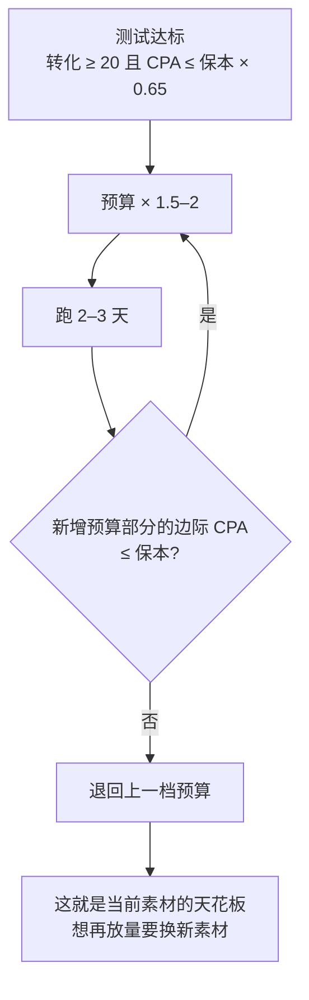

# 小预算测试：变量、样本量、止损线

投流最贵的不是消耗，而是**从噪声里得出错误结论**：投了两单 100 元，一单出了 3 个订单、一单出了 1 个，于是认定「素材 A 比 B 好三倍」，然后把 2,000 元全压在 A 上。小预算下数据很少，偶然性很大，测试方法比大预算时更重要。

这一章讲怎么设计一次测试：比什么、一次改几个变量、要多少数据才能下结论、什么时候止损、怎么判断投流带来的是增量。统计学的推导在[《数据分析与埋点》第 6 章](../product-analytics/06-ab-testing.md)，这里只讲在投流里怎么用。

## 一次测试只改一个变量

一个投放计划有很多可变的东西：

| 层 | 变量 |
|---|---|
| 内容 | 素材（视频 / 笔记本身）、开头 3 秒、封面、标题 |
| 投放设置 | 目标、定向、时长、出价 / ROI 目标、预算 |
| 承接 | 商品价格、详情页、直播间话术、私信回复 |
| 外部 | 日期（工作日 / 周末）、时段、平台大促 |

两个计划同时改了素材和定向，结果不同，你不知道是哪个造成的。所以：

- **每次比较只改一个变量**，其余全部相同
- **外部变量用「同时投」来控制**：两个计划同一时间开始、同样时长、同样预算，日期和时段的影响就相互抵消了
- **测试顺序：先测影响最大的**。一般来说素材 > 目标 > 定向 > 时长。素材好坏对 CTR 的影响常常是倍数级的，定向的微调通常只有几个百分点

### 各平台能怎么做 A/B

平台自带的 A/B 测试功能不一定对个人号开放。没有的时候，手动做：

| 平台 | 手动 A/B 的方式 |
|---|---|
| DOU+ / 粉条 / 薯条 / 视频号加热 | 同一时间给两条视频（或同一条视频的两种设置）各下一单，金额、时长相同 |
| 千川 / 磁力金牛 / 聚光 | 两个计划同时开，同预算、同出价，只差一个变量 |
| 直播间 | 难以同时对比，只能隔场对比，干扰因素多，结论要更保守 |

注意「同一条视频的两个订单」会互相影响（同一条视频，自然流量混在一起），比较素材时用两条不同的视频，比较设置时尽量用同一条视频的不同时段。

## 要多少数据才能下结论

### 比较点击率：看曝光数

点击率的样本量可以用第 6 章的双比例公式算。假设当前素材的 CTR 是 2%，想知道新素材能不能做到更高：

读法：

- 想分辨 2% 和 3% 这种「好一半」的差别，每组要约 3,800 次曝光，按 CPM 30 元算每组约 115 元
- 想分辨 2% 和 2.5% 这种「好四分之一」的差别，每组要约 1.4 万次曝光、约 414 元
- **小预算只能检测大差别**。这其实没关系：小预算阶段，你要找的就是「明显更好」的素材，差 10% 的优化留给预算大了以后

CPM 30 元只是示意，代入你自己的 CPM。计算函数在《数据分析与埋点》第 6 章，`sampleSizePerGroup(0.02, 0.5)` 就是第二行的结果。

### 估算 CPA：看转化数

成交、关注、私信这类转化数量少，算出来的 CPA 波动很大。转化数近似服从泊松分布，观察到 $n$ 个转化时，真实 CPA 的 95% 区间大约是观察值的：

| 观察到的转化数 | 真实 CPA 大约在观察值的 | 读法 |
|---|---|---|
| 5 | 0.43–3.08 倍 | 基本没法判断 |
| 10 | 0.54–2.09 倍 | 只能排除特别差或特别好 |
| 20 | 0.65–1.64 倍 | 能做粗略判断 |
| 30 | 0.70–1.48 倍 | 可以用来做决策 |
| 50 | 0.76–1.35 倍 | 比较可靠 |
| 100 | 0.82–1.23 倍 | 可靠 |

（按泊松分布的精确置信区间计算。）

举例：花 500 元出了 10 单，观察 CPA 是 50 元。真实 CPA 可能低到 27 元，也可能高到 105 元。如果你的保本 CPA 是 42 元，**这 10 单既不能证明赚钱，也不能证明亏钱**。

由此得到两条实用规则：

1. **决定「放量」至少要 20–30 个转化**，并且观察 CPA 比保本 CPA 低足够多（比如观察 CPA ≤ 保本 CPA × 0.65，那么即使真实值在区间上限也大致不亏）
2. **转化太贵、凑不够 20 个时，换一个更靠前的指标做测试**：比如测素材时先比 CTR 和商品点击率（样本多），选出胜者后再看成交

## 止损线：花多少钱还没转化就该停

最常见的问题：已经花了 150 元，一单都没出，要不要再等等？

如果这个计划的真实 CPA 恰好等于你的保本 CPA $c$，那么花掉 $k \cdot c$ 元时一单都没有的概率约为 $e^{-k}$：

| 已花费 | 一单没有的概率（若真实 CPA = 保本） | 结论 |
|---|---|---|
| 1 × 保本 CPA | 37% | 很正常，继续 |
| 2 × 保本 CPA | 14% | 可疑 |
| 3 × 保本 CPA | 5% | 大概率比保本差，停 |

所以第一条止损线可以这样定：**花费达到 3 倍保本 CPA 仍零转化，停**。保本 CPA 42 元的商品，花到约 126 元还没出单就停。

完整的止损规则表，开计划前填好：

| 规则 | 条件 | 动作 |
|---|---|---|
| 零转化止损 | 花费 ≥ 3 × 保本 CPA 且转化 = 0 | 停这个计划 |
| 前段止损 | CTR 低于账号历史中位数的一半，且曝光已超过 2,000 | 停，换素材（素材不行，不必等转化） |
| 成本止损 | 转化 ≥ 10 且观察 CPA ≥ 保本 CPA × 2 | 停 |
| 单日止损 | 当日消耗达到日预算，ROI 低于保本 | 当天停 |
| 测试总额 | 这一轮测试累计亏损达到预设金额（比如 500 元） | 整轮停，复盘 |

数字（3 倍、2,000 曝光、10 个转化、2 倍）是本书根据上面的统计算出或给出的起点，不是平台规则。你可以按承受能力调整，但**必须在开始前写下来**——开始以后再定，几乎一定会因为「再等等说不定就好了」而越亏越多。

## 放量规则

测试结果达标后，加预算也要有规则：

**边际 CPA** 的算法：

$$
\text{边际 CPA} = \frac{\text{加预算后的消耗} - \text{加预算前的消耗}}{\text{加预算后的转化} - \text{加预算前的转化}}
$$

例：日消耗 200 元出 6 单（CPA 33），加到 400 元后出 9 单。平均 CPA 是 44，看起来只涨了一点；但新增的 200 元只多出 3 单，**边际 CPA 是 67**，远高于保本 42。应该退回 200 元。

## 增量测试：投流到底多带来了多少

全域 / 全站推广的 ROI 含自然成交（第 4、7 章），内容加热的数据也混着自然流量。判断增量的简单方法：

### 开关对比（时间切分）

按天交替开关投流，比如连续两周，单日投、双日不投（或反过来，避免星期几的影响，可以用随机顺序）：

$$
\text{增量 ROI} \approx \frac{\overline{T}_{\text{投}} - \overline{T}_{\text{不投}}}{\overline{S}_{\text{投}}}
$$

$\overline{T}$ 是日均净成交，$\overline{S}$ 是投流日的日均消耗。

缺点：投流有滞后效应（今天的曝光，明天才有人下单），会让增量被低估一些。数据少时结论粗糙，但比完全不做好。

### 前后对比

最简单，也最不可靠：投流前两周日均成交 vs 投流期间日均成交。季节、热点、你自己内容的变化都会混进去。只用于「数量级判断」——增量 ROI 是 1 还是 3，而不是 2.3 还是 2.5。

## 一份测试计划表

每轮测试开始前填好，结束后填结论：

| 字段 | 示例 |
|---|---|
| 测试编号 | T-2026-11-01 |
| 平台 / 产品 | 抖音 / 小店随心推 |
| 要回答的问题 | 新开头（直接展示使用效果）是否比旧开头（先讲痛点）CTR 更高 |
| 变量 | 素材开头（其余全同） |
| 对照组 / 实验组 | 视频 A（旧开头）/ 视频 B（新开头） |
| 主要指标 | CTR；次要：商品点击率、成交 |
| 最小样本 | 每组 3,800 曝光（检测 2% → 3%） |
| 预算 | 每组 150 元，同时开始，同样时长 |
| 止损线 | 每组 CTR < 1% 且曝光 > 2,000 停；任一组花费 > 3 × 保本 CPA 零成交停 |
| 判断规则 | 实验组 CTR 显著更高（双比例检验 p < 0.05）→ 后续素材用新开头 |
| 结果 | （结束后填） |
| 结论与下一步 | （结束后填） |

把「判断规则」写在前面，是为了防止事后找理由：看到结果再定标准，总能找到支持自己想法的那一个。

## 常见坑

- **同时改多个变量**：结果没法解释
- **两个计划不同时间投**：日期、时段的影响混进来
- **看几单就下结论**：10 个转化的 CPA，真实值可能是观察值的一半到两倍
- **零转化一直等**：花到 3 倍保本 CPA 还没转化，继续等的期望是亏
- **用平均 CPA 判断加预算**：要看边际 CPA
- **测试中途改设置**：改了就是新测试，前面的数据作废
- **测了不记**：同一个错误重复犯。每次测试按上表留档

## 本章要点

- 一次只改一个变量，对照组和实验组同时投、同预算同时长
- 先测影响大的变量：素材 > 目标 > 定向 > 时长
- CTR 比较按双比例公式算样本：2% → 3% 每组约 3,800 次曝光；小预算只能检测大差别
- 10 个转化的 CPA 真实值在观察值的 0.54–2.09 倍之间，放量前至少攒 20–30 个转化
- 零转化止损：花费达到 3 倍保本 CPA 仍无转化（若真实 CPA 等于保本，这种情况只有 5% 概率），停
- 加预算看边际 CPA；全域 / 全站类产品用开关对比估算增量
- 止损线和判断规则必须在开始前写下来
