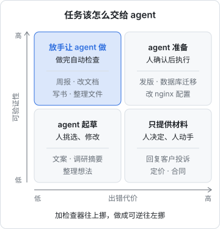

# 把工作拆成 agent 能接的活

很多人用编码 agent 写了几个月代码，却很少让它碰写代码以外的事。不是 agent 做不到，而是这些活还没被**整理成 agent 能接的形状**：输入散在脑子里，结果好坏全凭感觉，做错了也不知道怎么撤回。这一章先讲清这本书讲什么，再给出一套判断和拆分任务的方法，后面每一章都会反复用到它。

## 这本书讲什么

[《编码 Agent 实战》](../coding-agents/)讲的是让 agent 写代码：CLAUDE.md、rules、hooks、子 agent、评审与测试。这本书接着往外走，看 agent 在一个独立开发者的日常里还能接哪些活：

| 章 | 主题 | 典型的活 |
|---|---|---|
| 1 | 拆活 | 判断一件事该不该交给 agent，怎么写成任务 |
| 2 | 日常自动化 | 周报、整理文件、批量改写、把重复的 prompt 沉淀成 skill |
| 3 | 个人知识库 | 用一个 Markdown 目录 + agent 当管理员 |
| 4 | 定时任务 | 用 launchd / systemd 让 agent 在你不在时干活 |
| 5 | 写书 | 本书所在的书架就是 agent 写出来的，拆解它的真实流程 |
| 6 | 运维 | 让 agent 看日志、查故障、按手册操作，同时守住权限 |
| 7 | 迭代 | 记录、复盘、把失败修在正确的那一层 |

**适合谁**：已经在用 Claude Code 这类编码 agent、熟悉命令行和 Git、想让 agent 多分担一些事务性工作的人。不需要会写 agent 框架，原理部分见[《Agent 原理与设计》](../agent-principles/)。

**怎么读**：第 1 章和第 7 章是方法，建议先读；第 2–6 章是五类场景，彼此独立，挑眼下最痛的那一类读，读完马上在自己的项目里落一个。

书里的命令以 Claude Code 为例。Agent 工具迭代很快，具体参数、配置文件格式以你所用版本的官方文档为准；书里强调的是不随版本变化的做法。

## 什么样的活适合交给 agent

判断一件事适不适合交给 agent，看两个维度就够了：

- **可验证性**：结果对不对，能不能低成本地检查出来。能跑测试、能用脚本校验、看一眼就知道好坏，都算高
- **出错代价**：做错了损失多大、能不能撤回。在 Git 仓库里改文件是低代价；删生产数据库、给客户发邮件是高代价



四个象限对应四种交法：

| 象限 | 例子 | 交法 |
|---|---|---|
| 好验证、代价低 | 改文档、生成周报、重命名文件、写书 | 放手让 agent 做，做完自动检查 |
| 好验证、代价高 | 数据库迁移、发版、改 nginx 配置 | agent 准备，人确认后执行；或先在副本上演练 |
| 难验证、代价低 | 起草文案、整理想法、调研摘要 | agent 起草，人挑选和修改 |
| 难验证、代价高 | 回复客户投诉、合同条款、定价决策 | agent 只提供材料，决定和动作由人来做 |

这张表背后的逻辑是：**agent 的产出总会有一定比例出错**，问题不是能不能让它不出错，而是错了能不能被发现、能不能被撤回。好验证就能及时发现，代价低就能放心撤回。两者都不满足时，agent 只能当参谋。

### 往左上角挪

大部分活不是天生落在某个象限，而是可以通过改造挪过去：

- **提高可验证性**：给结果加一个检查器。写书有 `shelf-pack check`，代码有 `pnpm typecheck` 和测试，数据整理可以写个脚本核对行数和总额
- **降低出错代价**：让操作可逆。在 Git 仓库里干活、先写到草稿目录、先 `--dry-run`、先在副本上跑、只给只读权限

这两个动作是本书最常用的手法。第 5 章的写书流程和第 6 章的运维流程，本质上都是在把活往左上角挪。

## 一个 agent 能接的任务长什么样

一句「帮我整理一下下个月的报销」对人来说够用，对 agent 不够：它不知道票据在哪、按什么标准算、结果要什么格式、算完交给谁。一个能接的任务要说清五件事：

| 要素 | 问题 | 例子（月度报销） |
|---|---|---|
| 目标 | 做完是什么样 | 一份可以直接提交的报销清单 |
| 输入 | 材料在哪 | `~/Documents/receipts/2026-10/` 下的 PDF 和截图 |
| 产出 | 交付什么、放在哪 | `reimburse-2026-10.md`，按类别分表，带合计 |
| 约束 | 不能做什么 | 不改原始票据；拿不准的条目列出来，不猜 |
| 验收 | 怎么算做对了 | 条目数等于票据数；合计与各分表之和一致 |

写成 prompt 大致是这样：

```text
整理 2026 年 10 月的报销清单。

输入：~/Documents/receipts/2026-10/ 下的全部文件（PDF、截图）。
产出：在同一目录下写 reimburse-2026-10.md，按「交通 / 餐饮 / 住宿 / 其他」分表，
每行：日期、金额、事由、对应文件名；末尾写总合计。

约束：
- 只读原始文件，不改名、不移动
- 识别不清的金额或日期，单独列在「待确认」一节，不要猜

完成前自查：表格行数 + 待确认条数 = 文件数；各分表小计之和 = 总合计。
最后告诉我待确认的有几条。
```

注意最后两行：**让 agent 自己做验收**。agent 擅长按清单自查，你不写，它就不查。

### 验收条件是最重要的一行

五个要素里，最常被省略、也最值钱的是验收。它决定了：

1. agent 什么时候该停（达标了就停，而不是一直「优化」下去）
2. 你要不要逐行检查（验收能机器做，你只需看结论）
3. 这件事以后能不能无人值守（第 4 章的定时任务，前提就是验收能自动化）

一个经验：**如果你说不出怎么验收，这件事还没想清楚**，交给 agent 也只会得到一份看起来像样、实际不知道对不对的东西。

## 拆分的粒度

### 一次会话，一个交付物

agent 的上下文窗口是有限的，任务拖得越长，前面的约束越容易被淡忘，出错也越难定位。比较稳的粒度是：**一次会话产出一个可以独立验收的东西**。

| 太粗 | 合适 |
|---|---|
| 把我的知识库整理好 | 把 `inbox/` 下本周新增的笔记归档，并更新 `index.md` |
| 写一本 Agent 的书 | 按大纲写第 39 本书，产出 `books/personal-agent-workflow/` 并通过 check |
| 把服务器运维起来 | 查一下昨晚 API 5xx 升高的原因，只读，给出结论和建议命令 |

### 大活拆成流水线

真正大的活，拆成几个阶段，每个阶段的产出是下一个阶段的输入，并且落到文件里：


落到文件有三个好处：中途断了可以接着做；每个阶段可以换人（或换 agent）来做；出了问题能看到是哪一步错的。第 5 章会看到，这套书就是这样做的：`ROADMAP.md` 是规划，每本书由一个 agent 独立写，`shelf-pack check` 是检查，最后由人抽查后提交。

## 三种交接方式

拆完之后，每一步还要决定人和 agent 怎么分工：

| 方式 | agent 做什么 | 人做什么 | 适合 |
|---|---|---|---|
| 全自动 | 从头做到尾，包括检查 | 看结果或只看异常 | 左上象限、可以定时跑的 |
| 起草 + 审阅 | 产出草稿或待执行的命令 | 审阅、修改、批准 | 代价高或难验证的 |
| 人主导 | 查资料、算数、列选项 | 做决定、执行动作 | 右下象限、涉及对外承诺的 |

新的工作流一般从「起草 + 审阅」开始，跑顺了、审阅时几乎不改了，再升级成全自动。反过来，全自动的流程一旦出过一次你没发现的错，就降回「起草 + 审阅」。第 7 章会把这个升降级讲细。

## 先从哪件事开始

列一张清单，把你上周做过的、重复的、不涉及创造性判断的事写下来，每件估三个数：

| 事情 | 每次耗时 | 每月次数 | 能否写出验收 |
|---|---|---|---|
| 整理报销票据 | 40 分钟 | 1 | 能 |
| 写项目周报 | 20 分钟 | 4 | 能 |
| 看服务器日志有无异常 | 10 分钟 | 20 | 部分能 |
| 回复用户邮件 | 5 分钟 | 30 | 不能 |

（表中数字是举例，换成你自己的。）

优先挑「每月总耗时高」且「能写出验收」的。回复邮件虽然总耗时高，但验收写不出来、对外代价又高，适合放到最后，而且只让 agent 起草。

## 本章要点

- 用**可验证性**和**出错代价**两个维度判断一件事该怎么交给 agent
- 大部分活可以被改造：加检查器提高可验证性，加 Git、草稿目录、dry-run、只读权限降低出错代价
- 一个能接的任务要写清**目标、输入、产出、约束、验收**，其中验收最重要，并且让 agent 自己执行验收
- 粒度上，一次会话产出一个可独立验收的交付物；大活拆成落到文件的流水线
- 交接方式从「起草 + 审阅」起步，跑顺了再升级成全自动
