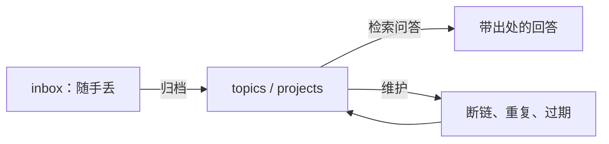
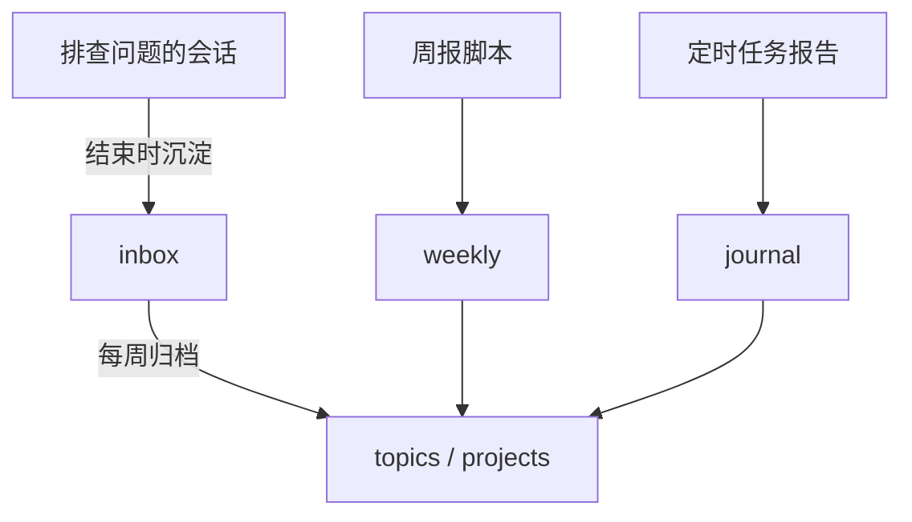

# 个人知识库

调研过的技术方案、踩过的坑、和客户聊出来的需求、读书时的想法，散在聊天记录、浏览器书签和脑子里，半年后基本找不回来。以前建知识库最大的成本是**维护**：归档、打标签、补链接，坚持不了几周。agent 恰好擅长这种活。这一章讲怎么用一个普通的 Markdown 目录加上 agent，搭一个自己真的会用下去的知识库。

## 为什么是 Markdown 目录

知识库软件很多，但给 agent 用，最好的格式是**一个放在 Git 里的 Markdown 目录**：

| 特性 | 好处 |
|---|---|
| 纯文本 | agent 用最基本的读写、搜索工具就能操作，不需要专门的插件或 API |
| 目录和文件名有意义 | 光看路径就能判断内容，agent 搜索时少走弯路 |
| Git 管理 | agent 每次改动都能 diff、能回滚，出错代价低 |
| 不绑定工具 | 换编辑器、换 agent 都不用迁移 |

这和 hatch-shelf 的原则是同一个思路：**文件即真相**。书架 App 里书籍原文只存在文件里，SQLite 只存可以重建的索引。知识库也一样：Markdown 文件是唯一的真相，任何索引、标签页、搜索库都应该能从文件重新生成，丢了也不心疼。

## 目录结构

结构不必复杂，关键是让新内容有一个固定的入口，让 agent 有明确的规则可循：

```text
~/notes/
├── CLAUDE.md          # 给 agent 的规则：目录含义、写法、禁止事项
├── index.md           # 总目录，由 agent 维护
├── inbox/             # 随手丢进来的原始材料，不讲究格式
├── topics/            # 按主题整理好的笔记，一个文件一个主题
├── projects/          # 每个项目一个目录：决策记录、调研、待办
├── journal/           # 按日期的流水：2026-11-02.md
└── weekly/            # 第 2 章的周报落在这里
```

`inbox/` 是整个系统能持续运转的关键：**记录时零门槛**，随便丢；整理的活交给 agent 定期做。人最容易放弃的环节是「记下来之前先想好放哪」，把这一步拿掉，就能坚持下去。

## 给知识库写一份 CLAUDE.md

在知识库根目录放一份规则文件，agent 每次进入这个目录都会读到它。它的作用跟代码仓库的 CLAUDE.md 一样：把你的约定写下来，而不是每次口头交代。

```markdown
# 个人知识库规则

## 目录
- inbox/：原始材料，处理完后删除原文件（Git 里有历史）
- topics/：一个文件一个主题，文件名用英文短横线，如 sqlite-wal.md
- projects/<项目>/decisions.md：决策记录，只追加，不改旧条目
- journal/：按日期流水，只追加

## 写法
- 每个 topics 文件开头一段话说清这个主题是什么、什么时候会用到
- 结论写在前面，过程和原始材料放后面
- 引用来源写名称和日期；不确定的内容标「待核实」
- 相关笔记用相对链接互相引用

## 禁止
- 不编造：inbox 里没有的信息不要补写
- 不删除 topics/ 下的文件；要合并时先列出方案让我确认
- 密码、密钥、身份证号等敏感信息不写进任何文件，发现了提醒我
```

最后一条很重要。知识库会被 agent 反复读取，里面的东西就会反复进入模型上下文。敏感信息应该放在密码管理器里，而不是笔记里。

## agent 在知识库里干的三种活



### 归档

每周一次，或者 inbox 攒多了的时候：

```text
处理 inbox/ 下的全部文件。对每个文件：
1. 判断它属于哪个已有的 topics 文件或项目；都不属于就新建一个 topics 文件
2. 把有价值的信息整理进去：结论在前，原始链接和出处放在末尾「来源」一节
3. 处理完删除 inbox 里的原文件

完成后：
- 更新 index.md
- 输出一张表：原文件 → 写进了哪个文件；新建了哪些文件
- 有拿不准归属的，不要删，列出来问我
```

归档时 agent 最容易犯的错是**过度概括**：把一段带具体命令和报错信息的记录总结成「解决了 SQLite 的锁问题」。在规则里写「保留具体命令、报错原文和版本号」，能避免这类信息损失。具体的东西才是将来真正要查的。

### 检索问答

知识库攒起来之后，最常用的反而是问：「之前那个 WebView 和 RN 通信的坑是怎么解决的？」agent 会用搜索工具在目录里找，读相关文件，再回答。

要求它**每个结论都附上出处文件路径**：

```text
在 ~/notes 里查一下：我之前在 Expo 项目里遇到过哪些 WebView 相关的问题，各自怎么解决的。
每条结论后面用括号写出处文件路径。笔记里没有的不要用你自己的知识补，直接说没找到。
```

「没有的不要补」这句不能省。不加这句，agent 会把通用知识和你的笔记混在一起，你分不清哪些是自己验证过的。

### 维护

知识库会自然腐烂：链接断掉、同一个主题写了两份、旧结论被新版本推翻。维护分两种：

- **确定性检查交给脚本**：断链、空文件、超长文件
- **语义检查交给 agent**：疑似重复的主题、互相矛盾的结论、明显过时的版本信息

断链检查用一个小脚本就够了，Node 22 直接能跑：

```javascript
// check-links.mjs：找出 ~/notes 里指向不存在文件的相对链接
import { readdirSync, readFileSync, existsSync, statSync } from 'node:fs';
import { join, dirname, resolve } from 'node:path';

const root = resolve(process.argv[2] ?? '.');
const broken = [];

function walk(dir) {
  for (const name of readdirSync(dir)) {
    if (name.startsWith('.')) continue;
    const p = join(dir, name);
    if (statSync(p).isDirectory()) walk(p);
    else if (name.endsWith('.md')) check(p);
  }
}

function check(file) {
  const text = readFileSync(file, 'utf8');
  for (const m of text.matchAll(/\]\(([^)\s]+)\)/g)) {
    const target = m[1].split('#')[0];
    if (!target || /^[a-z]+:/i.test(target)) continue; // 跳过锚点和 http: 等外部链接
    if (!existsSync(resolve(dirname(file), decodeURI(target)))) {
      broken.push(`${file.slice(root.length + 1)} -> ${m[1]}`);
    }
  }
}

walk(root);
console.log(broken.length ? broken.join('\n') : '没有断链');
process.exit(broken.length ? 1 : 0);
```

然后把脚本结果交给 agent 修：「运行 `node check-links.mjs ~/notes`，修复所有断链；目标文件被改名的改链接，确实不存在的删除链接并在原处注明」。脚本负责**发现**，agent 负责**修**，修完再跑一遍脚本确认。

## 要不要上向量检索

很多知识库教程一上来就讲 embedding 和向量数据库。对个人规模的知识库，通常不需要：

| 方式 | 适合规模 | 优点 | 缺点 |
|---|---|---|---|
| 文件名 + 目录 + `index.md` | 几百篇 | 零成本，人和 agent 都能直接看懂 | 依赖起名和归档质量 |
| 全文搜索（ripgrep 等） | 几千到几万篇 | 快、精确、agent 会自己换关键词多搜几轮 | 同义词、换种说法搜不到 |
| 向量检索 | 更大，或大量非结构化材料 | 能按意思找 | 要维护索引，结果难解释 |

agent 做检索时会自己迭代：搜一个词，看结果，换个词再搜，顺着链接读相关文件。这种**多轮的关键词搜索**在个人知识库上效果已经很好。真到了几万篇、大量 PDF 和网页存档的规模，再看[《RAG 与知识系统》](../rag-systems/)。

## 让知识自然流进来

知识库最大的敌人是「懒得记」。几个让记录几乎零成本的做法：

- **会话结束时顺手沉淀**：和 agent 一起排查完一个问题，最后说一句「把这次的原因和解决办法写进 ~/notes/inbox/」。原因、命令、报错都在上下文里，agent 写起来又快又全
- **决策记录只追加**：每个项目一个 `decisions.md`，记「当时为什么这么定」。hatch-shelf 的 README 第 12 节就是这种决策记录，比如「push --changed 的依据是内容指纹而不是 updated 日期」，后面附一句理由。半年后你自己或者 agent 想改这个设计时，先看到理由
- **周报和日志自动落盘**：第 2 章的周报、第 4 章的定时任务输出都写进知识库，不用专门记



## 本章要点

- 给 agent 用的知识库，最好的格式是放在 Git 里的 Markdown 目录：纯文本、可 diff、可回滚、不绑定工具
- 用 `inbox/` 让记录零门槛，整理交给 agent 定期做
- 在知识库根目录写一份 CLAUDE.md，规定目录含义、写法和禁止事项，敏感信息一律不进知识库
- agent 干三种活：**归档**、**带出处的检索问答**、**维护**；维护里确定性检查用脚本，语义检查用 agent
- 个人规模下，文件结构加全文搜索通常够用，不必一开始就上向量检索
