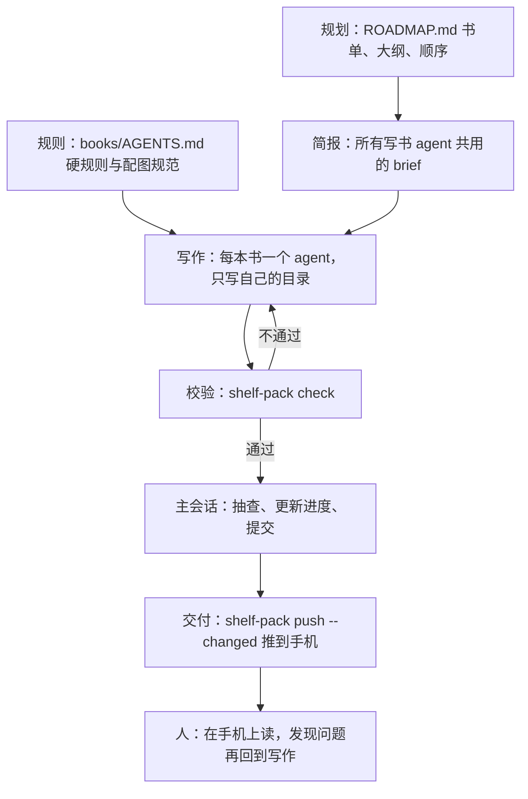
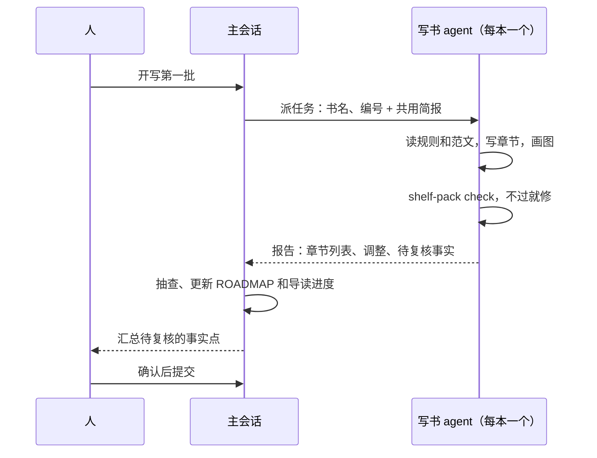

# 让 agent 写书

你正在读的这本书，以及书架上的其他书，都是 agent 写出来的。这不是一句「让 AI 写本书」就能做到的：从定书单到推到手机上，中间有规划、规则、分工、校验、交付好几层，每一层都对应前几章讲过的某个原则。这一章把 hatch-shelf 的 `books/` 当作案例完整拆一遍。它的价值不只在写书：写博客、写产品文档、做课程讲义，结构都一样。

## 整体结构

先看全貌。一本书从计划到上手机，经过五层：



每一层都落在文件或命令上，没有一层依赖「在对话里交代过」。这正是第 1 章说的：大活拆成落到文件的流水线。

## 第一层：规划

`books/ROADMAP.md` 是书单兼进度表，面向写书的 agent，不面向读者。每本书一个条目：

```text
### 39. 个人 Agent 工作流 `personal-agent-workflow`

- 中级 · `人工智能/Agent` · 状态：未写
- 章节：把工作拆成 agent 能接的活 · 日常自动化 · 个人知识库 · 定时任务 · 让 agent 写书 · 让 agent 做运维 · 工作流的迭代
```

一行里包含了 agent 需要的全部定位信息：编号、标题、目录名、难度、分类、状态、章节大纲。文件开头还有一节「约定」，比如每本 6–10 章、一本书一个 `content:` 提交、大纲可以调整但调整后要回写。

这份规划是**人花心思最多的地方**。选什么书、按什么顺序、每本讲到什么深度，决定了整个书架有没有用；而一旦规划定了，写每一本都变成了边界清楚的活。人做判断，agent 做执行，分工在这里就切开了。

## 第二层：规则

`books/AGENTS.md` 写的是**改坏了不会报错、但会让书不好用**的规则。它规定了目录结构、`book.yaml` 的字段、每章唯一 H1、代码块必须标语言，以及篇幅最长的一节：配图。

配图规范是典型的「从失败中长出来的规则」。早期 agent 写书时喜欢用字符画坐标轴和柱状图，在电脑上看着还行，推到手机窄屏上全部错位换行。于是规则里加了一条硬性禁令，并给出替代方案：

| 要表达的内容 | 用什么 |
|---|---|
| 流程、结构、时序 | Mermaid |
| 数据图、坐标图、矩阵示意 | SVG，放在 `assets/` |
| 行列组织的文字和数字 | Markdown 表格 |

SVG 的规范细到了色值和字号：白色圆角底板（阅读器有暗色主题，透明底会看不清）、宽 360（手机正文宽度附近，不缩放）、指定字体和六种颜色。这些细节 agent 自己猜不出来，写下来之后，每本书的图风格一致。

规则文件的写法有两个要点：

- **每条规则附上原因**。「透明底在暗色下会看不清」比「必须用白色底板」更能让 agent 在规则没覆盖的情况下做对判断
- **规则只写一处**。字段定义的权威来源是 `@shelf/spec` 里的 schema，AGENTS.md 里明确写着「两者冲突时以代码为准并修正本文件」

## 第三层：简报

规则说的是「书长什么样」，简报说的是「这次任务怎么做」。主会话派写书 agent 时，给每个 agent 同一份简报，内容包括：

| 简报的一节 | 作用 |
|---|---|
| 读者 | 仓库所有者的技术栈和目标，决定例子选什么、讲多深 |
| 动手前必读 | AGENTS.md、ROADMAP 里自己那一条、几章范文 |
| 产出 | 只能写 `books/<id>/`，不改其他文件，不运行 git |
| 案例 | 可以只读参考哪些自己的项目，绝不能写进敏感信息 |
| 准确性 | 不编造数字、版本号和引文；拿不准就讲原理并提示以官方为准 |
| 配图 | 每张 SVG 渲染成 PNG 亲眼看一遍，检查重叠和溢出 |
| 自检 | 必须通过的命令 |
| 最终报告 | 不超过 10 行，写调整了什么、哪些事实需要人复核 |

有几条特别值得借鉴。

**范文比描述有用**。与其写「语气要平实、结构要清楚」，不如指定三章已经写好的书作为范文：开头一段说清本章要解决什么，H2/H3 展开，表格、Mermaid、代码穿插，结尾「本章要点」。agent 模仿一个具体样本的能力，远强于理解一段抽象描述。

**写清边界**。「只能写自己的目录、不运行 git」看起来是限制，其实是并行的前提：几个 agent 同时写不同的书，谁也不会碰到谁的文件，不会出现提交冲突。

**要求报告「拿不准的事实」**。agent 写到具体版本号、命令参数时难免有不确定的地方，与其让它硬写，不如让它在报告里列出来，人只需核实这几处，而不必逐字审读整本书。

## 第四层：写作与校验

写书 agent 拿到简报后独立完成一本书。它的检查器是一条命令：

```bash
pnpm -s shelf-pack check books/personal-agent-workflow
```

`check` 背后是 `@shelf/spec` 里的 `lintBook()`，App 导入时用的也是同一个包。它比 App 导入更严格：导入时会被兜底的情况在这里都会报错，包括缺少 `book.yaml`、id 与目录名不一致、`chapters` 里列了但不存在的文件、存在但没列入的 `.md`、每章不止一个 H1、代码块没标语言、远程图片、引用了 `assets/` 下不存在的图片。

这里体现了两个原则：

- **验收是机器做的**。agent 自己就能跑，不通过就自己修，不需要人在中间来回传话
- **检查规则和产品规则是同一份代码**。如果 CLI 和 App 各写一套校验，迟早会出现「check 通过了但手机上导入有问题」。hatch-shelf 的约定是：判断书籍结构的逻辑只写在 `@shelf/spec`，App 和 CLI 都调用它

机器查不了的东西，简报要求 agent 自己查：每张 SVG 用 `qlmanage` 渲染成 PNG，用读图能力看一遍有没有文字重叠、溢出。这是把「人眼检查」也交给了 agent。

## 第五层：主会话与交付

多本书并行时，有一个主会话负责编排：



注意**进度由主会话统一更新**。`ROADMAP.md` 的状态栏和导读里的进度页是所有书共享的文件，如果每个写书 agent 都去改，并行时就会互相覆盖。把共享文件的写权限收到一个地方，是多 agent 协作里最简单有效的防冲突手段，详见[《多 Agent 编排》](../multi-agent/)。

提交也有规矩：一本书一个 `content:` 提交，不和代码改动混在一起。这样书架的历史和代码的历史可以分开看，回滚一本书也不会牵连代码。

交付用 `shelf-pack push --changed`。它不看 `book.yaml` 里的 `updated` 日期，而是比较内容指纹：`@shelf/spec` 的 `prepareImport()` 对要写入设备的全部文件算出哈希，App 导入时存下来，CLI 打包时用同一个函数再算一遍，相同就跳过。之所以不用日期，是因为 agent 改了内容却忘了改日期是很常见的事，按日期判断会漏推。**不依赖 agent 记得做某件事，而是让系统自己能判断**，这是一条通用的设计原则。

## 人在哪里

整套流程里，人做的事情很少，但都是关键的：

| 环节 | 人做什么 |
|---|---|
| 规划 | 定书单、顺序、每本的大纲和深度 |
| 规则 | 读书时发现问题，把它变成一条规则 |
| 复核 | 只看 agent 报告里列出的「拿不准的事实」 |
| 阅读 | 在手机上读，觉得哪里不对就记下来 |

最后一项是整个系统迭代的来源。你在手机上读到一张错位的图、一段太啰嗦的解释、一个过时的命令，记下来，回到电脑前改规则或简报，下一本书就不会再犯。第 7 章会专门讲这个循环。

## 搬到别的写作场景

这套结构可以直接套到其他写作任务上：

| 写书 | 写博客 / 产品文档 |
|---|---|
| ROADMAP.md | 选题表或文档目录，带每篇的要点 |
| AGENTS.md | 风格指南：语气、术语表、图片规范、禁止事项 |
| 共用简报 | 每篇的任务模板：读者、目标、必读材料、产出位置 |
| 范文 | 两三篇你最满意的旧文 |
| shelf-pack check | 链接检查、拼写检查、构建一次站点 |
| push --changed | 站点部署 |

关键不在工具，而在于：**规划由人做、规则写成文件、验收交给机器、共享状态只有一个写入者**。

## 本章要点

- agent 写书是一条五层流水线：规划、规则、简报、写作与校验、编排与交付，每一层都落在文件或命令上
- 规划是人花心思最多的地方；规划定了，写每一本都变成边界清楚的活
- 规则从失败中长出来，每条附上原因，并且只写一处；范文比抽象描述有用
- 验收交给机器，检查规则和产品规则用同一份代码；机器查不了的让 agent 自己渲染、自己看
- 并行时共享文件只由主会话写；交付按内容指纹判断，不依赖 agent 记得改日期

## 动手练习

1. **让检查器报错**：把一本书整个目录复制到临时目录（目录名不变，保证 id 一致），在第一章末尾追加一个 H1 和一个不标语言的代码块，再新建一个空的 `99-extra.md`，然后在仓库根目录运行 `pnpm shelf-pack check <临时目录>/<书 id>`。

   验证：输出 `✗`，错误里有「代码块没有标注语言」和「有 2 个 H1，每章只能有一个」；`99-extra.md` 作为提示出现，说明它不会被导入。

   参考答案：这些都是「改坏了 App 里会难看但不会崩」的问题，交给 `lintBook()` 后，写书 agent 自己就能发现并修好，不需要人逐章看。

2. **把五层搬到你的写作场景**：选一个你正在做或想做的写作任务（博客系列、产品文档、课程讲义），按本章「搬到别的写作场景」那张表，写出你自己的五样东西：选题表、风格指南、任务模板、范文、机器检查。

   验证：「机器检查」一栏是一条能直接运行的命令（如链接检查脚本、`pnpm build` 构建站点），而不是「我看一遍」。

   参考答案：判断要点是规划由你做、规则写成文件、验收能由机器执行。写不出机器检查时，先回到第 1 章想清楚验收是什么。

3. **用 Git 核对边界**（需要 Claude Code 账号或 API key）：在一个练习仓库里给 agent 一份简报，明确「只能写 `drafts/<题目>/`，不运行 git」，让它写一篇短文。

   验证：完成后 `git status --short` 里所有变动都在 `drafts/<题目>/` 下；`git log` 没有新提交。

   参考答案：边界写在简报里是软约束，用 `git status` 核对才知道有没有越界；越界了就补一条权限规则（比如禁止 `Bash(git commit:*)`），把约束往更硬的一层挪。
