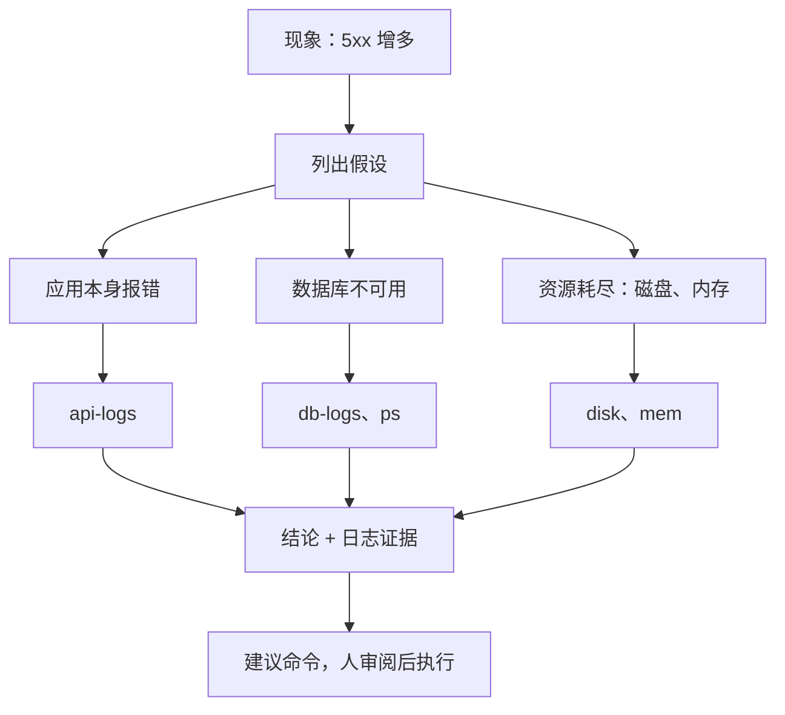

# 让 agent 做运维

一人公司没有运维同事。服务半夜报错、磁盘快满、证书要续、发版卡住，都得自己处理。agent 在这里能帮上大忙：读日志比人快，对着部署文档一步步排查也不会漏步骤。但运维也是出错代价最高的一类活，一条错误的命令就可能让线上停摆、数据丢失。这一章讲怎么分级放权、怎么给 agent 一条只读的诊断通道、怎么把运维手册写成 agent 能照着做的形式，以及从 hatch-counter 的部署设计里能学到哪些「对 agent 和人都安全」的原则。

## 放权分四级

不要一开始就问「能不能让 agent 管服务器」，而是问「这一类操作放到第几级」。通用的人机协作分级见[《AI 认知进阶》第 4 章](../ai-cognition/04-human-ai-division.md#自主程度的阶梯)，落到运维上是四级，越往下 agent 越自主、适用的操作越少：

| 级别 | agent 做什么 | 人做什么 | 适合的操作 |
|---|---|---|---|
| 1 只读诊断 | 看状态、读日志、查指标，给出结论 | 决定怎么处理 | 所有排查，默认从这里开始 |
| 2 起草命令 | 写出要执行的命令和理由 | 审阅后自己执行 | 重启服务、清理磁盘、改配置 |
| 3 白名单执行 | 只能调用事先写好的脚本 | 写脚本、定白名单 | 回滚静态站、查看某版状态 |
| 4 自主执行 | 自己决定、自己动手 | 事后看报告 | 个人场景下，生产环境基本不放 |

大部分时候停在 1 和 2 就够了。排查故障最花时间的是**定位**，而定位只需要读；真正动手的那一两条命令，人看一眼再执行，花不了几秒，却挡住了绝大部分事故。

## 一条只读的诊断通道

让 agent 从你的电脑 ssh 到服务器排查，最直接的风险是：它拿到的是你的账号，你能做的它都能做。更稳的做法是在服务器上给诊断单独开一条窄路。

### 不要靠 docker 用户组

一个常见误区是给诊断账号加进 `docker` 组，好让它能看容器日志。但 `docker` 组等同于 root：能运行容器的人，就能把宿主机的根目录挂进容器随意读写。这条路给出去的权限远大于「看日志」。

### 用固定子命令的包装脚本

更好的做法是写一个只接受固定子命令的脚本，再用 sudoers 只允许诊断账号以 root 身份运行**这一个脚本**：

```bash
#!/usr/bin/env bash
# /usr/local/bin/ops-diag：只读诊断入口，只认下面几个子命令
set -euo pipefail
COMPOSE="docker compose -f /srv/app/docker-compose.yml"

case "${1:-}" in
  ps)        $COMPOSE ps ;;
  api-logs)  $COMPOSE logs --since 2h --tail 500 api ;;
  db-logs)   $COMPOSE logs --since 2h --tail 200 postgres ;;
  nginx-err) tail -n 300 /var/log/nginx/error.log ;;
  disk)      df -h; echo; du -sh /var/lib/docker /var/log 2>/dev/null ;;
  mem)       free -m; echo; uptime ;;
  units)     systemctl --failed --no-pager ;;
  *) echo "用法：ops-diag ps|api-logs|db-logs|nginx-err|disk|mem|units" >&2; exit 2 ;;
esac
```

```text
# /etc/sudoers.d/ops-diag（用 visudo -f 编辑）
opsread ALL=(root) NOPASSWD: /usr/local/bin/ops-diag
```

脚本属主为 root、权限 755，诊断账号改不了它。几个设计点：

- **参数不透传**：子命令是写死的，没有「把剩下的参数交给 docker」这种口子，避免被拼出别的命令
- **输出有上限**：日志都带 `--since` 和 `--tail`，不会把几百 MB 的日志一次塞进 agent 的上下文
- **不碰配置和密钥**：脚本里没有任何读 `.env`、`api.env` 的子命令。日志本身也可能含敏感信息，所以服务端打日志时就不该输出令牌和密码

### 本地 agent 这一侧

在本地，用权限配置把 agent 能执行的 ssh 命令限定到这个入口上。Claude Code 的权限写在 `settings.json` 的 `permissions` 里，大致是这样（规则语法以你所用版本的官方文档为准）：

```json
{
  "permissions": {
    "allow": [
      "Bash(ssh opsread@prod-box ops-diag *)"
    ],
    "deny": [
      "Read(**/.env*)",
      "Read(**/*.env)"
    ]
  }
}
```

`prod-box` 是 `~/.ssh/config` 里的一个别名，真实地址写在 ssh 配置里，不出现在仓库和 prompt 里。`deny` 那两条让 agent 读不到本地仓库里的环境变量文件，即使它想「顺便看看配置」。

服务器那一侧的限制是硬的，本地这一侧的限制是软的（依赖 agent 工具正确执行权限规则）。**两边都设，以服务器那一侧为准**。

## 排查：让 agent 按顺序想

有了通道，排查时的 prompt 要给出现象、时间范围和边界：

```text
线上 API 从今晚 22:40 左右开始 5xx 明显增多。帮我排查，只读。

可用的诊断命令：ssh opsread@prod-box ops-diag <子命令>，子命令见 ops-diag 的用法说明。
部署结构见本仓库 deploy/README.md，先读它。

要求：
1. 先列出你的假设（至少三个），再逐个用诊断命令验证
2. 每个结论附上支撑它的日志原文（截取关键几行）
3. 最后给出建议的处理步骤，写成我可以复制执行的命令，标明哪条有风险
不要尝试执行任何修改操作。
```

「先列假设再验证」能防止 agent 看到第一条报错就下结论。线上故障的第一条报错往往是结果而不是原因：API 报数据库连接超时，原因可能是数据库挂了，也可能是磁盘满了数据库写不进去，还可能是连接池被一个慢查询占满了。



## 运维手册写给 agent 看

agent 排查得好不好，很大程度取决于它能不能读到**这台机器是怎么搭的**。hatch-counter 在这方面是一个好例子。

### 部署文档是「照着做的」

它的 `deploy/README.md` 开头第一句就是「这一页是照着做的，不是读的」。整篇按步骤编号，从一台新机器开始，一条条命令跑下来，服务就在线上了。文档里有机器上的目录树、每个进程归谁管（nginx 装在宿主机、API 和数据库在 compose 里、一个 systemd 单元负责静态站上线），还写清了哪些东西**不在**这台机器上。

这种文档对人和 agent 同样好用：agent 排查时先读它，就知道日志该去哪找、哪个服务归谁管，而不是在服务器上到处 `ls`。

### 规则按路径加载

hatch-counter 把「改坏了不报错」的规矩按路径放在 `.claude/rules/` 下，其中一份专管工具、流水线、发版和部署，动到 `deploy/`、`tools/` 等目录的文件时才加载。它的 CLAUDE.md 里还有一句很关键的提醒：**发版、部署之前先把这份规则读一遍**，因为跑发版命令本身碰不到任何文件，按路径加载的规则不会自动触发。

这是一个容易被忽略的细节：按路径加载的规则只在 agent 读写匹配的文件时生效，而运维操作经常只是跑命令，不读写文件。对这类操作，要在顶层说明里显式要求先读。规则的组织方式详见[《编码 Agent 实战》](../coding-agents/)。

### 事故复盘写回文档

每次故障处理完，让 agent 把原因、证据、处理步骤写进文档，并判断要不要变成一条规则。hatch-counter 的部署规则里有大量这样的痕迹，比如「推镜像是跨境的，十几分钟是正常的，别当卡死去取消」，这一条就来自一次被误取消的发版。下次 agent 或你自己看到发版很慢，读到这句就不会再犯同样的错。

## 把系统设计成对 agent 安全

比约束 agent 更根本的，是让系统本身经得起误操作。hatch-counter 的部署设计里有几条原则，无论执行者是人还是 agent 都适用：

| 原则 | hatch-counter 的做法 | 对 agent 的意义 |
|---|---|---|
| 生产机的钥匙不外放 | 静态站上线不由 CI 推，而是机器上的上线代理自己去读一份版本指针、拉包、切软链；CI 手里没有能 ssh 进生产机的私钥 | agent 即使能操作 CI，也拿不到进生产机的钥匙 |
| 能被指使的动作要窄 | 上线代理逐行校验指针，手工命令只认四个站名和三段式版本号；被篡改的指针最多能做到「把桶里某一版切上去」 | 白名单执行（第 3 级）的样板 |
| 配置不会被覆盖 | 往机器传部署文件走一个按白名单传的脚本，`*.env` 永远不在名单上 | agent 「同步一下配置」不会把本地的测试配置盖到线上 |
| 不可逆的放最后 | 发版流水线先检查、打包、上传，全部成功后才提交版本号、打 tag | 中途失败什么都没变，重试是安全的 |
| 状态用文件表达 | 停服维护就是一个标记文件，nginx 每个请求检查它在不在；中途出错标记故意不摘 | 状态一眼可见，进退都只是建或删一个文件 |
| 回滚是一条命令 | 每个静态站在机器上保留最近几版，回滚是切软链 | 第 2 级「起草命令」时，回滚命令简单到不会写错 |

这些设计的共同点是：**把危险的动作做窄、做成可逆的，并且不依赖执行者记得某条规矩**。系统设计得好，放权到第 2、3 级就很安心；系统设计得脆，第 1 级都要提心吊胆。更系统的讲解见[《一人运维手册》](../production-ops/)和[《Agent 安全》](../agent-safety/)。

## 绝对不交给 agent 的

有几类操作，在个人场景下建议始终由人亲手执行：

- **删除数据**：`DROP`、`TRUNCATE`、删除数据卷、删除备份
- **改认证和权限**：防火墙规则、sudoers、ssh 配置、云账号权限
- **处理密钥**：生成、轮换、查看任何密钥和令牌
- **对外可见的变更**：DNS、证书替换、给用户发通知

agent 可以帮你准备这些操作：查文档、写好命令、列出回滚方案。但按下回车的应该是你。

## 本章要点

- 运维操作分四级放权：只读诊断、起草命令、白名单执行、自主执行；默认停在前两级
- 给诊断单独开一条窄路：固定子命令的包装脚本 + sudoers 只放行这一个脚本；不要用 `docker` 组，它等同 root
- 本地用权限配置限制 agent 只能走诊断入口、读不到 `.env`；服务器侧的限制才是硬约束
- 排查时要求 agent 先列假设、再用证据逐个验证，结论附日志原文
- 部署文档写成「照着做的」；按路径加载的规则不会被纯命令操作触发，要显式要求先读
- 比约束 agent 更根本的是系统设计：钥匙不外放、动作做窄、配置不被覆盖、不可逆的放最后、回滚一条命令

## 动手练习

1. **试着从诊断入口钻出去**：把本章的 `ops-diag` 存成文件，在一台 Linux 机器上（本机即可，不需要 sudo）分别运行 `bash ops-diag mem`、`bash ops-diag 'mem; id'`、`bash ops-diag disk --help`。

   验证：第一条输出内存和负载；第二条只打印用法并退出码 2，没有执行 `id`；第三条和 `disk` 的输出一样，多出的参数被忽略。

   参考答案：`case` 只把第一个参数和固定字符串比较，整个参数不会被 shell 再解析一遍，后面的参数也不往下传，所以拼不出别的命令。macOS 上没有 `free`，`mem` 会报命令找不到，这一题在 Linux 上做。

2. **亲眼看 docker 组等于 root**：只在一次性的云服务器或虚拟机里做。新建用户 `opsread` 并加进 `docker` 组，切换到这个用户后运行 `docker run --rm -v /:/host alpine head -1 /host/etc/shadow`。

   验证：一个没有 sudo 权限的普通用户读出了 `/etc/shadow` 的第一行（root 的密码哈希）。

   参考答案：容器以 root 运行并挂载了宿主机根目录，能读就能写。做完删除这台机器，或至少 `gpasswd -d opsread docker`。改用本章的包装脚本 + sudoers 后，同一个用户只能运行那几个固定子命令。

3. **先列假设再下结论**：下面是一次 5xx 升高时三个子命令的关键输出，按本章的方法给出结论和建议命令。

   ```text
   api-logs:  Error: connect ETIMEDOUT postgres:5432
   db-logs:   PANIC: could not write to file "pg_wal/xlogtemp.31": No space left on device
   disk:      /dev/vda1  40G  40G  0  100% /
   ```

   验证：结论指向磁盘满而不是「数据库挂了」，并且每个结论都引用了上面对应的一行作证据。

   参考答案：API 超时是结果，数据库写不进 WAL 是中间环节，根因是磁盘 100%。建议的第一条命令应是只读的 `du -sh /var/lib/docker /var/log` 找出谁占满了，清理动作（如 `docker image prune`、截断日志）标为有风险、由人执行。
