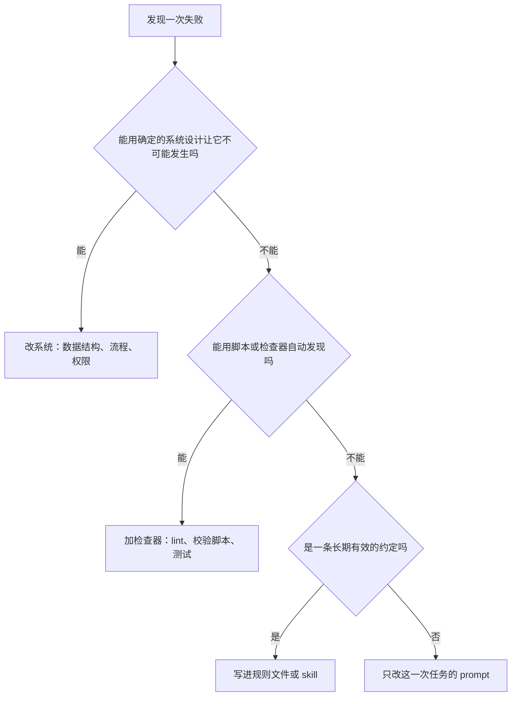
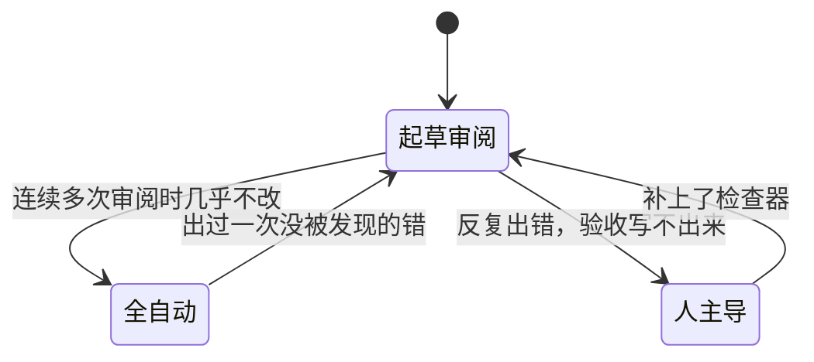
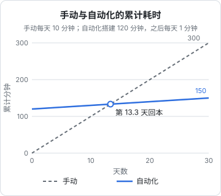

# 工作流的迭代

前面五章搭起来的每一个工作流，第一版都不会太好：周报漏了一个仓库，归档把具体命令概括没了，巡检在半夜发了一条误报。这很正常。真正决定 agent 工作流有没有用的，不是第一版写得多好，而是**出了问题之后能不能越改越好**。这一章讲怎么记录、怎么归因、把修复放在哪一层、什么时候给工作流升级或降级，以及什么时候该把它删掉。

## 工作流是一个产品

把每个工作流当成一个小产品来对待，你自己就是唯一的用户：

| 产品的做法 | 对应到工作流 |
|---|---|
| 有版本 | prompt、规则文件、脚本都放进 Git |
| 有日志 | 每次运行的输入、输出、退出码都落盘 |
| 有反馈 | 你用的时候觉得不对，随手记下来 |
| 有迭代 | 定期看反馈，改一处、跑一次、看效果 |
| 会下线 | 不再有用的就删掉 |

第 4 章的包装脚本已经解决了日志。反馈最简单的做法是在知识库里放一个 `workflows/feedback.md`，用的时候觉得哪里不对，写一行：日期、哪个工作流、哪里不对。hatch-shelf 的书架也是这样迭代的：在手机上读书时随手标注，导出的阅读笔记放在仓库的 `notes/` 下，修订一本书之前先读对应的笔记。

## 失败归因

拿到一次失败，先别急着改 prompt。先判断它属于哪一类：

| 类型 | 表现 | 例子 |
|---|---|---|
| 理解偏差 | 做了，但做的不是你要的 | 周报写成了流水账，没有归类 |
| 缺上下文 | agent 不知道某条约定 | 写书时用字符画坐标轴 |
| 工具或权限 | 想做但做不了，或者做了不该做的 | 定时任务卡在等权限确认 |
| 验收漏洞 | 做错了但没被发现 | 漏了一个仓库，周报照样「成功」 |
| 外部变化 | 以前好好的，突然不行了 | 依赖的命令改了输出格式 |

不同类型的修法完全不同。理解偏差改 prompt 或加范例；缺上下文写进规则文件；工具问题调权限或包装脚本；验收漏洞补检查；外部变化要修脚本，往往还得加一个能及早发现变化的检查。

## 修在哪一层

同一个问题，往往可以在好几层修。从「软」到「硬」排下来：



**越往上越可靠**。prompt 里的一句话，agent 可能看漏；规则文件每次都会加载，但仍然靠 agent 遵守；检查器不靠任何人记得，做错了就报错；系统设计让错误根本无从发生。所以原则是：**能修在越硬的那一层，就修在那一层**。

hatch-shelf 里三个真实的例子正好对应三层：

| 问题 | 修在哪 | 怎么修的 |
|---|---|---|
| agent 用字符画图，手机上错位 | 规则 | `books/AGENTS.md` 加上配图规范，写清禁止什么、用什么替代、为什么 |
| 章节里多写了一个 H1、代码块忘标语言 | 检查器 | `@shelf/spec` 的 `lintBook()` 直接报错，`shelf-pack check` 不通过 |
| 改了内容忘改 `updated`，推送时被漏掉 | 系统设计 | `push --changed` 改为按内容指纹判断，不再依赖日期 |

第三个例子最值得体会：问题表面上是「agent 忘了改日期」，最省事的修法是在规则里加一句「改了内容记得改日期」。但这条规则迟早还会被忘掉，不管是 agent 还是人。改成按内容判断之后，这件事就不再需要任何人记得了。

### 偏好类的规则

还有一类规则无法用检查器表达，只能写下来，比如个人偏好。hatch-shelf 的 CLAUDE.md 里规定提交信息不加任何 AI 署名，作者只有仓库所有者；同样的偏好也记在了 agent 的跨会话记忆里。这类规则的要点是**写在 agent 每次都会读到的地方**，并且写清楚适用范围，不要指望它从上一次对话里记住。

## 升级与降级

第 1 章讲过三种交接方式：全自动、起草 + 审阅、人主导。工作流在这几档之间应该是流动的：



几条实用的判断标准：

- **升级**：连续若干次（比如五次）审阅时你都没改什么，并且验收已经能自动化，就可以去掉人工审阅这一步
- **降级**：全自动的流程出过一次错，而且不是检查器拦下来的，而是你偶然发现的，立即降回起草 + 审阅，直到补上能拦住这类错误的检查
- **人主导**：同一个工作流反复出错，又写不出验收，说明它本来就不适合交给 agent，承认这一点也是一种迭代

降级时别觉得可惜。全自动最大的风险不是出错，而是**出错了你不知道**。

## 算一笔账

自动化不是越多越好。搭一个工作流要花时间，维护它也要花时间。用一个简单的模型估算：



设手动每次耗时 $m$，自动化后每次还要花 $a$ 审阅，搭建一次性花 $s$，那么回本需要的次数是：

$$
n = \frac{s}{m - a}
$$

图里 $m = 10$、$a = 1$、$s = 120$（单位分钟），$n = 120 / 9 \approx 13.3$ 次。如果这件事一个月只做一次，就要一年多才回本，而一年里工具和需求早就变了。

这个公式有几个推论：

- **频率高的先做**：每天一次的事，搭建成本很快就摊薄了
- **审阅成本 $a$ 决定上限**：如果每次审阅要花 8 分钟，$m - a$ 只剩 2，基本不值得。降低 $a$ 的办法是补上验收，让你只看异常
- **不要忽略维护**：外部变化会让工作流时不时坏掉，每次修理都要加进 $s$

时间之外还有模型调用的费用。定时任务用 `--max-turns` 和超时封住上限，定期看一眼用量，发现某个任务花得异常多，通常意味着它在原地打转，是 prompt 或工具出了问题。

## 维护一张工作流清单

工作流多了之后，你会忘记自己搭过哪些。在知识库里维护一张清单：

| 工作流 | 触发 | 输入 | 输出 | 交接方式 | 上次复查 |
|---|---|---|---|---|---|
| 周报 | 每周五 launchd | 各仓库 git log | `weekly/` | 全自动 | 2026-10 |
| 依赖检查 | 每天 7:30 launchd | `pnpm outdated` / `audit` | `journal/` | 全自动，异常通知 | 2026-10 |
| inbox 归档 | 每周日手动 | `inbox/` | `topics/` | 起草 + 审阅 | 2026-10 |
| 线上巡检 | 每晚 systemd | `ops-diag` | `journal/` | 只读，异常通知 | 2026-10 |
| 写书 | 按 ROADMAP | 简报 + 规则 | `books/<id>/` | 起草 + 审阅 | 2026-11 |

（表中内容是示例，按你自己的实际情况填。）

每个季度过一遍这张表，对每一行问三个问题：

1. 过去三个月它真的帮上忙了吗？
2. 它的交接方式还合适吗，要升级还是降级？
3. 它依赖的东西（命令、目录、外部服务）还在吗？

没帮上忙的直接删掉，连同它的定时器、脚本和 prompt。一个没人看的定时任务不是无害的：它照样消耗费用，照样可能在某天出错，而且没人会注意到。

## 让 agent 帮你迭代

最后，迭代本身也可以交给 agent 一部分。每个月让它读一遍反馈记录和运行日志：

```text
读 ~/notes/workflows/feedback.md 和 ~/notes/journal/agent-jobs/ 下本月的全部日志。

输出一份工作流复盘：
1. 每个工作流本月运行次数、失败次数、触发通知的次数
2. 反馈里提到的问题，按「理解偏差 / 缺上下文 / 工具权限 / 验收漏洞 / 外部变化」归类
3. 对每个问题建议修在哪一层（系统设计 / 检查器 / 规则 / prompt），优先建议更硬的那一层
4. 建议升级、降级或下线的工作流，各给一句理由

只给建议，不要修改任何文件。
```

它给出的是建议，改不改、改在哪里，由你决定。这本身也是第 1 章那条原则：难验证的判断，agent 起草，人拍板。

## 本章要点

- 把工作流当产品：有版本、有日志、有反馈、有迭代、会下线
- 失败先归因：理解偏差、缺上下文、工具权限、验收漏洞、外部变化，各有各的修法
- 修复从硬到软分四层：系统设计、检查器、规则、prompt；**能修在越硬的层就修在那一层**
- 工作流的交接方式要流动：审阅时几乎不改就升级，出过没被发现的错就降级
- 用 $n = s / (m - a)$ 估算回本次数；降低审阅成本 $a$ 的关键是补上验收
- 每季度复查工作流清单，没用的连同定时器一起删掉

## 动手练习

1. **算两笔回本账**：A 是每周一次的报销整理，手动 40 分钟，自动化后审阅 5 分钟，搭建 3 小时；B 是每天一次的日志巡检，手动 10 分钟，但自动化后每次审阅要 8 分钟，搭建 2 小时。分别算回本次数和大约要多久。

   验证：用 `node -e 'console.log(180/(40-5), 120/(10-8))'` 核对，A 约 5.1 次（约 5 周），B 是 60 次（约两个月）。

   参考答案：B 频率高却回本慢，问题在审阅成本 $a$。先补上验收、让巡检只在异常时通知，把 $a$ 降到 1 分钟，回本就缩短到 120 / 9 ≈ 13 次。

2. **给四次失败归因、选层**：按本章的五种类型和四层修法，处理这四次失败：① 归档时把一段报错原文概括成了「修好了锁问题」；② 定时任务在等一次权限确认，直到超时；③ 周报漏了一个仓库，脚本却报告成功；④ 依赖检查突然什么都报不出来，因为 `pnpm audit` 换了输出格式。

   验证：每一条都写出类型和修在哪一层，并且至少有两条落在「检查器」或「系统设计」。

   参考答案：① 缺上下文，写进知识库规则「保留命令、报错原文和版本号」；② 工具权限，在包装脚本或权限配置里预先放开所需命令（系统设计）；③ 验收漏洞，加检查器（第 2 章的每个仓库都有一节的 grep）；④ 外部变化，修解析逻辑，并加一个「输出为空即报错」的检查。

3. **对账：清单和真实的定时器**：把你实际配置过的工作流按本章的清单格式写下来，再列出机器上真正存在的定时任务：Mac 上 `launchctl list | grep -v com.apple`，Linux 上 `systemctl --user list-timers --all` 和 `crontab -l`。

   验证：两边一一对应；如果命令输出里出现清单上没有的任务，就找到了一个没人看着、仍在运行的工作流。

   参考答案：对不上的那几行，要么补进清单并决定交接方式，要么连同 plist / timer、脚本和 prompt 一起删掉。

这本书到这里结束。第一批「认知打底」接下来是[《一人公司方法论》](../opc-playbook/)：从 agent 能替你干什么，转到你自己该干什么。如果想把本书里的做法往深处挖，[《上下文工程》](../context-engineering/)讲规则和记忆该怎么组织，[《工具设计与 MCP》](../tools-and-mcp/)讲怎么给 agent 造更好用的工具，[《Agent 安全》](../agent-safety/)讲无人值守时的权限和沙箱。
