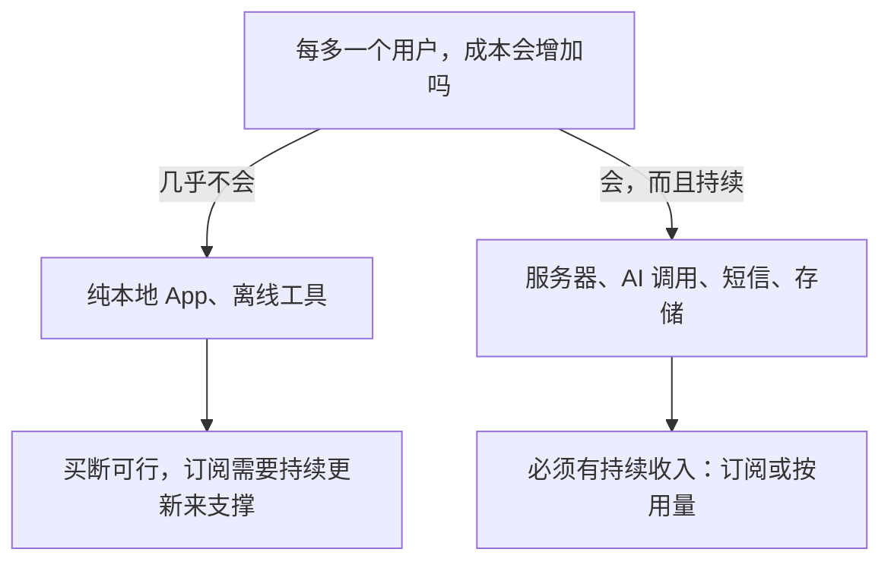
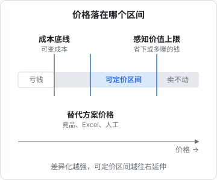
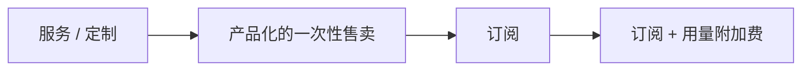

# 商业模式

很多独立开发者把定价当成上线前最后十分钟的事：看一眼竞品，填个数字，结束。结果是产品做得不错，却一直不赚钱，或者赚的钱撑不起一个人的生活。这一章先退一步，回答更根本的问题：**你的产品到底靠什么赚钱**。商业模式定了，后面的订阅还是买断、定多少、在哪收，才有依据。

## 这本书讲什么

**讲什么**：一人公司怎么设计收入。前四章是「定」：商业模式、收费形态、定价心理、价格实验；中间三章是「收」：国内支付接入、App Store 内购、退款与客诉；最后一章用作者自己的门店 SaaS 项目 hatch-counter 把前面的内容串起来推演一遍。

**适合谁**：准备给自己的产品收钱的独立开发者，技术上不需要帮忙，缺的是「收多少、怎么收」的判断框架和接入流程的全景图。

**怎么读**：第 1、2 章建议先读，它们决定后面所有选择。第 3、4 章在定价和改价前读。第 5、6 章是接入手册，做到那一步再翻。第 7 章在开始收钱之前读，退款规则要在第一笔钱进来之前写好。第 8 章可以当作复习。

本书不讲公司注册、开票、税务和备案细节，这些分别在[《国内合规实务》](../opc-compliance-cn/)和[《财务与税务》](../opc-finance/)里；海外收款在[《出海实务》](../going-global/)里。涉及费率、佣金、法规的地方，本书只讲框架，**具体数字以官方最新规定为准**。

## 商业模式是什么

去掉术语，商业模式回答四个问题：

| 问题 | 例子 |
|---|---|
| 谁付钱 | 用户本人、用户的老板、广告主、平台 |
| 为什么付 | 省时间、省钱、多赚钱、少出错、好玩、身份感 |
| 付多少、怎么算 | 按月、按年、一次性、按用量、按席位、按门店 |
| 怎么收到 | 应用商店、微信支付 / 支付宝、对公转账、经销商 |

很多产品的问题出在第一行：**使用者不等于付费者**。给员工用的工具，付钱的是老板；给孩子用的 App，付钱的是家长。你要打动的是付费者，讲的是付费者在乎的价值。

## 常见的几种模式

| 模式 | 收入来自 | 适合 | 一人公司的难点 |
|---|---|---|---|
| 买断 | 每个新用户付一次 | 工具类 App、桌面软件、模板 | 收入随新用户增长，老用户不再贡献 |
| 订阅 | 每个用户持续按期付 | 有持续成本或持续价值的服务 | 要持续交付价值，流失是头号敌人 |
| 免费增值 | 少数用户为高级功能付费 | 用户量大、边际成本低的产品 | 免费用户的成本和支持负担 |
| 按用量 | 用多少付多少 | API、AI 调用、存储 | 收入波动大，用户难以预估花费 |
| 广告 | 广告主为注意力付费 | 超大流量的内容产品 | 需要巨大流量，一人很难做到 |
| 服务 / 定制 | 按项目或工时 | 早期验证、专业领域 | 收入和时间绑定，难以规模化 |
| 交易抽成 | 撮合交易的佣金 | 平台、市场 | 冷启动要两边都有人，一人极难 |

对一人公司来说，**广告和平台抽成基本不现实**：前者要海量流量，后者要同时冷启动供需两端。可行的主力通常是**买断、订阅、按用量**三种，以及它们的组合。服务和定制适合作为早期现金流和验证手段，但不要把它当终点，原因在[《一人公司方法论》](../opc-playbook/)里讲过：它卖的是你的时间，天花板就是你的时间。

## 先看成本结构

选模式之前，先算清楚每多一个用户你要多花多少钱：



这是最硬的约束。hatch-shelf 这样的离线书架，数据全在手机上，多一个用户服务器成本为零，买断完全成立。hatch-counter 每家店都在服务端占数据库、每张进货单都要调视觉模型，**成本是持续的，收入就必须持续**，用买断等于用一次性收入去补贴无限期的成本。

AI 产品尤其要注意这一点：一次模型调用的成本不高，但重度用户可以无限调用。如果定价是固定月费、用量不设限，就要估算重度用户的成本会不会超过他付的钱。常见的处理是设合理的上限、按档位给额度，或者像 hatch-counter 那样在早期主动承担，但把这笔成本算进价格里。

## 价格的三条边界

定价不是凭空选数字，而是在三条边界之间找位置：



- **成本底线**：每个用户的可变成本。低于它，卖得越多亏得越多
- **替代方案价格**：客户不用你，会用什么、花多少钱？可能是竞品，也可能是 Excel、纸笔、雇一个人。这是客户心里的参照点
- **感知价值上限**：用了你的产品，客户省下或多赚了多少钱。没人会为一个东西付出超过它价值的价格

**价格应该由价值决定，成本只是底线**。很多开发者习惯「成本加成」：服务器每月 X 元，乘个倍数就是售价。这样定出来的价格往往远低于价值，因为软件的边际成本本来就低。一个帮餐馆每月少浪费几百元食材的工具，收几十元是在把钱留在桌上。

### 估算感知价值

对 To B 产品，价值通常可以折成钱：

```text
省下的时间：每天少花 30 分钟对账 × 30 天 × 店主时薪
减少的损失：每月少报废的食材、少算错的进货
多赚的钱：知道哪道菜不赚钱后调整菜单带来的毛利
```

这些数字不用很准，量级对就行。你会发现价值往往是成本的几十倍，定价空间比想象中大得多。卡住你的通常不是价值，而是**客户能不能相信这个价值**，这是文案、试用和口碑的问题。

对 To C 产品，价值更多是主观的：好玩、好看、省心、有面子。这时替代方案的价格更有参考意义，比如同类 App 的价位、一杯咖啡、一个月视频会员。

## 价值度量：按什么收费

比「收多少」更重要的是「**按什么单位收**」，也叫价值度量（value metric）。好的价值度量满足三条：

1. **跟客户得到的价值一起增长**：客户用得越多、得到越多，付得越多
2. **客户容易理解、容易预估**：一眼能算出自己要付多少
3. **你容易计量**：系统里有现成的数字

| 产品 | 可能的度量 | 评价 |
|---|---|---|
| 门店管理 | 按门店 | 店主天然按店算账，开第二家店价值翻倍 |
| 门店管理 | 按员工账号 | 店主会少开账号、共用密码，反而破坏使用 |
| AI 写作 | 按生成字数 | 跟成本对齐，但用户每次下笔都在算钱 |
| 团队协作 | 按席位 | 业界惯例，人越多价值越大 |
| 书架 App | 按书本数 | 莫名其妙，用户感觉被惩罚 |

一个常见的坑是**按会让用户「少用」的单位收费**。按账号收费的门店软件，会诱导店主少开账号、几个人共用一个，结果权限、操作记录全乱了。hatch-counter 的选择是按门店收费、每店成员数设一个统一上限、识别次数不限，就是在避免这个问题。第 8 章会展开。

## 组合与演进

商业模式不是一次定终身。常见的演进路径：



- 早期用**服务**接触客户、理解需求、获得现金流
- 把重复的服务固化成**产品**
- 产品有持续价值和持续成本后转成**订阅**
- 重度用户的成本明显高于平均时，加**用量档位**或附加包

也可以组合：基础订阅 + 一次性的开户实施费；买断 App + 云同步订阅；免费版 + 专业版买断。组合的原则是**每一种收费都对应一种清晰的价值**，用户能说清自己为什么付这笔钱。

## 一个人能做什么

一人公司的商业模式还有一个隐藏约束：**你的时间**。

| 隐性成本 | 例子 |
|---|---|
| 销售时间 | To B 要拜访、演示、谈价 |
| 实施时间 | 帮客户导入数据、培训 |
| 客服时间 | 回答问题、处理退款 |
| 收款时间 | 线下转账要对账、开发票 |

一个客单价很低、又需要你花大量时间服务的模式，规模越大你越累。判断时把你的时间也当作成本：如果每签一个客户要花半天，那半天按你期望的时薪折算，也要被客单价覆盖。这也是为什么一人公司更偏向**客户能自助上手、自助付款**的产品，以及为什么值得在退款、到期提醒这些流程上花心思自动化。

## 本章要点

- 商业模式回答四件事：谁付钱、为什么付、付多少怎么算、怎么收到；**使用者不一定是付费者**
- 一人公司的主力模式是买断、订阅、按用量及其组合；广告和平台抽成基本不现实
- **成本结构是硬约束**：有持续成本就必须有持续收入
- 价格在成本底线、替代方案、感知价值三条边界之间找位置，**由价值决定，成本只是底线**
- 比「收多少」更重要的是**价值度量**：跟价值一起增长、容易理解、容易计量，不诱导用户少用
- 你的时间也是成本，客户能自助上手、自助付款的模式更适合一个人
