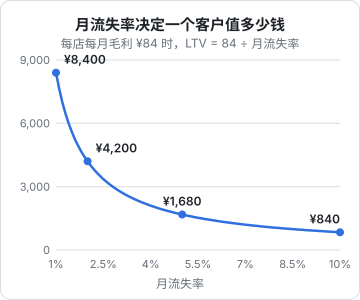
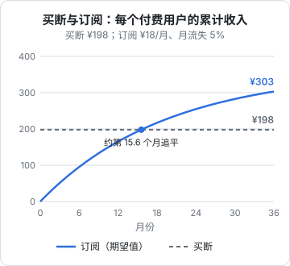
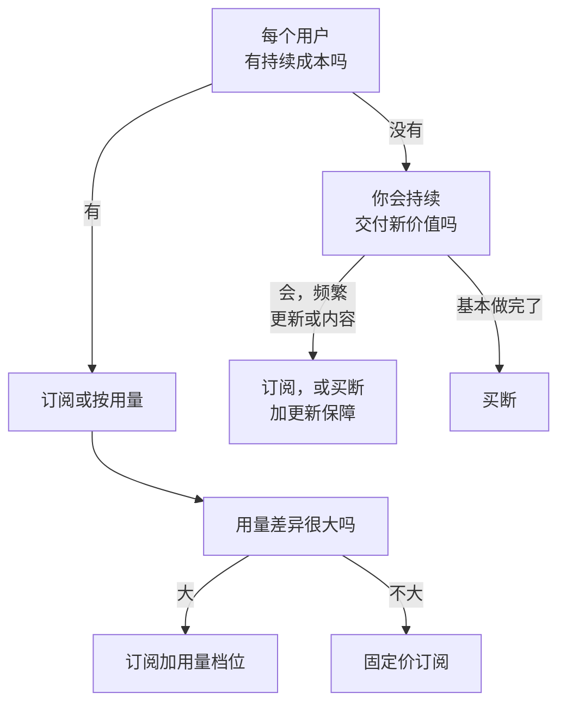
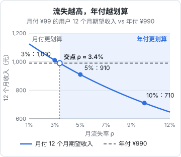

# 订阅、买断与内购

上一章定了「靠什么赚钱」，这一章落到具体的收费形态：**订阅、买断、内购**各自适合什么产品，它们的收入曲线长什么样，怎么用几个简单的公式判断一门生意算不算得过来。最后讲试用、免费版和年付这些常见的「配件」怎么设计。

## 三种形态的本质

| 形态 | 用户买到的是 | 你承诺的是 | 收入特征 |
|---|---|---|---|
| 买断 | 某个版本的永久使用权 | 这个版本能用 | 一次性，跟着新用户走 |
| 订阅 | 一段时间内的使用权 | 持续可用、持续改进 | 可预测，跟着存量用户走 |
| 内购 | 一个具体的东西或额度 | 交付那个东西 | 跟着使用行为走 |

注意「内购」这个词有两层意思：一是**收费形态**，指在产品里单独买某个功能、道具、额度；二是**收款渠道**，特指通过 App Store、Google Play 等应用商店的支付系统收钱（In-App Purchase，IAP）。苹果的 IAP 本身就分为消耗型、非消耗型、自动续期订阅、非续期订阅几类，所以买断和订阅在 iOS 上都可以通过 IAP 实现。本章讲的是形态，渠道在第 5、6 章。

## 买断：简单，但要持续获客

买断的优点很直接：

- 用户心理负担小，「一次付清，永远是我的」
- 没有续费、没有流失、没有账单纠纷
- 适合没有持续成本的产品：本地工具、离线 App、模板、电子书

缺点是**收入只来自新用户**。一个买断制 App 的月收入约等于：

$$
\text{月收入} = \text{月新增付费用户} \times \text{单价}
$$

只要获客停下，收入就归零。而你还得继续修 bug、适配新系统、回复用户。于是买断制产品常见的出路是：

- **大版本升级收费**：2.0 重新收费，老用户打折升级
- **升级保障期**：买断包含一年更新，过期后仍可使用旧版，想要新功能再续一年。这种模式在桌面软件里很常见，本质上是「订阅更新、买断使用」
- **周边付费**：买断本体 + 云同步订阅、主题包、高级模板

## 订阅：可预测，但要对抗流失

订阅的月收入是一个存量：

$$
\text{MRR}_{t+1} = \text{MRR}_t + \text{新增} - \text{流失} + \text{升级} - \text{降级}
$$

MRR（Monthly Recurring Revenue，月经常性收入）是订阅业务最核心的数字。它的好处是**可预测**：下个月大概有多少钱，现在就能算出来。这对一人公司特别重要，决定了你能不能放心地辞职全职做。

代价是你必须**每个月都配得上这个价格**。用户每次看到扣款都在重新做一次购买决定，流失就是这个决定的结果。

### 流失率决定一切

订阅业务里最重要的指标是**月流失率** $\rho$：每个月有多少比例的付费用户不再续费。如果每个用户每月贡献毛利 $m$（收入减可变成本），一个用户的平均生命周期是 $1/\rho$ 个月，生命周期价值约为：

$$
\text{LTV} \approx \frac{m}{\rho}
$$

图里用的是第 8 章 hatch-counter 推演中的假设数字：每店每月毛利 84 元。流失率从 1% 到 2%，LTV 直接减半；到 10%，一个客户只值 840 元。**流失率在分母上，降低流失比提价更有杠杆**。

LTV 要和获客成本 CAC（Customer Acquisition Cost）比。一个常被引用的经验是 LTV 至少是 CAC 的数倍才健康，但这个倍数因行业而异，不必死记。更实用的是**回本周期**：

$$
\text{回本月数} = \frac{\text{CAC}}{m}
$$

一人公司现金有限，回本周期越短越好。如果获取一个客户要花 600 元（广告费，或者你上门拜访半天的时间折算），每月毛利 84 元，就要七个多月才回本，这期间客户还可能流失。

### 流失从哪来

| 类型 | 原因 | 应对 |
|---|---|---|
| 主动流失 | 觉得不值、找到替代、不再需要 | 持续交付价值，做好上手引导 |
| 被动流失 | 支付失败：卡过期、余额不足 | 扣款失败重试、宽限期、提醒 |
| 结构性流失 | 客户自己没了：店倒闭、项目结束 | 无法控制，算进模型 |

被动流失常被忽视，但它是最容易挽回的。应用商店的自动续期订阅自带扣款重试和宽限期（Billing Grace Period）机制，可以在后台开启；自己做的订阅要自己实现。To B 场景里，到期前几天的提醒和续费入口往往比任何功能都管用，hatch-counter 在到期前 7 天、1 天、当天各发一条短信，就是在压低这部分流失。

## 买断还是订阅：算一笔账

假设同一个 App，买断定价 198 元，订阅定价 18 元/月，订阅用户月流失 5%。一个付费用户在两种模式下累计带来多少收入？

订阅用户第 $k$ 个月还在的概率是 $0.95^{k-1}$，前 $n$ 个月的期望累计收入是：

$$
R(n) = 18 \times \frac{1 - 0.95^n}{0.05}
$$

可以读出几点：

- 订阅大约**一年多才追平**买断，前期现金流不如买断
- 订阅的长期上限是 $18 / 0.05 = 360$ 元，比买断高，但前提是流失率能压在 5%
- 如果流失率是 10%，上限只有 180 元，**还不如买断**

这里还没算转化率的差异：同样的流量，「18 元/月」和「198 元一次」的付费转化率不一样，哪个更高取决于产品和人群，只能靠第 4 章的实验去验证。

### 判断清单

用户对订阅也有疲劳感，越来越多人讨厌「什么都要订阅」。对纯本地工具强行订阅，评论区会很难看。**收费形态要和用户感知到的价值形态一致**：持续的服务配持续的收费，一次性的工具配一次性的价格。

## 内购与用量计费

内购（作为形态）和按用量计费适合价值随使用次数变化的场景：

- AI 生成额度：每月送一定次数，超出买加油包
- 导出、打印、高清下载这类单次动作
- 游戏道具、虚拟货币

设计要点：

1. **让用户预先知道花费**。按用量后付费最容易引发纠纷，「怎么扣了我这么多」。预付额度、设上限、用到 80% 时提醒，都能减少客诉
2. **额度要有明确的有效期规则**。买的次数会不会过期、退款怎么算，要在购买前写清楚
3. **虚拟货币谨慎设计**。充值得到的虚拟币涉及预付卡、退款、未成年人保护等一系列规则，一人公司没必要碰，直接按功能或次数定价更简单

## 试用、免费版与年付

### 免费试用还是免费版

| 方式 | 机制 | 适合 |
|---|---|---|
| 限时试用 | 全功能用 N 天，到期付费 | 价值需要用一段时间才能体会；To B |
| 免费增值 | 永久免费的基础版，高级功能付费 | 用户量大、边际成本低，免费版本身有传播价值 |
| 反向试用 | 先给全功能，试用结束降为免费版 | 想兼顾两者 |

试用期长度要和**用户体会到价值所需的时间**匹配。hatch-counter 的试用是 14 天，因为店主至少要导入一两周的销量、录几次进货，才能看到「这周到底赚了多少」。试用太短，用户还没看到价值就到期了；太长，紧迫感消失。

试用要不要先绑定支付方式（到期自动扣款）是个取舍：绑卡试用转化率通常更高，但会拦下一部分不愿意先付钱的人，到期自动扣款也更容易引起投诉。在国内做自动续费，监管对**显著提示、到期前提醒、方便取消**都有要求，具体规定以市场监管部门的最新文件为准。

### 年付折扣

年付的好处对双方都清楚：用户省钱，你提前拿到现金、锁住一年的流失。常见做法是**年付相当于付 10 个月**，大约八三折。

打了折还划不划算，取决于流失率。用前面算订阅收入的同一个办法：按第 8 章 hatch-counter 的价目，月付 99 元的用户在月流失率 $\rho$ 下，头 12 个月的期望收入是

$$
R_{12} = 99 \times \frac{1 - (1 - \rho)^{12}}{\rho}
$$

拿它和年付的 990 元比，画成下图：

月流失率低于约 3.4% 时，月付用户一年带来的期望收入比 990 元多，年付折扣是让出去的钱；高于 3.4% 时，年付反而收得更多，到 10% 时年付比月付的期望收入多出约 280 元。**流失越高，年付越划算**。这里只比较一年内的收入，没有算年付对转化率的影响，也没有算提前拿到现金的价值。

年付的另一面是退款：用户年中想退怎么办？hatch-counter 的规则是按比例退、到期日按比例减回去，这类规则要在第 7 章讲的退款政策里事先写好。

### 套餐数量

**两到三档**通常就够了。档位多了用户选择困难，你维护也累。每一档的差异要落在**价值度量**上（门店数、额度、团队人数），而不是零散的小功能。下一章会讲为什么三档常常比两档卖得好。

## 本章要点

- 买断、订阅、内购是三种收费形态；IAP 既是形态也是渠道，别混淆
- 买断收入跟着新用户走，停止获客就归零；订阅收入是存量，可预测但要对抗流失
- $\text{LTV} \approx m / \rho$，**流失率在分母上**，降流失比提价更有杠杆；回本周期 $\text{CAC}/m$ 对现金有限的一人公司更实用
- 被动流失（支付失败、忘了续）最容易挽回：重试、宽限期、到期提醒
- 收费形态要和价值形态一致：持续服务配持续收费，一次性工具配一次性价格
- 试用长度匹配用户看到价值所需的时间；年付常按 10 个月定价；套餐两到三档就够
