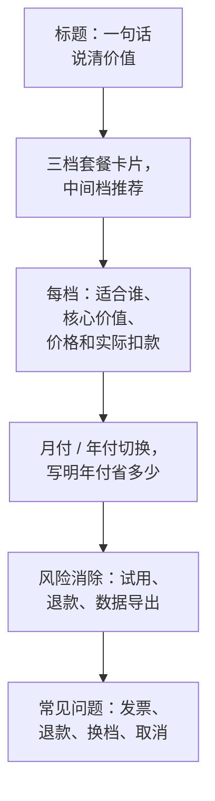

# 定价心理

同样一个产品、同样的价格，换一种展示方式，购买率可能完全不同。原因是人对价格的判断并不理性：没有人心里有一张「这个东西值多少钱」的标准表，大家都是**靠参照、比较和感觉**来判断贵不贵。这一章讲几种最常用的定价心理效应，以及怎么把它们落到定价页上。

先说清楚边界：这些技巧是**帮用户更容易理解价值、更容易做决定**，不是骗人。虚构原价、制造假的倒计时、隐藏自动续费，这些做法既违反消费者保护相关规定，也会毁掉一人公司最值钱的东西：口碑。

## 锚定：第一个数字决定后面的判断

**锚定效应**：人在判断一个数值时，会被最先看到的数字强烈影响，即使那个数字和判断无关。

定价页上的锚点有几种：

| 锚点 | 做法 | 例子 |
|---|---|---|
| 高价档 | 把最贵的套餐放在最显眼的位置 | 先看到「连锁版 ¥249/月」，再看「标准版 ¥99」就觉得不贵 |
| 替代成本 | 先摆出不用你时要花的钱 | 「雇一个兼职记账员每月要几千元」 |
| 价值数字 | 先说用户能得到多少 | 「平均每月帮门店发现 X 元的浪费」（必须是真实数据） |
| 原价 | 划线价、折扣前价格 | 只有真实存在过的价格才能用 |

最后一条要特别小心：**划线的「原价」必须是真实以该价格销售过的价格**，虚构原价再打折属于价格欺诈。相关规定见《价格法》和市场监管部门关于明码标价、价格欺诈的规定，具体以最新条文为准。

To B 产品最好用的锚点是**替代成本**：店主心里并没有「门店管理软件该多少钱」的概念，但他很清楚雇人、报废食材、算错账要花多少钱。

## 诱饵效应：为什么三档比两档好卖

下面用一组**假设的**门店软件价目来说明（不是 hatch-counter 的真实价目，它目前只有一个 99 元/月的标准版，见第 8 章）。假设只有两个选项：

| 套餐 | 价格 | 内容 |
|---|---|---|
| 基础版 | ¥49/月 | 1 家门店 |
| 专业版 | ¥99/月 | 1 家门店 + 进货单识别 + 经营分析 |

很多人会犹豫：多花一倍值吗？加一个第三档：

| 套餐 | 价格 | 内容 |
|---|---|---|
| 基础版 | ¥49/月 | 1 家门店 |
| 专业版 | ¥99/月 | 1 家门店 + 进货单识别 + 经营分析 |
| 连锁版 | ¥249/月 | 3 家门店 + 专业版全部功能 + 优先支持 |

连锁版的存在让专业版显得「中间、合理、性价比高」。这就是**折中效应**：面对三个选项，人倾向于选中间那个。更狭义的**诱饵效应**是加一个明显不如目标选项的「诱饵」，让目标选项显得更划算。

落到实践：

- **你最希望卖的那档放中间**，标上「推荐」或「最多人选」（后者要是事实）
- 高档要真的有人需要，不能是纯粹的摆设，否则用户会察觉
- 低档要足够「不够用」，让大多数认真的用户自然往上走，但不能残缺到没法用

## 价格的呈现方式

### 尾数

以 9 结尾的价格（99、199）会让人感觉明显便宜于整数（100、200），因为人读数字是从左往右，第一位数字占了主导。国内还有偏好 8、6 这类吉利数字的习惯。

但尾数也传递档次信号：精确的 99 像促销品，整数 100、300 显得更专业、更高端。To C 工具用 9 结尾比较常见；面向企业、高客单价的服务用整数更合适。

### 拆分与折算

同样的钱，拆小了说更容易接受。以第 8 章 hatch-counter 标准版的年付价为例：

```text
¥990/年
¥82.5/月（按年付）
每天不到 ¥2.8
```

三种说法是同一个价格。按月显示年付价格是业界惯例，但**要同时清楚写出一次扣多少**，否则用户看到一次性扣了 990 元会觉得被骗，这类投诉在应用商店和支付平台都很常见。

反过来，想强调节省时就用大的单位：「年付省 ¥198」（月付 12 个月是 1,188 元）比「每月省 ¥16.5」更有冲击力。

### 价格旁边写什么

用户看价格时在问三个问题：**这是什么、对我有什么用、有没有风险**。价格旁边的文字应该回答它们：

- 这一档适合谁：「适合一家店，老板自己记账」
- 核心价值，而不是功能列表：「每天看到今天赚了多少」比「支持销量导入」好
- 风险消除：「14 天免费试用，不用先付钱」「随时可以导出全部数据」

## 损失厌恶与禀赋效应

**损失厌恶**：失去一样东西的痛苦，大于得到同样东西的快乐。**禀赋效应**：人会高估自己已经拥有的东西。

这解释了为什么**反向试用**有效：先给用户全功能，试用结束时他面对的是「失去」这些功能，而不是「得到」。也解释了为什么数据导出、离开很容易的产品反而留存更好：用户不觉得被锁住，就更愿意投入。

hatch-counter 的一个细节值得参考：**门店到期后仍能登录，账都还在，只拦在记账操作上**。店主看到的是「我的账都在这里，续上就能接着用」，而不是一个打不开的系统。这比到期锁死登录更能促进续费，也避免了店主以为系统坏了来找客服。

要警惕的是滥用损失厌恶：用「您的数据将被永久删除」这类恐吓逼迫续费，会招来投诉，也可能违反个人信息保护相关的规定。数据保留多久、怎么导出，要写清楚，并给用户合理的时间。

## 公平感

人愿意为价值付钱，但非常在意**是否被公平对待**。几种破坏公平感的常见做法：

| 做法 | 用户的感受 |
|---|---|
| 老用户续费比新用户首月贵很多 | 忠诚被惩罚 |
| 同样的东西不同人看到不同价格 | 被「杀熟」 |
| 涨价不提前通知 | 被突袭 |
| 取消订阅的入口藏得很深 | 被困住 |
| 自动续费不提醒 | 被偷偷扣钱 |

一人公司的用户群小，彼此之间、行业群里会交流。一次不公平的感受传开，代价远大于多收的那点钱。

### 涨价怎么做

产品变好了、成本涨了，涨价是正常的。做法：

1. **老用户保留原价一段时间或永久**（grandfathering）。hatch-counter 的套餐改价「只影响以后开的订单」，停售的套餐老门店照样能续，就是这个思路
2. **提前通知**，说明为什么涨、涨了以后多了什么
3. **给一个窗口**：涨价前按旧价续年付
4. 涨价同时**交付新价值**，让用户觉得「贵了，但值」

应用商店的自动续期订阅涨价有平台规定的流程，某些情况下需要用户主动同意，否则到期不再续订，具体规则以苹果和各应用商店的最新文档为准。

## 把这些落到定价页



检查清单：

- 用户能在 10 秒内看懂每档的区别吗
- 每个价格旁边都写了**实际一次扣多少、多久扣一次**吗
- 自动续费、试用到期会发生什么，写清楚了吗
- 退款规则在付款前能看到吗
- 有没有任何一个数字（「原价」「最多人选」「省下 X 元」）不是真实的

## 本章要点

- 人靠**参照和比较**判断贵不贵，定价页的展示方式会显著影响购买
- **锚定**：To B 最好用的锚点是替代成本；划线原价必须真实存在过
- **折中与诱饵**：三档套餐、推荐档放中间，高档和低档都要真实可用
- 尾数传递档次信号；拆分价格更易接受，但必须写清实际扣款
- **损失厌恶**解释了反向试用和「到期不锁数据」为什么有效，但不要用恐吓逼续费
- **公平感**比多收的钱值钱：老用户保价、涨价提前通知、取消入口明显、自动续费要提醒
