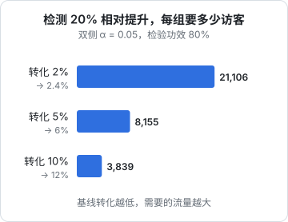

# 价格实验

前三章给出的是框架和经验，但你的产品最终该定多少，没有人能替你算出来，只能**试**。这一章讲一人公司能用的几种价格实验：上线前的访谈和问卷，上线后的分批测试，以及为什么大多数独立开发者其实没有做严格 A/B 测试的流量，那该怎么办。

## 先想清楚要优化什么

价格实验最常见的错误是**只看转化率**。降价几乎总能提高转化率，但收入可能反而下降。

更合适的指标是**每访客收入**（Revenue Per Visitor）：

$$
\text{RPV} = \text{转化率} \times \text{客单价}
$$

订阅产品还要再往后看：

| 指标 | 回答的问题 |
|---|---|
| 试用转付费率 | 价格有没有吓跑本来会付费的人 |
| 首期付费后的续费率 | 付了钱的人觉得值不值 |
| 月付 / 年付比例 | 年付折扣设得够不够有吸引力 |
| 套餐分布 | 用户是不是选了你希望他选的那档 |
| 退款率 | 价格和预期是否匹配 |

举个例子：价格从 ¥69 提到 ¥99，转化率从 4% 降到 3.2%。RPV 从 2.76 变成 3.17，反而涨了约 15%。如果高价用户的续费率也不更差，那提价就是对的。很多独立开发者回头看都会发现**自己定价偏低**，因为他们是用「我自己愿意付多少」来定的，而开发者恰恰是最不愿意为软件付钱的人群。

## 上线前：问出愿付价格

没有流量的时候，价格信息只能从和潜在客户的对话里来。

### 不要直接问「你愿意付多少」

直接问价格，得到的答案几乎没用：人会往低了说，而且说的和做的不一样。更好的问法是问**过去的行为**和**现在的花费**：

```text
- 你现在怎么解决这个问题？用什么工具、花多少时间？
- 你为这件事花过钱吗？花在哪、多少？
- 上次为类似工具付费是什么时候？后来还在用吗？
- 如果这个问题明天消失了，你每个月能省下多少时间或钱？
```

这些问题帮你估出第 1 章讲的「替代方案价格」和「感知价值」。

### 范·韦斯滕多普价格敏感度问卷

如果能收集几十份问卷，可以用**范·韦斯滕多普价格敏感度测试**（Van Westendorp Price Sensitivity Meter）。它问四个问题：

1. 多少钱你会觉得**太贵**，不会考虑买？
2. 多少钱你会觉得**有点贵**，但还会考虑？
3. 多少钱你会觉得**划算**，物有所值？
4. 多少钱你会觉得**太便宜**，以至于怀疑质量？

把每个问题的回答画成累计分布曲线，几条曲线的交点给出一个「可接受的价格区间」。它的价值不在于算出一个精确的最优价，而是告诉你**价格的合理范围在哪个量级**：是几十元还是几百元。

样本量少的时候不必画曲线，看看四个问题回答的中位数，已经比拍脑袋好得多。

### 最真实的信号：付钱

所有问卷都比不上真的让人掏钱。几种低成本的办法：

- **预售**：功能还没做完，先按某个价格收定金或首期，做不出来全额退
- **假门测试**：在定价页放上「立即购买」按钮，点了以后显示「即将上线，留下联系方式」，统计点击率。要注意别让用户感觉被耍，提示要诚恳
- **报价**：To B 场景直接报价，看对方的反应。如果所有人都毫不犹豫地答应，说明你报低了

## 上线后：分批测试

### A/B 测试需要多少流量

标准的 A/B 测试同时给两组用户展示不同价格，比较结果。问题是它需要的样本量往往超出一人公司的流量。比较两个转化率时，每组需要的样本量近似为：

$$
n = \frac{(z_{1-\alpha/2} + z_{1-\beta})^2 \left[ p_1(1-p_1) + p_2(1-p_2) \right]}{(p_1 - p_2)^2}
$$

其中 $p_1$、$p_2$ 是两组的转化率，常取 $\alpha = 0.05$（双侧，$z \approx 1.96$）、检验功效 80%（$z \approx 0.84$）。



如果你的定价页每月只有一两千访客、付费转化率 2%，要检测出 20% 的相对差异，需要每组两万多访客，也就是要跑**一两年**。等结果出来，产品早就变了。

可以用一段 TypeScript 代码自己算：

```ts
// 比较两个比例时每组所需样本量（正态近似）
function sampleSizePerGroup(p1: number, p2: number, zAlpha = 1.96, zBeta = 0.8416): number {
  const variance = p1 * (1 - p1) + p2 * (1 - p2);
  return Math.ceil(((zAlpha + zBeta) ** 2 * variance) / (p1 - p2) ** 2);
}

console.log(sampleSizePerGroup(0.02, 0.024)); // 21106
console.log(sampleSizePerGroup(0.05, 0.06)); // 8155
console.log(sampleSizePerGroup(0.1, 0.12)); // 3839
```

结论：**小流量下，只能检测大的差异**。与其测 ¥89 和 ¥99，不如测 ¥49 和 ¥99，或者测「有没有年付选项」「三档还是两档」这种可能带来大幅变化的改动。

### 同时给不同人不同价格：合规风险

除了流量问题，在国内同时给不同用户展示不同价格还有合规风险。《个人信息保护法》对利用个人信息进行自动化决策有专门规定，要求不得在交易价格等交易条件上实行不合理的差别待遇；电子商务、价格相关的法规对「大数据杀熟」也有约束。即使是随机分组的实验，用户发现后也很难解释清楚，公平感受损（见第 3 章）。

具体边界以最新的法律条文和监管解释为准。对一人公司来说，更稳妥的做法是下面这种**按时间分批**的实验。

### 按时间分批


所有人在同一时间看到的是同一个价格，没有公平性问题。缺点是两期之间其他因素也在变：季节、渠道、产品版本、你有没有发文章引流。应对办法：

- **每期尽量长**，至少覆盖完整的几周，避开节假日这类明显的波动
- **期间不改别的**：不同时改文案、不上大功能、不换主要渠道
- **按渠道拆开看**：自然流量和某篇爆文带来的流量要分开统计
- **接受不确定性**：小流量下你得到的是「方向性」证据，不是统计学结论

### 按新老用户分批

另一个自然的分组是**新用户用新价格、老用户保留旧价格**。这既是涨价时的标准做法（第 3 章），也是一个观察窗口：新价格下新用户的转化和续费是否明显变差。

## 记录：让实验可追溯

小流量实验最大的敌人是**记忆**：三个月后你不记得那段时间改过什么。建一个简单的价格变更日志，和代码一起放在仓库里：

```markdown
## 2026-09-01 标准版月付 69 → 99

- 原因：试用转付费率稳定，访谈中多个店主表示价格不是顾虑
- 同时变化：无
- 观察指标：试用转付费率、首月续费率、退款率
- 观察期：2026-09-01 至 2026-10-31

### 结果（2026-11-01）

- 试用转付费：28% → 25%
- RPV：上升约 28%
- 首月续费：无明显变化
- 结论：保留 99
```

数据层面，每个订单要记下**下单时的价格和套餐版本**，而不是只存一个套餐 ID 去查当前价格。否则改价之后，历史订单的金额就对不上了。这一点在数据库设计时就要考虑：

```ts
// Drizzle 示意：订单上冗余记录成交价，不依赖套餐表的当前价格
import { pgTable, uuid, integer, text, timestamp } from 'drizzle-orm/pg-core';

export const orders = pgTable('orders', {
  id: uuid('id').primaryKey().defaultRandom(),
  storeId: uuid('store_id').notNull(),
  planId: uuid('plan_id').notNull(),
  planName: text('plan_name').notNull(), // 下单时的套餐名
  months: integer('months').notNull(),
  amountCents: integer('amount_cents').notNull(), // 成交金额，单位分
  listPriceCents: integer('list_price_cents').notNull(), // 下单时的标价，用来算折扣
  createdAt: timestamp('created_at', { withTimezone: true }).notNull().defaultNow(),
});
```

金额用**整数分**存储，不用浮点数，这是所有涉及钱的系统都应该遵守的规则。

## 什么时候该重新定价

不需要频繁调价，但出现以下信号时值得认真考虑：

| 信号 | 可能的含义 |
|---|---|
| 几乎没有人嫌贵，也没人砍价 | 定低了 |
| 试用很多，转付费极少，原因多是价格 | 定高了，或价值没讲清楚 |
| 大多数人选最便宜的档 | 档位设计有问题，中间档没吸引力 |
| 重度用户的成本超过他付的钱 | 价值度量或额度设计要改 |
| 产品新增了重要能力 | 可以给新档位或新用户提价 |

## 本章要点

- 优化**每访客收入**而不是转化率；订阅还要看续费率和退款率
- 上线前问**过去的行为和现在的花费**，不要直接问愿付多少；范·韦斯滕多普问卷可以给出价格量级
- 最真实的信号是付钱：预售、假门测试、直接报价
- 严格 A/B 测试需要的流量通常超出一人公司的能力，**小流量只能测大差异**
- 同时给不同人不同价格有合规和公平感风险，**按时间分批、按新老用户分批**更稳妥
- 建价格变更日志；订单记录成交价和标价，金额用整数分存储
