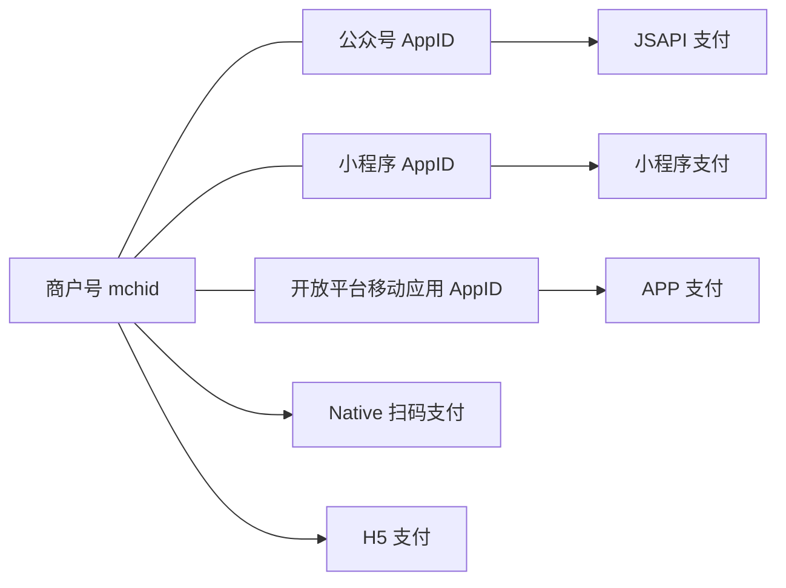
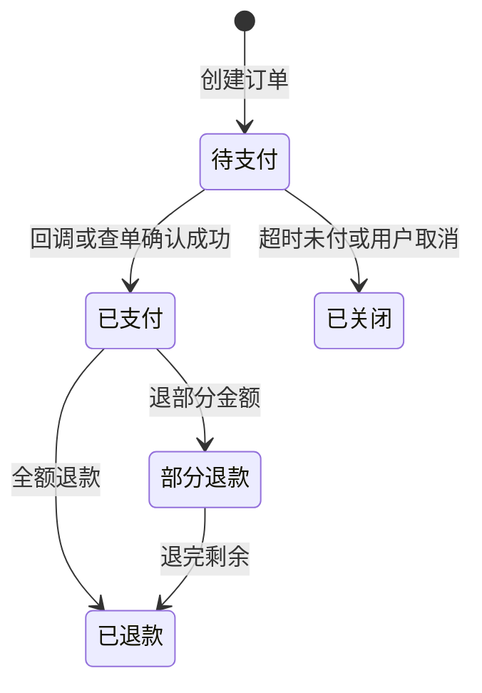

# 支付接入（国内）

价格定好了，接下来是把钱收进来。在国内，面向个人和小商户的线上收款基本绕不开**微信支付**和**支付宝**。这一章讲接入它们需要什么资质、走什么流程、选哪种支付产品，以及服务端怎么设计订单和回调才不会丢单、重复发货。

> [!WARNING]
> 本章按 2025 年前后的平台规则整理，两家平台的费率、结算周期、开通门槛、所需材料都会调整，不同行业、主体类型的规则也不一样；本章不写具体数字，以微信支付商户平台和支付宝开放平台的最新官方说明为准。

## 先决定要不要接

很多一人公司早期并不需要接在线支付。hatch-counter 到现在仍是**线下转账、后台人工确认收款**：

| 方式 | 优点 | 缺点 |
|---|---|---|
| 线下转账 + 人工确认 | 零开发、无手续费、每次都能和客户沟通 | 不能自助，客户多了对账累 |
| 收款码 | 几乎零开发 | 无法和订单自动关联，要人工核对 |
| 接入支付 API | 全自动、可自助、可对账 | 要主体资质、开发、维护证书 |

判断标准很简单：**人工确认收款的时间成本，什么时候超过了接入和维护的成本**。客户每月只有十几笔续费时，人工完全可以；面向 C 端、每天几十上百笔，就必须自动化。

另外注意：个人收款码设计上是用于个人之间的转账，用于经营收款有额度、风控和合规上的限制；做生意应该使用平台提供的**商户收款码或商户收款产品**。具体规则以两家平台和人民银行的最新规定为准。

## 资质：主体是第一道门槛

两家平台的 API 支付产品基本都要求**商户主体**，常见的是：

- **个体工商户**：一人公司起步最常用的主体，注册简单
- **企业**：如一人有限责任公司
- 其他组织类型（事业单位、社会组织等），一人公司用不到

纯个人身份通常无法开通网站支付、App 支付这类 API 产品（平台可能提供面向个人或小微商户的简化收款方式，但能力有限）。主体怎么选、怎么注册，见[《国内合规实务》](../opc-compliance-cn/)。

开通时一般要准备：

| 材料 | 说明 |
|---|---|
| 营业执照 | 主体信息要和后续结算账户一致 |
| 经营者 / 法人身份证件 | 实名认证 |
| 结算银行账户 | 企业通常要对公账户；个体工商户可能可以用经营者个人账户，以平台规定为准 |
| 经营场景信息 | 网站、App、小程序、公众号的名称和截图 |
| 网站备案 | 用网站收款时通常要求域名已完成 ICP 备案，且网站内容和经营范围相符 |
| 行业资质 | 特定行业需要额外许可 |

**经营场景要真实且和经营范围对得上**。审核会看你的网站或 App：有没有清晰的商品和价格、有没有客服联系方式、有没有退款说明。一个只有一个登录框的页面通常过不了审。

## 微信支付

### 账号体系

微信支付的账号体系一开始容易让人糊涂，核心是两个 ID：

- **商户号（mchid）**：在微信支付商户平台申请，代表「收钱的人」
- **AppID**：代表「在哪收」，可以是公众号、小程序，或在微信开放平台注册的移动应用、网站应用

一个商户号要和一个或多个 AppID **绑定**后，才能在对应场景发起支付。



### 选哪种支付产品

| 产品 | 场景 | 适合一人公司的情况 |
|---|---|---|
| Native 支付 | 网页上展示二维码，用户用微信扫码付 | **桌面网页 SaaS 首选**，开发最简单 |
| JSAPI 支付 | 在微信内打开的网页（公众号）里调起支付 | 产品主要在微信里传播 |
| 小程序支付 | 小程序内 | 产品本身是小程序 |
| APP 支付 | 原生 App 调起微信 | 安卓 App 卖实物或服务；iOS 见第 6 章 |
| H5 支付 | 手机浏览器（非微信内）跳转微信付 | 需要单独申请，审核较严 |

hatch-counter 这类桌面网页 SaaS，用 **Native 支付**最直接：服务端下单拿到一个 `code_url`，前端渲染成二维码，店主拿手机一扫就付了。

### 开发前要拿到的东西

微信支付当前主推 **APIv3**，接入需要：

| 东西 | 用途 |
|---|---|
| 商户号、AppID | 下单参数 |
| 商户 API 证书和私钥 | 你调用微信接口时签名 |
| 证书序列号 | 放在请求头里，告诉微信用哪张证书验签 |
| APIv3 密钥 | 解密回调通知里的加密数据 |
| 微信支付平台证书或微信支付公钥 | 验证微信发给你的回调和应答的签名 |

私钥和 APIv3 密钥是最高机密：**只放服务端的密钥管理或环境变量里，不进仓库、不进前端、不进日志**。

### Native 下单

下单请求要用商户私钥签名。签名串是请求方法、URL 路径、时间戳、随机串、请求体各占一行：

```ts
import { createSign, randomBytes } from 'node:crypto';

interface WechatPayConfig {
  mchid: string;
  appid: string;
  serialNo: string; // 商户 API 证书序列号
  privateKey: string; // 商户 API 私钥（PEM）
}

function buildAuthorization(cfg: WechatPayConfig, method: string, urlPath: string, body: string) {
  const timestamp = Math.floor(Date.now() / 1000).toString();
  const nonce = randomBytes(16).toString('hex');
  const message = `${method}\n${urlPath}\n${timestamp}\n${nonce}\n${body}\n`;
  const signature = createSign('RSA-SHA256').update(message).sign(cfg.privateKey, 'base64');
  return (
    `WECHATPAY2-SHA256-RSA2048 mchid="${cfg.mchid}",nonce_str="${nonce}",` +
    `signature="${signature}",timestamp="${timestamp}",serial_no="${cfg.serialNo}"`
  );
}

export async function createNativeOrder(cfg: WechatPayConfig, order: {
  outTradeNo: string;
  description: string;
  amountCents: number;
  notifyUrl: string;
}): Promise<string> {
  const urlPath = '/v3/pay/transactions/native';
  const body = JSON.stringify({
    appid: cfg.appid,
    mchid: cfg.mchid,
    description: order.description,
    out_trade_no: order.outTradeNo,
    notify_url: order.notifyUrl,
    amount: { total: order.amountCents, currency: 'CNY' },
  });
  const res = await fetch(`https://api.mch.weixin.qq.com${urlPath}`, {
    method: 'POST',
    headers: {
      'Content-Type': 'application/json',
      Accept: 'application/json',
      Authorization: buildAuthorization(cfg, 'POST', urlPath, body),
    },
    body,
  });
  if (!res.ok) throw new Error(`下单失败：${res.status} ${await res.text()}`);
  const data = (await res.json()) as { code_url: string };
  return data.code_url; // 前端渲染成二维码
}
```

这段代码展示的是协议本身。生产中可以用官方或社区维护的 SDK，它们会处理平台证书下载、应答验签等细节；但理解签名原理，排查「签名错误」时会快很多。**接口路径、字段以微信支付官方文档的当前版本为准**。

注意 `amount.total` 的单位是**分**，又一次印证了金额用整数分存储的必要。

### 处理回调

用户付款成功后，微信会 POST 到你的 `notify_url`。处理时必须：

1. **验签**：用请求头 `Wechatpay-Timestamp`、`Wechatpay-Nonce` 和原始请求体拼出签名串，用微信支付平台证书或公钥验证 `Wechatpay-Signature`
2. **解密**：通知里的 `resource` 是用 APIv3 密钥以 AEAD_AES_256_GCM 加密的，解出来才是订单数据
3. **核对**：商户号、订单号、金额是否和你库里的一致
4. **幂等更新订单**，然后返回成功应答

```ts
import { createDecipheriv, createVerify } from 'node:crypto';

export function verifyWechatNotify(headers: Record<string, string>, rawBody: string, wechatPublicKey: string) {
  const message = `${headers['wechatpay-timestamp']}\n${headers['wechatpay-nonce']}\n${rawBody}\n`;
  return createVerify('RSA-SHA256').update(message).verify(wechatPublicKey, headers['wechatpay-signature'], 'base64');
}

export function decryptResource(apiV3Key: string, r: { ciphertext: string; nonce: string; associated_data?: string }) {
  const buf = Buffer.from(r.ciphertext, 'base64');
  const authTag = buf.subarray(buf.length - 16);
  const data = buf.subarray(0, buf.length - 16);
  const decipher = createDecipheriv('aes-256-gcm', Buffer.from(apiV3Key, 'utf8'), Buffer.from(r.nonce, 'utf8'));
  decipher.setAuthTag(authTag);
  if (r.associated_data) decipher.setAAD(Buffer.from(r.associated_data, 'utf8'));
  return JSON.parse(Buffer.concat([decipher.update(data), decipher.final()]).toString('utf8'));
}
```

验签要用**原始请求体**，所以在 NestJS 里要为这个路由保留 raw body（`NestFactory.create(AppModule, { rawBody: true })` 后通过 `req.rawBody` 读取），不能用 JSON 解析后再序列化的结果，否则字段顺序和空白一变，签名就对不上。

## 支付宝

### 开放平台与应用

支付宝的流程是：在**支付宝开放平台**创建应用 → 给应用添加需要的支付产品 → 签约（提交主体和场景材料）→ 配置密钥 → 上线。

| 产品 | 场景 |
|---|---|
| 电脑网站支付 | 桌面浏览器跳转到支付宝收银台，或扫码 |
| 手机网站支付 | 手机浏览器拉起支付宝 App 或收银台 |
| APP 支付 | 原生 App 拉起支付宝 |
| 当面付 | 线下扫码场景，也常被用于生成付款二维码 |

### 密钥

支付宝 API 使用 RSA2（SHA256withRSA）签名，有两种模式：

- **公钥模式**：你上传应用公钥，拿到支付宝公钥
- **公钥证书模式**：用证书代替裸公钥，涉及资金支出类接口（如转账）时通常要求用这种

签名用你的应用私钥，验签用支付宝公钥（或证书）。官方提供多语言 SDK，Node 端有官方维护的 SDK 包，但不同大版本的调用方式差别较大，**按你所用版本的文档写**。

### 异步通知

支付成功后支付宝向 `notify_url` 发送异步通知（表单格式）。处理要点：

- 用支付宝公钥**验签**
- 核对 `app_id`、`out_trade_no`、`total_amount` 和你的订单一致
- `trade_status` 为 `TRADE_SUCCESS` 或 `TRADE_FINISHED` 才算支付成功
- 处理完返回纯文本 `success`，否则支付宝会按策略重试

注意**同步跳转（return_url）不能作为支付成功的依据**。用户付完跳回你的页面只是一个体验上的提示，可能被伪造，也可能因为用户关了页面根本没跳回来。以异步通知和主动查单为准。

## 服务端设计：不丢单、不重复

两家平台的细节不同，但服务端的设计原则一样。

### 订单状态机



### 幂等

回调会**重复**发送：网络超时、你返回慢了、平台重试策略，都会导致同一笔支付通知多次到达。处理逻辑必须幂等：

```ts
// NestJS + Drizzle 示意：用条件更新保证一笔订单只入账一次
import { and, eq } from 'drizzle-orm';

async function markPaid(db: Db, outTradeNo: string, amountCents: number, transactionId: string) {
  await db.transaction(async (tx) => {
    const [order] = await tx
      .update(orders)
      .set({ status: 'paid', paidAt: new Date(), transactionId })
      .where(and(eq(orders.outTradeNo, outTradeNo), eq(orders.status, 'pending')))
      .returning();

    if (!order) return; // 已经处理过，或订单不存在：直接返回成功，不重复发货
    if (order.amountCents !== amountCents) throw new Error('金额不一致，需人工核查');

    await extendSubscription(tx, order); // 顺延到期日，与状态更新在同一个事务里
  });
}
```

关键是 `where status = 'pending'` 这个条件：只有第一次能更新成功，后续重复通知更新 0 行，直接返回。顺延到期日和改订单状态**在同一个事务里**，不会出现「钱收了、日子没加」的情况。hatch-counter 的「确认收款后在同一个事务里把到期日顺延」也是同样的设计，只是触发者从回调换成了财务点按钮。

### 主动查单兜底

不能只依赖回调：你的服务可能正好在重启，回调重试也有次数上限。兜底办法：

- 用户在支付页等待时，前端**轮询你自己的订单状态接口**；超过一定时间仍是待支付，服务端**主动调平台的查单接口**
- 定时任务扫描一段时间内仍为待支付的订单，逐个查单，已付的补记，超时的调关单接口关闭

### 对账

每天从商户平台下载**交易账单**，和自己库里的订单逐笔核对：平台有、你没有（漏单）；你标记已付、平台没有（错单）；金额不一致。客户少的时候可以每周手动看一眼，量大了写个定时任务。这是财务上的安全网，也是发现 bug 的好办法。

### 退款接口

两家都提供退款 API（微信支付 APIv3 的申请退款接口、支付宝的统一收单交易退款接口），都支持部分退款，都以你自己生成的退款单号保证幂等。退款也有异步结果，同样要处理通知或查询。退款的业务规则见第 7 章。

## 聚合支付与服务商

如果不想分别对接两家，可以考虑**持牌的聚合支付服务商**：一次接入同时支持微信和支付宝，部分还提供开户代办、分账等能力。代价是多一层依赖和费用，且要确认对方有合法的支付业务资质。选择前查清楚它的牌照情况，资金最好直接结算到你自己的账户，而不是先进对方账户。

## 本章要点

- 先判断要不要接：客户少时线下转账 + 人工确认完全可行；个人收款码不适合经营收款
- API 支付基本都要求**商户主体**（个体工商户或企业），经营场景要真实，网站通常要先完成 ICP 备案
- 微信支付核心是**商户号 + AppID 绑定**；桌面网页 SaaS 首选 Native 扫码支付；APIv3 请求要签名、回调要验签并用 APIv3 密钥解密
- 支付宝走开放平台创建应用、签约产品、配置 RSA2 密钥；异步通知验签后返回 `success`
- **同步跳转不能作为成功依据**，以异步通知和主动查单为准
- 服务端三件事：订单状态机、**幂等的条件更新 + 同一事务内发货**、查单和对账兜底
- 费率、门槛、材料和接口细节都会变，**以两家平台的最新官方文档为准**
